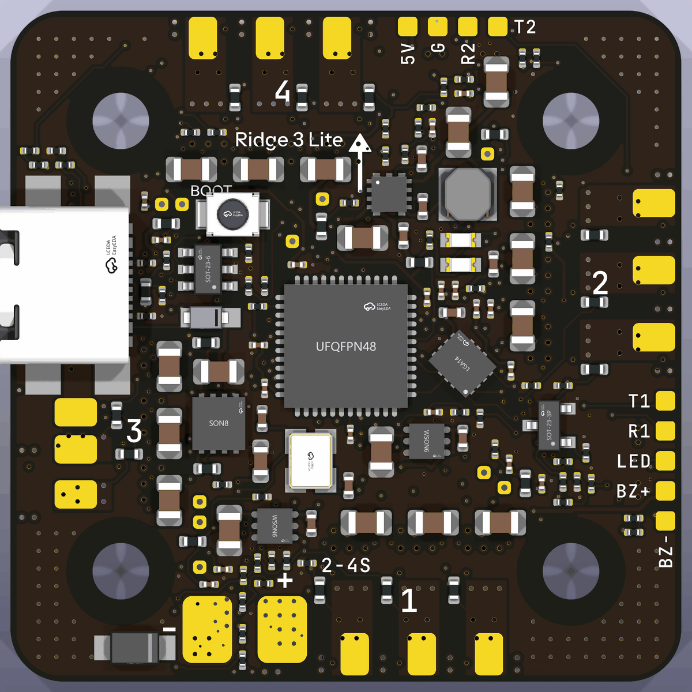
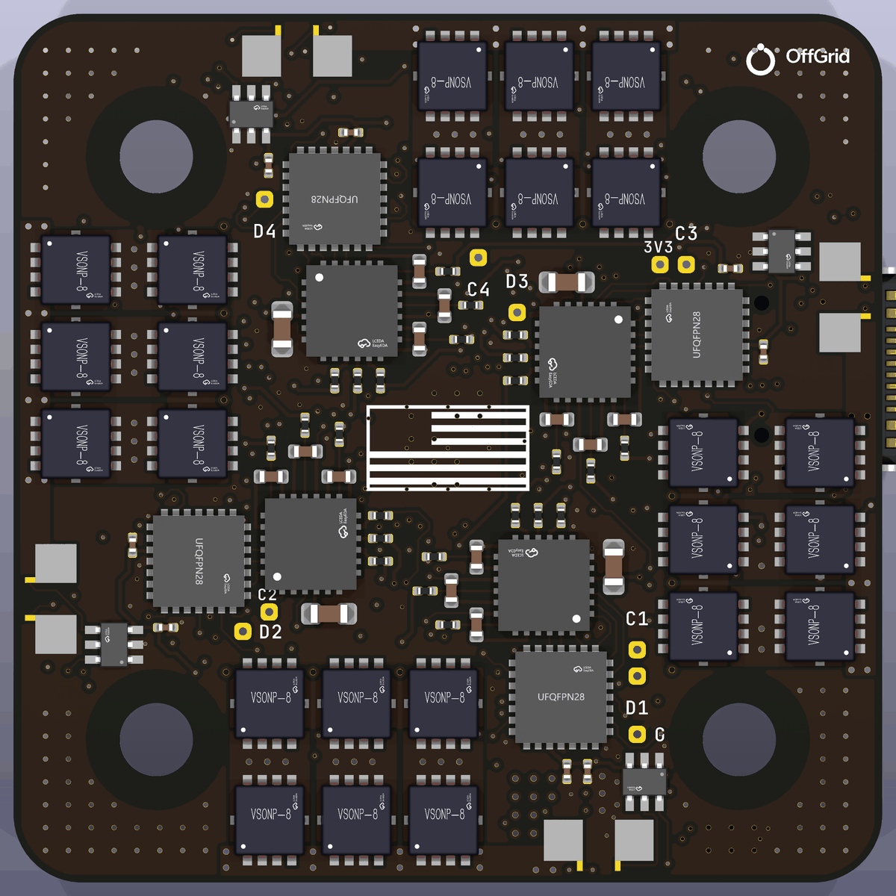

# Ridge 3 Lite — v1

**One board that does it all:** the flight controller and the 4-in-1 ESC of a
3-inch quad on a single 38 × 38 mm board, for Project Cheap Drone Phase 1. A
battery lead and four motors connect to it, and it flies on stock Betaflight.
It has no FPV parts: no OSD, no video transmitter, no camera connector.

It replaces the GEPRC TAKER G4 AIO that Phase 1 flew. It uses the same
25.5 mm mounting pattern, and Betaflight's own TAKERG4AIO target runs on it
pin for pin.

> **Status: design complete, not yet built.** The board is fully routed
> (`ridge3-lite.kicad_pcb`): KiCad 10 DRC 0 errors, 0 warnings, 0
> unconnected, every fab gate and all 100 checks in `VERIFICATION.md` pass,
> and Gerbers, BOM, CPL and renders are in `production/` and `renders/`.
> Nothing has been measured on hardware: build a few and go through
> bring-up before a volume order.




| | |
|---|---|
| Size | 38 × 38 mm, 3 mm corner radius, 25.5 mm M2 holes for soft-mount grommets |
| Battery | 2–4S LiPo, 4S HV (17.4 V) included; XT30 lead on solder pads |
| Motors | 4 × brushless, up to 15 A each continuous, 25 A peak (per-motor current limit) |
| Flight controller | STM32G473CEU6, ICM-42688-P gyro (BMI270 as second source), Betaflight |
| ESCs | 4 × STM32G071 + TI DRV8300D + 6 × Toshiba TPN2R304PL (40 V, 2.3 mΩ), AM32 |
| Power | 5 V 0.6 A BEC (TI LMR36506, 70 V input), 3.3 V for the FC and the ESCs, 11 V gate drive |
| Sensing | battery voltage and current to Betaflight; per-motor current and voltage to each ESC |
| PCB | 8 layers, about 1.5 mm, 1 oz copper on every layer, 0.09 mm track and gap, 0.37 / 0.15 mm vias, every via filled and capped |

---

## What's on the board

- **Flight controller (top centre).** The STM32G473 runs Betaflight. It has:
  - the gyro on SPI1;
  - an 8 MHz crystal;
  - USB-C with ESD protection;
  - a BOOT button;
  - status and power LEDs;
  - a buzzer switch.

  There is no blackbox flash; log to an OpenLager on UART1 if needed.
- **Four ESCs, one per edge (bottom).** Each motor channel is the same layout,
  turned 90° per edge. Each has:
  - its own STM32G071 running AM32 (stock GEN_64K_G071 target);
  - a DRV8300D gate driver with 22 Ω / 10 Ω gate resistors, chosen by
    simulation to keep the FETs inside 40 V;
  - six FETs;
  - a 0.5 mΩ Kelvin shunt with an INA186 amplifier, so the ESC limits each
    motor's current itself;
  - back-EMF sensing and battery-voltage sensing.
- **Power.**
  - A 70 V-rated buck makes 5 V for the receiver and the LDOs.
  - A 60 V-rated LDO makes the 11 V gate drive.
  - A 22 V TVS clamps spikes on the battery.
  - The board runs from USB alone for configuration: everything powers up
    except the motors.
- **Pads.**
  - Battery + and − at the rear edge.
  - Three motor pads at each edge.
  - The receiver (UART2, 5 V, G) at the front.
  - Aux (UART1, LED strip, buzzer) at the right.
  - USB-C at the left.
  - SWD test points for each ESC's first flash, plated through so a probe
    reaches them from either side.

## Ordering

JLCPCB or PCBWay, from `production/`:

- **8 layers, 1 oz copper on every layer.** Layers: F (parts, power) / In1
  ground plane / In2-In4 signals / In5 the channels' return pours / In6 battery plane / B
  (parts, power).
- **0.09 mm (3.5 mil) track and gap, 0.37 / 0.15 mm vias.** Both are inside
  JLCPCB's multilayer capability, but they are its fine-line and small-via
  price tiers: expect them on the quote. The board needs them: 260 parts on
  38 mm leave no room for 0.1 mm rules. Going to 40 mm would not help (the
  congestion is round the flight controller in the middle, not at the edges).
- **Matte black solder mask, white silkscreen, ENIG.**
- **Via-in-pad: "Epoxy filled & capped" (POFV).** Every via is filled; on 6+
  layers JLCPCB does this at no extra charge.
- Assembly: upload the BOM and CPL from `production/`. All assembled parts
  are on both sides; JLCPCB's two-sided assembly.
- **Fit by hand after assembly:**
  - the XT30 battery lead on the battery pads;
  - the bulk capacitor across the same pads (`docs/bulk-capacitor.md`:
    2 × Rubycon 35PZK470M10X11, or 1 × Panasonic EEH-AZSV681UB);
  - the motor wires.

**Check before you pay:** the SMF22A-TP's cathode band must face pad 1 (battery
+) in JLCPCB's placement preview. MCC's library symbol does not mark it.

## Bring-up

Firmware and every setting are in `firmware/`, with a README that walks
through it. In short:

1. USB only: flash Betaflight. Use the stock TAKERG4AIO target, or this
   board's RIDGE3LITE build; both are in `firmware/betaflight/`. Then paste
   `cli-setup.txt`.
2. Still on USB: flash each ESC's AM32 bootloader and firmware once over SWD
   (`firmware/am32/flash_esc.sh`). Then set them in ESC-configurator through
   Betaflight passthrough (`esc-settings.md`).
3. Battery, props off:
   - check motor order and direction in Betaflight's Motors tab;
   - check that the gyro moves the right way. The IMU sits at 135°; see
     `firmware/gyro-orientation.md`.

## What was checked

Each check is a gate: the build stops if it fails. All of these pass now.

| Check | Result |
|---|---|
| Every part has a footprint and an LCSC number; every pin is on its footprint; no single-pin net | pass, 260 parts |
| Firmware pin map: FC against Betaflight TAKERG4AIO, all four ESCs against AM32 GEN_64K_G071 (`src/verify.py`) | pass, pin for pin |
| Gyro orientation against Betaflight's alignment maths | pass |
| Routed board, KiCad 10 DRC | 0 errors, 0 warnings, 0 unconnected |
| Every part in production (`docs/lifecycle.md`) | 45 parts checked; 2 swapped for active parts |
| Volume sourcing for 10,000 boards (`docs/sourcing-10k.md`) | second sources and factory lead times listed |

### Simulation (`sim/`)

Worst case: a 4S HV pack (17.4 V), XING2 1404 3800KV on 3" props
(15 A per motor sustained, 25 A stalled).

- **Half-bridge switching (ngspice, fitted FET model).**
  - Peak FET voltage is 29.7–32.2 V at 15 A and 39.4 V at 30 A with 4 nH of
    loop, against the FETs' 40 V. The 22 / 10 Ω gate resistors fixed a
    41–50 V overshoot found in the first draft.
  - The switch node slews at most 1.85 V/ns.
- **Battery spikes.**
  - 18.6 V worst with the bulk capacitor fitted; the TVS never conducts in
    normal use.
  - Unplugging the pack while the motors brake reaches 57 V. No TVS this
    size can absorb that: keep the lead soldered or the XT30 seated.
- **Gate supply, BEC, sense chains.** All within ratings at a 100 °C board.
  The current sense reads 20 mV/A per ESC and 12 mV/A total.
- **Thermal (finite-volume model of the routed eight-layer board; `sim/thermal/`).**
  Validated against Toshiba's published Rth(ch-a) to within 2 %.

### Heat: what the board can do on a hot day

The routed board as ordered (8 layers, 1 oz, bare, no heat sink), 50 °C air,
1000 W/m² of sun on the board, prop wash (`sim/thermal/`, `--case desert`):

| Flight | FET (limit 175) | ESC MCU (105) | Gyro (85) |
|---|---|---|---|
| Armed on the ground, still air | 74 °C | 79 °C | |
| Hover | 98 °C | 95 °C | **89 °C** |
| Cruise | 110 °C | 101 °C | |
| 8 punches of 3 s full throttle | 119 °C | 110 °C | |
| Full throttle, 60 s | 165 °C | **154 °C** | **120 °C** |
| Motor 1 stalled at 25 A for 2 s | **179 °C** | 102 °C | |

At 25 °C in the shade, hover is 67 / 64 / 57 °C and 60 s of full throttle is
130 / 119 / 88 °C.  With half the prop wash, 60 s of full throttle would reach
225 °C: on such a day the ESCs' temperature limit, not the copper, is what
keeps the board alive.  Channel 1 runs hottest: it sits by the battery pads,
where all 60 A enter.  Its FETs are 40 °C above channel 4's at full throttle.

**What this means.**
- In normal flying on a normal day nothing comes near a limit.
- On a 50 °C day in direct sun the board will not burn out. Each ESC's
  temperature limit (AM32, 100 °C on its own chip) throttles that motor back
  first. The ESC chip tracks its FETs closely (154 against 165 °C at the end
  of the 60 s run), so the cut-back starts with the FETs near 110 °C, far
  under their 175 °C. Sustained full throttle on such a day is therefore
  throttled (by about two thirds on the placed board's estimate,
  `sim/thermal/results-size-cooling.md`), more if the prop wash is weak.
- A jammed prop is cut by AM32's stuck-rotor protection; the 2 s stall above
  is the case where it fails to act, and stays within 4 °C of the FET rating.
- Short punches are fine.
- Under those conditions the gyro runs slightly over its rated 85 °C even at
  hover, and Betaflight's gyro drifts with temperature.

**Fixes, in order of value:**
1. Keep the sun off the board. A frame top plate or a canopy over the stack
   removes the 1000 W/m² of sun, the largest single input at hover.
2. A finned aluminium top sink (9.6 g, 4 mm fins) takes 25–35 °C off at full
   throttle.

The full tables, with every cooling option, 35 against 38 mm and 1 against
2 oz, are in `sim/thermal/results-size-cooling.md`.

## Limits

- **Battery:** 2–4S. 5S and up exceed the FETs' 40 V rating under switching
  spikes.
- **The pack must stay connected while the motors spin** (see the 57 V
  case above).
- **Motors:** keep each ESC's current limit at 26 A or lower (`esc-settings.md`).
- **Bulk capacitor:** it must be fitted. Without it the battery ripple is
  2–7 V p-p and a hot plug rings to 26 V.

## Files

```
README.md                  this file
firmware/                  Betaflight and AM32 hex files, settings, flashing scripts
docs/                      lifecycle, 10k sourcing, bulk capacitor, gyro second source
sim/                       circuit simulations (ngspice) and the thermal model
src/                       the generator: circuit, footprints, placement, power copper, routing, checks
tools/                     the pinned KiCad 10 toolchain (Docker) and helpers
```
