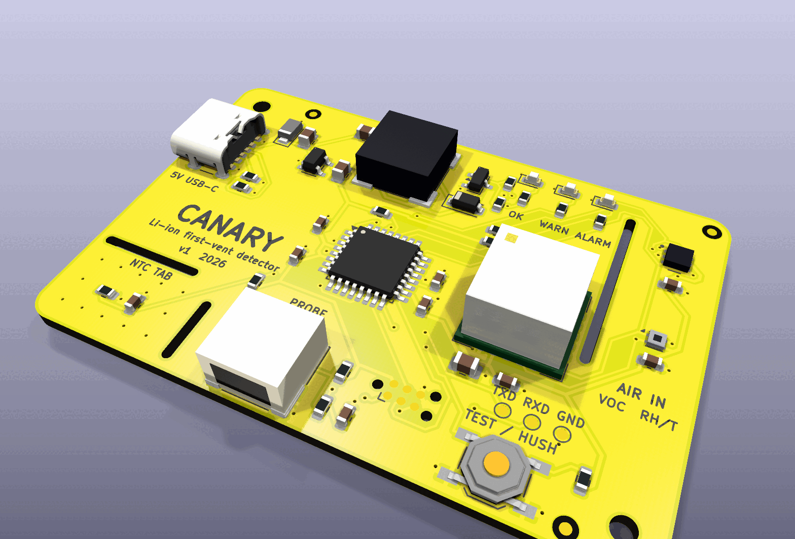
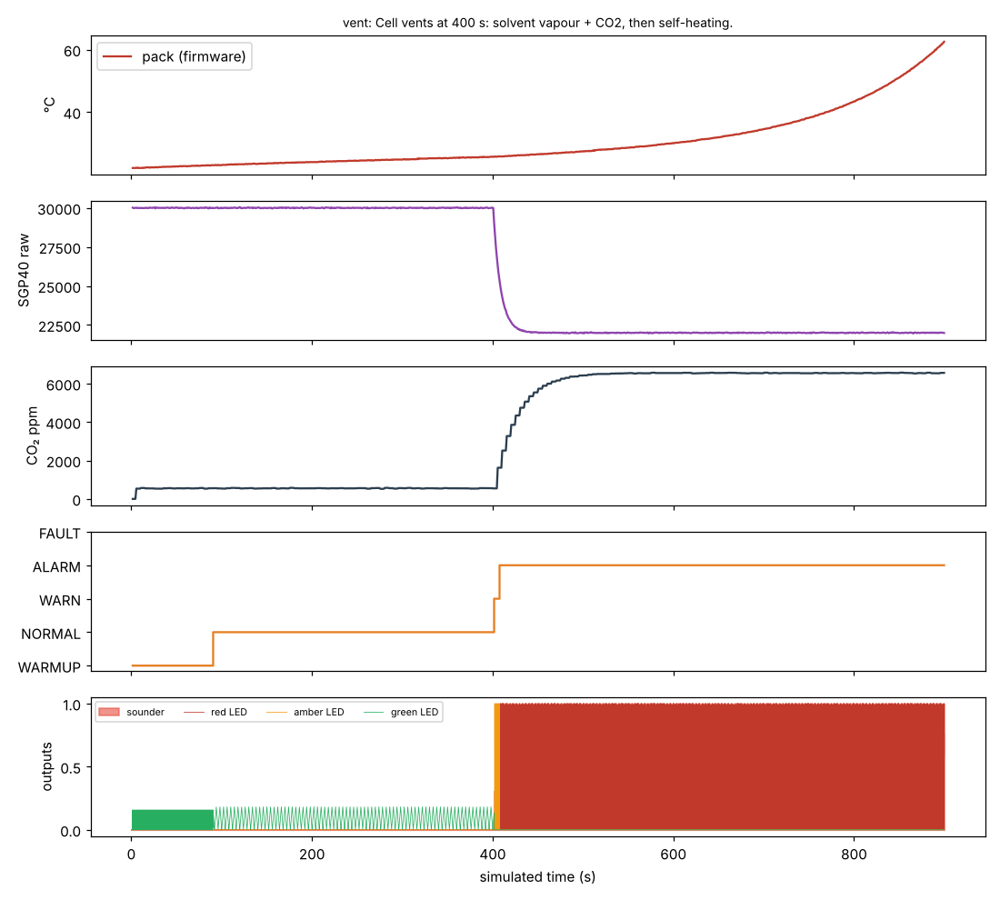

# Canary v1 — first-vent detector for lithium batteries



**Status: designed and verified in simulation, not yet built.** Every gate below
passes on this revision; no board has been assembled or powered yet.

## What it is

A 60 × 40 mm board you put next to (or on) an e-bike or scooter battery
while it charges. It watches for the **first vent** — the moment a failing
cell boils off electrolyte as solvent vapour and CO₂ — which comes *before*
self-heating, thermal runaway and smoke. A smoke alarm reacts at the end of
that chain; Canary is built to react near its start.

Grid storage and EV packs already carry off-gas detectors (Honeywell BES,
Li-ion Tamer). The battery charging in a hallway has nothing. Canary is that
detector as an open, cheap, USB-powered board you can order fully assembled.

It fuses three kinds of evidence and needs **two at once** to alarm:

| Evidence | Sensor | Fires on | Alone it means |
|---|---|---|---|
| Gas | Sensirion **SGP40** MOX (on the isolated sensor head) | raw signal ≥ 700 ticks below its learned clean-air baseline (strong ≥ 2500) | WARN (cleaning spray, solvents) |
| CO₂ | Sensirion **SCD41** photoacoustic | rise ≥ 250 ppm/min or ≥ 1500 ppm over baseline (strong ≥ 1200 ppm/min or ≥ 4000 ppm) | WARN (someone breathing on it) |
| Heat | NTC on the **thermal tab** (or remote probe) | ≥ 50 °C, or ≥ 1 °C/min above 35 °C (strong: ≥ 65 °C, or ≥ 3 °C/min above 30 °C) | WARN; strong heat alone → ALARM |

ALARM = gas **and** CO₂ (one strong), or heat **and** any gas evidence, or
strong heat alone; held 3 s before it sounds, latched for at least 60 s.
Outputs: green breathing (watching), amber (one kind of evidence), red
flashing + 100 dB 4 kHz sounder in the smoke-alarm T3 pattern. The button
self-tests in normal state and hushes for 2 minutes in alarm — the hush
ends early if the evidence gets worse.

**Product video:** [`video/canary-v1-product-video.mp4`](video/canary-v1-product-video.mp4)
(about 4 minutes, narrated, subtitles included).

The real firmware, on a simulated ATmega328P with virtual sensors, catching
a vent at 400 s (alarm 7.6 s later) — `sim/hil/`:



## Requirements, and whether they are met

| Requirement | How it is checked | Met? |
|---|---|---|
| Order from PCBWay, arrive assembled and working | Gerbers + PCBWay BOM + CPL + firmware HEX in `production/`; all parts on top; every part has an MPN | Yes (files); hardware not yet built |
| Parts in production today | Distributor check 2026-10-14, [docs/sourcing-2026-10-14.md](docs/sourcing-2026-10-14.md) | Yes — one NRND part replaced (NTC) |
| Latest KiCad | KiCad **10.0.6** (`kicad/kicad:10.0.6-full`), current stable | Yes |
| Schematic clean | `kicad-cli sch erc`: **0 violations** | Yes |
| Board clean, fab's limits | `kicad-cli pcb drc --schematic-parity --severity-all`: **0 errors, 0 warnings, 0 unconnected** against PCBWay 2-layer limits (with margin) | Yes |
| Schematic = circuit = board = firmware | `check_netlist.py` (27 nets, 0 mismatches), DRC parity, `check_pins.py` (11 pins, 0 mismatches) | Yes |
| Detects a vent within seconds, ignores single-cause events | HIL simulation of the real firmware: vent → ALARM in **7.6 s**; spray, breath → no alarm; **56/56 checks** across 8 scenarios | Yes, in simulation |
| Sounder driver safe | ngspice: drain clamped at **5.4 V** on 5 V, clamp diode ≤ 0.34 A, VBUS dip ≥ 4.95 V, for 0.5–4 mH coils | Yes |
| Pack temperature good enough at the thresholds | Tolerance stack-up: ≤ 1.24 °C worst case at 65 °C; rate quantum 0.2 °C/min | Yes |
| Runs from any USB charger | 23.5 mA watching, ~520 mA worst-case peak in alarm | Yes (≤ 900 mA) |

## How to order (PCBWay, fully assembled)

1. **PCB**: upload `production/canary-gerbers.zip`.
   - 2 layers, FR-4, **1.6 mm**, 60 × 40 mm, 1 design
   - Min track/spacing **6/6 mil** (the design's tightest gap is 0.2 mm), min hole **0.3 mm**
   - Solder mask **yellow**, silkscreen **black** (white is fine if black is not offered on yellow)
   - Surface finish **ENIG** (fine-pitch DFN sensors)
   - The board has three internal routed slots (1.0 mm wide): they are intended, not errors.
2. **Assembly**: turnkey, **top side only**, 43 placements / 27 unique parts.
   - BOM: `production/canary-bom-pcbway.csv` (MPN, maker, LCSC # for reference, notes)
   - Centroid: `production/canary-cpl.csv`; drawing: `production/canary-assembly.pdf`
   - J1 (USB-C) has four plated shell slots — pin-in-paste/hand-solder as PCBWay prefers.
   - Sensirion parts (U3 SGP40, U4 SHT40, U5 SCD41): **no washing, no conformal coating**.
3. **Programming** (PCBWay offers it; ask in the order notes): flash
   `production/canary.hex` to U2 (ATmega328P) through the Tag-Connect TC2030
   pads (J2, standard 6-pin AVR ISP pinout), with fuses
   **lfuse 0xE2, hfuse 0xD9, efuse 0xFD** (internal 8 MHz, no clock divider,
   brown-out 2.7 V). To do it yourself: a USBasp + TC2030-IDC-NL cable, then
   `make -C firmware flash`.

## Bring-up

1. Plug a USB-C cable from any phone charger. Green blinks for 90 s (gas
   sensor warm-up), then breathes slowly.
2. Press TEST/HUSH: green, amber, red sweep, a short beep, and the SGP40
   self-test runs. A fault shows as an amber double blink with a chirp every
   minute.
3. Telemetry: TXD pad, 3.3 V, **38400 8N1**, one line a second
   (`t= st= tp= ... sraw= co2= rate= dtdt= e= f=`).
4. Use: lay the board on the pack with the **thermal tab** touching it (or
   plug a 10 kΩ B3950 NTC probe into the JST-PH and tape it to the pack), the
   sensor head ("AIR IN") facing the air above the pack.

## Limits — read these

- **Not a certified safety device.** Keep your smoke alarm.
- **The thresholds are not yet validated against a real venting cell.** The
  simulated worlds use stated assumptions (SGP40 drop of thousands of ticks,
  CO₂ rising by thousands of ppm within a minute, accelerating self-heating),
  based on how first vent is described for commercial off-gas detectors. A
  real abuse test (a cell vented beside the board, in a safe facility) is the
  next step, and the thresholds in `firmware/src/detect.h` may move.
- No battery backup: if the outlet loses power, Canary is off.
- Placement matters: the gas and CO₂ sensors need the vent plume to reach
  them; inside a closed bag or a frame with no airflow, use the probe and
  expect slower gas detection.
- The ATmega328P has no USB: firmware updates need an ISP programmer.
- 3D models for SGP40, SHT40, SCD41, the sounder and the JST connector are
  simple dimensioned boxes made by `src/models3d.py` (KiCad 10.0.6 ships none).

## Files

| Path | What |
|---|---|
| `production/` | Gerber zip, PCBWay BOM, CPL, netlist, assembly + schematic PDFs, firmware HEX |
| `canary.kicad_sch`, `canary.kicad_pcb`, `canary.kicad_pro` | KiCad 10 design (generated) |
| `src/` | the design source: `circuit.py` (every part and net), `schematic.py`, `board.py`, `finish.py`, `fab.py`, checks |
| `firmware/` | AVR C firmware (`detect.c` is the detector logic) |
| `sim/hil/` | simavr hardware-in-the-loop harness + scenarios |
| `sim/spice/`, `sim/analysis/` | sounder driver SPICE, NTC/power/I²C analyses |
| `video/` | the product video and the scripts that build it |
| `TESTS.md`, `docs/decisions.md` | every test with results; the trade-offs |

## How to build

Needs docker (`kicad/kicad:10.0.6-full`), Java + xvfb (Freerouting 1.9.0 at
`/opt/fr/freerouting-1.9.0.jar` or `FREEROUTING_JAR`), avr-gcc, Python 3.

```sh
python3 src/make.py                 # schematic, ERC, netlist gate, place, route, DRC gate, fab
python3 src/make.py sch finish fab  # without re-routing (the routed board in out/ is reused)
make -C firmware                    # firmware only
cd sim/hil && gcc -O2 -I<simavr>/simavr/sim ... && python3 scenarios.py   # see sim/hil/README.md
```

Routing is done by Freerouting and is not bit-for-bit repeatable, so the
committed **`canary.kicad_pcb` is the design of record**: CI rebuilds the
fab outputs from it and checks they match what is committed.
