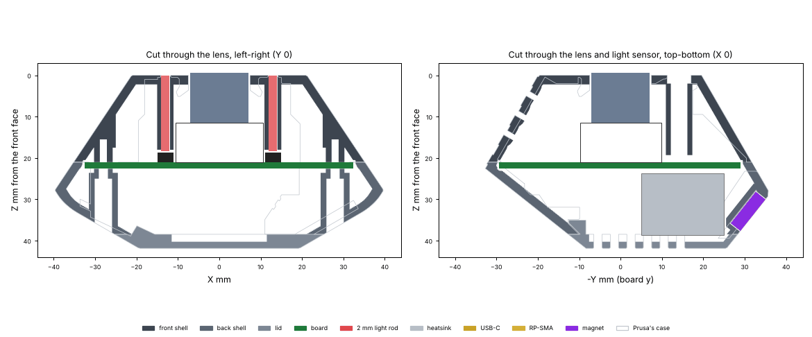
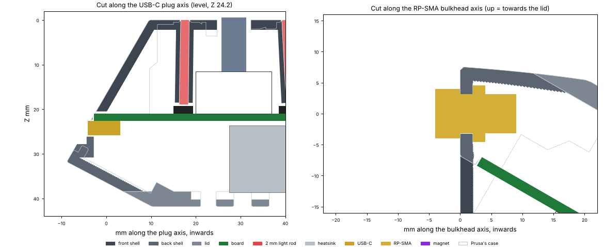

# LayerCam Pro v1

A camera for the inside of a Prusa CORE One, on one circuit board. It sits
in a printed case with the outside of Prusa's Buddy3D camera case, so it
fits the same corner of the printer. It sees the whole bed in daylight and
in infrared, and feeds Prusa Connect. It takes one picture per layer while
the head is parked, makes the timelapse into an MP4 on the camera, and
uploads it to a NAS or S3.

One board carries everything: the image sensor, the infrared lights, the
light sensor, the main chip, the Wi-Fi and the USB-C. The lens, the
day/night filter holder, the heatsink and the antenna are bought
separately. Fab and assembly: PCBWay. The case is printed by the owner.

**Status: designed; not yet built.** Nothing here has been made or
powered. Every result below is a design check or a simulation.



*The case cut through the lens. The board (green) sits at the case's
widest point. Six 2 mm clear rods (red) carry the infrared light to
Prusa's six front holes. The heatsink stands under the lid's vent slots.
Prusa's case is drawn in thin grey for comparison.*



*Left: the USB-C plug goes in level, in the same side wall as Prusa's.
Right: the antenna socket (RP-SMA) in the back shell.*

## This revision

| | |
|---|---|
| Revision | **v1** (product: [`../README.md`](../README.md)), printed on the board (`LayerCam Pro V1`) |
| Status | designed, not yet built |
| Board | one 6-layer board, 65.3 x 57.8 mm, cut to fit the case |
| Tests and simulations | [`TESTS.md`](TESTS.md): every one with its v1 result |
| Trade-offs | [`docs/decisions.md`](docs/decisions.md) |
| Parts and stock | [`docs/parts.md`](docs/parts.md) (check stock again before ordering); the dated check: [`docs/parts-check-2026-10-31.md`](docs/parts-check-2026-10-31.md) |
| The case | [`enclosure/README.md`](enclosure/README.md) (GPL v2, from Prusa's published files) |
| Camera software | [`firmware/README.md`](firmware/README.md) |
| Toolchain | KiCad 10.0.7 (pinned image, `tools/Dockerfile`), Freerouting 1.9.0 and 2.5.0 |
| Brand | OffGrid v3.2.2 ([`docs/brand.md`](../../docs/brand.md)): the lockup, the name and revision, the US flag, on the back face |

## What it had to do, and whether it does

| Requirement | Met? | How it is checked |
|---|---|---|
| **One circuit board.** Every part on it; no flat cables or board-to-board cables inside. The one lead is the antenna's | **Yes, in the design.** `circuit.py` has one board. The antenna lead runs from the Wi-Fi module to the case wall | the build's BOM and placement gates (175 parts in 52 BOM lines) |
| **One order at PCBWay:** one Gerber zip, one BOM, one placement file | **Yes, but for one part.** The bare image sensor (SC4336H) is not stocked by Digi-Key, Mouser, LCSC or JLCPCB. PCBWay has to source it from SmartSens or its agents, or it is bought and sent to them | PCBWay's quote, not yet asked |
| **Prusa's outside, our inside.** Same shape, same corner of the printer. USB-C in the same side wall, the plug level | **Yes, on paper.** The case is Prusa's outside surface with a new inside. The board clears the case by 0.5 mm all round; the USB-C plug goes in level | `enclosure/src/check.py`: every check passes. Not yet printed |
| **A 65 °C chamber**, in snapshot and timelapse mode, with the ESP32-C6's power save on. Stock heatsink, no fan. (Prusa's firmware caps the chamber at 55 °C on the CORE One and 60 °C on the CORE One L) | **Yes, in the model, by 3.3 K.** Every part stays in its rating up to a 68.3 °C chamber by night and 70.5 °C by day, on the routed board. The model is good to about ±10 K | `sim/thermal.py` (`sim/thermal.md`). An oven test of the first camera at 65 °C decides |
| **Never shorts in the heat.** Parts rated above what they see; a high-temperature board (Tg 170); no bare copper that can touch the carbon-fibre case | **Partly.** Every part is in its rating in the model. Copper and parts keep 0.6 mm from the board edge; the case touches the board only at the four screw pads. The coating the plan named is not ordered (`docs/decisions.md`, *Open*) | the part ratings, `sim/thermal.md`, the design rules |
| **Every part in production today** | **Yes**, as checked on 31 Oct and 1 Nov 2026. Thin stock: the RV1106G3 (257 at JLCPCB), the IR LEDs (0 at JLCPCB) | [`docs/parts.md`](docs/parts.md) |
| **Everything else from Amazon** | **Partly.** The antenna, its lead, the screws, the rods and the epoxy are Amazon searches. The lens (Towin), the day/night filter holder (Commonlands), the SH-grade magnets (K&J Magnetics) and the heatsink tape (Digi-Key) are not on Amazon as exact parts. The heatsink's Amazon listing is not confirmed | *How to order* |
| **Wi-Fi 6, 2.4 GHz,** to an antenna screwed on outside | **Yes, in the design.** ESP32-C6-MINI-1U-H4, a short lead to an RP-SMA socket in the case wall, a 2 dBi antenna. Its Linux driver has not been run on this main chip by anyone yet | `firmware/` host tests; a range test in a printer |
| **1080p or better, wide angle; night vision** (IR LEDs, light sensor, day/night filter) | **Yes, on paper.** 4 MP sensor (2560 x 1440); timelapse at 1920 x 1080; 2.8 mm lens. Six 850 nm LEDs, a light sensor, an IR-cut filter. The sensor's driver needs SmartSens' chip ID and register table (under NDA) | `sim/power.md` (LED currents). The picture is untested |
| **Prusa Connect, the per-layer timelapse, upload to SMB / NFS / S3** | **Yes, in software.** LayerCam's camera software, moved to the Pro's parts | `firmware/` host tests: 212, all pass in CI. Not tried on a printer |
| **Good parts, not expensive, can be sold.** The Wi-Fi is approved for sale in the US | **Partly.** The Wi-Fi module has its FCC approval; the antenna must be 2.33 dBi or less (2 dBi chosen). The USB IDs are a placeholder. The cost is PCBWay's quote, not yet asked | `docs/parts.md`; the FCC grant's antenna list is still to read |

## Next steps

1. **Settle the open points** in [`docs/decisions.md`](docs/decisions.md),
   *Open*: the screw holes, the antenna's face, the coating, the magnets.
2. **Ask PCBWay** to source the SC4336H and quote the board. Ask SmartSens
   or its agent for the SC4336H's ball map, chip ID and driver.
3. **Order 5 boards** from PCBWay and the parts in *How to order*. Check
   stock first.
4. **Print one case**, build one camera, bring it up (*How to build one*,
   *How to bring it up*). Fill in the hardware rows of `TESTS.md`.
5. **Oven test** in the printed case at 65 °C for 4 hours, then re-run
   `sim/thermal.py` with the measured currents.
6. **Try it on a CORE One:** Prusa Connect snapshots, a per-layer timelapse
   uploaded to a NAS and S3, Wi-Fi range with the antenna fitted.
7. Changes that need new copper go into `v2/`
   ([`docs/versioning.md`](../../docs/versioning.md)).

## Where things are

| | |
|---|---|
| `src/` | the board as code: `circuit.py` (the schematic), `parts.py`, `geometry.py` (every number the board shares with the case), `layout_main.py` (placement), routing, fab files, design checks; `plan_section.py` drew the first plan |
| `layercam-pro.kicad_pcb` | the routed board (with its `.kicad_pro` and `.kicad_dru`), made by the build |
| `production/` | what PCBWay needs: Gerber zip, BOM, placement file; also the netlist and the assembly PDF |
| `images/` | renders of the board; `plan-section.png` is the first plan (31 Oct), before the board was cut to the case and the light pipes became rods |
| `mechanical/` | the STEP model of the assembled board |
| `sim/` | impedance, power and thermal simulations, with their results (`*.md`) |
| `firmware/` | the camera software, device tree, SDK config, slicer G-code ([`firmware/README.md`](firmware/README.md)) |
| `enclosure/` | the printed case: its code, `print/` (the three STLs), `images/` ([`enclosure/README.md`](enclosure/README.md)) |
| `docs/` | [`decisions.md`](docs/decisions.md) (why), [`parts.md`](docs/parts.md), the dated parts check |
| `lc.pretty/`, `lc.3dshapes/` | the footprints and 3D models the board uses |
| `fonts/` | the brand's typefaces for the silkscreen (OFL) |
| `tools/` | the pinned toolchain (`Dockerfile`, `kd`), the fab-file check, the stock check (`lcsc.py`) |
| [`TESTS.md`](TESTS.md) | every test and simulation, and its result |

## How to order

Two orders: the board from **PCBWay**, and everything else from the shops
below. Everything below is per camera. Parts were checked on 31 Oct and
1 Nov 2026 (`docs/parts.md`): check stock again before ordering.

### 1. PCBWay: the board, assembled

One "PCB + SMT assembly" (turnkey) order. Upload the three files in
`production/`:

| Gerbers | BOM | Placement |
|---|---|---|
| `production/layercam-pro-gerbers.zip` | `production/layercam-pro-bom-pcbway.csv` | `production/layercam-pro-cpl.csv` |

The placement file gives designator, X, Y, side and rotation in the
Gerbers' own coordinates. The BOM gives maker, maker's part number and
LCSC number. Every part is SMD. 175 parts in 52 BOM
lines, on both sides.

**The board** (65.3 x 57.8 mm):
- 6 layers, 1.6 mm, PCBWay's standard 6-layer stackup (No. 1: 1 oz on every
  layer, 2116 prepreg next to the outer layers).
- **Tg 170** material (the plan's requirement). Ask PCBWay to confirm that
  stackup No. 1's thicknesses and Dk hold with it (the impedance depends
  on them).
- **Impedance control, ±10 %:** 100 Ω differential, the MIPI pairs, 0.12 mm
  track / 0.15 mm gap, on layer 1 (F.Cu, over In1) and layer 6 (B.Cu,
  over In4) (`sim/impedance.md`). Nothing else is controlled.
- **Via in pad, resin filled and capped (POFV).**
- Minimum track and gap 0.1 mm, only round the main chip and the image
  sensor; 0.127 mm elsewhere. Minimum drill 0.2 mm. Two via sizes:
  0.45 / 0.2 mm, and 0.35 / 0.2 mm round the main chip.
- ENIG, green mask, white silk.
- Parts on both sides.

**Assembly notes for PCBWay** (write them in the order):
- **The image sensor (U8, SmartSens SC4336H, 35-ball CSP):** no
  distributor stocks it. Ask PCBWay to source it. If they cannot, buy it
  from a SmartSens agent and send it to them (consigned). The BOM gives
  no LCSC number for U8. Its land pattern is the SC4336P's (EasyEDA
  C9900187041): fit the SC4336H, not the SC4336P.
- **Reflow the sensor's side last.** The sensor is on the placement
  file's bottom side (the lens side). Reflow the top side first, then the
  bottom, so the sensor goes through the oven once. Ask PCBWay to confirm
  the Wi-Fi module and the USB-C stay in place on the second pass.
- **No-clean flux, no wash.** Water or residue under the sensor's glass
  spoils the picture.

### 2. Everything else

| Qty | Part | Exact part | Where |
|---|---|---|---|
| 1 | Lens | Towin **CCL127028MPR**: M12 x 0.5, 2.8 mm, F2.5, IR corrected, **no IR-cut filter of its own**, back focal length 3.0 mm at most | Towin, quote by email |
| 1 | Day/night filter holder | Commonlands **CLA219**: carries the lens on its own M12 thread, 9.5 mm tall, 2-wire lead on a "1.25 mm JST" plug for J3 (a PicoBlade: check it, `docs/parts.md`) | [commonlands.com](https://commonlands.com/products/ir-cut-off-filter-exchanger-cla219), $12 |
| 2 | Holder screws | **M1.6 x 5** thread-forming for plastic, stainless: through the 1.6 mm board they leave 3.4 mm in the holder's 4.3 mm base (an M1.6 x 6 would bottom out) | Commonlands (sells M1.6 x 5) |
| 1 | Heatsink | **20 x 20 x 15 mm** aluminium, black, straight fins, 2 mm base, no tape | Amazon: search "20x20x15mm aluminum heatsink" (the size is sold, seen at Newegg; an Amazon listing is not confirmed) |
| 12 x 12 mm | Heatsink tape | **3M 8810**, 0.25 mm (rated to 100 °C), cut from a roll | Digi-Key 3M10316-ND (2 in x 15 ft, enough for hundreds) |
| 1 length, 120 mm or more | Light rods | **2.0 mm clear polycarbonate rod**, cut into 4 x 18.4 mm and 2 x 18.5 mm, ends square and polished (clear acrylic is second choice: it softens near 100 °C) | Amazon: "2mm clear polycarbonate rod" |
| 2 | Magnets | **10 x 3 mm disc, N35SH or N38SH** (rated 150 °C; plain N grades are 80 °C). No Amazon listing names an SH grade in this size. K&J Magnetics **D62SH** (3/8 x 1/8 in, N42SH, 150 °C) fits the pocket, 0.08 mm proud | K&J Magnetics |
| 1 | Epoxy | **J-B Weld Original** (rated 287 °C), for the magnets and the rods | Amazon |
| 1 | Antenna lead | **W.FL / MHF III to RP-SMA female bulkhead, about 10 cm, 1.13 mm cable**, nut and lock washer. Check the listing says MHF III (MHF3), and check the module's socket on the board in hand (*Limits*) | Amazon: "MHF3 W.FL to RP-SMA female bulkhead 10cm 1.13mm" |
| 1 | Antenna | **2.4 GHz RP-SMA dipole, 2 dBi**, tilt-swivel. No more gain: the module is approved with 2.33 dBi. Most listings are 3-9 dBi | Amazon: "2.4GHz 2dBi RP-SMA antenna swivel" |
| 4 | Board and shell screws | **M2 x 8** socket head cap screw, A2 stainless (DIN 912). They tap their own thread in the case's 1.7 mm pilots | Amazon |
| 2 | Lid screws | **M2 x 6** socket head cap screw, A2 stainless | Amazon |
| 1 | USB-C to USB-C cable to the printer | the CORE One's own camera cable (fitted on printers built since June 2025), or any USB-C cable routed as Prusa's guide [g405529](https://help.prusa3d.com/g405529) shows, to the electronics box's **upper** USB-C port (the lower one gives no power). For flashing: a USB-C data cable to a computer | Prusa / any |
| 1 | Case | the three parts in `enclosure/print/`, in **PCCF** (Prusament PC Blend Carbon Fiber), hardened 0.4 mm nozzle, 0.20 mm layers, 4 perimeters, 15 % infill, no supports ([`enclosure/README.md`](enclosure/README.md)) | your printer |

## How to build one

1. **Print the case** (three parts). Clean the 1.7 mm pilots and the
   2.15 mm rod channels with a drill bit of that size if needed.
2. **Magnets:** a little J-B Weld in each pocket, press the disc in flush,
   wipe it. Let it cure for a day.
3. **Rods:** push each rod in from inside the front shell until its end is
   flush with the front face. A small drop of epoxy on its side, about
   5 mm from the inner end, before the last push holds it. Keep the inner
   end clean.
4. **Heatsink:** clean the main chip's top (the large chip on the back
   face, below the lens) with alcohol. Put the 3M 8810 on the heatsink's
   base, centre it on the chip and press for 10 s, fins across the lid's
   slots. **Leave it 24 h** to reach full bond before handling the board
   hard.
5. **Lens and holder:** screw the lens into the CLA219. Blow any dust off
   the image sensor; do not touch its glass. Set the holder on the front
   face over the sensor, its lead towards J3. Fix it with the two
   M1.6 x 5 screws, driven from the back face into the holder.
6. **Filter lead:** plug the holder's lead into J3 on the front face.
7. **Board into the front shell:** front face down on the four bosses,
   the LEDs over the rods, the light sensor under its tube, the USB-C tab
   in its slot.
8. **Antenna lead:** feed the W.FL end in through the D-shaped hole in the
   back shell from outside. Seat the socket's hex on the flat outside;
   lock washer and nut inside. Plug the W.FL end onto the Wi-Fi module.
9. **Back shell** on (the seam meets the board). Four M2 x 8: two through
   the holes in the back face's straight edge, two through the holes in
   the side chamfers (a long 1.5 mm hex key).
10. **Lid** on, two M2 x 6.
11. **Mount it** in the printer's top-left front corner: the magnet face
    on the back chamfer against the left frame, the straight back chamfer
    against the ceiling, the USB-C cable to the back, into the printer's
    upper USB-C port. Screw the antenna on and fold it down along the
    front-left post.

## How to bring it up

Full steps, in this order, in
[`firmware/README.md`](firmware/README.md) (*Flashing a new board*,
*Bringing up a board*).

1. **Flash a new board.** The test pads are on the back face. Along the
   bottom edge, below the heatsink: `G TX RX` from left to right seen from
   the back, and 5V on its own to their left. Left of the main chip, in a
   row: `D- D+ G BOOT` (the Wi-Fi chip's USB, then ground and BOOT). Bridge
   BOOT and the G beside it with tweezers while plugging USB-C into a computer: the main chip waits in
   MaskROM. Flash the image with Rockchip's tool. The console is TX, RX
   and G, 3.3 V, 115200 baud.
2. **Flash the ESP32-C6, with power save on.** A new module is blank, so
   there is no Wi-Fi yet. Build its firmware after
   `firmware/tools/c6-power-save.sh` (the 65 °C rating needs power save
   on), then run `layercam-c6-flash` on the camera.
3. **Check the Wi-Fi:** `iw dev` shows `wlan0`; `iw list` shows 2.4 GHz
   only.
4. **Read the sensor's chip ID.** The first image does not know it: the
   driver logs it at boot and stops. Rebuild with `SC4336H_CHIP_ID` set to
   what it read.
5. **Turn the picture the right way up.** The sensor is turned 180° on the
   board (KiCad flips a front-face part top to bottom). Set the sensor's
   flip and mirror: `flip = both` in `layercam.ini`'s `[camera]` section.
   (`firmware/README.md` does not say this yet.)
6. **The picture and the focus:** live view on the setup page. Turn the
   lens through the front bore until the bed is sharp.
7. **Set it up:** join the camera's setup Wi-Fi, enter your Wi-Fi, the
   Prusa Connect token, PrusaLink and the upload target. Paste
   `firmware/slicer/` into PrusaSlicer's printer profile; allow the
   camera's metrics once on the printer's screen.

## Limits

- **Not built.** Every result here is a design check or a simulation.
- **Rated for a 65 °C chamber, with 3.3 K to spare in the model** (run on
  the routed board). The model is good to about ±10 K. With the
  ESP32-C6's power save off, the USB-C reaches its 85 °C at a 64.7 °C
  chamber, 0.3 K short. The oven test decides.
- **Power save needs a patched C6 firmware.** Espressif's firmware turns
  it off, and its Linux driver cannot turn it on. `tools/c6-power-save.sh`
  changes one line before the build; not yet measured on a camera.
- **Live view only while cool:** every part stays in its rating up to a
  53.1 °C chamber by day and 41.6 °C by night. The firmware refuses live
  view when the main chip reads 87 °C.
- **The image sensor's best picture ends at 60 °C**, which it passes at
  about a 42 °C chamber. Above that the picture gets noisier; the sensor
  still works to 85 °C.
- **The SC4336H has no driver.** Its chip ID and register table are under
  SmartSens NDA. The driver is the SC4336's renamed; whether it gives a
  picture is unknown. Its ball map is the SC4336P's, also to confirm.
- **The bare sensor is not stocked by distributors.** PCBWay sources it,
  or it is consigned.
- **The Wi-Fi path is untried on this main chip.** Nobody has shown
  Espressif's driver on the RV1106 yet.
- **The picture comes out turned 180°** until the sensor's flip and mirror
  are set (*How to bring it up*).
- **The antenna's place** rests on the camera's pose in the printer,
  worked out from Prusa's files and photos: check it in a CORE One.
- **The lens, the filter holder and the rods have no published
  temperature rating** for this use. The oven test covers them.
- **Supply:** a millisecond peak of 1.18 A against the printer port's 1 A,
  and 91 µF on 5 V at hot plug (USB allows 10 µF): plug the camera in with
  the printer off. The IR LEDs' brightness varies 2.6 : 1 over the supply
  and LED spread (`sim/power.md`).
- **USB IDs are a placeholder**: the USB console needs a real vendor and
  product ID before the camera is sold.

## How to build the files

Everything is generated by `src/` in a pinned toolchain (KiCad 10.0.7,
Freerouting 1.9.0 and 2.5.0, `tools/Dockerfile`; the image is
`ogkicad-layercam:2`, shared with LayerCam v1):

```sh
cd layercam-pro/v1
tools/kd python3 src/make.py                # every gate and output
tools/kd python3 src/make.py --reroute      # place and route from scratch
tools/kd python3 src/verify.py              # design checks
tools/kd python3 sim/thermal.py             # and sim/impedance.py, sim/power_budget.py
python3 enclosure/src/case.py <Prusa's files>   # the case: STLs, images, checks
cd firmware && python3 -m unittest          # camera software host tests
```

Prusa's case files (Printables model 1343977) are downloaded, not
committed. CI (`ci / layercam-pro-v1`) rebuilds the fab files from the
committed board and checks them, with the design checks, the simulations
and the firmware's tests.

Licence: CERN-OHL-S-2.0 (hardware), as the rest of this repository. The
case (`enclosure/`) is GPL v2, as Prusa's files it comes from.
