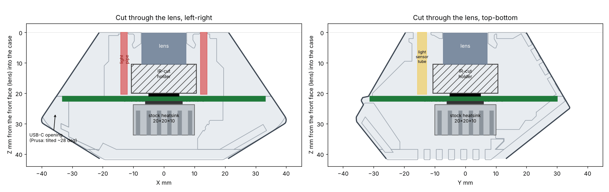

# LayerCam Pro v1

A camera for the inside of a Prusa CORE One, on one circuit board, in a
printed case with the outside of Prusa's Buddy3D camera case. It sees the
whole bed in daylight and in infrared, feeds Prusa Connect, takes one
picture per layer while the head is parked, makes the timelapse into an MP4
on the camera, and uploads it to a NAS or S3.

**Status: planned. This README is the plan; nothing has been designed,
made or powered.** The decisions behind it are in
[`docs/decisions.md`](docs/decisions.md). The part checks (in production,
stock, temperature) are in
[`docs/parts-check-2026-10-31.md`](docs/parts-check-2026-10-31.md).

*Prusa's case outside, cut through the lens. One board (green) sits where
the case is widest, about 66 mm across. The image sensor and the lens
holder are on its front face. Light pipes carry the infrared light to
Prusa's six front holes. A stock heatsink sits on the main chip, under the
back vents; the new inside opens the vents onto its fins.*

## What it has to do

| Requirement | How it will be checked |
|---|---|
| **One circuit board.** Image sensor, infrared lights, light sensor, main chip, Wi-Fi, USB-C and every other part on it. No flat cables or wire cables inside the case | the BOM and the assembly drawing: one board, no cable |
| **One order at PCBWay:** one Gerber zip, one BOM and one placement file; PCBWay buys and fits every part | PCBWay's quote. The one known exception is the bare image sensor (see *Risks*) |
| **Prusa's outside, our inside.** Same outer shape and magnets, so it fits the same top-left front corner of the CORE One. The USB-C socket stays on the same side wall, but the plug goes in level, not tilted about 28° as on Prusa's case | the case is built from Prusa's published files (Printables 1343977, GPL v2); a check script measures the board against the new case |
| **A 70 °C chamber.** Every part inside its rating with the chamber at 70 °C, in snapshot and timelapse mode, cooled by a stock heatsink only (no fan) | a thermal model of the routed board at 70 °C (`sim/thermal.py`), then an oven test of a built camera |
| **Never shorts in the heat.** Parts rated well above what they will see, a high-temperature board (Tg 170), coated, and no bare copper that can touch the carbon-fibre case | the part ratings, the thermal model, the design checks |
| **Every part in production today**, bought by PCBWay from the usual distributors | [`docs/parts-check-2026-10-31.md`](docs/parts-check-2026-10-31.md), checked again before ordering |
| **Everything else from Amazon:** heatsink, magnets, antenna, antenna cable, USB-C cable | the *How to order* list names each one |
| **Wi-Fi 6, 2.4 GHz,** to an antenna that screws on outside the case | a range test in a printer |
| **1080p or better, wide angle** (the whole bed), and **night vision** (infrared LEDs, a light sensor, a day/night filter) | test pictures in a printer, day and night |
| **Prusa Connect, the per-layer timelapse, upload to SMB / NFS / S3** | LayerCam's camera software, carried over, with its tests |
| **High-quality parts, not expensive; can be sold as a product.** The Wi-Fi is already approved for sale in the US (FCC) | the BOM cost from PCBWay's quote |

## The plan

| | |
|---|---|
| **Board** | One 6-layer board, about 66 x 60 mm with its corners cut to the case. It sits at the case's widest point, where its two halves meet, and is clamped between them. Tg 170 material, ENIG finish, 1.6 mm |
| **Main chip** | Rockchip RV1106G3, as on LayerCam: Linux, image processor, H.264 video encoder, 256 MB memory inside. LayerCam's camera software (Prusa Connect, timelapse, uploads; 192 tests) carries over |
| **Image sensor** | SmartSens **SC4336H** (4 MP), soldered straight on the board's front face. It replaces the SC3336 that LayerCam uses, which SmartSens now lists as legacy; it is in mass production and is said to fit the same pads. The camera software already has the driver for its close relative, the SC4336 |
| **Lens and day/night filter** | An M12 lens in an M12 holder with a built-in day/night (IR-cut) filter, screwed to the board over the sensor. The lens front sits just behind the case's front face |
| **Wi-Fi** | Espressif **ESP32-C6-MINI-1U-H4**: Wi-Fi 6 at 2.4 GHz, **rated to 105 °C**, US approved (FCC), about $4.40. It talks to the main chip over SDIO with Espressif's Linux driver (`esp-hosted`). The main chip programs it, so there is no second programming step at the factory |
| **Antenna** | A short U.FL to RP-SMA cable (bought in bulk) from the Wi-Fi module to a socket in the case wall. A 2.4 GHz screw-on antenna outside, no stronger than the gain the Wi-Fi module is approved with |
| **Infrared lights** | Six 860 nm LEDs (OSRAM SFH 4715CS, rated to 125 °C) on the board's front face, with a light pipe on each. The pipes carry the light about 19 mm to Prusa's six front holes and keep its wide beam (Bivar LPV2-0750, PCB-mounted, fitted by PCBWay) |
| **Light sensor** | Behind Prusa's light window, looking through a printed tube |
| **USB-C** | Power only (and firmware flashing), on the board's edge, out of the case's side wall, plug level with the board |
| **Cooling** | A stock aluminium heatsink (about 20 x 20 x 10 mm, on 3M 8810 tape) on the main chip, reaching the back vents so it sits in the chamber's air, not air trapped in the case. Parts are spread over a board nearly twice the size of LayerCam's main board. The camera sleeps between pictures and drops to snapshots when hot, as LayerCam does |
| **Case** | Printed by OffGrid in PC carbon fibre (Prusa's own recommendation for this case). Prusa's outside; a new inside: the board seat, the light-pipe guides, the light-sensor tube, the antenna socket, a level USB-C opening, vents over the heatsink. Built from Prusa's published files, which are GPL v2, so our case files are published under GPL v2 too |
| **Magnets** | Round disc magnets from Amazon, high-temperature grade (SH, 150 °C), in printed pockets on the outside, set with heat-proof epoxy (J-B Weld) |
| **Fab** | PCBWay: one board, one Gerber zip, BOM and placement file |

## Risks, and how each is closed before ordering

| Risk | What closes it |
|---|---|
| **The Wi-Fi driver is not proven on the RV1106.** Espressif's driver supports the ESP32-C6 over SDIO on Linux 4.9 and later, but nobody has shown it on this chip | A bench test with parts from Amazon: a Luckfox Pico Max (RV1106) and an ESP32-C6 dev board, joined through its microSD slot with a microSD breakout. Snapshots and an upload over Wi-Fi, before the board is designed around it |
| **The bare image sensor is not sold by Digi-Key, Mouser or LCSC.** It is sold through SmartSens and its agents | Ask PCBWay to source the SC4336H in the quote. Fallback: buy it from a SmartSens agent and send it to PCBWay with the order |
| **SC4336H software:** the SDK has the SC4336 driver and tuning, not the SC4336H | Compare the two datasheets; port the driver (usually a chip ID and register table). Early test on a cheap SC4336H camera board if one is sold |
| **The image sensor is rated to 85 °C and gives its best picture up to 60 °C** | Put the sensor at the board's cool end, away from the main chip, behind a slot in the copper; the thermal model has to show it under 85 °C at a 70 °C chamber |
| **Parts that stop at 85 °C:** the USB-C socket (no 105 °C USB 2.0 socket exists), the memory chip, the sensor | Place them at the cool edge; the thermal model checks each against its rating |
| **The day/night filter holder has no published temperature rating** (the ones found are rated to 70 °C) | Ask Commonlands for the CLA219's rating; test in the oven |
| **Light pipe temperature rating:** Bivar gives -40 to 125 °C for its polycarbonate pipes in general, not for this part | Confirm with Bivar; oven test |
| **Carbon-fibre plastic conducts a little** | No bare copper at the board edge or near the case; the board is coated; the case touches only the grounded mounting holes |
| **The antenna moves near the gantry.** The camera sits in the top corner, where the CoreXY gantry runs | The socket points down along the frame post; a short antenna; checked in a printer |
| **Selling it in the US:** the Wi-Fi module is approved only with antennas of the same type and no more gain than it was tested with | Read the module's FCC grant for its antenna list; name or ship a matching antenna, and say so in the manual |

## Next steps

1. **Bench test the Wi-Fi** on a Luckfox Pico Max and an ESP32-C6 dev
   board (both on Amazon).
2. **Ask PCBWay** whether they can source the SC4336H, and get a rough
   quote for a 6-layer board of this size with assembly.
3. **Ask Commonlands and Bivar** for the temperature ratings of the IR-cut
   holder and the light pipes.
4. **Design the board**, following [`docs/new-board.md`](../../docs/new-board.md):
   circuit in code, placement, routing, design checks, thermal model at 70 °C.
5. **Design the case's inside** from Prusa's files.
6. **Order 5, build, oven test at 70 °C, try it on a CORE One.**

## Where things are

| | |
|---|---|
| [`docs/decisions.md`](docs/decisions.md) | every decision so far, and what it costs |
| [`docs/parts-check-2026-10-31.md`](docs/parts-check-2026-10-31.md) | the main parts: in production, stock, price, temperature, with sources |
| `images/plan-section.png` | the plan drawn in Prusa's case |

The rest of the folder (`src/`, `production/`, `sim/`, `firmware/`,
`enclosure/`, `TESTS.md`) comes with the design.
