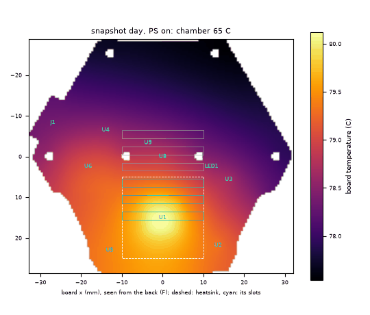
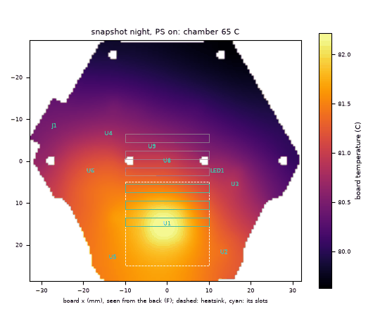
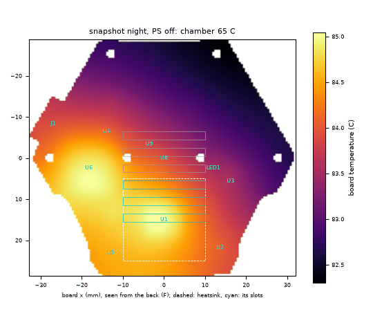
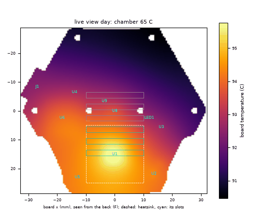
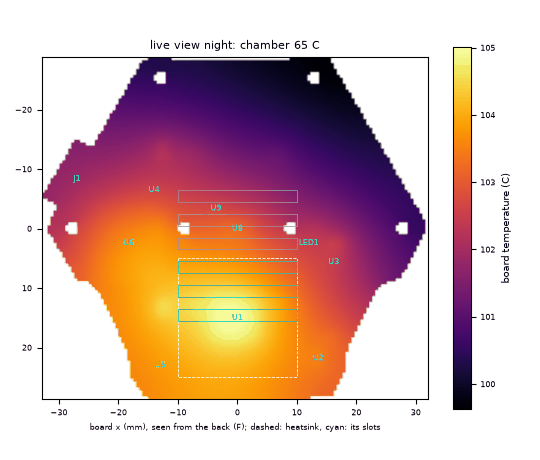
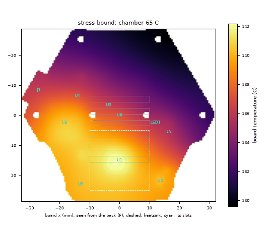

# LayerCam Pro v1: temperatures, rated for a 65 C chamber

Computed by `sim/thermal.py`: the one board as a 2D plate on a 0.5 mm grid (outline from `src/pcb.py` / `src/geometry.py`, part places from the routed board (layercam-pro.kicad_pcb), heat from `sim/power_budget.py`), in the PC-CF case with Prusa's outside, its stock 20 x 20 x 15 mm heatsink under three lid slots, in a 65 C chamber with still air. The model and every assumed number are listed at the end; the copper coverage is measured on the routed board (layercam-pro.kicad_pcb).

**The rating: a 65 C chamber.** The owner decided (1 Nov 2026) that LayerCam Pro is rated for a 65 C chamber, not 70 C: every part inside its rating in **snapshot mode** (one still at most every 10 s; a timelapse frame per layer is one of those shots, so timelapse mode is the same load), day and night, with the ESP32-C6's **Wi-Fi power save on** (the C6 firmware build sets it). Prusa's firmware caps the chamber at 55 C on the CORE One and 60 C on the CORE One L, so 65 C is 5 K above the higher of the two. This script exits 1 only if that requirement fails (`snap_day_ps`, `snap_night_ps` at 65 C). The earlier 70 C target and power save off (`snap_day`, `snap_night`, the C6 as first built) are reported as information, not checked; so are live view and the stress bound.

A 10 s cycle is modelled by its average heat (the case's time constant is many minutes); the LED junctions and string resistors are checked at their power while lit. Each case below is at the 65 C rating; the verdict also gives every mode at 70 C.

Board: 27.5 cm^2 a face; in-plane conductance 0.0730 W/K per square (copper coverage F 82 %, In1 95 %, In2 86 %, In3 88 %, In4 95 %, B 87 %). SoC exposed pad to the planes: 1.13 K/W through 25 filled vias; junction to heatsink 12.0 K/W (theta-JC top 8.4 + 3M 8810 tape 3.3 + base 0.3).

## Verdict

**Rated for a 65 C chamber: PASS** (0 FAIL, 3 WARN). The owner's decision: LayerCam Pro is rated for a 65 C chamber in snapshot and timelapse mode, day and night, with the ESP32-C6's Wi-Fi power save on (its firmware sets it), the stock heatsink and no fan. Prusa's firmware caps the chamber at 55 C on the CORE One and 60 C on the CORE One L, so the rating sits 5 K above the highest chamber a stock printer allows.

With power save on, every part stays inside its rating up to a **68.3 C** chamber by night and **70.5 C** by day: 3.3 K of margin over the rating at night, inside the model's +-10 K uncertainty, so the first board must be measured in a 65 C oven before this is called a pass. The part closest to its limit at 65 C is the **W25N02KV flash (U5)**: 81.9 C against 85 C (+3.1 K).

At 65 C (the rating; power save on is the requirement):

| | snapshot day, PS on | snapshot night, PS on | snapshot day, PS off | snapshot night, PS off | live view day | live view night |
|---|---|---|---|---|---|---|
| RV1106 junction (125 C) | 83.3 C | 85.2 C | 85.9 C | 87.8 C | 101.9 C | 110.2 C |
| image sensor (85 C; best image 60 C) | 79.3 C | 81.5 C | 82.4 C | 84.5 C | 95.6 C | 105.2 C |
| ESP32-C6 (105 C) | 80.2 C | 82.4 C | 84.8 C | 86.9 C | 96.6 C | 106.4 C |
| flash (85 C) | 79.7 C | 81.9 C | 82.8 C | 84.9 C | 94.9 C | 104.5 C |
| USB-C (85 C) | 79.6 C | 81.8 C | 83.2 C | 85.3 C | 94.0 C | 103.5 C |
| status LED (85 C) | 78.7 C | 80.9 C | 81.4 C | 83.6 C | 92.8 C | 102.6 C |
| air inside (85 C ambient parts) | 74.6 C | 76.1 C | 76.7 C | 78.1 C | 84.4 C | 90.8 C |
| IR LED junction while lit (100 C) | 79.7 C | 87.7 C | 82.8 C | 90.6 C | 95.1 C | 110.4 C |
| board max | 80.1 C | 82.2 C | 83.0 C | 85.0 C | 95.8 C | 105.0 C |
| heatsink | 79.0 C | 80.8 C | 81.5 C | 83.3 C | 93.2 C | 101.1 C |
| heat in the case | 0.73 W | 0.86 W | 0.91 W | 1.03 W | 1.64 W | 2.26 W |

At 70 C (information only):

| | snapshot day, PS on | snapshot night, PS on | snapshot day, PS off | snapshot night, PS off | live view day | live view night |
|---|---|---|---|---|---|---|
| RV1106 junction (125 C) | 88.0 C | 89.9 C | 90.6 C | 92.4 C | 106.4 C | 114.6 C |
| image sensor (85 C; best image 60 C) | 84.0 C | 86.2 C | 87.0 C | 89.1 C | 100.1 C | 109.5 C |
| ESP32-C6 (105 C) | 84.9 C | 87.1 C | 89.5 C | 91.6 C | 101.1 C | 110.7 C |
| flash (85 C) | 84.4 C | 86.6 C | 87.4 C | 89.5 C | 99.4 C | 108.8 C |
| USB-C (85 C) | 84.3 C | 86.4 C | 87.8 C | 89.9 C | 98.5 C | 107.8 C |
| status LED (85 C) | 83.4 C | 85.6 C | 86.1 C | 88.2 C | 97.3 C | 106.9 C |
| air inside (85 C ambient parts) | 79.4 C | 80.9 C | 81.4 C | 82.8 C | 89.0 C | 95.3 C |
| IR LED junction while lit (100 C) | 84.5 C | 92.3 C | 87.4 C | 95.3 C | 99.6 C | 114.8 C |
| board max | 84.9 C | 86.9 C | 87.7 C | 89.7 C | 100.3 C | 109.4 C |
| heatsink | 83.8 C | 85.5 C | 86.2 C | 87.9 C | 97.8 C | 105.5 C |
| heat in the case | 0.73 W | 0.86 W | 0.91 W | 1.03 W | 1.64 W | 2.26 W |

**Highest chamber temperature with every part inside its rating** (bisection):

| mode | every part in rating up to | first part there | image sensor 85 C at | image sensor 60 C at |
|---|---|---|---|---|
| snapshot day, PS on (rating) | **70.5 C** | W25N02KV flash (U5) | 71.0 C | 44.5 C |
| snapshot night, PS on (rating) | **68.3 C** | W25N02KV flash (U5) | 68.7 C | 42.0 C |
| snapshot day, PS off | **66.9 C** | USB-C receptacle USB4105 (J1) | 67.8 C | 41.0 C |
| snapshot night, PS off | **64.6 C** | USB-C receptacle USB4105 (J1) | 65.5 C | 38.4 C |
| live view day | **53.1 C** | SC4336H image sensor (U8) | 53.1 C | 25.1 C |
| live view night | **41.6 C** | SC4336H image sensor (U8) | 41.6 C | 12.6 C |
| stress bound | **-10.5 C** | W25N02KV flash (U5) | -7.0 C | never (not even at -20 C) |

- **Image sensor** (the rating case, night): 81.5 C at 65 C against 85 C (+3.5 K); its 85 C is reached at a 68.7 C chamber. Its best image ends at 60 C, which it passes at a 42.0 C chamber: above that the picture degrades (noise, dark current) but the sensor works. At 70 C it would be 86.2 C.
- **The board is nearly isothermal** (79.6-82.2 C in night snapshots at 65 C): six copper layers spread the heat faster than the still air takes it off, so the four parts rated 85 C (USB-C, flash, image sensor, status LED) are within 1.0 K of each other and their order is inside the model's uncertainty: the margin is the board's as a whole.
- **Wi-Fi power save is needed for the rating**: off (the C6 as first built), the limit drops to 64.6 C by night and 66.9 C by day, 3.7 K lower; the sensor runs 3.0 K and the junction 2.6 K warmer. The C6 firmware must set it, and the first board should confirm the C6's current with it on (power.md: 47 mA against 98 mA, ASSUMED duty cycles).
- **70 C is not met** (information): with power save on, 70.5 C by day and 68.3 C by night; off, 66.9 C and 64.6 C. The parts that stop it are the 85 C ones above.
- **The vent slots carry little**: 0.027 W of the heatsink's 0.21 W leaves through its three slots and 0.083 W through the lid over it; the rest goes into the case's inside air and the board. Without the heatsink the sensor would be 84.8 C, with a 1 mm gap pad from the fin tops to the lid 80.3 C (chamber limit then 69.5 C by night, power save on).
- Live view: every part in rating to 53.1 C by day and 41.6 C by night; it stays a firmware-gated mode (TSADC below 87 C; snapshot mode spaces Connect pictures to 30 s from 84 C).
- Model uncertainty about +-10 K (optimistic bracket: RV1106 84.8 C, sensor 81.0 C in the rating case); part places from the routed board (layercam-pro.kicad_pcb), copper coverage measured on the routed board (layercam-pro.kicad_pcb), the snapshot currents ASSUMED. Measure the first board in a 65 C oven.

## Snapshot, day, Wi-Fi power save on (the rating)

Heat in the case: **0.73 W** (U1 0.49, U6 0.15, U3 0.03, U8 0.02, U2 0.02, U5 0.01, U4 0.01, L1 0.01).

| | value |
|---|---|
| case wall | 70.6 C (5.6 K over the chamber) |
| air inside (mean of board and wall) | 74.6 C |
| board mean / max | 78.6 / 80.1 C |
| board heat out: faces / edge and bosses / into the heatsink's underside | 0.38 / 0.17 / 0.00 W |
| heatsink | 79.0 C; 0.19 W from the junction; out to the chamber through its slots 0.023 W (exchange flow 0.007 W), through the lid patch 0.073 W (patch 70.5 C) |
| other slots' air exchange | 0.009 W |
| RV1106 | 0.30 W into the board; board under the pad 80.0 C, at the package edge 79.6 C; Tj 81.2 C (pad path) / 83.3 C (theta-JB 12.5 from the edge) |

| part | temperature (C) | limit (C) | margin (K) | limit from |
|---|---|---|---|---|
| W25N02KV flash (U5) | 79.7 | 85 | +5.3 | -40..85 C (Winbond) |
| USB-C receptacle USB4105 (J1) | 79.6 | 85 | +5.4 | -40..85 C incl. rise (GCT) |
| SC4336H image sensor (U8) | 79.3 | 85 | +5.7 | -30..85 C operating; best image to 60 C (SmartSens) |
| status LED LED1 (KT-0603G) | 78.7 | 85 | +6.3 | -40..85 C (KENTO) |
| internal air (RV1106 / EA3036C ambient) | 74.6 | 85 | +10.4 | ambient operating max (RV1106 T3-2, EA3036C TA) |
| 3M 8810 tape on the RV1106 | 80.3 | 100 | +19.7 | long-term 100 C (3M; UNVERIFIED: data sheet not read here) |
| TEMT6000 light sensor (Q2) | 80.1 | 100 | +19.9 | -40..100 C (Vishay) |
| IR LEDs VSMY3850X01, junction while lit | 79.7 | 100 | +20.3 | Tj 100 C (Vishay VSMY3850 rev 1.5; the X01 grade's own data sheet not read) |
| ESP32-C6-MINI-1U-H4 (U6) | 80.2 | 105 | +24.8 | -40..105 C, the -H4 grade (Espressif) |
| X6S capacitors (2.2uF, 4.7uF, 10uF, 22uF) under the SoC (B face) | 80.1 | 105 | +24.9 | X6S: -55..105 C |
| X6S capacitors (2.2uF, 4.7uF, 10uF, 22uF) at the bucks | 79.3 | 105 | +25.7 | X6S: -55..105 C |
| X6S capacitors (2.2uF, 4.7uF, 10uF, 22uF) at the sensor | 79.1 | 105 | +25.9 | X6S: -55..105 C |
| PicoBlade IR-cut lead socket (J3) | 78.1 | 105 | +26.9 | -40..105 C (Molex) |
| IR LEDs VSMY3850X01, ambient | 77.2 | 105 | +27.8 | -40..105 C, X01 grade (parts.py; the base part is rated 85 C) |
| case wall (PC carbon fibre) | 70.6 | 110 | +39.4 | softens near its HDT, ~110 C (PC; ESTIMATED) |
| RV1106 junction (U1) | 83.3 | 125 | +41.7 | Tj max (datasheet 4.1) |
| X7S capacitors (1uF) under the SoC (B face) | 80.1 | 125 | +44.9 | X7S: -55..125 C |
| TLV62569 0.9 V (U2) junction | 80.0 | 125 | +45.0 | TJ max (SLVSDG1C 6.3) |
| crystals Y1 (24 MHz) / Y2 (32 kHz) | 79.6 | 125 | +45.4 | -40..125 C (ECS, Abracon) |
| inductor L1 (DFE252012F) | 79.6 | 125 | +45.4 | -40..125 C incl. self-heating (Murata) |
| X7S capacitors (1uF) at the bucks | 79.3 | 125 | +45.7 | X7S: -55..125 C |
| EA3036C junction (U3) | 79.1 | 125 | +45.9 | TJ range (datasheet) |
| X7S capacitors (1uF) at the sensor | 79.1 | 125 | +45.9 | X7S: -55..125 C |
| TLV62569 Wi-Fi (U4) junction | 78.9 | 125 | +46.1 | TJ max (SLVSDG1C 6.3) |
| TLV75528 sensor LDO junction (U9) | 78.8 | 125 | +46.2 | TJ max (SBVS320D) |
| DRV8210P IR-cut driver (U7) | 78.7 | 125 | +46.3 | TA -40..125 C (TI) |
| inductor L4 (DFE252012F) | 78.7 | 125 | +46.3 | -40..125 C incl. self-heating (Murata) |
| inductor L5 (DFE252012F) | 78.7 | 125 | +46.3 | -40..125 C incl. self-heating (Murata) |
| inductor L3 (DFE252012F) | 78.6 | 125 | +46.4 | -40..125 C incl. self-heating (Murata) |
| inductor L2 (DFE252012F) | 78.4 | 125 | +46.6 | -40..125 C incl. self-heating (Murata) |
| USBLC6 / SMF6.0CA (U10 / D1) | 78.3 | 125 | +46.7 | TJ to 125 / 150 C |

Image sensor: **79.3 C** against its 85 C rating (+5.7 K) and its best-image limit of 60 C (-19.3 K).

## Snapshot, night, IR LEDs lit 2 s of every 10 s, Wi-Fi power save on (the rating)

Heat in the case: **0.86 W** (U1 0.49, U6 0.15, U3 0.03, U8 0.02, R90 0.02, R91 0.02, R92 0.02, U2 0.02, U5 0.01, D2 0.01, D3 0.01, D4 0.01, D5 0.01, D6 0.01, D7 0.01, U4 0.01, L1 0.01).

| | value |
|---|---|
| case wall | 71.4 C (6.4 K over the chamber) |
| air inside (mean of board and wall) | 76.1 C |
| board mean / max | 80.8 / 82.2 C |
| board heat out: faces / edge and bosses / into the heatsink's underside | 0.45 / 0.20 / 0.01 W |
| heatsink | 80.8 C; 0.21 W from the junction; out to the chamber through its slots 0.027 W (exchange flow 0.009 W), through the lid patch 0.083 W (patch 71.2 C) |
| other slots' air exchange | 0.011 W |
| RV1106 | 0.28 W into the board; board under the pad 82.1 C, at the package edge 81.7 C; Tj 83.3 C (pad path) / 85.2 C (theta-JB 12.5 from the edge) |

| part | temperature (C) | limit (C) | margin (K) | limit from |
|---|---|---|---|---|
| W25N02KV flash (U5) | 81.9 | 85 | +3.1 | -40..85 C (Winbond) |
| USB-C receptacle USB4105 (J1) | 81.8 | 85 | +3.2 | -40..85 C incl. rise (GCT) |
| SC4336H image sensor (U8) | 81.5 | 85 | +3.5 | -30..85 C operating; best image to 60 C (SmartSens) |
| status LED LED1 (KT-0603G) | 80.9 | 85 | +4.1 | -40..85 C (KENTO) |
| internal air (RV1106 / EA3036C ambient) | 76.1 | 85 | +8.9 | ambient operating max (RV1106 T3-2, EA3036C TA) |
| IR LEDs VSMY3850X01, junction while lit | 87.7 | 100 | +12.3 | Tj 100 C (Vishay VSMY3850 rev 1.5; the X01 grade's own data sheet not read) |
| TEMT6000 light sensor (Q2) | 82.2 | 100 | +17.8 | -40..100 C (Vishay) |
| 3M 8810 tape on the RV1106 | 82.1 | 100 | +17.9 | long-term 100 C (3M; UNVERIFIED: data sheet not read here) |
| ESP32-C6-MINI-1U-H4 (U6) | 82.4 | 105 | +22.6 | -40..105 C, the -H4 grade (Espressif) |
| X6S capacitors (2.2uF, 4.7uF, 10uF, 22uF) under the SoC (B face) | 82.2 | 105 | +22.8 | X6S: -55..105 C |
| X6S capacitors (2.2uF, 4.7uF, 10uF, 22uF) at the bucks | 81.4 | 105 | +23.6 | X6S: -55..105 C |
| X6S capacitors (2.2uF, 4.7uF, 10uF, 22uF) at the sensor | 81.3 | 105 | +23.7 | X6S: -55..105 C |
| PicoBlade IR-cut lead socket (J3) | 80.3 | 105 | +24.7 | -40..105 C (Molex) |
| IR LEDs VSMY3850X01, ambient | 79.0 | 105 | +26.0 | -40..105 C, X01 grade (parts.py; the base part is rated 85 C) |
| case wall (PC carbon fibre) | 71.4 | 110 | +38.6 | softens near its HDT, ~110 C (PC; ESTIMATED) |
| RV1106 junction (U1) | 85.2 | 125 | +39.8 | Tj max (datasheet 4.1) |
| X7S capacitors (1uF) under the SoC (B face) | 82.2 | 125 | +42.8 | X7S: -55..125 C |
| TLV62569 0.9 V (U2) junction | 82.1 | 125 | +42.9 | TJ max (SLVSDG1C 6.3) |
| crystals Y1 (24 MHz) / Y2 (32 kHz) | 81.8 | 125 | +43.2 | -40..125 C (ECS, Abracon) |
| inductor L1 (DFE252012F) | 81.7 | 125 | +43.3 | -40..125 C incl. self-heating (Murata) |
| X7S capacitors (1uF) at the bucks | 81.4 | 125 | +43.6 | X7S: -55..125 C |
| EA3036C junction (U3) | 81.3 | 125 | +43.7 | TJ range (datasheet) |
| X7S capacitors (1uF) at the sensor | 81.3 | 125 | +43.7 | X7S: -55..125 C |
| TLV62569 Wi-Fi (U4) junction | 81.1 | 125 | +43.9 | TJ max (SLVSDG1C 6.3) |
| TLV75528 sensor LDO junction (U9) | 81.0 | 125 | +44.0 | TJ max (SBVS320D) |
| DRV8210P IR-cut driver (U7) | 80.9 | 125 | +44.1 | TA -40..125 C (TI) |
| inductor L5 (DFE252012F) | 80.9 | 125 | +44.1 | -40..125 C incl. self-heating (Murata) |
| inductor L4 (DFE252012F) | 80.9 | 125 | +44.1 | -40..125 C incl. self-heating (Murata) |
| inductor L3 (DFE252012F) | 80.8 | 125 | +44.2 | -40..125 C incl. self-heating (Murata) |
| inductor L2 (DFE252012F) | 80.6 | 125 | +44.4 | -40..125 C incl. self-heating (Murata) |
| USBLC6 / SMF6.0CA (U10 / D1) | 80.5 | 125 | +44.5 | TJ to 125 / 150 C |
| 47R string resistors, power while lit | 0.110 W | 0.216 W at 82 C | +0.106 W | 0.25 W to 70 C, 0 at 155 C |

Image sensor: **81.5 C** against its 85 C rating (+3.5 K) and its best-image limit of 60 C (-21.5 K).

## Snapshot, day, Wi-Fi power save off (information)

Heat in the case: **0.91 W** (U1 0.49, U6 0.32, U3 0.03, U8 0.02, U2 0.02, U5 0.01, U4 0.01, L1 0.01).

| | value |
|---|---|
| case wall | 71.7 C (6.7 K over the chamber) |
| air inside (mean of board and wall) | 76.7 C |
| board mean / max | 81.6 / 83.0 C |
| board heat out: faces / edge and bosses / into the heatsink's underside | 0.48 / 0.21 / 0.01 W |
| heatsink | 81.5 C; 0.21 W from the junction; out to the chamber through its slots 0.028 W (exchange flow 0.009 W), through the lid patch 0.087 W (patch 71.5 C) |
| other slots' air exchange | 0.012 W |
| RV1106 | 0.27 W into the board; board under the pad 82.9 C, at the package edge 82.5 C; Tj 84.0 C (pad path) / 85.9 C (theta-JB 12.5 from the edge) |

| part | temperature (C) | limit (C) | margin (K) | limit from |
|---|---|---|---|---|
| USB-C receptacle USB4105 (J1) | 83.2 | 85 | +1.8 | -40..85 C incl. rise (GCT) |
| W25N02KV flash (U5) | 82.8 | 85 | +2.2 | -40..85 C (Winbond) |
| SC4336H image sensor (U8) | 82.4 | 85 | +2.6 | -30..85 C operating; best image to 60 C (SmartSens) |
| status LED LED1 (KT-0603G) | 81.4 | 85 | +3.6 | -40..85 C (KENTO) |
| internal air (RV1106 / EA3036C ambient) | 76.7 | 85 | +8.3 | ambient operating max (RV1106 T3-2, EA3036C TA) |
| TEMT6000 light sensor (Q2) | 83.0 | 100 | +17.0 | -40..100 C (Vishay) |
| 3M 8810 tape on the RV1106 | 82.8 | 100 | +17.2 | long-term 100 C (3M; UNVERIFIED: data sheet not read here) |
| IR LEDs VSMY3850X01, junction while lit | 82.8 | 100 | +17.2 | Tj 100 C (Vishay VSMY3850 rev 1.5; the X01 grade's own data sheet not read) |
| ESP32-C6-MINI-1U-H4 (U6) | 84.8 | 105 | +20.2 | -40..105 C, the -H4 grade (Espressif) |
| X6S capacitors (2.2uF, 4.7uF, 10uF, 22uF) under the SoC (B face) | 83.0 | 105 | +22.0 | X6S: -55..105 C |
| X6S capacitors (2.2uF, 4.7uF, 10uF, 22uF) at the sensor | 82.3 | 105 | +22.7 | X6S: -55..105 C |
| X6S capacitors (2.2uF, 4.7uF, 10uF, 22uF) at the bucks | 82.2 | 105 | +22.8 | X6S: -55..105 C |
| PicoBlade IR-cut lead socket (J3) | 80.8 | 105 | +24.2 | -40..105 C (Molex) |
| IR LEDs VSMY3850X01, ambient | 79.7 | 105 | +25.3 | -40..105 C, X01 grade (parts.py; the base part is rated 85 C) |
| case wall (PC carbon fibre) | 71.7 | 110 | +38.3 | softens near its HDT, ~110 C (PC; ESTIMATED) |
| RV1106 junction (U1) | 85.9 | 125 | +39.1 | Tj max (datasheet 4.1) |
| X7S capacitors (1uF) under the SoC (B face) | 83.0 | 125 | +42.0 | X7S: -55..125 C |
| TLV62569 0.9 V (U2) junction | 82.7 | 125 | +42.3 | TJ max (SLVSDG1C 6.3) |
| crystals Y1 (24 MHz) / Y2 (32 kHz) | 82.7 | 125 | +42.3 | -40..125 C (ECS, Abracon) |
| TLV62569 Wi-Fi (U4) junction | 82.4 | 125 | +42.6 | TJ max (SLVSDG1C 6.3) |
| inductor L1 (DFE252012F) | 82.3 | 125 | +42.7 | -40..125 C incl. self-heating (Murata) |
| X7S capacitors (1uF) at the sensor | 82.3 | 125 | +42.7 | X7S: -55..125 C |
| X7S capacitors (1uF) at the bucks | 82.2 | 125 | +42.8 | X7S: -55..125 C |
| inductor L5 (DFE252012F) | 82.2 | 125 | +42.8 | -40..125 C incl. self-heating (Murata) |
| EA3036C junction (U3) | 81.9 | 125 | +43.1 | TJ range (datasheet) |
| TLV75528 sensor LDO junction (U9) | 81.9 | 125 | +43.1 | TJ max (SBVS320D) |
| USBLC6 / SMF6.0CA (U10 / D1) | 81.7 | 125 | +43.3 | TJ to 125 / 150 C |
| DRV8210P IR-cut driver (U7) | 81.4 | 125 | +43.6 | TA -40..125 C (TI) |
| inductor L4 (DFE252012F) | 81.4 | 125 | +43.6 | -40..125 C incl. self-heating (Murata) |
| inductor L3 (DFE252012F) | 81.3 | 125 | +43.7 | -40..125 C incl. self-heating (Murata) |
| inductor L2 (DFE252012F) | 81.1 | 125 | +43.9 | -40..125 C incl. self-heating (Murata) |

Image sensor: **82.4 C** against its 85 C rating (+2.6 K) and its best-image limit of 60 C (-22.4 K).

## Snapshot, night, Wi-Fi power save off (information)

Heat in the case: **1.03 W** (U1 0.49, U6 0.32, U3 0.03, U8 0.02, R90 0.02, R91 0.02, R92 0.02, U2 0.02, U5 0.01, D2 0.01, D3 0.01, D4 0.01, D5 0.01, D6 0.01, D7 0.01, U4 0.01, L1 0.01).

| | value |
|---|---|
| case wall | 72.4 C (7.4 K over the chamber) |
| air inside (mean of board and wall) | 78.1 C |
| board mean / max | 83.7 / 85.0 C |
| board heat out: faces / edge and bosses / into the heatsink's underside | 0.55 / 0.24 / 0.01 W |
| heatsink | 83.3 C; 0.23 W from the junction; out to the chamber through its slots 0.032 W (exchange flow 0.011 W), through the lid patch 0.097 W (patch 72.1 C) |
| other slots' air exchange | 0.014 W |
| RV1106 | 0.26 W into the board; board under the pad 84.9 C, at the package edge 84.6 C; Tj 86.0 C (pad path) / 87.8 C (theta-JB 12.5 from the edge) |

| part | temperature (C) | limit (C) | margin (K) | limit from |
|---|---|---|---|---|
| USB-C receptacle USB4105 (J1) | 85.3 | 85 | -0.3 | -40..85 C incl. rise (GCT) |
| W25N02KV flash (U5) | 84.9 | 85 | +0.1 | -40..85 C (Winbond) |
| SC4336H image sensor (U8) | 84.5 | 85 | +0.5 | -30..85 C operating; best image to 60 C (SmartSens) |
| status LED LED1 (KT-0603G) | 83.6 | 85 | +1.4 | -40..85 C (KENTO) |
| internal air (RV1106 / EA3036C ambient) | 78.1 | 85 | +6.9 | ambient operating max (RV1106 T3-2, EA3036C TA) |
| IR LEDs VSMY3850X01, junction while lit | 90.6 | 100 | +9.4 | Tj 100 C (Vishay VSMY3850 rev 1.5; the X01 grade's own data sheet not read) |
| TEMT6000 light sensor (Q2) | 85.0 | 100 | +15.0 | -40..100 C (Vishay) |
| 3M 8810 tape on the RV1106 | 84.6 | 100 | +15.4 | long-term 100 C (3M; UNVERIFIED: data sheet not read here) |
| ESP32-C6-MINI-1U-H4 (U6) | 86.9 | 105 | +18.1 | -40..105 C, the -H4 grade (Espressif) |
| X6S capacitors (2.2uF, 4.7uF, 10uF, 22uF) under the SoC (B face) | 85.0 | 105 | +20.0 | X6S: -55..105 C |
| X6S capacitors (2.2uF, 4.7uF, 10uF, 22uF) at the sensor | 84.4 | 105 | +20.6 | X6S: -55..105 C |
| X6S capacitors (2.2uF, 4.7uF, 10uF, 22uF) at the bucks | 84.4 | 105 | +20.6 | X6S: -55..105 C |
| PicoBlade IR-cut lead socket (J3) | 83.0 | 105 | +22.0 | -40..105 C (Molex) |
| IR LEDs VSMY3850X01, ambient | 81.5 | 105 | +23.5 | -40..105 C, X01 grade (parts.py; the base part is rated 85 C) |
| RV1106 junction (U1) | 87.8 | 125 | +37.2 | Tj max (datasheet 4.1) |
| case wall (PC carbon fibre) | 72.4 | 110 | +37.6 | softens near its HDT, ~110 C (PC; ESTIMATED) |
| X7S capacitors (1uF) under the SoC (B face) | 85.0 | 125 | +40.0 | X7S: -55..125 C |
| crystals Y1 (24 MHz) / Y2 (32 kHz) | 84.8 | 125 | +40.2 | -40..125 C (ECS, Abracon) |
| TLV62569 0.9 V (U2) junction | 84.8 | 125 | +40.2 | TJ max (SLVSDG1C 6.3) |
| TLV62569 Wi-Fi (U4) junction | 84.6 | 125 | +40.4 | TJ max (SLVSDG1C 6.3) |
| X7S capacitors (1uF) at the sensor | 84.4 | 125 | +40.6 | X7S: -55..125 C |
| X7S capacitors (1uF) at the bucks | 84.4 | 125 | +40.6 | X7S: -55..125 C |
| inductor L5 (DFE252012F) | 84.4 | 125 | +40.6 | -40..125 C incl. self-heating (Murata) |
| inductor L1 (DFE252012F) | 84.3 | 125 | +40.7 | -40..125 C incl. self-heating (Murata) |
| EA3036C junction (U3) | 84.0 | 125 | +41.0 | TJ range (datasheet) |
| TLV75528 sensor LDO junction (U9) | 84.0 | 125 | +41.0 | TJ max (SBVS320D) |
| USBLC6 / SMF6.0CA (U10 / D1) | 83.8 | 125 | +41.2 | TJ to 125 / 150 C |
| DRV8210P IR-cut driver (U7) | 83.6 | 125 | +41.4 | TA -40..125 C (TI) |
| inductor L4 (DFE252012F) | 83.5 | 125 | +41.5 | -40..125 C incl. self-heating (Murata) |
| inductor L3 (DFE252012F) | 83.4 | 125 | +41.6 | -40..125 C incl. self-heating (Murata) |
| inductor L2 (DFE252012F) | 83.3 | 125 | +41.7 | -40..125 C incl. self-heating (Murata) |
| 47R string resistors, power while lit | 0.110 W | 0.206 W at 85 C | +0.096 W | 0.25 W to 70 C, 0 at 155 C |

Image sensor: **84.5 C** against its 85 C rating (+0.5 K) and its best-image limit of 60 C (-24.5 K).

## Live view, day: streaming (reported, not required)

Heat in the case: **1.64 W** (U1 0.97, U6 0.38, U8 0.12, U2 0.06, L1 0.04, U3 0.03, U5 0.02, U4 0.01, U9 0.01).

| | value |
|---|---|
| case wall | 75.9 C (10.9 K over the chamber) |
| air inside (mean of board and wall) | 84.4 C |
| board mean / max | 92.8 / 95.8 C |
| board heat out: faces / edge and bosses / into the heatsink's underside | 0.88 / 0.36 / 0.01 W |
| heatsink | 93.2 C; 0.39 W from the junction; out to the chamber through its slots 0.058 W (exchange flow 0.025 W), through the lid patch 0.152 W (patch 75.7 C) |
| other slots' air exchange | 0.026 W |
| RV1106 | 0.57 W into the board; board under the pad 95.6 C, at the package edge 94.7 C; Tj 97.9 C (pad path) / 101.9 C (theta-JB 12.5 from the edge) |

| part | temperature (C) | limit (C) | margin (K) | limit from |
|---|---|---|---|---|
| SC4336H image sensor (U8) | 95.6 | 85 | -10.6 | -30..85 C operating; best image to 60 C (SmartSens) |
| W25N02KV flash (U5) | 94.9 | 85 | -9.9 | -40..85 C (Winbond) |
| USB-C receptacle USB4105 (J1) | 94.0 | 85 | -9.0 | -40..85 C incl. rise (GCT) |
| status LED LED1 (KT-0603G) | 92.8 | 85 | -7.8 | -40..85 C (KENTO) |
| internal air (RV1106 / EA3036C ambient) | 84.4 | 85 | +0.6 | ambient operating max (RV1106 T3-2, EA3036C TA) |
| 3M 8810 tape on the RV1106 | 95.8 | 100 | +4.2 | long-term 100 C (3M; UNVERIFIED: data sheet not read here) |
| TEMT6000 light sensor (Q2) | 95.7 | 100 | +4.3 | -40..100 C (Vishay) |
| IR LEDs VSMY3850X01, junction while lit | 95.1 | 100 | +4.9 | Tj 100 C (Vishay VSMY3850 rev 1.5; the X01 grade's own data sheet not read) |
| ESP32-C6-MINI-1U-H4 (U6) | 96.6 | 105 | +8.4 | -40..105 C, the -H4 grade (Espressif) |
| X6S capacitors (2.2uF, 4.7uF, 10uF, 22uF) under the SoC (B face) | 95.8 | 105 | +9.2 | X6S: -55..105 C |
| X6S capacitors (2.2uF, 4.7uF, 10uF, 22uF) at the bucks | 94.4 | 105 | +10.6 | X6S: -55..105 C |
| X6S capacitors (2.2uF, 4.7uF, 10uF, 22uF) at the sensor | 94.0 | 105 | +11.0 | X6S: -55..105 C |
| PicoBlade IR-cut lead socket (J3) | 91.6 | 105 | +13.4 | -40..105 C (Molex) |
| IR LEDs VSMY3850X01, ambient | 89.7 | 105 | +15.3 | -40..105 C, X01 grade (parts.py; the base part is rated 85 C) |
| RV1106 junction (U1) | 101.9 | 125 | +23.1 | Tj max (datasheet 4.1) |
| TLV62569 0.9 V (U2) junction | 96.6 | 125 | +28.4 | TJ max (SLVSDG1C 6.3) |
| inductor L1 (DFE252012F) | 96.4 | 125 | +28.6 | -40..125 C incl. self-heating (Murata) |
| X7S capacitors (1uF) under the SoC (B face) | 95.8 | 125 | +29.2 | X7S: -55..125 C |
| crystals Y1 (24 MHz) / Y2 (32 kHz) | 94.8 | 125 | +30.2 | -40..125 C (ECS, Abracon) |
| X7S capacitors (1uF) at the bucks | 94.4 | 125 | +30.6 | X7S: -55..125 C |
| X7S capacitors (1uF) at the sensor | 94.0 | 125 | +31.0 | X7S: -55..125 C |
| TLV75528 sensor LDO junction (U9) | 93.6 | 125 | +31.4 | TJ max (SBVS320D) |
| EA3036C junction (U3) | 93.4 | 125 | +31.6 | TJ range (datasheet) |
| TLV62569 Wi-Fi (U4) junction | 93.4 | 125 | +31.6 | TJ max (SLVSDG1C 6.3) |
| inductor L5 (DFE252012F) | 93.1 | 125 | +31.9 | -40..125 C incl. self-heating (Murata) |
| DRV8210P IR-cut driver (U7) | 92.8 | 125 | +32.2 | TA -40..125 C (TI) |
| inductor L4 (DFE252012F) | 92.8 | 125 | +32.2 | -40..125 C incl. self-heating (Murata) |
| inductor L3 (DFE252012F) | 92.5 | 125 | +32.5 | -40..125 C incl. self-heating (Murata) |
| USBLC6 / SMF6.0CA (U10 / D1) | 92.3 | 125 | +32.7 | TJ to 125 / 150 C |
| inductor L2 (DFE252012F) | 92.1 | 125 | +32.9 | -40..125 C incl. self-heating (Murata) |
| case wall (PC carbon fibre) | 75.9 | 110 | +34.1 | softens near its HDT, ~110 C (PC; ESTIMATED) |

Image sensor: **95.6 C** against its 85 C rating (-10.6 K) and its best-image limit of 60 C (-35.6 K).

## Live view, night: streaming with the IR LEDs on (reported, not required)

Heat in the case: **2.26 W** (U1 0.97, U6 0.38, U8 0.12, R90 0.11, R91 0.11, R92 0.11, U2 0.06, D2 0.05, D3 0.05, D4 0.05, D5 0.05, D6 0.05, D7 0.05, L1 0.04, U3 0.03, U5 0.02, U4 0.01, J1 0.01, U9 0.01).

| | value |
|---|---|
| case wall | 79.3 C (14.3 K over the chamber) |
| air inside (mean of board and wall) | 90.8 C |
| board mean / max | 102.3 / 105.0 C |
| board heat out: faces / edge and bosses / into the heatsink's underside | 1.27 / 0.49 / 0.03 W |
| heatsink | 101.1 C; 0.48 W from the junction; out to the chamber through its slots 0.082 W (exchange flow 0.038 W), through the lid patch 0.201 W (patch 78.6 C) |
| other slots' air exchange | 0.040 W |
| RV1106 | 0.49 W into the board; board under the pad 104.8 C, at the package edge 104.1 C; Tj 106.8 C (pad path) / 110.2 C (theta-JB 12.5 from the edge) |

| part | temperature (C) | limit (C) | margin (K) | limit from |
|---|---|---|---|---|
| SC4336H image sensor (U8) | 105.2 | 85 | -20.2 | -30..85 C operating; best image to 60 C (SmartSens) |
| W25N02KV flash (U5) | 104.5 | 85 | -19.5 | -40..85 C (Winbond) |
| USB-C receptacle USB4105 (J1) | 103.5 | 85 | -18.5 | -40..85 C incl. rise (GCT) |
| status LED LED1 (KT-0603G) | 102.6 | 85 | -17.6 | -40..85 C (KENTO) |
| IR LEDs VSMY3850X01, junction while lit | 110.4 | 100 | -10.4 | Tj 100 C (Vishay VSMY3850 rev 1.5; the X01 grade's own data sheet not read) |
| internal air (RV1106 / EA3036C ambient) | 90.8 | 85 | -5.8 | ambient operating max (RV1106 T3-2, EA3036C TA) |
| TEMT6000 light sensor (Q2) | 105.0 | 100 | -5.0 | -40..100 C (Vishay) |
| 3M 8810 tape on the RV1106 | 103.8 | 100 | -3.8 | long-term 100 C (3M; UNVERIFIED: data sheet not read here) |
| ESP32-C6-MINI-1U-H4 (U6) | 106.4 | 105 | -1.4 | -40..105 C, the -H4 grade (Espressif) |
| X6S capacitors (2.2uF, 4.7uF, 10uF, 22uF) under the SoC (B face) | 105.0 | 105 | -0.0 | X6S: -55..105 C |
| X6S capacitors (2.2uF, 4.7uF, 10uF, 22uF) at the sensor | 103.6 | 105 | +1.4 | X6S: -55..105 C |
| X6S capacitors (2.2uF, 4.7uF, 10uF, 22uF) at the bucks | 103.5 | 105 | +1.5 | X6S: -55..105 C |
| PicoBlade IR-cut lead socket (J3) | 101.2 | 105 | +3.8 | -40..105 C (Molex) |
| IR LEDs VSMY3850X01, ambient | 97.7 | 105 | +7.3 | -40..105 C, X01 grade (parts.py; the base part is rated 85 C) |
| RV1106 junction (U1) | 110.2 | 125 | +14.8 | Tj max (datasheet 4.1) |
| TLV62569 0.9 V (U2) junction | 105.8 | 125 | +19.2 | TJ max (SLVSDG1C 6.3) |
| inductor L1 (DFE252012F) | 105.6 | 125 | +19.4 | -40..125 C incl. self-heating (Murata) |
| X7S capacitors (1uF) under the SoC (B face) | 105.0 | 125 | +20.0 | X7S: -55..125 C |
| crystals Y1 (24 MHz) / Y2 (32 kHz) | 104.4 | 125 | +20.6 | -40..125 C (ECS, Abracon) |
| X7S capacitors (1uF) at the sensor | 103.6 | 125 | +21.4 | X7S: -55..125 C |
| X7S capacitors (1uF) at the bucks | 103.5 | 125 | +21.5 | X7S: -55..125 C |
| TLV75528 sensor LDO junction (U9) | 103.3 | 125 | +21.7 | TJ max (SBVS320D) |
| TLV62569 Wi-Fi (U4) junction | 103.1 | 125 | +21.9 | TJ max (SLVSDG1C 6.3) |
| EA3036C junction (U3) | 103.1 | 125 | +21.9 | TJ range (datasheet) |
| inductor L5 (DFE252012F) | 102.8 | 125 | +22.2 | -40..125 C incl. self-heating (Murata) |
| DRV8210P IR-cut driver (U7) | 102.5 | 125 | +22.5 | TA -40..125 C (TI) |
| inductor L4 (DFE252012F) | 102.3 | 125 | +22.7 | -40..125 C incl. self-heating (Murata) |
| inductor L3 (DFE252012F) | 102.1 | 125 | +22.9 | -40..125 C incl. self-heating (Murata) |
| USBLC6 / SMF6.0CA (U10 / D1) | 102.0 | 125 | +23.0 | TJ to 125 / 150 C |
| inductor L2 (DFE252012F) | 101.9 | 125 | +23.1 | -40..125 C incl. self-heating (Murata) |
| case wall (PC carbon fibre) | 79.3 | 110 | +30.7 | softens near its HDT, ~110 C (PC; ESTIMATED) |
| 47R string resistors, power while lit | 0.110 W | 0.148 W at 105 C | +0.039 W | 0.25 W to 70 C, 0 at 155 C |

Image sensor: **105.2 C** against its 85 C rating (-20.2 K) and its best-image limit of 60 C (-45.2 K).

## Stress bound: SoC flat out, Wi-Fi transmitting, LEDs at the high corner (reported)

Heat in the case: **4.87 W** (U1 2.06, U6 1.21, U2 0.23, L1 0.20, U8 0.15, R90 0.14, R91 0.14, R92 0.14, U5 0.11, U3 0.06, D2 0.05, D3 0.05, D4 0.05, D5 0.05, D6 0.05, D7 0.05, J1 0.04, U4 0.03, L5 0.02, U9 0.01, L3 0.01).

| | value |
|---|---|
| case wall | 92.3 C (27.3 K over the chamber) |
| air inside (mean of board and wall) | 114.2 C |
| board mean / max | 136.1 / 142.2 C |
| board heat out: faces / edge and bosses / into the heatsink's underside | 2.90 / 0.93 / 0.05 W |
| heatsink | 134.3 C; 0.99 W from the junction; out to the chamber through its slots 0.207 W (exchange flow 0.117 W), through the lid patch 0.412 W (patch 90.3 C) |
| other slots' air exchange | 0.105 W |
| RV1106 | 1.06 W into the board; board under the pad 141.8 C, at the package edge 140.3 C; Tj 146.2 C (pad path) / 153.6 C (theta-JB 12.5 from the edge) |

| part | temperature (C) | limit (C) | margin (K) | limit from |
|---|---|---|---|---|
| W25N02KV flash (U5) | 142.9 | 85 | -57.9 | -40..85 C (Winbond) |
| SC4336H image sensor (U8) | 140.1 | 85 | -55.1 | -30..85 C operating; best image to 60 C (SmartSens) |
| USB-C receptacle USB4105 (J1) | 138.7 | 85 | -53.7 | -40..85 C incl. rise (GCT) |
| status LED LED1 (KT-0603G) | 135.9 | 85 | -50.9 | -40..85 C (KENTO) |
| IR LEDs VSMY3850X01, junction while lit | 147.8 | 100 | -47.8 | Tj 100 C (Vishay VSMY3850 rev 1.5; the X01 grade's own data sheet not read) |
| ESP32-C6-MINI-1U-H4 (U6) | 148.2 | 105 | -43.2 | -40..105 C, the -H4 grade (Espressif) |
| TEMT6000 light sensor (Q2) | 142.1 | 100 | -42.1 | -40..100 C (Vishay) |
| 3M 8810 tape on the RV1106 | 140.0 | 100 | -40.0 | long-term 100 C (3M; UNVERIFIED: data sheet not read here) |
| X6S capacitors (2.2uF, 4.7uF, 10uF, 22uF) under the SoC (B face) | 142.2 | 105 | -37.2 | X6S: -55..105 C |
| X6S capacitors (2.2uF, 4.7uF, 10uF, 22uF) at the bucks | 140.4 | 105 | -35.4 | X6S: -55..105 C |
| X6S capacitors (2.2uF, 4.7uF, 10uF, 22uF) at the sensor | 138.9 | 105 | -33.9 | X6S: -55..105 C |
| internal air (RV1106 / EA3036C ambient) | 114.2 | 85 | -29.2 | ambient operating max (RV1106 T3-2, EA3036C TA) |
| RV1106 junction (U1) | 153.6 | 125 | -28.6 | Tj max (datasheet 4.1) |
| PicoBlade IR-cut lead socket (J3) | 132.8 | 105 | -27.8 | -40..105 C (Molex) |
| inductor L1 (DFE252012F) | 151.9 | 125 | -26.9 | -40..125 C incl. self-heating (Murata) |
| TLV62569 0.9 V (U2) junction | 149.6 | 125 | -24.6 | TJ max (SLVSDG1C 6.3) |
| IR LEDs VSMY3850X01, ambient | 127.8 | 105 | -22.8 | -40..105 C, X01 grade (parts.py; the base part is rated 85 C) |
| X7S capacitors (1uF) under the SoC (B face) | 142.2 | 125 | -17.2 | X7S: -55..125 C |
| crystals Y1 (24 MHz) / Y2 (32 kHz) | 141.0 | 125 | -16.0 | -40..125 C (ECS, Abracon) |
| X7S capacitors (1uF) at the bucks | 140.4 | 125 | -15.4 | X7S: -55..125 C |
| TLV62569 Wi-Fi (U4) junction | 138.9 | 125 | -13.9 | TJ max (SLVSDG1C 6.3) |
| X7S capacitors (1uF) at the sensor | 138.9 | 125 | -13.9 | X7S: -55..125 C |
| inductor L5 (DFE252012F) | 138.6 | 125 | -13.6 | -40..125 C incl. self-heating (Murata) |
| TLV75528 sensor LDO junction (U9) | 137.3 | 125 | -12.3 | TJ max (SBVS320D) |
| EA3036C junction (U3) | 136.9 | 125 | -11.9 | TJ range (datasheet) |
| DRV8210P IR-cut driver (U7) | 135.9 | 125 | -10.9 | TA -40..125 C (TI) |
| USBLC6 / SMF6.0CA (U10 / D1) | 135.8 | 125 | -10.8 | TJ to 125 / 150 C |
| inductor L4 (DFE252012F) | 135.6 | 125 | -10.6 | -40..125 C incl. self-heating (Murata) |
| inductor L3 (DFE252012F) | 135.2 | 125 | -10.2 | -40..125 C incl. self-heating (Murata) |
| inductor L2 (DFE252012F) | 134.2 | 125 | -9.2 | -40..125 C incl. self-heating (Murata) |
| case wall (PC carbon fibre) | 92.3 | 110 | +17.7 | softens near its HDT, ~110 C (PC; ESTIMATED) |
| 47R string resistors, power while lit | 0.138 W | 0.041 W at 141 C | -0.098 W | 0.25 W to 70 C, 0 at 155 C |

Image sensor: **140.1 C** against its 85 C rating (-55.1 K) and its best-image limit of 60 C (-80.1 K).

## Sensitivity (snap_night_ps: the rating case, night, power save on, 65 C)

| change | RV1106 Tj (C) | image sensor (C) | C6 (C) | flash (C) | USB-C (C) | heatsink (C) | out by the slots / lid patch (W) |
|---|---|---|---|---|---|---|---|
| as above | 85.2 | 81.5 | 82.4 | 81.9 | 81.8 | 80.8 | 0.027 / 0.083 |
| Wi-Fi power save off (snap_night, information) | 87.8 | 84.5 | 86.9 | 84.9 | 85.3 | 83.3 | 0.032 / 0.097 |
| no heatsink (bare chip) | 91.6 | 84.8 | 85.8 | 85.6 | 84.7 | - | 0.000 / 0.000 |
| the three slots over the heatsink taped over | 85.3 | 81.6 | 82.5 | 82.0 | 81.9 | 81.0 | 0.000 / 0.097 |
| camera looking straight down (slots level: no exchange flow) | 85.5 | 81.7 | 82.6 | 82.1 | 81.9 | 81.1 | 0.018 / 0.085 |
| camera looking level (slots one above the other) | 85.1 | 81.4 | 82.3 | 81.8 | 81.7 | 80.8 | 0.029 / 0.083 |
| a 1 mm 6 W/mK gap pad from the fin tops to the lid (option) | 83.2 | 80.3 | 81.2 | 80.6 | 80.7 | 78.6 | 0.022 / 0.132 |
| a slot through the copper between SoC and sensor (y 5.4, 22 mm long; option) | 85.4 | 81.1 | 82.5 | 82.0 | 81.7 | 81.0 | 0.027 / 0.084 |
| copper coverage x0.7 (a more perforated routed board) | 85.3 | 81.5 | 82.6 | 82.1 | 81.7 | 81.1 | 0.027 / 0.084 |
| case wall 0.20 W/mK (plain PC) | 85.6 | 81.8 | 82.7 | 82.2 | 82.1 | 81.2 | 0.028 / 0.069 |
| case wall 0.50 / 0.90 W/mK (high fibre loading) | 84.9 | 81.3 | 82.2 | 81.6 | 81.5 | 80.5 | 0.026 / 0.091 |
| inside emissivity 0.6 (bare metal holder, lens, shields) | 85.9 | 82.3 | 83.2 | 82.7 | 82.6 | 81.5 | 0.028 / 0.085 |
| optimistic bracket: emissivity 0.85, copper x1.2 | 84.8 | 81.0 | 81.9 | 81.3 | 81.3 | 80.4 | 0.026 / 0.082 |
| chamber air moving at 0.5 m/s past the case | 83.2 | 79.5 | 80.4 | 79.9 | 79.8 | 78.9 | 0.025 / 0.085 |
| SoC idle 50 % higher than assumed | 91.6 | 85.3 | 86.3 | 86.0 | 85.3 | 85.1 | 0.037 / 0.106 |
| C6 30 % above its datasheet figures (hot) | 85.9 | 82.3 | 83.5 | 82.6 | 82.7 | 81.5 | 0.028 / 0.087 |

## Highest chamber temperature per case

Bisection on the same model: the chamber temperature at which the first part reaches its limit, and the image sensor's two limits.

| case | every part inside its limit up to (first part there) | image sensor 85 C at | image sensor 60 C (best image) at | RV1106 Tj 125 C at |
|---|---|---|---|---|
| snapshot day, PS on | 70.5 C (W25N02KV flash (U5)) | 71.0 C | 44.5 C | 85 C or more |
| snapshot night, PS on | 68.3 C (W25N02KV flash (U5)) | 68.7 C | 42.0 C | 85 C or more |
| snapshot day, PS off | 66.9 C (USB-C receptacle USB4105 (J1)) | 67.8 C | 41.0 C | 85 C or more |
| snapshot night, PS off | 64.6 C (USB-C receptacle USB4105 (J1)) | 65.5 C | 38.4 C | 85 C or more |
| live view day | 53.1 C (SC4336H image sensor (U8)) | 53.1 C | 25.1 C | 85 C or more |
| live view night | 41.6 C (SC4336H image sensor (U8)) | 41.6 C | 12.6 C | 81.7 C |
| stress bound | -10.5 C (W25N02KV flash (U5)) | -7.0 C | never (not even at -20 C) | 28.8 C |

## Firmware rules (thermal governor)

The RV1106's TSADC reads its own junction (+-3 C). In a steady state every part sits at a fixed offset from it for a given load, so the junction temperature at the chamber where the first part reaches its rating is a threshold for that mode, less the sensor's 3 C error.

| mode | chamber limit (first part) | RV1106 Tj there (steady state) | rule: allowed while TSADC below | at 65 C the TSADC reads |
|---|---|---|---|---|
| snapshot day, PS on | 70.5 C (W25N02KV flash (U5)) | 89 C | **86 C** | 83 C |
| snapshot night, PS on | 68.3 C (W25N02KV flash (U5)) | 88 C | **85 C** | 85 C |
| snapshot day, PS off | 66.9 C (USB-C receptacle USB4105 (J1)) | 88 C | **85 C** | 86 C |
| snapshot night, PS off | 64.6 C (USB-C receptacle USB4105 (J1)) | 87 C | **84 C** | 88 C |
| live view day | 53.1 C (SC4336H image sensor (U8)) | 91 C | **88 C** | 102 C |
| live view night | 41.6 C (SC4336H image sensor (U8)) | 90 C | **87 C** | 110 C |

1. **Snapshot mode is the default**: CPU at its lowest OPP between shots, NPU off, sensor in standby, the C6's Wi-Fi power save on (the rating assumes it).
2. **Live view** only while TSADC < 87 C; above it, back to snapshot mode (the page says "too hot for live view").
3. TSADC >= 84 C (the lowest snapshot-mode limit above): Prusa Connect pictures no more often than every 30 s and the IR flash cut to 200 ms before each night picture (firmware `thermal.warm_c`). The Wi-Fi's TX power is capped at 10 dBm at every temperature (`wifi.tx_power_dbm`).
4. TSADC >= 105 C: no Prusa Connect uploads (timelapse frames continue); >= 110 C: camera stopped, Wi-Fi kept associated and the fault shown on the page, until the TSADC is back under 95 C (`thermal.stop_c`, `resume_c`).

The firmware's defaults (`firmware/layercam/config.py`, *thermal*) are these numbers; `firmware/tests/test_thermal.py` checks them.

## The heatsink and the slots

snap_night_ps at 65 C. The junction sends 0.21 W of its 0.49 W into the heatsink (junction to heatsink 12.0 K/W, against 4.1 K/W into the board); the heatsink at 80.8 C passes it on:

| path from the heatsink | conductance (W/K) | heat (W) |
|---|---|---|
| sides and fins to the air inside the case (1200 mm^2 of envelope at 11 W/m^2K, 3120 mm^2 of fin faces at 3) | 0.0226 | 0.107 |
| top across the 0.7 mm gap and 1.6 mm of lid into the lid patch (10.7 cm^2 outside, 0.0129 W/K into the rest of the lid) | 0.0084 | 0.081 |
| up the three slots' still air (2.3 mm) to the chamber | 0.0008 | 0.012 |
| radiation out through the slots | 0.0004 | 0.006 |
| exchange flow, in at the lowest slot and out at the highest (5.7 mm higher at a 45 deg tilt) through the fin channels | 0.0006 | 0.009 |
| the board under its overhang | 0.0089 | -0.007 |

**The slots are not a way out for much heat.** Three 2 x 20 mm openings 2.3 mm deep give the fins 0.0017 W/K to the chamber in all: a 2 mm slot is too narrow for air to circulate in it (Rayleigh number about 5 on its width), so it conducts like still air, and the stack-driven exchange between slots a few millimetres apart, through 1.9 mm fin channels, moves 561.6 mm^3/s. For comparison the whole case gives the chamber 0.158 W/K. The heatsink still helps, because it spreads the junction's heat into the back cavity and the lid: without it the junction is 91.6 C and the sensor 84.8 C (sensitivity above).

## Every part's rating against the chamber

From `src/parts.py` and docs/parts-check-2026-10-31.md. Flagged against snap_night_ps (the rating case): a part rated below 85 C, over its rating, or within 10 K of it.

| part | rated | snapshot night, PS on, at 65 C (C) | live night at 65 C (C) | flag (snapshot) |
|---|---|---|---|---|
| RV1106G3 | Tj 125, ambient -20..85 | 85 | 110 |  |
| RV1106G3 / EA3036C ambient (the air inside) | -20..85 / -40..85 | 76 | 91 | under 10 K margin |
| SC4336H image sensor | -30..85, best image to 60 | 81 | 105 | under 10 K margin |
| ESP32-C6-MINI-1U-H4 | -40..105 | 82 | 106 |  |
| W25N02KVZEIR | -40..85 | 82 | 104 | under 10 K margin |
| USB4105-GF-A USB-C | -40..85 | 82 | 104 | under 10 K margin |
| KT-0603G status LED | -40..85 | 81 | 103 | under 10 K margin |
| TLV62569, EA3036C (junction) | TJ -40..125 | 82 | 106 |  |
| TLV75528 | TJ -40..125 | 81 | 103 |  |
| DRV8210P | TA -40..125 | 81 | 103 |  |
| AO3400A | TJ -55..150 | 81 | 102 |  |
| crystals ECS 24 MHz, Abracon 32 kHz | -40..125 | 82 | 104 |  |
| Molex 53261 PicoBlade | -40..105 | 80 | 101 |  |
| USBLC6-2SC6, SMF6.0CA | TJ to 125 / 150 | 80 | 102 |  |
| VSMY3850X01 IR LED (junction while lit) | Tj 100 (base part), -40..105 (X01) | 88 | 110 |  |
| TEMT6000 | -40..100 | 82 | 105 |  |
| DFE252012F inductors | -40..125 | 82 | 106 |  |
| BLM15PD121 bead | -55..125 | 81 | 102 |  |
| 0402 / 1206 thick-film resistors | -55..155 (power derates above 70) | 82 | 105 |  |
| C0G / X7R capacitors | -55..125 | 82 | 105 |  |
| X7S capacitors (1uF) | -55..125 | 82 | 105 |  |
| X6S capacitors (2.2uF .. 22uF) | -55..105 | 82 | 105 |  |
| 3M 8810 tape (bought) | 100 long term (UNVERIFIED) | 82 | 104 |  |
| CLA219 IR-cut holder (bought) | not published (plastic, NdFeB magnet) | 81 | 105 | UNKNOWN rating: ask the maker |
| Towin CCL127028MPR lens (bought) | not published | 76 | 92 | UNKNOWN rating: ask the maker |
| light rods (bought) | -40..125 (Bivar, its PC pipes in general) | 79 | 98 |  |
| PC-CF case | HDT ~110 (ESTIMATED) | 71 | 79 |  |

## Model and assumptions

- Chamber 65 C, still air (no credit for the chamber fan); bed radiation 0.10 W on the front. The camera looks down about 45 deg below horizontal (ASSUMED; it sets how far apart in height the slots are).
- Case: Prusa's outside, outer hull 125.6 cm^2 (measured from the STLs); new inside with 2 mm walls, 91.8 cm^2 of inner wall, cavities 15.5 mm (back) and 12.3 mm (front) deep on average. PC carbon fibre at 0.30 W/mK through the wall and 0.45 along it: ESTIMATED from Stratasys' FDM PC (0.28 W/mK, ASTM E1952) and unfilled PC (0.20); no PC-CF filament data sheet found gives a value. The wall itself is not the bottleneck (sensitivity: 0.20-0.50). Emissivity 0.90 outside; natural convection 1.32 (dT/0.05 m)^0.25 plus linearised radiation.
- Inside: radiation board to wall with effective emissivity 0.75; still-air conduction across the cavities with Catton's enclosure correlation (Nu 1.16 / 1.00 back / front in the rating case); board edge to the wall across 0.5 mm of air; 0.0006 W/K at each M2 boss; the front face under the IR-cut holder's base at 50 % (the holder traps air). Board places: the routed board (layercam-pro.kicad_pcb).
- Copper coverage measured on the routed board (layercam-pro.kicad_pcb) (docs/lessons.md: simulate heat on the routed board; routing raised temperatures 15 K on Ridge 3).
- Heatsink: 20 x 20 x 15 mm aluminium, 2 mm base, 7 straight fins 1.2 mm thick (ASSUMED: a typical stock part; the listing is to be confirmed), black anodised (emissivity 0.85); envelope 11 W/m^2K and fin faces 3 W/m^2K to the inside (LayerCam v1's estimates); on 3M 8810 (0.25 mm, 0.6 W/mK) over the 12.3 mm package with 0.5 K/W of contacts; top 0.7 mm under a 1.6 mm lid. The exchange flow assumes the fins run across the slots (the favourable way); fins along the slots would block it, which the taped-slot row bounds.
- RV1106: die to exposed pad 3 K/W (ASSUMED) plus the computed via array; the datasheet theta-JB (12.5 K/W, JEDEC 2s2p) from the board at the package edge as the pessimistic reading; the higher is used.
- Above the board: TLV62569 psi-JB 40.6, TLV75528 64.8 K/W (TI); EA3036C 15, inductors 60, ESP32-C6 module 6, SC4336H die 15, IR LED junction 120 K/W: ASSUMED.
- Loads: sim/power.md (the RV1106's snapshot currents and the C6's duty cycles are ASSUMED; the C6's currents are Espressif's at 25 C). Model uncertainty about +-10 K. Measure the first board in a 70 C oven and rerun.

## Checks

- PASS snap_day_ps: RV1106 junction (U1) 83.3 C against 125 C (Tj max (datasheet 4.1))
- PASS snap_day_ps: internal air (RV1106 / EA3036C ambient) 74.6 C against 85 C (ambient operating max (RV1106 T3-2, EA3036C TA))
- PASS snap_day_ps: 3M 8810 tape on the RV1106 80.3 C against 100 C (long-term 100 C (3M; UNVERIFIED: data sheet not read here))
- PASS snap_day_ps: SC4336H image sensor (U8) 79.3 C against 85 C (-30..85 C operating; best image to 60 C (SmartSens))
- PASS snap_day_ps: ESP32-C6-MINI-1U-H4 (U6) 80.2 C against 105 C (-40..105 C, the -H4 grade (Espressif))
- PASS snap_day_ps: W25N02KV flash (U5) 79.7 C against 85 C (-40..85 C (Winbond))
- PASS snap_day_ps: USB-C receptacle USB4105 (J1) 79.6 C against 85 C (-40..85 C incl. rise (GCT))
- PASS snap_day_ps: status LED LED1 (KT-0603G) 78.7 C against 85 C (-40..85 C (KENTO))
- PASS snap_day_ps: TLV62569 0.9 V (U2) junction 80.0 C against 125 C (TJ max (SLVSDG1C 6.3))
- PASS snap_day_ps: TLV62569 Wi-Fi (U4) junction 78.9 C against 125 C (TJ max (SLVSDG1C 6.3))
- PASS snap_day_ps: EA3036C junction (U3) 79.1 C against 125 C (TJ range (datasheet))
- PASS snap_day_ps: TLV75528 sensor LDO junction (U9) 78.8 C against 125 C (TJ max (SBVS320D))
- PASS snap_day_ps: inductor L1 (DFE252012F) 79.6 C against 125 C (-40..125 C incl. self-heating (Murata))
- PASS snap_day_ps: inductor L2 (DFE252012F) 78.4 C against 125 C (-40..125 C incl. self-heating (Murata))
- PASS snap_day_ps: inductor L3 (DFE252012F) 78.6 C against 125 C (-40..125 C incl. self-heating (Murata))
- PASS snap_day_ps: inductor L4 (DFE252012F) 78.7 C against 125 C (-40..125 C incl. self-heating (Murata))
- PASS snap_day_ps: inductor L5 (DFE252012F) 78.7 C against 125 C (-40..125 C incl. self-heating (Murata))
- PASS snap_day_ps: DRV8210P IR-cut driver (U7) 78.7 C against 125 C (TA -40..125 C (TI))
- PASS snap_day_ps: X7S capacitors (1uF) under the SoC (B face) 80.1 C against 125 C (X7S: -55..125 C)
- PASS snap_day_ps: X7S capacitors (1uF) at the bucks 79.3 C against 125 C (X7S: -55..125 C)
- PASS snap_day_ps: X7S capacitors (1uF) at the sensor 79.1 C against 125 C (X7S: -55..125 C)
- PASS snap_day_ps: X6S capacitors (2.2uF, 4.7uF, 10uF, 22uF) under the SoC (B face) 80.1 C against 105 C (X6S: -55..105 C)
- PASS snap_day_ps: X6S capacitors (2.2uF, 4.7uF, 10uF, 22uF) at the bucks 79.3 C against 105 C (X6S: -55..105 C)
- PASS snap_day_ps: X6S capacitors (2.2uF, 4.7uF, 10uF, 22uF) at the sensor 79.1 C against 105 C (X6S: -55..105 C)
- PASS snap_day_ps: crystals Y1 (24 MHz) / Y2 (32 kHz) 79.6 C against 125 C (-40..125 C (ECS, Abracon))
- PASS snap_day_ps: TEMT6000 light sensor (Q2) 80.1 C against 100 C (-40..100 C (Vishay))
- PASS snap_day_ps: PicoBlade IR-cut lead socket (J3) 78.1 C against 105 C (-40..105 C (Molex))
- PASS snap_day_ps: USBLC6 / SMF6.0CA (U10 / D1) 78.3 C against 125 C (TJ to 125 / 150 C)
- PASS snap_day_ps: IR LEDs VSMY3850X01, junction while lit 79.7 C against 100 C (Tj 100 C (Vishay VSMY3850 rev 1.5; the X01 grade's own data sheet not read))
- PASS snap_day_ps: IR LEDs VSMY3850X01, ambient 77.2 C against 105 C (-40..105 C, X01 grade (parts.py; the base part is rated 85 C))
- PASS snap_day_ps: case wall (PC carbon fibre) 70.6 C against 110 C (softens near its HDT, ~110 C (PC; ESTIMATED))
- WARN snap_day_ps: image sensor 79.3 C against its best-image 60 C
- PASS snap_day_ps: RV1106 junction 83.3 C with 10 K margin (115 C)
- PASS snap_night_ps: RV1106 junction (U1) 85.2 C against 125 C (Tj max (datasheet 4.1))
- PASS snap_night_ps: internal air (RV1106 / EA3036C ambient) 76.1 C against 85 C (ambient operating max (RV1106 T3-2, EA3036C TA))
- PASS snap_night_ps: 3M 8810 tape on the RV1106 82.1 C against 100 C (long-term 100 C (3M; UNVERIFIED: data sheet not read here))
- PASS snap_night_ps: SC4336H image sensor (U8) 81.5 C against 85 C (-30..85 C operating; best image to 60 C (SmartSens))
- PASS snap_night_ps: ESP32-C6-MINI-1U-H4 (U6) 82.4 C against 105 C (-40..105 C, the -H4 grade (Espressif))
- PASS snap_night_ps: W25N02KV flash (U5) 81.9 C against 85 C (-40..85 C (Winbond))
- PASS snap_night_ps: USB-C receptacle USB4105 (J1) 81.8 C against 85 C (-40..85 C incl. rise (GCT))
- PASS snap_night_ps: status LED LED1 (KT-0603G) 80.9 C against 85 C (-40..85 C (KENTO))
- PASS snap_night_ps: TLV62569 0.9 V (U2) junction 82.1 C against 125 C (TJ max (SLVSDG1C 6.3))
- PASS snap_night_ps: TLV62569 Wi-Fi (U4) junction 81.1 C against 125 C (TJ max (SLVSDG1C 6.3))
- PASS snap_night_ps: EA3036C junction (U3) 81.3 C against 125 C (TJ range (datasheet))
- PASS snap_night_ps: TLV75528 sensor LDO junction (U9) 81.0 C against 125 C (TJ max (SBVS320D))
- PASS snap_night_ps: inductor L1 (DFE252012F) 81.7 C against 125 C (-40..125 C incl. self-heating (Murata))
- PASS snap_night_ps: inductor L2 (DFE252012F) 80.6 C against 125 C (-40..125 C incl. self-heating (Murata))
- PASS snap_night_ps: inductor L3 (DFE252012F) 80.8 C against 125 C (-40..125 C incl. self-heating (Murata))
- PASS snap_night_ps: inductor L4 (DFE252012F) 80.9 C against 125 C (-40..125 C incl. self-heating (Murata))
- PASS snap_night_ps: inductor L5 (DFE252012F) 80.9 C against 125 C (-40..125 C incl. self-heating (Murata))
- PASS snap_night_ps: DRV8210P IR-cut driver (U7) 80.9 C against 125 C (TA -40..125 C (TI))
- PASS snap_night_ps: X7S capacitors (1uF) under the SoC (B face) 82.2 C against 125 C (X7S: -55..125 C)
- PASS snap_night_ps: X7S capacitors (1uF) at the bucks 81.4 C against 125 C (X7S: -55..125 C)
- PASS snap_night_ps: X7S capacitors (1uF) at the sensor 81.3 C against 125 C (X7S: -55..125 C)
- PASS snap_night_ps: X6S capacitors (2.2uF, 4.7uF, 10uF, 22uF) under the SoC (B face) 82.2 C against 105 C (X6S: -55..105 C)
- PASS snap_night_ps: X6S capacitors (2.2uF, 4.7uF, 10uF, 22uF) at the bucks 81.4 C against 105 C (X6S: -55..105 C)
- PASS snap_night_ps: X6S capacitors (2.2uF, 4.7uF, 10uF, 22uF) at the sensor 81.3 C against 105 C (X6S: -55..105 C)
- PASS snap_night_ps: crystals Y1 (24 MHz) / Y2 (32 kHz) 81.8 C against 125 C (-40..125 C (ECS, Abracon))
- PASS snap_night_ps: TEMT6000 light sensor (Q2) 82.2 C against 100 C (-40..100 C (Vishay))
- PASS snap_night_ps: PicoBlade IR-cut lead socket (J3) 80.3 C against 105 C (-40..105 C (Molex))
- PASS snap_night_ps: USBLC6 / SMF6.0CA (U10 / D1) 80.5 C against 125 C (TJ to 125 / 150 C)
- PASS snap_night_ps: IR LEDs VSMY3850X01, junction while lit 87.7 C against 100 C (Tj 100 C (Vishay VSMY3850 rev 1.5; the X01 grade's own data sheet not read))
- PASS snap_night_ps: IR LEDs VSMY3850X01, ambient 79.0 C against 105 C (-40..105 C, X01 grade (parts.py; the base part is rated 85 C))
- PASS snap_night_ps: case wall (PC carbon fibre) 71.4 C against 110 C (softens near its HDT, ~110 C (PC; ESTIMATED))
- PASS snap_night_ps: string resistor 0.110 W while lit against 0.216 W derated at 82 C
- WARN snap_night_ps: image sensor 81.5 C against its best-image 60 C
- PASS snap_night_ps: RV1106 junction 85.2 C with 10 K margin (115 C)
- PASS snap_day_ps keeps every part inside its rating up to a 70.5 C chamber (rating 65 C)
- PASS snap_night_ps keeps every part inside its rating up to a 68.3 C chamber (rating 65 C)
- WARN snapshot-mode margin 3.3 K at 65 C (power save on), against a model uncertainty of about +-10 K

**no FAIL, 3 WARN**
