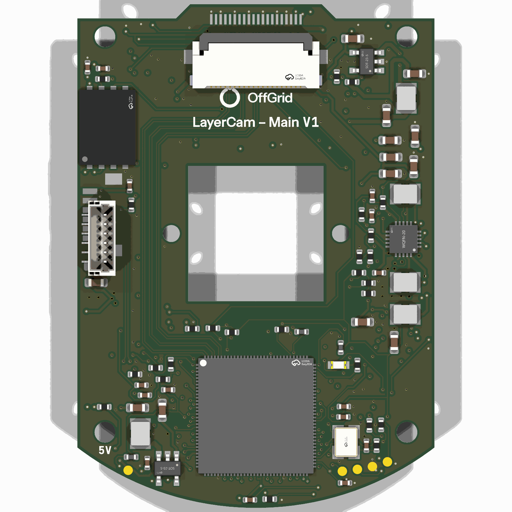
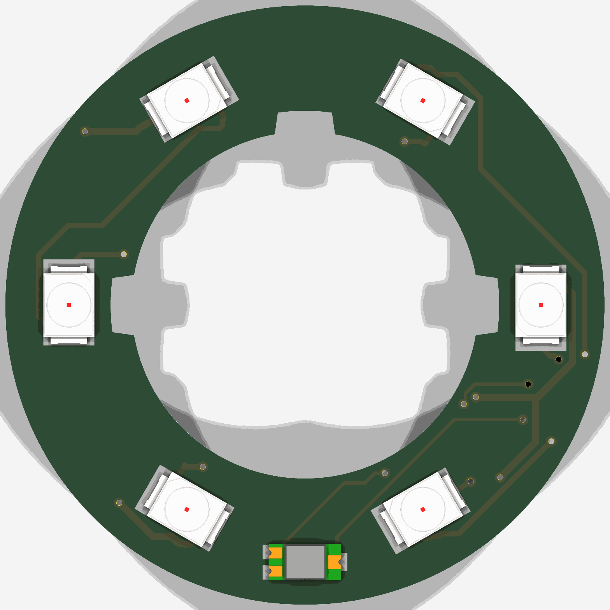
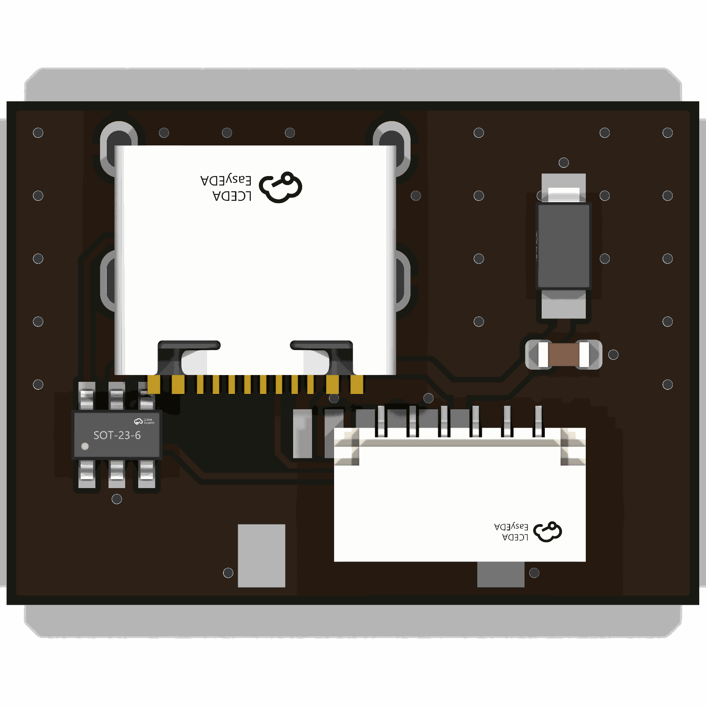

# LayerCam v1

A camera for the inside of a Prusa CORE One. It sits in Prusa's own printed
Buddy3D camera case, sees the whole bed in daylight and in infrared, and
feeds Prusa Connect. It takes one picture per layer while the head is
parked, makes the timelapse into an MP4 on the camera, and uploads it to a
NAS or S3.

Three boards in the case (main, LED ring, USB-C), a camera module and lens
bought separately, and a stick-on heatsink. Fab and assembly: PCBWay.

**Status: designed, every check and simulation run; not yet built.**
Nothing here has been made or powered.

| | |
|---|---|
| Main board (6 layers) |  |
| LED ring |  |
| USB-C board |  |

## This revision

| | |
|---|---|
| Revision | **v1** (product: [`../README.md`](../README.md)), printed on every board |
| Status | designed, not yet built |
| Tests and simulations | [`TESTS.md`](TESTS.md): every one with its v1 result |
| Trade-offs | [`docs/decisions.md`](docs/decisions.md) |
| Parts and stock | [`docs/parts.md`](docs/parts.md) (check stock again before ordering) |
| Fit in the case | [`docs/housing.md`](docs/housing.md) |
| Toolchain | KiCad 10.0.7 (pinned image, `tools/Dockerfile`), Freerouting 1.9.0 |
| Brand | OffGrid v3.2.2 ([`docs/brand.md`](../../docs/brand.md)): the lockup, each board's name and revision, the US flag on the USB-C board |

## What it had to do, and whether it does

| Requirement | Met? | How it is checked |
|---|---|---|
| Fit Prusa's Buddy3D case for the CORE One, case unchanged | **Yes, on paper.** The outlines come from Prusa's files, 0.5 mm clear | `src/verify.py` checks the main board is inside the measured pocket; `docs/housing.md`. Not yet tried in a printed case |
| Survive a 65 °C chamber | **No: rated for 63 °C.** With the stock heatsink, snapshot mode keeps every part in rating up to a 63 °C chamber; the optional CNC block (`mechanical/heat-plate/`) reaches 65.7 °C. The model is good to about ±10 K | `sim/thermal.md`. An oven test of the first board decides. Live video is limited to cooler chambers (see Limits) |
| 1080p, wide angle | **Yes.** 3 MP sensor (2304 x 1296); timelapse at 1920 x 1080 by default; 2.8 mm lens, about 137° diagonal | the lens's fit and focus are untested |
| Night vision like the Buddy3D: IR LEDs, light sensor, day/night filter | **Yes.** Six 850 nm LEDs, a light sensor, an IR-cut filter | `sim/power.md` (LED currents) |
| USB-C for power only; Wi-Fi | **Yes.** USB-C also flashes the firmware; Wi-Fi 5 (2.4 / 5 GHz) | |
| Feed the Prusa app (Prusa Connect) | **Yes, in software.** Snapshots to Connect's camera API | `firmware/` host tests; not tried against Connect yet |
| Per-layer timelapse: the slicer parks the head, the camera snaps | **Yes, in software.** PrusaSlicer G-code in `firmware/slicer/` makes the printer send the camera a UDP message at each layer | host tests emulate the printer; not tried on a printer |
| Know the print from the printer's local API | **Yes.** PrusaLink: the job's name, start and end | host tests from Prusa's own source formats |
| Make the video and upload it to SMB / NFS / S3 / NAS | **Yes, in software.** H.264 encoded frame by frame in hardware, wrapped as MP4 while uploading | SigV4 against AWS's test suite; MP4 against ffprobe |
| No SD card | **Yes.** Video and settings on the 256 MB on-board flash | |

## Next steps

1. **Order 5 of each board** from PCBWay and the parts in *How to order*.
   Check stock first (`docs/parts.md`): the SoC, the Wi-Fi module and
   the 32 kHz TCXO have no second source.
2. **Print one case** (Prusa's files, in the material Prusa recommends).
3. **Build one and bring it up** (*How to build one*, *How to bring it
   up*). Fill in the hardware rows of `TESTS.md`: each rail, the camera
   cable, MaskROM flashing, snapshot-mode currents, Wi-Fi range.
4. **Oven test** in the printed case at 63 °C for 4 hours, then re-run
   `sim/thermal.py` with the measured currents.
5. **Try it on a CORE One:** Prusa Connect snapshots and a per-layer
   timelapse uploaded to a NAS and S3.
6. Changes that need new copper go into `v2/`
   ([`docs/versioning.md`](../../docs/versioning.md)).

## Where things are

| | |
|---|---|
| `src/` | the boards as code: `circuit.py` (the schematic), `parts.py`, placement and routing, fab files, design checks |
| `main/`, `ring/`, `usb/` | each board: KiCad files, `production/` (what PCBWay needs: Gerber zip, BOM, placement file; plus the netlist and assembly PDF), `images/` |
| `mechanical/` | STEP models of the assembled boards; `heat-plate/` the heat block |
| `sim/` | impedance, power and thermal simulations |
| `firmware/` | the camera software, device tree, SDK config, slicer G-code ([`firmware/README.md`](firmware/README.md)) |
| `docs/` | [`decisions.md`](docs/decisions.md) (why), [`parts.md`](docs/parts.md), [`housing.md`](docs/housing.md) |
| `lc.pretty/`, `lc.3dshapes/` | the footprints and 3D models the boards use |
| `fonts/` | the brand's typefaces for the silkscreen (OFL) |
| `tools/` | the pinned toolchain (`Dockerfile`, `kd`), the fab-file check, the LCSC stock check |
| [`TESTS.md`](TESTS.md) | every test and simulation, and its result |

## How to order

Two orders: the three boards from **PCBWay**, and the parts that are not on
a board from the shops below. Everything below is per camera. The boards'
parts were checked on 26 Oct 2026, the rest on 31 Oct 2026
(`docs/parts.md`): check stock again before ordering.

### 1. PCBWay: the three boards, assembled

One "PCB + SMT assembly" (turnkey) order per board. For each, upload the
three files in its `production/` folder:

| Board | Gerbers | BOM | Placement |
|---|---|---|---|
| Main | `main/production/layercam-main-gerbers.zip` | `layercam-main-bom-pcbway.csv` | `layercam-main-cpl.csv` |
| LED ring | `ring/production/layercam-ring-gerbers.zip` | `layercam-ring-bom-pcbway.csv` | `layercam-ring-cpl.csv` |
| USB-C | `usb/production/layercam-usb-gerbers.zip` | `layercam-usb-bom-pcbway.csv` | `layercam-usb-cpl.csv` |

The placement file gives designator, X, Y, side and rotation in the
Gerbers' own coordinates. The BOM gives maker, maker's part number, LCSC
and (where chosen there) Digi-Key numbers; every part is SMD.

**Main board** (38.0 x 53.6 mm):
- 6 layers, 1.6 mm, PCBWay's standard 6-layer stackup (No. 1: 1 oz on every
  layer, 2116 prepreg next to the outer layers).
- **Impedance control, ±10 %:** 100 Ω differential (MIPI, 0.12 / 0.15 mm,
  on layer 1, F.Cu), 90 Ω differential (USB, 0.15 / 0.13 mm, on layers 1
  and 6), 50 Ω single (antenna, 0.18 mm, on layer 6, B.Cu), each referenced
  to the next layer in (`sim/impedance.md`).
- **Via in pad, resin filled and capped (POFV):** the SoC's exposed pad and
  fine-pitch pads have vias in them.
- Minimum track and gap 0.1 mm (only round the SoC's pins; 0.127 mm
  elsewhere), minimum drill 0.2 mm. Two via sizes: 0.45 / 0.2 mm, and
  0.35 / 0.2 mm round the SoC.
- ENIG, green mask, white silk.
- Parts on both sides.

**LED ring** (Ø33.0 mm ring): 2 layers, 1.6 mm, 1 oz, ENIG, green mask,
white silk, parts on both sides.

**USB-C board** (22.0 x 16.0 mm): 2 layers, **1.2 mm ±0.1 mm** (the case's
grooves take 1.2 mm), 1 oz, ENIG, green mask, white silk, parts on both
sides (the two CC resistors on the bottom).

**Optional, from PCBWay too:**
- the CNC heat block for a 65 °C chamber (`mechanical/heat-plate/`:
  black-anodised 6061, STL and drawing there);
- the two board-to-board cables made to length (tick "Cable wire harness
  assembly" on the SMT quote and send the cable spec in the table below:
  PCBWay quotes it by hand).

### 2. Everything else

| Qty | Part | Exact part | Where |
|---|---|---|---|
| 1 | Camera module | Luckfox **SC3336 3MP Camera (B)** (25 x 24 mm, 20-pin 0.5 mm FFC socket). Its own lens and holder are removed | [Luckfox](https://wiki.luckfox.com) / Waveshare |
| 1 | Lens | Towin **CCL127028MPR**: M12 x 0.5, 2.8 mm, F2.5, IR corrected, **no IR-cut filter of its own**, back focal length 3.0 mm at most (the CLA219's limit) | Towin, quote by email |
| 1 | IR-cut switcher | Commonlands **CLA219**: carries the lens (its own M12 thread), 9.5 mm tall, 60 mm 2-wire lead on a 1.25 mm plug for J3 | [commonlands.com](https://commonlands.com/products/ir-cut-off-filter-exchanger-cla219), $12 |
| 1 | Camera flat cable | Molex Premo-Flex **0151660205**: 20 way, 0.5 mm, 30 mm, contacts on the same side, -40 to +105 °C. If it is out of stock: Molex **0152660205**, also 20 way, 0.5 mm, 30 mm, same side (Digi-Key WM10518-ND; its temperature is not stated). The run is about 15 mm; the extra folds once behind the module | Digi-Key |
| 2 | Board-to-board cables (USB-C board to J1, LED ring to J4) | JST **A06SR06SR30K51A**: 6 way, 1.0 mm (SR/SH), 51 mm, **pin 1 to pin 1** (the "B" version is reversed: do not use it). If out of stock: build them from 12 x JST **ASSHSSH28K51** (51 mm wire with a contact crimped on each end) and 4 x JST **SHR-06V-S** housings, six wires per cable, pin 1 to pin 1. Spec for a made-to-length cable: 2 x SHR-06V-S, SSH-003T-P0.2-H contacts, 28-30 AWG, 6 wires straight through, 30 mm | Digi-Key 455-2999-ND, Mouser 306-A06SR06SR30K51A; 455-3075-ND and SHR-06V-S |
| 1 | Wi-Fi antenna | Molex **146153-0100**: 2.4 / 5 GHz flex dipole, 34.9 x 9 mm, U.FL on 100 mm cable, adhesive-backed, to 85 °C | Digi-Key WM12218-ND, $2.59 |
| 1 | SoC heatsink | **LCSC C286230** (XSD1690-058): 14 x 14 x 10 mm black aluminium, no tape | LCSC |
| 14 x 14 mm | Thermal tape for it | **3M 8810**, 0.25 mm (rated to 100 °C), cut from a roll: Digi-Key 3M10316-ND is 2 in x 15 ft, about $148, enough for hundreds | Digi-Key 3M10316-ND |
| 6 | Board-to-case and lid screws | **M2 x 6** thread-forming for plastic, stainless (McMaster **96817A844**): four hold the main board on the case's bosses (Ø1.7 pilot holes about 5.5 mm deep: longer screws bottom out), two hold the lid to the top shell | McMaster |
| 2 | Shell screws | **M2 x 8**, the same kind (McMaster **96817A846**): join the top shell to the bottom at the straight end (4.3 mm through the top, a 4.6 mm Ø1.7 pilot in the bottom) | McMaster |
| 2 | Lens-stack screws | **M1.6 x 6** thread-forming for plastic, stainless, Ø2.95 mm head (McMaster **99397A018**), from the module side into the CLA219: 3.8 mm of stack (module 1.2, washers 1.0, board 1.6) leaves 2.2 mm (6 turns) in the holder's 4.3 mm base. No 7 mm exists at McMaster; the 8 mm (99397A022) would reach 4.2 mm, nearly the base's full depth | McMaster |
| 6 | Spacer washers | **M1.6 stainless washers**, 1.7 ID / 3.5 OD, 0.3-0.4 mm (McMaster **98689A221**): three per screw make the 1.0 mm gap between board and sensor | McMaster |
| 1 | Magnet | **10 x 10 x 2 mm** NdFeB block, magnetised through the 2 mm (supermagnete **Q-10-10-02-N**, N45, 80 °C): the camera holds onto the printer's frame with it, as Prusa's does. It goes in the sloping 10.3 x 2.8 mm slot in the top shell's rounded end | supermagnete |
| 1 | USB-C to USB-C cable to the printer | the CORE One's own camera cable (fitted on printers built since June 2025), or any USB-C cable routed as Prusa's guide [g405529](https://help.prusa3d.com/g405529) shows, to the electronics box's **upper** USB-C port (the lower one gives no power). For flashing: a USB-C data cable to a computer | Prusa / any |
| 1 | Case | Prusa's Buddy3D case for the CORE One, unchanged ([Printables 1343977](https://www.printables.com/model/1343977-buddy3d-camera-for-core-one-printed-parts)): print in **PCCF** as Prusa does (hardened nozzle; 0.2 mm layers) | your printer |

For the 65 °C option, the heat block replaces the heatsink and tape, with
two TG-A6200 gap pads (`mechanical/heat-plate/README.md`).

## How to build one

1. **Print the case** (Printables 1343977) in PCCF. Press the magnet into
   the slot in the top shell's rounded end (a drop of glue).
2. **Heatsink, first:** clean the SoC's top (the large chip on the back
   face) with alcohol, put the 3M 8810 tape on the heatsink's base, and
   press it on for 10 s, centred at board (0, 15.9): 3.5 mm towards the
   cable socket J2 from the chip's middle
   (`mechanical/heat-plate/README.md`). Leave the tape 24 h to reach full
   bond.
3. **Lens stack:** remove the camera module's own lens holder. Screw the
   lens into the IR-cut holder (CLA219) and set the holder on the main
   board's front face over the window. Fit the module behind the board
   with three washers on each screw between board and module. Clamp all
   three with the two M1.6 screws, driven from the module's side into the
   IR-cut holder.
4. **Camera cable:** before fitting it, check it. With the cable in the
   module only, the two conductors at one edge of the free end beep to
   each other (the module's pins 19-20, its 3.3 V): that edge must go to
   J2's pins 19-20. A reversed cable puts 3.3 V on ground. Fit it into J2,
   the extra length folded flat behind the module.
5. **Front-face cables** (J3, J4 and J5 are on the front face, so they go
   in before the board goes down): the IR-cut holder's lead into J3, one
   JST cable into J4, the antenna into J5.
6. **LED ring:** plug the J4 cable's other end into the ring's socket and
   set the ring into its seat at the front of the case, on the two pins,
   its LEDs in the six holes.
7. **Main board:** lay it on the four bosses, front face down, and fix it
   with four M2 x 6 screws.
8. **USB-C board:** slide it into its grooves in the top shell, the
   socket's mouth in the opening, and plug the second JST cable between
   it and J1 on the main board's back face.
9. **Antenna:** leave it loose inside the case with its backing on, as
   Prusa does with its own camera (guide g405529), away from the board and
   the heatsink where it can be, its cable led away from it. Fold the
   cables' spare length flat where nothing presses on it.
10. **Close it:** the top shell onto the bottom with two M2 x 8 screws,
    the lid onto the top with two M2 x 6.
11. **Mount it** as Prusa's camera: the magnet onto the printer frame's
    left front corner, the USB-C cable towards the back of the printer,
    plugged into the printer's upper USB-C port.

## How to bring it up

Full steps in [`firmware/README.md`](firmware/README.md).
1. **Flash a new board.** The test pads are on the back face by the round
   edge: 5V on its own on the left (labelled), and a row of four on the
   right, unlabelled (too close together for printable text): `TX RX G BOOT`
   in that order from left to right, seen from the back face. Bridge BOOT
   and G with tweezers while
   plugging USB-C into a computer: the SoC waits in MaskROM. Then flash the
   image with Rockchip's tool.
2. **First power-up:** the camera opens its own setup Wi-Fi (its name and
   passphrase come from the chip's serial number: `firmware/tools/layercam-ap.py`
   reads them over USB). Join it, enter your Wi-Fi, the Prusa Connect
   token, PrusaLink and the upload target.
3. **Slicer:** paste `firmware/slicer/` into PrusaSlicer's printer
   profile (custom G-code). The first print asks on the printer's screen to
   allow the camera's metrics: allow it once.
4. **Console:** TX, RX and G test pads, 3.3 V, 115200 baud.

## Limits

- **Not built.** Every result below is a design check or a simulation.
- **Rated for a 63 °C chamber, not 65 °C.** The case is sealed plastic;
  with the stock heatsink, snapshot mode keeps every part in rating up to
  63 °C in the model, which is good to about ±10 K. For 65 °C, fit the
  optional CNC aluminium block instead (65.7 °C, `mechanical/heat-plate/`).
  The firmware's thermal governor slows the camera down and then stops it
  before anything overheats, and refuses live view when the board is hot
  (thresholds in `sim/thermal.md`).
- **The Wi-Fi module and the sensor run above 75 °C** in a 65 °C chamber,
  where the module's full radio performance and the sensor's best image
  quality end: expect some range and noise loss in a hot chamber.
- **Snapshot-mode currents are estimates** (no published idle figures for
  the RV1106): measure them on the first board, then re-run
  `sim/thermal.py`.
- **The lens and the IR-cut holder's fit**, the focus, the folded flat
  cable and JST cables, and the antenna's place in the case are untested.
  The lens is a quoted part from Towin. The IR-cut holder's plug is sold
  as "1.25 mm JST" and assumed to be a PicoBlade (J3): check it on the
  part in hand (`docs/parts.md`).
- **The 37.4 MHz Wi-Fi crystal's load** follows the reference designs: measure
  its frequency on the first boards.
- **USB IDs are a placeholder**, and the USB console needs a real
  vendor/product ID before the camera is sold.

## How to build the outputs

Everything is generated by `src/` in a pinned toolchain (KiCad 10.0.7,
Freerouting 1.9.0; `tools/Dockerfile`). The main board was routed with
`KD_IMAGE=ogkicad-layercam:1 FR_FANOUT=1 FR_EXTRA="-mt 0" FINISH_SEED=1`
(Freerouting's fan-out pass, no optimisation; `docs/decisions.md`,
*Routing the main board*):

```sh
cd layercam/v1
tools/kd python3 src/make.py                # every gate and output, all three boards
tools/kd python3 src/make.py --reroute main # place and route a board from scratch
tools/kd python3 src/verify.py              # design checks
tools/kd python3 sim/thermal.py             # and sim/impedance.py, sim/power_budget.py
cd firmware && python3 -m unittest          # camera software host tests
```

CI (`ci / layercam-v1`) rebuilds all three boards on every push and checks
the committed fab files are exactly what the scripts produce.

Licence: CERN-OHL-S-2.0 (hardware), as the rest of this repository.
