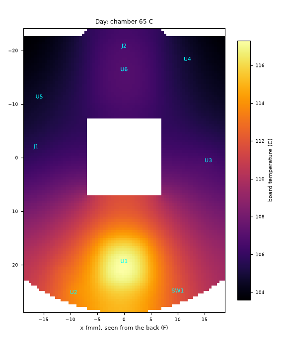
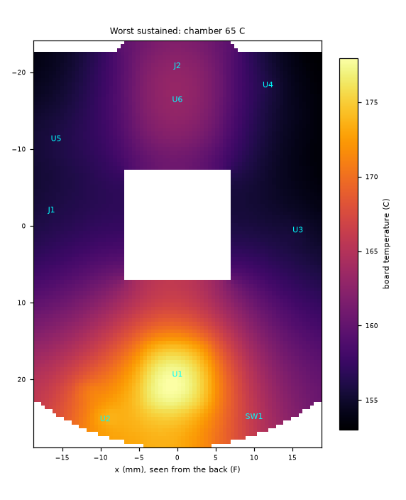

# LayerCam v1: temperatures at 65 C ambient

Computed by `sim/thermal.py`: the main board as a 2D plate on a 0.5 mm grid (outline from `src/geometry.py`, part places from `src/layout_main.py`, heat from `sim/power_budget.py`), inside Prusa's printed housing in a 65 C chamber with still air. The model and every assumed number are listed at the end; the board is the placed design (routing changes the copper coverage, see the sensitivity).

Board: 17.2 cm^2 a face; in-plane conductance 0.0344 W/K per square (copper coverage F 55 %, In1 90 %, In2 50 %, In3 85 %, In4 90 %, B 55 %). SoC exposed pad to the planes: 0.85 K/W through 25 filled vias.

## Day: streaming, Wi-Fi average, LEDs off

Heat in the housing: **1.72 W** (U1 0.96, U6 0.40, camera module 0.20, U2 0.06, L1 0.04, U3 0.03, U5 0.02, U4 0.01, cable, connectors 0.01).

| | value |
|---|---|
| housing wall | 77.0 C (12.0 K over the chamber; outside h 13.5 W/m^2K) |
| air inside (mean of board and wall) | 92.8 C |
| main board mean / max | 108.5 / 117.3 C |
| inside heat transfer, F / B face | 12.2 / 11.7 W/m^2K |
| lid-slot air exchange | 0.19 W |
| board heat out: faces to the wall / edge to the pocket / into the camera module | 1.15 / 0.35 / 0.02 W |
| LED ring | 68.9 C (0.00 W; 0.05 W out through the front wall) |
| RV1106 | 0.96 W; board under the pad 116.6 C, at the package edge 113.6 C; Tj 120.3 C (pad path) / 125.6 C (thetaJB 12.5 from the edge) |

| part | temperature (C) | limit (C) | margin (K) | limit from |
|---|---|---|---|---|
| side button SW1 (TS24CA) | 112.8 | 70 | -42.8 | -20..70 C (catalogue) |
| X5R capacitors under the SoC (B face) | 117.3 | 85 | -32.3 | X5R: -55..85 C (Samsung) |
| X5R capacitors at the bucks | 114.3 | 85 | -29.3 | X5R: -55..85 C (Samsung) |
| crystals Y2 / Y3, oscillator Y4 | 113.8 | 85 | -28.8 | -40..85 C |
| 24 MHz crystal Y1 | 112.8 | 85 | -27.8 | -40..85 C (YXC) |
| status LED LED1 | 111.5 | 85 | -26.5 | -40..85 C (KENTO) |
| AP6256 module (U6) | 110.1 | 85 | -25.1 | operating max; full RF only to 75 C |
| SC3336 sensor (camera module) | 109.9 | 85 | -24.9 | operating max; best image to 60 C (SmartSens) |
| DRV8837 (U7) | 108.8 | 85 | -23.8 | ambient -40..85 C (TI) |
| X5R capacitors elsewhere (board mean) | 108.5 | 85 | -23.5 | X5R: -55..85 C |
| SH connectors J1 / J4 (JST) | 107.8 | 85 | -22.8 | -25..85 C incl. rise (JST) |
| camera FFC connector J2 (XF2M) | 106.8 | 85 | -21.8 | -30..85 C incl. rise (Omron) |
| W25N02KV flash (U5) | 105.5 | 85 | -20.5 | -40..85 C (Winbond) |
| U.FL J5 | 105.2 | 90 | -15.2 | -40..90 C (Hirose) |
| USB-C receptacle (USB board) | 94.8 | 80 | -14.8 | -30..80 C (catalogue) |
| RV1106 surroundings (internal air) | 92.8 | 85 | -7.8 | ambient operating max (T3-2) |
| PicoBlade J3 | 107.4 | 105 | -2.4 | -40..105 C (Molex) |
| RV1106 junction (U1) | 125.6 | 125 | -0.6 | Tj max (datasheet 4.1) |
| housing wall (PETG/ASA print) | 77.0 | 80 | +3.0 | PETG softens ~ 80 C (Tg); ASA/PC higher |
| TLV62569 0.9 V (U2) junction | 116.4 | 125 | +8.6 | TJ max (SLVSDG1C 6.3) |
| inductor L1 (FPA252012D) | 115.1 | 125 | +9.9 | typical for molded 2520 power inductors (UNVERIFIED: no datasheet read) |
| inductor L4 (FPA252012D) | 108.4 | 125 | +16.6 | typical for molded 2520 power inductors (UNVERIFIED: no datasheet read) |
| inductor L3 (FPA252012D) | 107.7 | 125 | +17.3 | typical for molded 2520 power inductors (UNVERIFIED: no datasheet read) |
| EA3036C junction (U3) | 107.4 | 125 | +17.6 | TJ range (datasheet) |
| inductor L2 (FPA252012D) | 105.9 | 125 | +19.1 | typical for molded 2520 power inductors (UNVERIFIED: no datasheet read) |
| TLV62569 Wi-Fi (U4) junction | 105.5 | 125 | +19.5 | TJ max (SLVSDG1C 6.3) |
| inductor L5 (FPA252012D) | 104.8 | 125 | +20.2 | typical for molded 2520 power inductors (UNVERIFIED: no datasheet read) |
| IR LEDs (ring), case | 68.9 | 100 | +31.1 | operating -40..100 C (JNJ) |
| TEMT6000 light sensor (ring) | 68.9 | 100 | +31.1 | -40..100 C (Vishay) |
| IR LEDs (ring), junction | 68.9 | 115 | +46.1 | Tj max (JNJ) |

## Night: streaming with the IR LEDs on

Heat in the housing: **2.60 W** (U1 0.96, ring resistors 0.51, U6 0.40, ring LEDs 0.36, camera module 0.20, U2 0.06, L1 0.04, U3 0.03, cable, connectors 0.02, U5 0.02, U4 0.01).

| | value |
|---|---|
| housing wall | 78.8 C (13.8 K over the chamber; outside h 13.8 W/m^2K) |
| air inside (mean of board and wall) | 94.5 C |
| main board mean / max | 110.3 / 119.0 C |
| inside heat transfer, F / B face | 12.3 / 11.8 W/m^2K |
| lid-slot air exchange | 0.21 W |
| board heat out: faces to the wall / edge to the pocket / into the camera module | 1.16 / 0.35 / 0.02 W |
| LED ring | 118.4 C (0.87 W; 0.63 W out through the front wall) |
| RV1106 | 0.96 W; board under the pad 118.3 C, at the package edge 115.3 C; Tj 122.0 C (pad path) / 127.3 C (thetaJB 12.5 from the edge) |

| part | temperature (C) | limit (C) | margin (K) | limit from |
|---|---|---|---|---|
| side button SW1 (TS24CA) | 114.5 | 70 | -44.5 | -20..70 C (catalogue) |
| X5R capacitors under the SoC (B face) | 119.0 | 85 | -34.0 | X5R: -55..85 C (Samsung) |
| X5R capacitors at the bucks | 116.0 | 85 | -31.0 | X5R: -55..85 C (Samsung) |
| crystals Y2 / Y3, oscillator Y4 | 115.5 | 85 | -30.5 | -40..85 C |
| 24 MHz crystal Y1 | 114.5 | 85 | -29.5 | -40..85 C (YXC) |
| status LED LED1 | 113.2 | 85 | -28.2 | -40..85 C (KENTO) |
| AP6256 module (U6) | 111.8 | 85 | -26.8 | operating max; full RF only to 75 C |
| SC3336 sensor (camera module) | 111.6 | 85 | -26.6 | operating max; best image to 60 C (SmartSens) |
| DRV8837 (U7) | 110.5 | 85 | -25.5 | ambient -40..85 C (TI) |
| X5R capacitors elsewhere (board mean) | 110.3 | 85 | -25.3 | X5R: -55..85 C |
| SH connectors J1 / J4 (JST) | 109.6 | 85 | -24.6 | -25..85 C incl. rise (JST) |
| camera FFC connector J2 (XF2M) | 108.6 | 85 | -23.6 | -30..85 C incl. rise (Omron) |
| W25N02KV flash (U5) | 107.3 | 85 | -22.3 | -40..85 C (Winbond) |
| IR LEDs (ring), case | 120.7 | 100 | -20.7 | operating -40..100 C (JNJ) |
| TEMT6000 light sensor (ring) | 118.4 | 100 | -18.4 | -40..100 C (Vishay) |
| U.FL J5 | 107.0 | 90 | -17.0 | -40..90 C (Hirose) |
| USB-C receptacle (USB board) | 96.5 | 80 | -16.5 | -30..80 C (catalogue) |
| IR LEDs (ring), junction | 125.5 | 115 | -10.5 | Tj max (JNJ) |
| RV1106 surroundings (internal air) | 94.5 | 85 | -9.5 | ambient operating max (T3-2) |
| PicoBlade J3 | 109.1 | 105 | -4.1 | -40..105 C (Molex) |
| RV1106 junction (U1) | 127.3 | 125 | -2.3 | Tj max (datasheet 4.1) |
| housing wall (PETG/ASA print) | 78.8 | 80 | +1.2 | PETG softens ~ 80 C (Tg); ASA/PC higher |
| TLV62569 0.9 V (U2) junction | 118.1 | 125 | +6.9 | TJ max (SLVSDG1C 6.3) |
| inductor L1 (FPA252012D) | 116.8 | 125 | +8.2 | typical for molded 2520 power inductors (UNVERIFIED: no datasheet read) |
| inductor L4 (FPA252012D) | 110.1 | 125 | +14.9 | typical for molded 2520 power inductors (UNVERIFIED: no datasheet read) |
| inductor L3 (FPA252012D) | 109.3 | 125 | +15.7 | typical for molded 2520 power inductors (UNVERIFIED: no datasheet read) |
| EA3036C junction (U3) | 109.1 | 125 | +15.9 | TJ range (datasheet) |
| inductor L2 (FPA252012D) | 107.6 | 125 | +17.4 | typical for molded 2520 power inductors (UNVERIFIED: no datasheet read) |
| TLV62569 Wi-Fi (U4) junction | 107.2 | 125 | +17.8 | TJ max (SLVSDG1C 6.3) |
| inductor L5 (FPA252012D) | 106.5 | 125 | +18.5 | typical for molded 2520 power inductors (UNVERIFIED: no datasheet read) |
| 39 R string resistor (ring), power | 0.169 W | 0.108 W at 118 C | | 0.25 W to 70 C, 0 at 155 C |

## Worst sustained: SoC at its measured maximum, Wi-Fi transmitting, LEDs at the high corner

Heat in the housing: **5.39 W** (U1 2.03, U6 1.33, ring resistors 0.63, ring LEDs 0.40, camera module 0.27, U2 0.23, L1 0.19, U5 0.12, cable, connectors 0.07, U3 0.06, U4 0.04, L5 0.02, L3 0.01).

| | value |
|---|---|
| housing wall | 92.7 C (27.7 K over the chamber; outside h 15.3 W/m^2K) |
| air inside (mean of board and wall) | 127.1 C |
| main board mean / max | 161.6 / 178.0 C |
| inside heat transfer, F / B face | 14.8 / 14.3 W/m^2K |
| lid-slot air exchange | 0.63 W |
| board heat out: faces to the wall / edge to the pocket / into the camera module | 3.05 / 0.77 / 0.24 W |
| LED ring | 129.6 C (1.03 W; 0.77 W out through the front wall) |
| RV1106 | 2.03 W; board under the pad 176.3 C, at the package edge 170.2 C; Tj 184.1 C (pad path) / 195.6 C (thetaJB 12.5 from the edge) |

| part | temperature (C) | limit (C) | margin (K) | limit from |
|---|---|---|---|---|
| side button SW1 (TS24CA) | 167.5 | 70 | -97.5 | -20..70 C (catalogue) |
| X5R capacitors under the SoC (B face) | 178.0 | 85 | -93.0 | X5R: -55..85 C (Samsung) |
| AP6256 module (U6) | 173.8 | 85 | -88.8 | operating max; full RF only to 75 C |
| X5R capacitors at the bucks | 173.7 | 85 | -88.7 | X5R: -55..85 C (Samsung) |
| crystals Y2 / Y3, oscillator Y4 | 172.4 | 85 | -87.4 | -40..85 C |
| 24 MHz crystal Y1 | 167.5 | 85 | -82.5 | -40..85 C (YXC) |
| status LED LED1 | 164.7 | 85 | -79.7 | -40..85 C (KENTO) |
| camera FFC connector J2 (XF2M) | 163.0 | 85 | -78.0 | -30..85 C incl. rise (Omron) |
| X5R capacitors elsewhere (board mean) | 161.6 | 85 | -76.6 | X5R: -55..85 C |
| W25N02KV flash (U5) | 159.2 | 85 | -74.2 | -40..85 C (Winbond) |
| SH connectors J1 / J4 (JST) | 159.1 | 85 | -74.1 | -25..85 C incl. rise (JST) |
| DRV8837 (U7) | 159.0 | 85 | -74.0 | ambient -40..85 C (TI) |
| RV1106 junction (U1) | 195.6 | 125 | -70.6 | Tj max (datasheet 4.1) |
| U.FL J5 | 157.8 | 90 | -67.8 | -40..90 C (Hirose) |
| SC3336 sensor (camera module) | 152.3 | 85 | -67.3 | operating max; best image to 60 C (SmartSens) |
| TLV62569 0.9 V (U2) junction | 182.8 | 125 | -57.8 | TJ max (SLVSDG1C 6.3) |
| inductor L1 (FPA252012D) | 182.8 | 125 | -57.8 | typical for molded 2520 power inductors (UNVERIFIED: no datasheet read) |
| PicoBlade J3 | 156.5 | 105 | -51.5 | -40..105 C (Molex) |
| USB-C receptacle (USB board) | 129.1 | 80 | -49.1 | -30..80 C (catalogue) |
| RV1106 surroundings (internal air) | 127.1 | 85 | -42.1 | ambient operating max (T3-2) |
| inductor L4 (FPA252012D) | 158.1 | 125 | -33.1 | typical for molded 2520 power inductors (UNVERIFIED: no datasheet read) |
| TLV62569 Wi-Fi (U4) junction | 158.1 | 125 | -33.1 | TJ max (SLVSDG1C 6.3) |
| IR LEDs (ring), case | 132.3 | 100 | -32.3 | operating -40..100 C (JNJ) |
| inductor L3 (FPA252012D) | 157.2 | 125 | -32.2 | typical for molded 2520 power inductors (UNVERIFIED: no datasheet read) |
| EA3036C junction (U3) | 156.7 | 125 | -31.7 | TJ range (datasheet) |
| inductor L5 (FPA252012D) | 155.6 | 125 | -30.6 | typical for molded 2520 power inductors (UNVERIFIED: no datasheet read) |
| inductor L2 (FPA252012D) | 154.8 | 125 | -29.8 | typical for molded 2520 power inductors (UNVERIFIED: no datasheet read) |
| TEMT6000 light sensor (ring) | 129.6 | 100 | -29.6 | -40..100 C (Vishay) |
| IR LEDs (ring), junction | 137.6 | 115 | -22.6 | Tj max (JNJ) |
| housing wall (PETG/ASA print) | 92.7 | 80 | -12.7 | PETG softens ~ 80 C (Tg); ASA/PC higher |
| 39 R string resistor (ring), power | 0.210 W | 0.075 W at 130 C | | 0.25 W to 70 C, 0 at 155 C |

## Sensitivity (night case, RV1106 Tj / board max / ring)

| change | RV1106 Tj (C) | board max (C) | ring (C) |
|---|---|---|---|
| as above | 127.3 | 119.0 | 118.4 |
| no lid slots (vents taped or facing down) | 128.4 | 120.2 | 118.7 |
| ring not touching the front wall | 129.4 | 121.1 | 227.5 |
| copper coverage x0.7 (a more perforated routed board) | 128.9 | 122.1 | 118.4 |
| inside emissivity 0.6 (bare metal shields, lens holder) | 130.8 | 122.5 | 120.1 |
| air gaps convecting (Nu 1.5) | 125.0 | 116.7 | 117.1 |
| chamber air moving at 0.5 m/s past the housing (forced h 12 W/m^2K) | 124.0 | 115.7 | 110.2 |
| optimistic bracket: emissivity 0.85, Nu 1.5, copper x1.2 | 122.7 | 113.8 | 116.1 |
| aluminium lid with a gap pad on the SoC (26 K/W SoC to chamber) | 99.7 | 93.3 | 117.7 |
| SoC heat -25 % (lower clocks, NPU off, lower bitrate) | 117.1 | 110.8 | 118.2 |
| IR LEDs at 50 % PWM | 126.5 | 118.2 | 93.7 |

## Highest chamber temperature per case

The chamber temperature at which the first part reaches its limit (bisection on the same model):

| case | every part inside its limit up to | RV1106 Tj 125 C reached at | SoC 105 C (a 20 K margin) at |
|---|---|---|---|
| day | 13 C | 64 C | 40 C |
| night | 11 C | 62 C | 38 C |
| worst | -20 C | -20 C | -20 C |

## Every part's rating against the chamber

From `src/parts.py` (descriptions, the JLCPCB catalogue's temperature field read 26 Oct 2026, the datasheets). A part rated below 85 C, or whose estimate above leaves under 10 K, is flagged.

| part | rated | worst estimate (C) | flag |
|---|---|---|---|
| RV1106G3 | Tj 125, ambient -20..85 | 196 | OVER its rating |
| W25N02KVZEIR | -40..85 | 159 | OVER its rating |
| AP6256 | -30..85 (full RF -20..75) | 174 | OVER its rating |
| EA3036C | TA -40..85, TJ to 125 | 157 | OVER its rating |
| TLV62569 | TJ -40..125 | 183 | OVER its rating |
| DRV8837 | TA -40..85 | 159 | OVER its rating |
| AO3400A | TJ -55..150 | 162 | OVER its rating |
| ASH7KW 32.768 kHz osc. | -40..85 | 172 | OVER its rating |
| X322524MOB4SI 24 MHz | -40..85 | 168 | OVER its rating |
| 3225 37.4 MHz | -40..85 | 172 | OVER its rating |
| Q13FC1350 32.768 kHz | -40..85 | 172 | OVER its rating |
| KT-0603G LED | -40..85 | 165 | OVER its rating |
| XF2M-2015-1A FFC | -30..85 | 163 | OVER its rating |
| JST SH BM06B / SM06B | -25..85 | 159 | OVER its rating |
| Molex 53261 PicoBlade | -40..105 | 157 | OVER its rating |
| Hirose U.FL | -40..90 | 158 | OVER its rating |
| TS24CA side button | -20..70 | 168 | RATED BELOW 85 C; OVER its rating |
| TYPE-C-31-M-12 USB-C | -30..80 | 129 | RATED BELOW 85 C; OVER its rating |
| USBLC6-2SC6 | TJ -40..125 | 129 | OVER its rating |
| SMF5.0CA TVS | -55..150 | 129 |  |
| JNJ 850 nm IR LED | -40..100, Tj 115 | 138 | OVER its rating |
| TEMT6000 | -40..100 | 130 | OVER its rating |
| FPA252012D inductors | not in the catalogue (typ. -40..125) | 183 | UNKNOWN rating: ask the maker |
| BLM15PD121 bead | -55..125 | 162 | OVER its rating |
| 0402 / 1206 thick-film resistors | -55..155 (power derates above 70) | 178 | OVER its rating |
| C0G / X7R capacitors (12p, 18p, 1n, 10n, 100n) | -55..125 | 178 | OVER its rating |
| X5R capacitors (1u, 4.7u, 10u, 22u) | -55..85 | 178 | OVER its rating |
| SC3336 module (bought) | -30..85, best image to 60 | 152 | OVER its rating |
| CLA219 IR-cut holder (bought) | not published (plastic, NdFeB magnet) | 162 | UNKNOWN rating: ask the maker |
| Towin CCL127028MPR lens (bought) | not published | 93 | UNKNOWN rating: ask the maker |

## Model and assumptions

- Chamber 65 C, still air (no credit for the chamber fan); bed radiation 0.10 W on the front.
- Housing: outer hull 125.6 cm^2, 2 mm walls at 0.20 W/mK, emissivity 0.90; natural convection 1.32 (dT/0.05 m)^0.25 plus linearised radiation outside. Lid slots: 240 mm^2 split in two halves 11 mm apart, Cd 0.6.
- Inside: radiation board to wall with effective emissivity 0.75; still-air conduction across 8.5 / 9.8 mm gaps (F / B) with Nu 1.1.
- Copper coverage per layer as listed above (ASSUMED until the board is routed; rerun on the routed board, docs/lessons.md: routing raised temperatures 15 K on Ridge 3).
- RV1106: die to exposed pad 3 K/W (ASSUMED) plus the computed via array; the datasheet thetaJB (12.5 K/W, JEDEC 2s2p) from the board temperature at the package edge as the pessimistic reading; the higher is used.
- TLV62569 psiJB 40.6 K/W (TI). EA3036C 15 K/W, inductors 60 K/W, AP6256 8 K/W above the board, LED junction 120 K/W above the ring: ASSUMED.
- Camera module: one node coupled to the board across its 1 mm shim gap (air conduction + radiation) and to the lid from its back face; the sensor die 3 K above it. Board edge to the housing pocket across 0.6 mm of air.
- LED ring: front face pressed on the printed wall (contact 150 W/m^2K), heat through 2 mm of plastic to the outside over the ring's area plus 5 mm all round; back face to the inside. The ring has no copper pours, so the LEDs sit on thin tracks.

## Checks

- FAIL day: RV1106 junction (U1) 125.6 C against 125 C (Tj max (datasheet 4.1))
- FAIL day: RV1106 surroundings (internal air) 92.8 C against 85 C (ambient operating max (T3-2))
- PASS day: TLV62569 0.9 V (U2) junction 116.4 C against 125 C (TJ max (SLVSDG1C 6.3))
- PASS day: TLV62569 Wi-Fi (U4) junction 105.5 C against 125 C (TJ max (SLVSDG1C 6.3))
- PASS day: EA3036C junction (U3) 107.4 C against 125 C (TJ range (datasheet))
- PASS day: inductor L1 (FPA252012D) 115.1 C against 125 C (typical for molded 2520 power inductors (UNVERIFIED: no datasheet read))
- PASS day: inductor L2 (FPA252012D) 105.9 C against 125 C (typical for molded 2520 power inductors (UNVERIFIED: no datasheet read))
- PASS day: inductor L3 (FPA252012D) 107.7 C against 125 C (typical for molded 2520 power inductors (UNVERIFIED: no datasheet read))
- PASS day: inductor L4 (FPA252012D) 108.4 C against 125 C (typical for molded 2520 power inductors (UNVERIFIED: no datasheet read))
- PASS day: inductor L5 (FPA252012D) 104.8 C against 125 C (typical for molded 2520 power inductors (UNVERIFIED: no datasheet read))
- FAIL day: AP6256 module (U6) 110.1 C against 85 C (operating max; full RF only to 75 C)
- FAIL day: SC3336 sensor (camera module) 109.9 C against 85 C (operating max; best image to 60 C (SmartSens))
- FAIL day: W25N02KV flash (U5) 105.5 C against 85 C (-40..85 C (Winbond))
- FAIL day: DRV8837 (U7) 108.8 C against 85 C (ambient -40..85 C (TI))
- FAIL day: X5R capacitors under the SoC (B face) 117.3 C against 85 C (X5R: -55..85 C (Samsung))
- FAIL day: X5R capacitors at the bucks 114.3 C against 85 C (X5R: -55..85 C (Samsung))
- FAIL day: X5R capacitors elsewhere (board mean) 108.5 C against 85 C (X5R: -55..85 C)
- FAIL day: 24 MHz crystal Y1 112.8 C against 85 C (-40..85 C (YXC))
- FAIL day: crystals Y2 / Y3, oscillator Y4 113.8 C against 85 C (-40..85 C)
- FAIL day: status LED LED1 111.5 C against 85 C (-40..85 C (KENTO))
- FAIL day: side button SW1 (TS24CA) 112.8 C against 70 C (-20..70 C (catalogue))
- FAIL day: camera FFC connector J2 (XF2M) 106.8 C against 85 C (-30..85 C incl. rise (Omron))
- FAIL day: SH connectors J1 / J4 (JST) 107.8 C against 85 C (-25..85 C incl. rise (JST))
- FAIL day: U.FL J5 105.2 C against 90 C (-40..90 C (Hirose))
- FAIL day: PicoBlade J3 107.4 C against 105 C (-40..105 C (Molex))
- FAIL day: USB-C receptacle (USB board) 94.8 C against 80 C (-30..80 C (catalogue))
- PASS day: IR LEDs (ring), junction 68.9 C against 115 C (Tj max (JNJ))
- PASS day: IR LEDs (ring), case 68.9 C against 100 C (operating -40..100 C (JNJ))
- PASS day: TEMT6000 light sensor (ring) 68.9 C against 100 C (-40..100 C (Vishay))
- PASS day: housing wall (PETG/ASA print) 77.0 C against 80 C (PETG softens ~ 80 C (Tg); ASA/PC higher)
- FAIL night: RV1106 junction (U1) 127.3 C against 125 C (Tj max (datasheet 4.1))
- FAIL night: RV1106 surroundings (internal air) 94.5 C against 85 C (ambient operating max (T3-2))
- PASS night: TLV62569 0.9 V (U2) junction 118.1 C against 125 C (TJ max (SLVSDG1C 6.3))
- PASS night: TLV62569 Wi-Fi (U4) junction 107.2 C against 125 C (TJ max (SLVSDG1C 6.3))
- PASS night: EA3036C junction (U3) 109.1 C against 125 C (TJ range (datasheet))
- PASS night: inductor L1 (FPA252012D) 116.8 C against 125 C (typical for molded 2520 power inductors (UNVERIFIED: no datasheet read))
- PASS night: inductor L2 (FPA252012D) 107.6 C against 125 C (typical for molded 2520 power inductors (UNVERIFIED: no datasheet read))
- PASS night: inductor L3 (FPA252012D) 109.3 C against 125 C (typical for molded 2520 power inductors (UNVERIFIED: no datasheet read))
- PASS night: inductor L4 (FPA252012D) 110.1 C against 125 C (typical for molded 2520 power inductors (UNVERIFIED: no datasheet read))
- PASS night: inductor L5 (FPA252012D) 106.5 C against 125 C (typical for molded 2520 power inductors (UNVERIFIED: no datasheet read))
- FAIL night: AP6256 module (U6) 111.8 C against 85 C (operating max; full RF only to 75 C)
- FAIL night: SC3336 sensor (camera module) 111.6 C against 85 C (operating max; best image to 60 C (SmartSens))
- FAIL night: W25N02KV flash (U5) 107.3 C against 85 C (-40..85 C (Winbond))
- FAIL night: DRV8837 (U7) 110.5 C against 85 C (ambient -40..85 C (TI))
- FAIL night: X5R capacitors under the SoC (B face) 119.0 C against 85 C (X5R: -55..85 C (Samsung))
- FAIL night: X5R capacitors at the bucks 116.0 C against 85 C (X5R: -55..85 C (Samsung))
- FAIL night: X5R capacitors elsewhere (board mean) 110.3 C against 85 C (X5R: -55..85 C)
- FAIL night: 24 MHz crystal Y1 114.5 C against 85 C (-40..85 C (YXC))
- FAIL night: crystals Y2 / Y3, oscillator Y4 115.5 C against 85 C (-40..85 C)
- FAIL night: status LED LED1 113.2 C against 85 C (-40..85 C (KENTO))
- FAIL night: side button SW1 (TS24CA) 114.5 C against 70 C (-20..70 C (catalogue))
- FAIL night: camera FFC connector J2 (XF2M) 108.6 C against 85 C (-30..85 C incl. rise (Omron))
- FAIL night: SH connectors J1 / J4 (JST) 109.6 C against 85 C (-25..85 C incl. rise (JST))
- FAIL night: U.FL J5 107.0 C against 90 C (-40..90 C (Hirose))
- FAIL night: PicoBlade J3 109.1 C against 105 C (-40..105 C (Molex))
- FAIL night: USB-C receptacle (USB board) 96.5 C against 80 C (-30..80 C (catalogue))
- FAIL night: IR LEDs (ring), junction 125.5 C against 115 C (Tj max (JNJ))
- FAIL night: IR LEDs (ring), case 120.7 C against 100 C (operating -40..100 C (JNJ))
- FAIL night: TEMT6000 light sensor (ring) 118.4 C against 100 C (-40..100 C (Vishay))
- PASS night: housing wall (PETG/ASA print) 78.8 C against 80 C (PETG softens ~ 80 C (Tg); ASA/PC higher)
- FAIL night: 39 R dissipates 0.169 W against 0.108 W derated at 118 C
- FAIL worst: RV1106 junction (U1) 195.6 C against 125 C (Tj max (datasheet 4.1))
- FAIL worst: RV1106 surroundings (internal air) 127.1 C against 85 C (ambient operating max (T3-2))
- FAIL worst: TLV62569 0.9 V (U2) junction 182.8 C against 125 C (TJ max (SLVSDG1C 6.3))
- FAIL worst: TLV62569 Wi-Fi (U4) junction 158.1 C against 125 C (TJ max (SLVSDG1C 6.3))
- FAIL worst: EA3036C junction (U3) 156.7 C against 125 C (TJ range (datasheet))
- FAIL worst: inductor L1 (FPA252012D) 182.8 C against 125 C (typical for molded 2520 power inductors (UNVERIFIED: no datasheet read))
- FAIL worst: inductor L2 (FPA252012D) 154.8 C against 125 C (typical for molded 2520 power inductors (UNVERIFIED: no datasheet read))
- FAIL worst: inductor L3 (FPA252012D) 157.2 C against 125 C (typical for molded 2520 power inductors (UNVERIFIED: no datasheet read))
- FAIL worst: inductor L4 (FPA252012D) 158.1 C against 125 C (typical for molded 2520 power inductors (UNVERIFIED: no datasheet read))
- FAIL worst: inductor L5 (FPA252012D) 155.6 C against 125 C (typical for molded 2520 power inductors (UNVERIFIED: no datasheet read))
- FAIL worst: AP6256 module (U6) 173.8 C against 85 C (operating max; full RF only to 75 C)
- FAIL worst: SC3336 sensor (camera module) 152.3 C against 85 C (operating max; best image to 60 C (SmartSens))
- FAIL worst: W25N02KV flash (U5) 159.2 C against 85 C (-40..85 C (Winbond))
- FAIL worst: DRV8837 (U7) 159.0 C against 85 C (ambient -40..85 C (TI))
- FAIL worst: X5R capacitors under the SoC (B face) 178.0 C against 85 C (X5R: -55..85 C (Samsung))
- FAIL worst: X5R capacitors at the bucks 173.7 C against 85 C (X5R: -55..85 C (Samsung))
- FAIL worst: X5R capacitors elsewhere (board mean) 161.6 C against 85 C (X5R: -55..85 C)
- FAIL worst: 24 MHz crystal Y1 167.5 C against 85 C (-40..85 C (YXC))
- FAIL worst: crystals Y2 / Y3, oscillator Y4 172.4 C against 85 C (-40..85 C)
- FAIL worst: status LED LED1 164.7 C against 85 C (-40..85 C (KENTO))
- FAIL worst: side button SW1 (TS24CA) 167.5 C against 70 C (-20..70 C (catalogue))
- FAIL worst: camera FFC connector J2 (XF2M) 163.0 C against 85 C (-30..85 C incl. rise (Omron))
- FAIL worst: SH connectors J1 / J4 (JST) 159.1 C against 85 C (-25..85 C incl. rise (JST))
- FAIL worst: U.FL J5 157.8 C against 90 C (-40..90 C (Hirose))
- FAIL worst: PicoBlade J3 156.5 C against 105 C (-40..105 C (Molex))
- FAIL worst: USB-C receptacle (USB board) 129.1 C against 80 C (-30..80 C (catalogue))
- FAIL worst: IR LEDs (ring), junction 137.6 C against 115 C (Tj max (JNJ))
- FAIL worst: IR LEDs (ring), case 132.3 C against 100 C (operating -40..100 C (JNJ))
- FAIL worst: TEMT6000 light sensor (ring) 129.6 C against 100 C (-40..100 C (Vishay))
- FAIL worst: housing wall (PETG/ASA print) 92.7 C against 80 C (PETG softens ~ 80 C (Tg); ASA/PC higher)
- FAIL worst: 39 R dissipates 0.210 W against 0.075 W derated at 130 C

**71 FAIL, 0 WARN**
