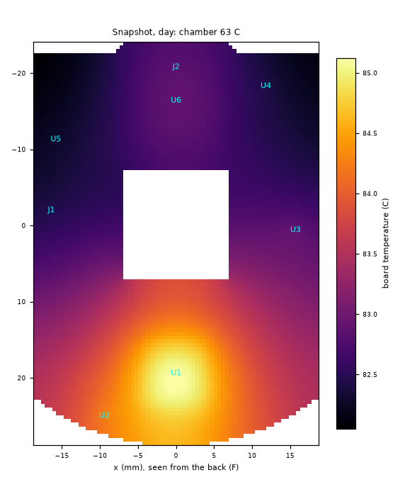
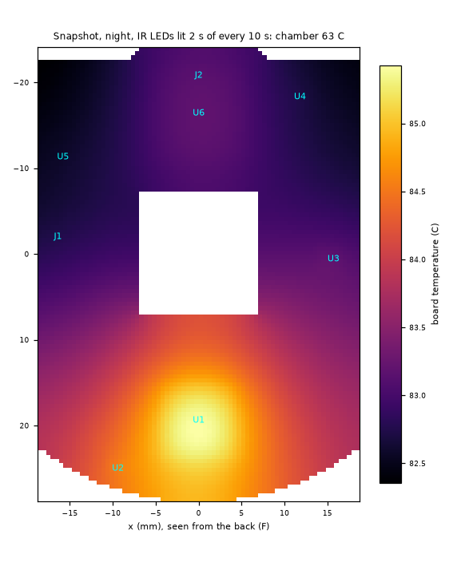

# LayerCam v1: temperatures in a 63 C chamber

Computed by `sim/thermal.py`: the main board as a 2D plate on a 0.5 mm grid (outline from `src/geometry.py`, part places from `src/layout_main.py`, heat from `sim/power_budget.py`), inside Prusa's printed housing in a 63 C chamber with still air. The model and every assumed number are listed at the end; each layer's copper coverage is measured on the routed board (main/layercam-main.kicad_pcb).

The requirement cases are **snapshot mode** (`snap_day`, `snap_night`): a still at most every 10 s, the sensor in standby, the CPU at its lowest DVFS point and Wi-Fi in power-save between shots (power_budget.py has the loads). The housing's time constant is many minutes, so a 10 s cycle is modelled by its average heat; the LED junctions and the string resistors are checked at their power while lit. Live view (`day`, `night`) and the stress bound are reported, not checked; live view gets a chamber limit and a firmware rule instead.

Every case below includes the **hs14x10 heat path** from the RV1106's top (`mechanical/heat-plate/`, chosen in *Heat paths compared*). The side button has been removed from the design (test pads instead).

Board: 17.2 cm^2 a face; in-plane conductance 0.0640 W/K per square (copper coverage F 67 %, In1 89 %, In2 66 %, In3 84 %, In4 89 %, B 73 %). SoC exposed pad to the planes: 1.13 K/W through 25 filled vias.

## Firmware thermal governor (TSADC = the RV1106's own junction sensor, +-3 C)

With the hs14x10 heat path, at the design limits below:

| rule | TSADC threshold |
|---|---|
| live view (streaming) allowed only while the reading is below | **90 C** |
| snapshot mode: stretch the interval to 30 s, cap Wi-Fi TX power, IR flash 1 s, above | **87 C** |
| stop capturing (Wi-Fi stays associated, fault reported) above | **110 C** |
| power the sensor and Wi-Fi down above | **120 C** |
| Linux critical trip (shutdown) at | **125 C** |

Each threshold is the steady-state junction temperature at which the first part reaches its rating in that mode, less the TSADC's 3 C error. In snapshot mode at a 63 C chamber the TSADC reads about 89 C, so near the rated maximum the firmware will stretch the interval to 30 s, and a live view started there ends within minutes.

Rating: snapshot mode keeps every part inside its rating up to a **63.3 C** chamber with the hs14x10 heat path (requirement 63 C). The original 65 C requirement is **not met** with the stock heatsink; the optional CNC block meets it by 0.7 K (snapshot to 65.7 C), the bent sheet by 0.1 K.

## Verdict

**Snapshot mode at 63 C, with the hs14x10 heat path: PASS (marginal)** (0 FAIL, 5 WARN). Every part stays inside its rating up to a **63.3 C** chamber: a margin of 0.3 K, inside the model's +-10 K uncertainty, so the first board must be measured in a 63 C oven before this is called a pass.

| at 63 C, hs14x10 heat path | snap_day | snap_night | live day | live night |
|---|---|---|---|---|
| RV1106 junction | 89.2 C | 89.5 C | 115.9 C | 117.4 C |
| AP6256 (85 C) | 84.3 C | 84.6 C | 107.6 C | 109.0 C |
| SC3336 sensor (85 C) | 84.4 C | 84.7 C | 106.8 C | 108.2 C |
| USB-C (80 C) | 78.4 C | 78.7 C | 91.9 C | 93.4 C |
| crystals (85 C) | 84.3 C | 84.6 C | 106.5 C | 107.9 C |
| board max | 85.1 C | 85.4 C | 107.9 C | 109.4 C |
| LED ring (average) | 65.0 C | 73.5 C | 67.1 C | 108.5 C |
| IR LED junction while lit | 65.0 C | 79.4 C | 67.1 C | 114.4 C |
| heat in the housing | 0.79 W | 0.93 W | 1.77 W | 2.50 W |

Heat paths (snap_night at 63 C; chamber limit for snapshot mode):

- bare board: RV1106 93.1, AP6256 86.2, SC3336 86.1 C; snapshot in rating to **60.8 C** (first: crystals Y2 / Y3, oscillator Y4); live view to 31.4 C / 29.5 C.
- 1 heatsink 14x14x6: RV1106 90.6, AP6256 85.1, SC3336 85.2 C; snapshot in rating to **62.5 C** (first: crystals Y2 / Y3, oscillator Y4); live view to 35.0 C / 33.1 C.
- 1b heatsink 14x14x10: RV1106 89.5, AP6256 84.6, SC3336 84.7 C; snapshot in rating to **63.3 C** (first: SC3336 sensor (camera module)); live view to 36.2 C / 34.4 C.
- 1c heatsink + pad into the shell: RV1106 90.6, AP6256 85.1, SC3336 85.2 C; snapshot in rating to **62.6 C** (first: crystals Y2 / Y3, oscillator Y4); live view to 35.0 C / 33.1 C.
- 1d 20x20x6 copper (does not fit): RV1106 89.0, AP6256 84.5, SC3336 84.6 C; snapshot in rating to **63.4 C** (first: SC3336 sensor (camera module)); live view to 36.7 C / 34.9 C.
- 2 CNC block: RV1106 84.7, AP6256 82.1, SC3336 82.4 C; snapshot in rating to **65.7 C** (first: SC3336 sensor (camera module)); live view to 42.3 C / 40.7 C.
- 3 bent sheet: RV1106 86.0, AP6256 82.8, SC3336 83.0 C; snapshot in rating to **65.1 C** (first: SC3336 sensor (camera module)); live view to 40.8 C / 39.2 C.

- Within 3 K of their rating in snapshot mode at 63 C: SC3336 sensor (camera module) 84.7 / 85 C; AP6256 module (U6) 84.6 / 85 C; crystals Y2 / Y3, oscillator Y4 84.6 / 85 C; 24 MHz crystal Y1 84.5 / 85 C; status LED LED1 84.2 / 85 C; USB-C receptacle (USB board) 78.7 / 80 C; DRV8837 (U7) 83.6 / 85 C; SH connectors J1 / J4 (JST) 83.2 / 85 C; camera FFC connector J2 (XF2M) 83.2 / 85 C; W25N02KV flash (U5) 82.9 / 85 C
- String resistor (47R) while lit at night: 0.141 W against 0.240 W derated at 74 C.
- Live view stays a firmware-gated mode: every part in rating to 36.2 C by day and 34.4 C by night with the hs14x10 path. Governor: live view only while TSADC < 90 C; snapshot mode stretches to 30 s above 87 C; stop at 110 C; shutdown 125 C.
- AP6256 and SC3336 run above 75 C in snapshot mode (full RF and best image end there): WARN, they work.
- Model uncertainty about +-10 K (optimistic bracket 2 K lower on the SoC); the snapshot currents are ASSUMED. Measure on the first board and rerun.

## Snapshot, day (requirement)

Heat in the housing: **0.79 W** (U1 0.49, U6 0.18, camera module 0.04, U3 0.03, U2 0.02, U5 0.01, U4 0.01, L1 0.01).

| | value |
|---|---|
| housing wall | 69.5 C (6.5 K over the chamber) |
| air inside (mean of board and wall) | 76.4 C |
| main board mean / max | 83.2 / 85.1 C |
| board heat out: faces / edge to the pocket / into the camera module | 0.45 / 0.16 / 0.04 W |
| lid-slot air exchange | 0.06 W |
| LED ring (average) | 65.0 C (0.00 W average; 0.02 W out through the front wall) |
| RV1106 | 0.39 W; board under the pad 85.0 C, at the package edge 84.3 C; Tj 86.6 C (pad path) / 89.2 C (thetaJB 12.5 from the edge) |

| part | temperature (C) | limit (C) | margin (K) | limit from |
|---|---|---|---|---|
| SC3336 sensor (camera module) | 84.4 | 85 | +0.6 | operating max; best image to 60 C (SmartSens) |
| AP6256 module (U6) | 84.3 | 85 | +0.7 | operating max; full RF only to 75 C |
| crystals Y2 / Y3, oscillator Y4 | 84.3 | 85 | +0.7 | -40..85 C |
| 24 MHz crystal Y1 | 84.2 | 85 | +0.8 | -40..85 C (YXC) |
| status LED LED1 | 83.9 | 85 | +1.1 | -40..85 C (KENTO) |
| USB-C receptacle (USB board) | 78.4 | 80 | +1.6 | -30..80 C (catalogue) |
| DRV8837 (U7) | 83.3 | 85 | +1.7 | ambient -40..85 C (TI) |
| SH connectors J1 / J4 (JST) | 82.9 | 85 | +2.1 | -25..85 C incl. rise (JST) |
| camera FFC connector J2 (XF2M) | 82.9 | 85 | +2.1 | -30..85 C incl. rise (Omron) |
| W25N02KV flash (U5) | 82.6 | 85 | +2.4 | -40..85 C (Winbond) |
| U.FL J5 | 82.4 | 90 | +7.6 | -40..90 C (Hirose) |
| RV1106 surroundings (internal air) | 76.4 | 85 | +8.6 | ambient operating max (T3-2) |
| housing wall (PETG/ASA print) | 69.5 | 80 | +10.5 | PETG softens ~ 80 C (Tg); ASA/PC higher |
| X6S capacitors (4.7uF, 10uF, 22uF) under the SoC (B face) | 85.1 | 105 | +19.9 | X6S: -55..105 C (Murata) |
| X6S capacitors (4.7uF, 10uF, 22uF) at the bucks | 84.4 | 105 | +20.6 | X6S: -55..105 C (Murata) |
| PicoBlade J3 | 83.0 | 105 | +22.0 | -40..105 C (Molex) |
| IR LEDs (ring), case | 65.0 | 100 | +35.0 | operating -40..100 C (JNJ) |
| TEMT6000 light sensor (ring) | 65.0 | 100 | +35.0 | -40..100 C (Vishay) |
| RV1106 junction (U1) | 89.2 | 125 | +35.8 | Tj max (datasheet 4.1) |
| X7S capacitors (1uF) under the SoC (B face) | 85.1 | 125 | +39.9 | X7S: -55..125 C (Murata) |
| TLV62569 0.9 V (U2) junction | 85.0 | 125 | +40.0 | TJ max (SLVSDG1C 6.3) |
| X7S capacitors (1uF) at the bucks | 84.4 | 125 | +40.6 | X7S: -55..125 C (Murata) |
| inductor L1 (FPA252012D) | 84.4 | 125 | +40.6 | typical for molded 2520 power inductors (UNVERIFIED: no datasheet read) |
| EA3036C junction (U3) | 83.3 | 125 | +41.7 | TJ range (datasheet) |
| inductor L4 (FPA252012D) | 83.3 | 125 | +41.7 | typical for molded 2520 power inductors (UNVERIFIED: no datasheet read) |
| inductor L3 (FPA252012D) | 83.1 | 125 | +41.9 | typical for molded 2520 power inductors (UNVERIFIED: no datasheet read) |
| inductor L2 (FPA252012D) | 82.7 | 125 | +42.3 | typical for molded 2520 power inductors (UNVERIFIED: no datasheet read) |
| TLV62569 Wi-Fi (U4) junction | 82.7 | 125 | +42.3 | TJ max (SLVSDG1C 6.3) |
| inductor L5 (FPA252012D) | 82.4 | 125 | +42.6 | typical for molded 2520 power inductors (UNVERIFIED: no datasheet read) |
| IR LEDs (ring), junction | 65.0 | 115 | +50.0 | Tj max (JNJ) |

## Snapshot, night, IR LEDs lit 2 s of every 10 s (requirement)

Heat in the housing: **0.93 W** (U1 0.49, U6 0.18, ring resistors 0.08, ring LEDs 0.06, camera module 0.04, U3 0.03, U2 0.02, U5 0.01, U4 0.01, L1 0.01).

| | value |
|---|---|
| housing wall | 69.8 C (6.8 K over the chamber) |
| air inside (mean of board and wall) | 76.7 C |
| main board mean / max | 83.5 / 85.4 C |
| board heat out: faces / edge to the pocket / into the camera module | 0.45 / 0.16 / 0.04 W |
| lid-slot air exchange | 0.07 W |
| LED ring (average) | 73.5 C (0.14 W average; 0.12 W out through the front wall) |
| RV1106 | 0.39 W; board under the pad 85.3 C, at the package edge 84.6 C; Tj 86.9 C (pad path) / 89.5 C (thetaJB 12.5 from the edge) |

| part | temperature (C) | limit (C) | margin (K) | limit from |
|---|---|---|---|---|
| SC3336 sensor (camera module) | 84.7 | 85 | +0.3 | operating max; best image to 60 C (SmartSens) |
| AP6256 module (U6) | 84.6 | 85 | +0.4 | operating max; full RF only to 75 C |
| crystals Y2 / Y3, oscillator Y4 | 84.6 | 85 | +0.4 | -40..85 C |
| 24 MHz crystal Y1 | 84.5 | 85 | +0.5 | -40..85 C (YXC) |
| status LED LED1 | 84.2 | 85 | +0.8 | -40..85 C (KENTO) |
| USB-C receptacle (USB board) | 78.7 | 80 | +1.3 | -30..80 C (catalogue) |
| DRV8837 (U7) | 83.6 | 85 | +1.4 | ambient -40..85 C (TI) |
| SH connectors J1 / J4 (JST) | 83.2 | 85 | +1.8 | -25..85 C incl. rise (JST) |
| camera FFC connector J2 (XF2M) | 83.2 | 85 | +1.8 | -30..85 C incl. rise (Omron) |
| W25N02KV flash (U5) | 82.9 | 85 | +2.1 | -40..85 C (Winbond) |
| U.FL J5 | 82.7 | 90 | +7.3 | -40..90 C (Hirose) |
| RV1106 surroundings (internal air) | 76.7 | 85 | +8.3 | ambient operating max (T3-2) |
| housing wall (PETG/ASA print) | 69.8 | 80 | +10.2 | PETG softens ~ 80 C (Tg); ASA/PC higher |
| X6S capacitors (4.7uF, 10uF, 22uF) under the SoC (B face) | 85.4 | 105 | +19.6 | X6S: -55..105 C (Murata) |
| X6S capacitors (4.7uF, 10uF, 22uF) at the bucks | 84.7 | 105 | +20.3 | X6S: -55..105 C (Murata) |
| PicoBlade J3 | 83.3 | 105 | +21.7 | -40..105 C (Molex) |
| IR LEDs (ring), case | 75.5 | 100 | +24.5 | operating -40..100 C (JNJ) |
| TEMT6000 light sensor (ring) | 73.5 | 100 | +26.5 | -40..100 C (Vishay) |
| RV1106 junction (U1) | 89.5 | 125 | +35.5 | Tj max (datasheet 4.1) |
| IR LEDs (ring), junction | 79.4 | 115 | +35.6 | Tj max (JNJ) |
| X7S capacitors (1uF) under the SoC (B face) | 85.4 | 125 | +39.6 | X7S: -55..125 C (Murata) |
| TLV62569 0.9 V (U2) junction | 85.3 | 125 | +39.7 | TJ max (SLVSDG1C 6.3) |
| X7S capacitors (1uF) at the bucks | 84.7 | 125 | +40.3 | X7S: -55..125 C (Murata) |
| inductor L1 (FPA252012D) | 84.7 | 125 | +40.3 | typical for molded 2520 power inductors (UNVERIFIED: no datasheet read) |
| EA3036C junction (U3) | 83.6 | 125 | +41.4 | TJ range (datasheet) |
| inductor L4 (FPA252012D) | 83.6 | 125 | +41.4 | typical for molded 2520 power inductors (UNVERIFIED: no datasheet read) |
| inductor L3 (FPA252012D) | 83.4 | 125 | +41.6 | typical for molded 2520 power inductors (UNVERIFIED: no datasheet read) |
| inductor L2 (FPA252012D) | 83.1 | 125 | +41.9 | typical for molded 2520 power inductors (UNVERIFIED: no datasheet read) |
| TLV62569 Wi-Fi (U4) junction | 83.0 | 125 | +42.0 | TJ max (SLVSDG1C 6.3) |
| inductor L5 (FPA252012D) | 82.7 | 125 | +42.3 | typical for molded 2520 power inductors (UNVERIFIED: no datasheet read) |
| 47R string resistor (ring), power while lit | 0.141 W | 0.240 W at 74 C | +0.099 W | 0.25 W to 70 C, 0 at 155 C |

## Live view, day: streaming (reported, not required)

Heat in the housing: **1.77 W** (U1 0.97, U6 0.43, camera module 0.20, U2 0.06, L1 0.04, U3 0.03, U5 0.02, U4 0.01, cable, connectors 0.01).

| | value |
|---|---|
| housing wall | 75.5 C (12.5 K over the chamber) |
| air inside (mean of board and wall) | 89.9 C |
| main board mean / max | 104.3 / 107.9 C |
| board heat out: faces / edge to the pocket / into the camera module | 1.03 / 0.33 / 0.00 W |
| lid-slot air exchange | 0.18 W |
| LED ring (average) | 67.1 C (0.00 W average; 0.05 W out through the front wall) |
| RV1106 | 0.77 W; board under the pad 107.6 C, at the package edge 106.4 C; Tj 110.8 C (pad path) / 115.9 C (thetaJB 12.5 from the edge) |

| part | temperature (C) | limit (C) | margin (K) | limit from |
|---|---|---|---|---|
| AP6256 module (U6) | 107.6 | 85 | -22.6 | operating max; full RF only to 75 C |
| SC3336 sensor (camera module) | 106.8 | 85 | -21.8 | operating max; best image to 60 C (SmartSens) |
| crystals Y2 / Y3, oscillator Y4 | 106.5 | 85 | -21.5 | -40..85 C |
| 24 MHz crystal Y1 | 105.9 | 85 | -20.9 | -40..85 C (YXC) |
| status LED LED1 | 105.4 | 85 | -20.4 | -40..85 C (KENTO) |
| DRV8837 (U7) | 104.2 | 85 | -19.2 | ambient -40..85 C (TI) |
| camera FFC connector J2 (XF2M) | 104.1 | 85 | -19.1 | -30..85 C incl. rise (Omron) |
| SH connectors J1 / J4 (JST) | 103.8 | 85 | -18.8 | -25..85 C incl. rise (JST) |
| W25N02KV flash (U5) | 103.3 | 85 | -18.3 | -40..85 C (Winbond) |
| U.FL J5 | 102.9 | 90 | -12.9 | -40..90 C (Hirose) |
| USB-C receptacle (USB board) | 91.9 | 80 | -11.9 | -30..80 C (catalogue) |
| RV1106 surroundings (internal air) | 89.9 | 85 | -4.9 | ambient operating max (T3-2) |
| X6S capacitors (4.7uF, 10uF, 22uF) under the SoC (B face) | 107.9 | 105 | -2.9 | X6S: -55..105 C (Murata) |
| X6S capacitors (4.7uF, 10uF, 22uF) at the bucks | 106.7 | 105 | -1.7 | X6S: -55..105 C (Murata) |
| PicoBlade J3 | 103.7 | 105 | +1.3 | -40..105 C (Molex) |
| housing wall (PETG/ASA print) | 75.5 | 80 | +4.5 | PETG softens ~ 80 C (Tg); ASA/PC higher |
| RV1106 junction (U1) | 115.9 | 125 | +9.1 | Tj max (datasheet 4.1) |
| TLV62569 0.9 V (U2) junction | 108.9 | 125 | +16.1 | TJ max (SLVSDG1C 6.3) |
| inductor L1 (FPA252012D) | 108.2 | 125 | +16.8 | typical for molded 2520 power inductors (UNVERIFIED: no datasheet read) |
| X7S capacitors (1uF) under the SoC (B face) | 107.9 | 125 | +17.1 | X7S: -55..125 C (Murata) |
| X7S capacitors (1uF) at the bucks | 106.7 | 125 | +18.3 | X7S: -55..125 C (Murata) |
| inductor L4 (FPA252012D) | 104.1 | 125 | +20.9 | typical for molded 2520 power inductors (UNVERIFIED: no datasheet read) |
| EA3036C junction (U3) | 104.0 | 125 | +21.0 | TJ range (datasheet) |
| inductor L3 (FPA252012D) | 103.9 | 125 | +21.1 | typical for molded 2520 power inductors (UNVERIFIED: no datasheet read) |
| TLV62569 Wi-Fi (U4) junction | 103.4 | 125 | +21.6 | TJ max (SLVSDG1C 6.3) |
| inductor L2 (FPA252012D) | 103.2 | 125 | +21.8 | typical for molded 2520 power inductors (UNVERIFIED: no datasheet read) |
| inductor L5 (FPA252012D) | 102.8 | 125 | +22.2 | typical for molded 2520 power inductors (UNVERIFIED: no datasheet read) |
| IR LEDs (ring), case | 67.1 | 100 | +32.9 | operating -40..100 C (JNJ) |
| TEMT6000 light sensor (ring) | 67.1 | 100 | +32.9 | -40..100 C (Vishay) |
| IR LEDs (ring), junction | 67.1 | 115 | +47.9 | Tj max (JNJ) |

## Live view, night: streaming with the IR LEDs on (reported, not required)

Heat in the housing: **2.50 W** (U1 0.97, U6 0.43, ring resistors 0.42, ring LEDs 0.30, camera module 0.20, U2 0.06, L1 0.04, U3 0.03, U5 0.02, cable, connectors 0.02, U4 0.01).

| | value |
|---|---|
| housing wall | 77.0 C (14.0 K over the chamber) |
| air inside (mean of board and wall) | 91.4 C |
| main board mean / max | 105.7 / 109.4 C |
| board heat out: faces / edge to the pocket / into the camera module | 1.04 / 0.33 / 0.01 W |
| lid-slot air exchange | 0.20 W |
| LED ring (average) | 108.5 C (0.72 W average; 0.54 W out through the front wall) |
| RV1106 | 0.77 W; board under the pad 109.1 C, at the package edge 107.8 C; Tj 112.2 C (pad path) / 117.4 C (thetaJB 12.5 from the edge) |

| part | temperature (C) | limit (C) | margin (K) | limit from |
|---|---|---|---|---|
| AP6256 module (U6) | 109.0 | 85 | -24.0 | operating max; full RF only to 75 C |
| SC3336 sensor (camera module) | 108.2 | 85 | -23.2 | operating max; best image to 60 C (SmartSens) |
| crystals Y2 / Y3, oscillator Y4 | 107.9 | 85 | -22.9 | -40..85 C |
| 24 MHz crystal Y1 | 107.4 | 85 | -22.4 | -40..85 C (YXC) |
| status LED LED1 | 106.8 | 85 | -21.8 | -40..85 C (KENTO) |
| DRV8837 (U7) | 105.6 | 85 | -20.6 | ambient -40..85 C (TI) |
| camera FFC connector J2 (XF2M) | 105.5 | 85 | -20.5 | -30..85 C incl. rise (Omron) |
| SH connectors J1 / J4 (JST) | 105.3 | 85 | -20.3 | -25..85 C incl. rise (JST) |
| W25N02KV flash (U5) | 104.7 | 85 | -19.7 | -40..85 C (Winbond) |
| U.FL J5 | 104.4 | 90 | -14.4 | -40..90 C (Hirose) |
| USB-C receptacle (USB board) | 93.4 | 80 | -13.4 | -30..80 C (catalogue) |
| IR LEDs (ring), case | 110.5 | 100 | -10.5 | operating -40..100 C (JNJ) |
| TEMT6000 light sensor (ring) | 108.5 | 100 | -8.5 | -40..100 C (Vishay) |
| RV1106 surroundings (internal air) | 91.4 | 85 | -6.4 | ambient operating max (T3-2) |
| X6S capacitors (4.7uF, 10uF, 22uF) under the SoC (B face) | 109.4 | 105 | -4.4 | X6S: -55..105 C (Murata) |
| X6S capacitors (4.7uF, 10uF, 22uF) at the bucks | 108.1 | 105 | -3.1 | X6S: -55..105 C (Murata) |
| PicoBlade J3 | 105.1 | 105 | -0.1 | -40..105 C (Molex) |
| IR LEDs (ring), junction | 114.4 | 115 | +0.6 | Tj max (JNJ) |
| housing wall (PETG/ASA print) | 77.0 | 80 | +3.0 | PETG softens ~ 80 C (Tg); ASA/PC higher |
| RV1106 junction (U1) | 117.4 | 125 | +7.6 | Tj max (datasheet 4.1) |
| TLV62569 0.9 V (U2) junction | 110.3 | 125 | +14.7 | TJ max (SLVSDG1C 6.3) |
| inductor L1 (FPA252012D) | 109.6 | 125 | +15.4 | typical for molded 2520 power inductors (UNVERIFIED: no datasheet read) |
| X7S capacitors (1uF) under the SoC (B face) | 109.4 | 125 | +15.6 | X7S: -55..125 C (Murata) |
| X7S capacitors (1uF) at the bucks | 108.1 | 125 | +16.9 | X7S: -55..125 C (Murata) |
| inductor L4 (FPA252012D) | 105.5 | 125 | +19.5 | typical for molded 2520 power inductors (UNVERIFIED: no datasheet read) |
| EA3036C junction (U3) | 105.4 | 125 | +19.6 | TJ range (datasheet) |
| inductor L3 (FPA252012D) | 105.3 | 125 | +19.7 | typical for molded 2520 power inductors (UNVERIFIED: no datasheet read) |
| TLV62569 Wi-Fi (U4) junction | 104.8 | 125 | +20.2 | TJ max (SLVSDG1C 6.3) |
| inductor L2 (FPA252012D) | 104.6 | 125 | +20.4 | typical for molded 2520 power inductors (UNVERIFIED: no datasheet read) |
| inductor L5 (FPA252012D) | 104.2 | 125 | +20.8 | typical for molded 2520 power inductors (UNVERIFIED: no datasheet read) |
| 47R string resistor (ring), power while lit | 0.141 W | 0.137 W at 108 C | -0.004 W | 0.25 W to 70 C, 0 at 155 C |

## Stress bound: SoC flat out, Wi-Fi transmitting, LEDs at the high corner (reported)

Heat in the housing: **5.35 W** (U1 2.06, U6 1.44, ring resistors 0.52, ring LEDs 0.33, camera module 0.27, U2 0.23, L1 0.19, U5 0.12, cable, connectors 0.07, U3 0.06, U4 0.04, L5 0.02, L3 0.01).

| | value |
|---|---|
| housing wall | 91.4 C (28.4 K over the chamber) |
| air inside (mean of board and wall) | 123.8 C |
| main board mean / max | 156.3 / 162.5 C |
| board heat out: faces / edge to the pocket / into the camera module | 2.81 / 0.74 / 0.21 W |
| lid-slot air exchange | 0.62 W |
| LED ring (average) | 119.1 C (0.85 W average; 0.66 W out through the front wall) |
| RV1106 | 1.63 W; board under the pad 161.8 C, at the package edge 159.2 C; Tj 168.5 C (pad path) / 179.5 C (thetaJB 12.5 from the edge) |

| part | temperature (C) | limit (C) | margin (K) | limit from |
|---|---|---|---|---|
| AP6256 module (U6) | 170.5 | 85 | -85.5 | operating max; full RF only to 75 C |
| crystals Y2 / Y3, oscillator Y4 | 160.5 | 85 | -75.5 | -40..85 C |
| camera FFC connector J2 (XF2M) | 159.0 | 85 | -74.0 | -30..85 C incl. rise (Omron) |
| 24 MHz crystal Y1 | 157.7 | 85 | -72.7 | -40..85 C (YXC) |
| W25N02KV flash (U5) | 157.4 | 85 | -72.4 | -40..85 C (Winbond) |
| status LED LED1 | 156.6 | 85 | -71.6 | -40..85 C (KENTO) |
| SH connectors J1 / J4 (JST) | 154.7 | 85 | -69.7 | -25..85 C incl. rise (JST) |
| DRV8837 (U7) | 154.1 | 85 | -69.1 | ambient -40..85 C (TI) |
| U.FL J5 | 155.2 | 90 | -65.2 | -40..90 C (Hirose) |
| SC3336 sensor (camera module) | 149.2 | 85 | -64.2 | operating max; best image to 60 C (SmartSens) |
| X6S capacitors (4.7uF, 10uF, 22uF) under the SoC (B face) | 162.5 | 105 | -57.5 | X6S: -55..105 C (Murata) |
| X6S capacitors (4.7uF, 10uF, 22uF) at the bucks | 161.2 | 105 | -56.2 | X6S: -55..105 C (Murata) |
| RV1106 junction (U1) | 179.5 | 125 | -54.5 | Tj max (datasheet 4.1) |
| PicoBlade J3 | 153.3 | 105 | -48.3 | -40..105 C (Molex) |
| inductor L1 (FPA252012D) | 171.3 | 125 | -46.3 | typical for molded 2520 power inductors (UNVERIFIED: no datasheet read) |
| USB-C receptacle (USB board) | 125.8 | 80 | -45.8 | -30..80 C (catalogue) |
| TLV62569 0.9 V (U2) junction | 170.4 | 125 | -45.4 | TJ max (SLVSDG1C 6.3) |
| RV1106 surroundings (internal air) | 123.8 | 85 | -38.8 | ambient operating max (T3-2) |
| X7S capacitors (1uF) under the SoC (B face) | 162.5 | 125 | -37.5 | X7S: -55..125 C (Murata) |
| X7S capacitors (1uF) at the bucks | 161.2 | 125 | -36.2 | X7S: -55..125 C (Murata) |
| TLV62569 Wi-Fi (U4) junction | 156.6 | 125 | -31.6 | TJ max (SLVSDG1C 6.3) |
| inductor L5 (FPA252012D) | 154.8 | 125 | -29.8 | typical for molded 2520 power inductors (UNVERIFIED: no datasheet read) |
| EA3036C junction (U3) | 154.1 | 125 | -29.1 | TJ range (datasheet) |
| inductor L4 (FPA252012D) | 153.8 | 125 | -28.8 | typical for molded 2520 power inductors (UNVERIFIED: no datasheet read) |
| inductor L3 (FPA252012D) | 153.8 | 125 | -28.8 | typical for molded 2520 power inductors (UNVERIFIED: no datasheet read) |
| inductor L2 (FPA252012D) | 153.3 | 125 | -28.3 | typical for molded 2520 power inductors (UNVERIFIED: no datasheet read) |
| IR LEDs (ring), case | 121.3 | 100 | -21.3 | operating -40..100 C (JNJ) |
| TEMT6000 light sensor (ring) | 119.1 | 100 | -19.1 | -40..100 C (Vishay) |
| housing wall (PETG/ASA print) | 91.4 | 80 | -11.4 | PETG softens ~ 80 C (Tg); ASA/PC higher |
| IR LEDs (ring), junction | 125.7 | 115 | -10.7 | Tj max (JNJ) |
| 47R string resistor (ring), power while lit | 0.174 W | 0.106 W at 119 C | -0.068 W | 0.25 W to 70 C, 0 at 155 C |

## Sensitivity (snap_night, RV1106 Tj / board max / ring average)

| change | RV1106 Tj (C) | board max (C) | ring (C) |
|---|---|---|---|
| as above | 89.5 | 85.4 | 73.5 |
| no lid slots (vents taped or facing down) | 89.9 | 85.9 | 73.7 |
| ring not touching the front wall | 89.7 | 85.6 | 97.2 |
| copper coverage x0.7 (a more perforated routed board) | 89.7 | 86.0 | 73.5 |
| inside emissivity 0.6 (bare metal shields, lens holder) | 90.7 | 86.7 | 73.7 |
| optimistic bracket: emissivity 0.85, Nu 1.5, copper x1.2 | 87.9 | 83.6 | 73.3 |
| chamber air moving at 0.5 m/s past the housing | 87.5 | 83.5 | 71.4 |
| SoC idle 50 % higher than assumed | 98.4 | 92.2 | 74.0 |
| Wi-Fi average twice the assumed 0.05 A | 93.1 | 89.1 | 73.8 |

## Highest chamber temperature per case

Bisection on the same model: the chamber temperature at which the first part reaches its limit.

| case | every part inside its limit up to (first part there) | RV1106 Tj 125 C at | RV1106 Tj 115 C (10 K margin) at |
|---|---|---|---|
| snap_day | 63.6 C (SC3336 sensor (camera module)) | 85 C or more | 85 C or more |
| snap_night | 63.3 C (SC3336 sensor (camera module)) | 85 C or more | 85 C or more |
| day | 36.2 C (AP6256 module (U6)) | 73.5 C | 61.8 C |
| night | 34.4 C (AP6256 module (U6)) | 71.9 C | 60.2 C |
| worst | never (AP6256 module (U6)) | -14.9 C | never (not even at -20 C) |

## Firmware rules (thermal governor)

The RV1106's TSADC reads its own junction (+-3 C). In a steady state every part sits at a fixed offset from it for a given load, so a junction temperature can stand in for the hottest part. For each mode: the junction temperature at the chamber temperature where the first part reaches its rating. Live view may run while the TSADC is below that reading, less the sensor's 3 C error; above it the firmware falls back to snapshot mode.

| mode | chamber limit (first part) | RV1106 Tj there (steady state) | rule: allowed while TSADC below | at 63 C in snapshot mode the TSADC reads |
|---|---|---|---|---|
| snapshot, day | 64 C | 90 C | **87 C** | 89 C |
| snapshot, night | 63 C | 90 C | **87 C** | 89 C |
| live view, day | 36 C | 93 C | **90 C** | 89 C |
| live view, night | 34 C | 93 C | **90 C** | 89 C |

Rule set, in order (to be tuned on a board in an oven):

1. **Snapshot mode is the default**: CPU at its lowest OPP between shots, NPU off, sensor in standby, Wi-Fi power-save on 2.4 GHz.
2. **Live view** only while TSADC < 90 C; crossing it ends live view (back to snapshot mode, the user sees "live view paused: camera too warm"). In a 63 C chamber the snapshot-mode reading is 89 C.
3. TSADC > 87 C in snapshot mode: stretch the interval to 30 s, cap Wi-Fi TX power, shorten the IR flash to 1 s (the reading at which the first 85 C part reaches its rating in snapshot mode).
4. TSADC > 110 C: stop capturing (keep Wi-Fi associated, report the fault).
5. TSADC > 120 C: power the sensor and Wi-Fi down; Linux critical trip (shutdown) at 125 C.

## Heat paths from the RV1106 compared

The three parts in `mechanical/heat-plate/` (plate.py computes each path from its geometry; README.md has the parts). The junction splits its heat between the board (exposed pad, 4.1 K/W) and the part on its top (theta-JC top 8.4 K/W + pad or tape + metal); the part passes it to the air inside and, for the two that reach the lid pocket, through the 3.35 mm lid and its slots to the chamber.

| heat path | junction to part (K/W) | part to chamber (K/W) | part to inside air (K/W) | snap_night at 63 C: RV1106 / AP6256 / SC3336 / board max (C) | heat leaving by the top / straight out (W) | snapshot keeps every part in rating up to | live view (day / night) every part in rating up to |
|---|---|---|---|---|---|---|---|
| none (bare board) | - | - | - | 93.1 / 86.2 / 86.1 / 88.0 | 0.00 / 0.00 | **60.8 C** (crystals Y2 / Y3, oscillator Y4) | 31.4 C / 29.5 C |
| 1: 14 x 14 x 6 heatsink on tape | 12.0 | - | 149 | 90.6 / 85.1 / 85.2 / 86.3 | 0.07 / 0.00 | **62.5 C** (crystals Y2 / Y3, oscillator Y4) | 35.0 C / 33.1 C |
| 1b: 14 x 14 x 10 heatsink (tallest 14 mm that fits) | 12.6 | - | 90 | 89.5 / 84.6 / 84.7 / 85.4 | 0.10 / 0.00 | **63.3 C** (SC3336 sensor (camera module)) | 36.2 C / 34.4 C |
| 1c: 14 x 14 heatsink + gap pad pressed into the shell (best case) | 11.9 | 2899 | 156 | 90.6 / 85.1 / 85.2 / 86.2 | 0.07 / 0.01 | **62.6 C** (crystals Y2 / Y3, oscillator Y4) | 35.0 C / 33.1 C |
| 1d: 20 x 20 x 6 copper (does NOT fit; as if it did) | 11.8 | - | 77 | 89.0 / 84.5 / 84.6 / 85.1 | 0.11 / 0.00 | **63.4 C** (SC3336 sensor (camera module)) | 36.7 C / 34.9 C |
| 2: CNC 6061 block, gap pads | 12.2 | 96 | 203 | 84.7 / 82.1 / 82.4 / 81.8 | 0.21 / 0.18 | **65.7 C** (SC3336 sensor (camera module)) | 42.3 C / 40.7 C |
| 3: bent 1.5 mm 5052 sheet, gap pads | 19.0 | 115 | 238 | 86.0 / 82.8 / 83.0 / 82.8 | 0.18 / 0.15 | **65.1 C** (SC3336 sensor (camera module)) | 40.8 C / 39.2 C |

**Why fins inside the sealed case barely help** (snap_night at 63 C, bare board): every watt has to cross two bottlenecks in series. Board to the inside of the case (faces and edge, across still air): 0.048 W/K. Case to the chamber (outside convection and radiation over 112 cm^2): 0.140 W/K; the 2 mm wall itself 1.07 W/K is not the limit. A 14 x 14 x 6 heatsink adds only 0.0062 W/K from the junction to the *same* inside air (theta-JC 8.4 K/W + tape + its 149 K/W to the air in series), about 13 % of what the board already has, and nothing to the case-to-chamber step. A 20 x 20 copper one would add about 0.0112 W/K. A gap pad from a stock heatsink into the shell touches at best 14 mm^2 of a 7.2 mm-thick plastic wall: 0.0003 W/K. The block's flange gets 0.0104 W/K into the chamber through 3.35 mm of lid over ~2.2 cm^2, which is why it is the only one that moves the limit.

## Every part's rating against the chamber

From `src/parts.py` (descriptions, the JLCPCB catalogue's temperature field read 26 Oct 2026, the datasheets). Flagged against the snapshot-night case: a part rated below 85 C, over its rating, or within 10 K of it.

| part | rated | snap_night at 63 C (C) | live night at 63 C (C) | flag (snapshot) |
|---|---|---|---|---|
| RV1106G3 | Tj 125, ambient -20..85 | 89 | 117 |  |
| W25N02KVZEIR | -40..85 | 83 | 105 | under 10 K margin |
| AP6256 | -30..85 (full RF -20..75) | 85 | 109 | under 10 K margin |
| EA3036C | TA -40..85, TJ to 125 | 84 | 105 |  |
| TLV62569 | TJ -40..125 | 85 | 110 |  |
| DRV8837 | TA -40..85 | 84 | 106 | under 10 K margin |
| AO3400A | TJ -55..150 | 83 | 106 |  |
| crystals / oscillator (24M, 37.4M, 32k) | -40..85 | 85 | 108 | under 10 K margin |
| KT-0603G LED | -40..85 | 84 | 107 | under 10 K margin |
| XF2M-2015-1A FFC | -30..85 | 83 | 106 | under 10 K margin |
| JST SH BM06B / SM06B | -25..85 | 83 | 105 | under 10 K margin |
| Molex 53261 PicoBlade | -40..105 | 83 | 105 |  |
| Hirose U.FL | -40..90 | 83 | 104 | under 10 K margin |
| TYPE-C-31-M-12 USB-C | -30..80 | 79 | 93 | RATED BELOW 85 C; under 10 K margin |
| USBLC6-2SC6, SMF5.0CA | TJ to 125 / 150 | 79 | 93 |  |
| JNJ 850 nm IR LED (junction while lit) | -40..100, Tj 115 | 79 | 114 |  |
| TEMT6000 | -40..100 | 74 | 108 |  |
| FPA252012D inductors | not in the catalogue (typ. -40..125) | 85 | 110 | UNKNOWN rating: ask the maker |
| BLM15PD121 bead | -55..125 | 83 | 106 |  |
| 0402 / 1206 thick-film resistors | -55..155 (power derates above 70) | 85 | 109 |  |
| C0G / X7R capacitors (12p, 18p, 1n, 10n, 100n) | -55..125 | 85 | 109 |  |
| X7S capacitors (1uF) | -55..125 | 85 | 109 |  |
| X6S capacitors (4.7uF, 10uF, 22uF) | -55..105 | 85 | 109 |  |
| SC3336 module (bought) | -30..85, best image to 60 | 85 | 108 | under 10 K margin |
| CLA219 IR-cut holder (bought) | not published (plastic, NdFeB magnet) | 83 | 106 | UNKNOWN rating: ask the maker |
| Towin CCL127028MPR lens (bought) | not published | 77 | 91 | UNKNOWN rating: ask the maker |

## Model and assumptions

- Chamber 63 C, still air (no credit for the chamber fan); bed radiation 0.10 W on the front.
- Housing: outer hull 125.6 cm^2, 2 mm walls at 0.20 W/mK, emissivity 0.90; natural convection 1.32 (dT/0.05 m)^0.25 plus linearised radiation outside. Lid slots: 240 mm^2 split in two halves 11 mm apart, Cd 0.6.
- Inside: radiation board to wall with effective emissivity 0.75; still-air conduction across 8.5 / 9.8 mm gaps (F / B) with Nu 1.1; board edge to the pocket across 0.6 mm of air.
- Copper coverage per layer as listed above, measured on the routed board (main/layercam-main.kicad_pcb) (docs/lessons.md: simulate heat on the routed board; routing raised temperatures 15 K on Ridge 3).
- RV1106: die to exposed pad 3 K/W (ASSUMED) plus the computed via array; the datasheet thetaJB (12.5 K/W, JEDEC 2s2p) from the board at the package edge as the pessimistic reading; the higher is used.
- TLV62569 psiJB 40.6 K/W (TI). EA3036C 15 K/W, inductors 60 K/W, AP6256 8 K/W above the board, LED junction 120 K/W above the ring: ASSUMED.
- Camera module: one node coupled to the board across its 1 mm shim gap and to the lid from its back face; the sensor die 3 K above it.
- LED ring: front face pressed on the printed wall (contact 150 W/m^2K), heat through 2 mm of plastic to the outside; back face to the inside. No copper pours on the ring.
- Snapshot mode: the 10 s cycle averaged (housing and board time constants of minutes); the SoC's own rise during a 1.5 s shot (about 0.4 W x 4 K/W) is under 2 K and not added.

## Checks

- PASS snap_day: RV1106 junction (U1) 89.2 C against 125 C (Tj max (datasheet 4.1))
- PASS snap_day: RV1106 surroundings (internal air) 76.4 C against 85 C (ambient operating max (T3-2))
- PASS snap_day: TLV62569 0.9 V (U2) junction 85.0 C against 125 C (TJ max (SLVSDG1C 6.3))
- PASS snap_day: TLV62569 Wi-Fi (U4) junction 82.7 C against 125 C (TJ max (SLVSDG1C 6.3))
- PASS snap_day: EA3036C junction (U3) 83.3 C against 125 C (TJ range (datasheet))
- PASS snap_day: inductor L1 (FPA252012D) 84.4 C against 125 C (typical for molded 2520 power inductors (UNVERIFIED: no datasheet read))
- PASS snap_day: inductor L2 (FPA252012D) 82.7 C against 125 C (typical for molded 2520 power inductors (UNVERIFIED: no datasheet read))
- PASS snap_day: inductor L3 (FPA252012D) 83.1 C against 125 C (typical for molded 2520 power inductors (UNVERIFIED: no datasheet read))
- PASS snap_day: inductor L4 (FPA252012D) 83.3 C against 125 C (typical for molded 2520 power inductors (UNVERIFIED: no datasheet read))
- PASS snap_day: inductor L5 (FPA252012D) 82.4 C against 125 C (typical for molded 2520 power inductors (UNVERIFIED: no datasheet read))
- PASS snap_day: AP6256 module (U6) 84.3 C against 85 C (operating max; full RF only to 75 C)
- PASS snap_day: SC3336 sensor (camera module) 84.4 C against 85 C (operating max; best image to 60 C (SmartSens))
- PASS snap_day: W25N02KV flash (U5) 82.6 C against 85 C (-40..85 C (Winbond))
- PASS snap_day: DRV8837 (U7) 83.3 C against 85 C (ambient -40..85 C (TI))
- PASS snap_day: X7S capacitors (1uF) under the SoC (B face) 85.1 C against 125 C (X7S: -55..125 C (Murata))
- PASS snap_day: X7S capacitors (1uF) at the bucks 84.4 C against 125 C (X7S: -55..125 C (Murata))
- PASS snap_day: X6S capacitors (4.7uF, 10uF, 22uF) under the SoC (B face) 85.1 C against 105 C (X6S: -55..105 C (Murata))
- PASS snap_day: X6S capacitors (4.7uF, 10uF, 22uF) at the bucks 84.4 C against 105 C (X6S: -55..105 C (Murata))
- PASS snap_day: 24 MHz crystal Y1 84.2 C against 85 C (-40..85 C (YXC))
- PASS snap_day: crystals Y2 / Y3, oscillator Y4 84.3 C against 85 C (-40..85 C)
- PASS snap_day: status LED LED1 83.9 C against 85 C (-40..85 C (KENTO))
- PASS snap_day: camera FFC connector J2 (XF2M) 82.9 C against 85 C (-30..85 C incl. rise (Omron))
- PASS snap_day: SH connectors J1 / J4 (JST) 82.9 C against 85 C (-25..85 C incl. rise (JST))
- PASS snap_day: U.FL J5 82.4 C against 90 C (-40..90 C (Hirose))
- PASS snap_day: PicoBlade J3 83.0 C against 105 C (-40..105 C (Molex))
- PASS snap_day: USB-C receptacle (USB board) 78.4 C against 80 C (-30..80 C (catalogue))
- PASS snap_day: IR LEDs (ring), junction 65.0 C against 115 C (Tj max (JNJ))
- PASS snap_day: IR LEDs (ring), case 65.0 C against 100 C (operating -40..100 C (JNJ))
- PASS snap_day: TEMT6000 light sensor (ring) 65.0 C against 100 C (-40..100 C (Vishay))
- PASS snap_day: housing wall (PETG/ASA print) 69.5 C against 80 C (PETG softens ~ 80 C (Tg); ASA/PC higher)
- PASS snap_day: RV1106 junction (U1) 89.2 C with 10 K margin (115 C)
- WARN snap_day: AP6256 module (U6) 84.3 C with 10 K margin (75 C)
- WARN snap_day: SC3336 sensor (camera module) 84.4 C with 10 K margin (75 C)
- PASS snap_night: RV1106 junction (U1) 89.5 C against 125 C (Tj max (datasheet 4.1))
- PASS snap_night: RV1106 surroundings (internal air) 76.7 C against 85 C (ambient operating max (T3-2))
- PASS snap_night: TLV62569 0.9 V (U2) junction 85.3 C against 125 C (TJ max (SLVSDG1C 6.3))
- PASS snap_night: TLV62569 Wi-Fi (U4) junction 83.0 C against 125 C (TJ max (SLVSDG1C 6.3))
- PASS snap_night: EA3036C junction (U3) 83.6 C against 125 C (TJ range (datasheet))
- PASS snap_night: inductor L1 (FPA252012D) 84.7 C against 125 C (typical for molded 2520 power inductors (UNVERIFIED: no datasheet read))
- PASS snap_night: inductor L2 (FPA252012D) 83.1 C against 125 C (typical for molded 2520 power inductors (UNVERIFIED: no datasheet read))
- PASS snap_night: inductor L3 (FPA252012D) 83.4 C against 125 C (typical for molded 2520 power inductors (UNVERIFIED: no datasheet read))
- PASS snap_night: inductor L4 (FPA252012D) 83.6 C against 125 C (typical for molded 2520 power inductors (UNVERIFIED: no datasheet read))
- PASS snap_night: inductor L5 (FPA252012D) 82.7 C against 125 C (typical for molded 2520 power inductors (UNVERIFIED: no datasheet read))
- PASS snap_night: AP6256 module (U6) 84.6 C against 85 C (operating max; full RF only to 75 C)
- PASS snap_night: SC3336 sensor (camera module) 84.7 C against 85 C (operating max; best image to 60 C (SmartSens))
- PASS snap_night: W25N02KV flash (U5) 82.9 C against 85 C (-40..85 C (Winbond))
- PASS snap_night: DRV8837 (U7) 83.6 C against 85 C (ambient -40..85 C (TI))
- PASS snap_night: X7S capacitors (1uF) under the SoC (B face) 85.4 C against 125 C (X7S: -55..125 C (Murata))
- PASS snap_night: X7S capacitors (1uF) at the bucks 84.7 C against 125 C (X7S: -55..125 C (Murata))
- PASS snap_night: X6S capacitors (4.7uF, 10uF, 22uF) under the SoC (B face) 85.4 C against 105 C (X6S: -55..105 C (Murata))
- PASS snap_night: X6S capacitors (4.7uF, 10uF, 22uF) at the bucks 84.7 C against 105 C (X6S: -55..105 C (Murata))
- PASS snap_night: 24 MHz crystal Y1 84.5 C against 85 C (-40..85 C (YXC))
- PASS snap_night: crystals Y2 / Y3, oscillator Y4 84.6 C against 85 C (-40..85 C)
- PASS snap_night: status LED LED1 84.2 C against 85 C (-40..85 C (KENTO))
- PASS snap_night: camera FFC connector J2 (XF2M) 83.2 C against 85 C (-30..85 C incl. rise (Omron))
- PASS snap_night: SH connectors J1 / J4 (JST) 83.2 C against 85 C (-25..85 C incl. rise (JST))
- PASS snap_night: U.FL J5 82.7 C against 90 C (-40..90 C (Hirose))
- PASS snap_night: PicoBlade J3 83.3 C against 105 C (-40..105 C (Molex))
- PASS snap_night: USB-C receptacle (USB board) 78.7 C against 80 C (-30..80 C (catalogue))
- PASS snap_night: IR LEDs (ring), junction 79.4 C against 115 C (Tj max (JNJ))
- PASS snap_night: IR LEDs (ring), case 75.5 C against 100 C (operating -40..100 C (JNJ))
- PASS snap_night: TEMT6000 light sensor (ring) 73.5 C against 100 C (-40..100 C (Vishay))
- PASS snap_night: housing wall (PETG/ASA print) 69.8 C against 80 C (PETG softens ~ 80 C (Tg); ASA/PC higher)
- PASS snap_night: string resistor 0.141 W while lit against 0.240 W derated at 74 C
- PASS snap_night: RV1106 junction (U1) 89.5 C with 10 K margin (115 C)
- WARN snap_night: AP6256 module (U6) 84.6 C with 10 K margin (75 C)
- WARN snap_night: SC3336 sensor (camera module) 84.7 C with 10 K margin (75 C)
- PASS snapshot mode (heat path: hs14x10) keeps every part inside its rating up to a 63.3 C chamber (requirement 63 C)
- WARN snapshot-mode margin 0.3 K at 63 C, against a model uncertainty of about +-10 K

**no FAIL, 5 WARN**
