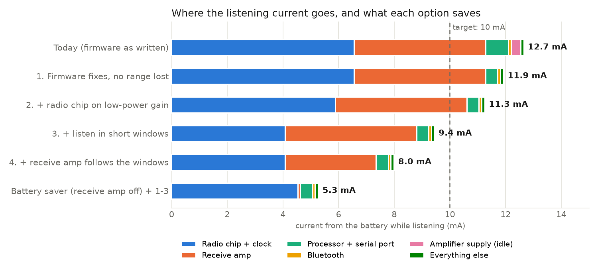

# Mesh Radio v1: power study (listening current)

Written 2 Nov 2026, when the owner asked whether re-doing the layout would make
the board use less power. **It would not** (under 1 %: copper losses at
listening currents are microamps). The current goes into the parts that listen,
so this study goes through every load on the battery and asks what firmware or a
small hardware change can save without losing range.

```
tools/kd python3 sim/power/run.py      # from mesh-radio/v1; writes results.txt and power.png
```

`run.py` is a spreadsheet in code: every number below is a constant in it, with
its source.  These are datasheet figures and estimates; measurements on the
first boards replace them.



## Result

3.7 V cell, 25 °C, listening with no traffic.  Battery life is for a 1,800 mAh
cell (90 % usable, the plan's minimum) with 1 W messages, 0.48 s on air each.

| Option | Listening | Life, quiet | Life, 100 sent/day | Range cost | How |
|---|---|---|---|---|---|
| Today (firmware as written) | **12.7 mA** | 5.3 days | 5.1 days | - | - |
| 1. Firmware fixes | **11.9 mA** | 5.7 days | 5.4 days | none | amplifier supply off between messages; drone serial port wakes on its first byte |
| 2. + radio chip on low-power gain | **11.3 mA** | 6.0 days | 5.7 days | about 0.3-0.5 dB | firmware setting (boosted gain only with the receive amp off) |
| 3. + listen in short windows | **9.4 mA** | 7.1 days | 6.7 days | small: a busy mesh collides a little more | firmware feature, not in Meshtastic today |
| 4. + receive amp follows the windows | **8.0 mA** | 8.4 days | 7.9 days | same as 3 | **board change**: one small logic chip |
| Battery saver (receive amp off) + 1-3 | **5.3 mA** | 12.8 days | 11.6 days | about 7 dB less hearing (0.45x the range in open air) | firmware setting |

Switched off: about 34-41 µA (the plan said 20-30 µA), 4.5-5.4 years on the
shelf at 25 °C.

**Sending is cheap; listening is what drains the battery.** 100 messages a day
at 1 W cost about 13 mAh, a fifth of what one day of listening costs (about
300 mAh).

## Where the 12.7 mA goes today

| Load | mA at the battery | Source |
|---|---|---|
| SX1262 receiving, boosted gain (5.3 mA) + its TCXO (1.5 mA) | 6.6 | Semtech DS rev 1.2 table 3-5; TCXO estimated from distributor listings |
| BGA7L1BN6 receive amp, gain mode | 4.7 | Infineon DS rev 3.1 table 3 (4.9 mA typ) |
| nRF52840: sleep, Meshtastic's loop, packet decode | 0.4 | estimate (Nordic PS sleep and CPU tables) |
| nRF52840: drone serial port left listening (keeps the fast clock on) | 0.4 | estimate (DevZone measurement, ~0.3 mA) |
| Amplifier supply left on: TPS2121 mux, TPS63810, QPA9510 standby | 0.34 | TI SLVSEA3F, SLVSEK4C; Qorvo QPA9510 DS |
| Bluetooth advertising | 0.1 | estimate (Nordic PS radio currents) |
| Everything else: TPS22950, charger, protector, antenna switch, dividers | 0.11 | TI, Skyworks datasheets; resistor values in `src/circuit.py` |

The buck is about 92.5 % efficient here (TPS62840 SLVSEC6D fig. 19).

## Findings

1. **The firmware leaves the amplifier's supply on while listening (0.34 mA).**
   `firmware/variant/variant.cpp` sets `PA_PWR_EN` high at start-up and low only
   at shutdown, so the mux, the buck-boost and the amplifier's standby current run
   all the time.  **Fixed 2 Nov** (`firmware/variant/variant.cpp`): the supply goes
   off 3 s after the last packet and back on before the next, about 8-10 ms of
   start-up (mux, I2C to the TPS63810, which forgets its settings, and its ramp).
   Untested on hardware.
2. **The drone serial port listens all the time (about 0.4 mA, estimate).**  An
   open UART receiver keeps the nRF52840's fast clock running.  The firmware can
   watch the RX pin with a pin interrupt instead and open the port on the first
   edge (the first message from the autopilot may be lost; the protocol resends).
   **Fixed 2 Nov**, slightly differently: the port opens once a device is seen on
   it (its TX idles high against a pull-down, checked every 2 s), and stays open
   until the next reboot (patch 0001 part 4).  Untested on hardware.
3. **The radio chip's boosted gain buys little when the receive amp is on.**
   Power-saving gain costs 0.7 mA less and about 0.3-0.5 dB of hearing behind a
   13.6 dB receive amp.  Keep boosted gain for battery-saver mode.
4. **Listening in short windows (SX1262 RxDutyCycle) is the big firmware saving.**
   Meshtastic's LongFast preamble is 16 symbols of 8.2 ms (131 ms).  The radio can
   sleep 49 ms and listen 91 ms and still catch every preamble and its header
   (datasheet 13.1.7), awake 69 % of the time.  Meshtastic does not do this today
   (RadioLib issue #1100: its call landed on the edge where it never sleeps;
   Meshtastic issue #9699, still open, measured 7.5 -> 4.5 mA on an nRF52840 +
   SX1262 board).  Cost: carrier sense goes partly blind while asleep, so a busy
   mesh collides a little more.  Needs bench tests for lost packets.
5. **The receive amp cannot follow those windows on this board** (kept for a
   future board: `docs/plan.md`, *Future: lower listening power*).  Its enable is a
   processor pin, so it stays on through the sleeps.  One small logic chip makes it
   follow the radio: amp on = radio clock-enable (DIO3, on only while the radio is
   awake) AND not transmitting (DIO2) AND the firmware's enable (today's LNA_EN).
   The DIO2 term matters: with the amp in gain while transmitting, the radio's own
   input would be overdriven.  The amp settles in 3-6 µs.
6. **Bluetooth costs little (about 0.1 mA).**  Meshtastic on nRF52 advertises
   forever; turning Bluetooth off, or a "stop advertising after N minutes" setting,
   saves about 0.1 mA.  A phone that stays connected costs 0.2-1 mA.
7. **No better receive amp exists for this.**  Every allowed-maker part with the
   same noise figure at 915 MHz draws as much or more.  The NXP BGU7003W can run at
   about 3 mA (saving about 2 mA for under 0.3 dB) but needs its own 2.2-2.85 V rail
   and has no bypass.  Keep the BGA7L1BN6.
8. **Small switched-off leaks (about 10 µA).**  Three paths sit straight across the
   cell, ahead of the protector, so they keep draining after it cuts off: the 1 M on
   the reverse FET's gate, the 1 M across the plug, and the 100 k + 4.7 V zener
   clamp (its soft knee draws 3-6 µA).  The bypass Schottky (RB060MM) leaks into the
   switched-off rail: about 1.5 µA at 25 °C but about 100 µA at 75 °C, for a node
   left in the sun.  All minor; worth measuring on the first boards.
9. **The RAK comparison in `docs/plan.md` may be off.**  The plan quotes a RAK
   WisBlock at about 20 mA (owner-measured).  Published RAK4631 listening currents
   are 6-9 mA (MeshCore issue #3602; Meshtastic #9699).  Worth re-measuring the RAK
   side by side with the first boards.

## Not verified

- Everything here is datasheet arithmetic; nothing has been measured.
- The TCXO current, the nRF52840's Meshtastic average, the UART clock cost and the
  Bluetooth averages are estimates.
- The SX1262 figures are from datasheet rev 1.2 (the current revision is behind a
  login); its receive current at 250 kHz is not in the datasheet (125 kHz figure used).
- Windowed listening's packet loss in a real mesh.
