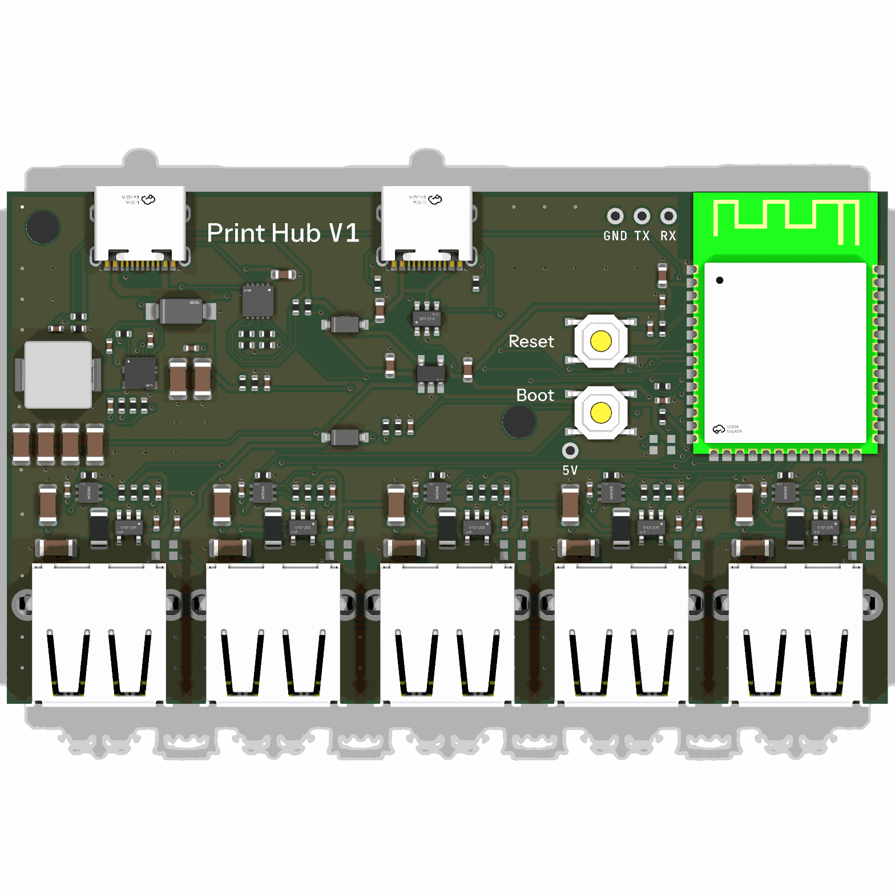
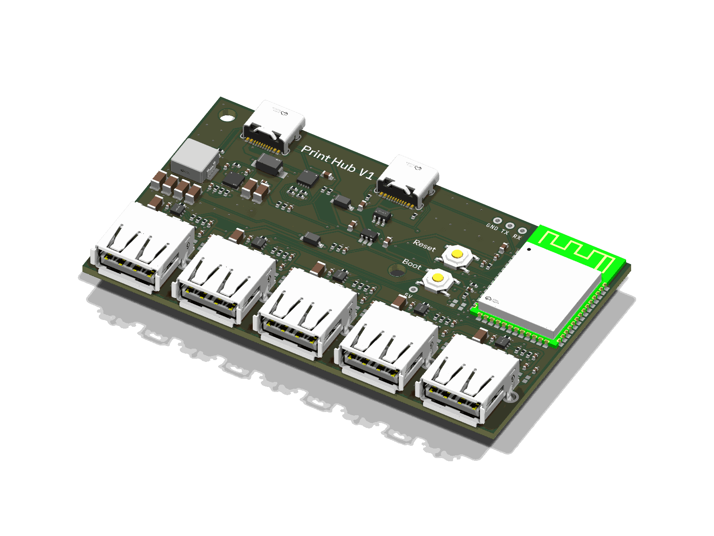

# Print Hub — v1

**Five switched USB ports for a resin printer's accessories**, controlled
by the print server. The exhaust fan, the light and the air filters plug
into the board; when a print starts, the server tells the board which ports
to switch on, and later which to switch off (and when). Each port measures
its own current, limits it, and can never put more than 5.4 V on a device.
The board talks Wi-Fi, and has a USB-C port for the server too.

> **Status: designed, not yet built.** Routed 4-layer board, 86 × 50 mm,
> every track corner at 45 degrees, KiCad 10 DRC 0 errors, 0 warnings,
> 0 unconnected; every gate, design check and simulation in `TESTS.md`
> passes, the board's heat in its closed case included; firmware builds and
> its logic passes its tests on the host. Nothing has been measured on hardware: order a few,
> bring one up (below), then use it.



## This revision

| | |
|---|---|
| Revision | **v1** (product: [`../README.md`](../README.md)) |
| Status | designed, not yet built |
| Tests and simulations | [`TESTS.md`](TESTS.md): every one with its v1 result |
| Trade-offs | [`docs/decisions.md`](docs/decisions.md) |
| Parts, stock, second sources | [`docs/parts.md`](docs/parts.md) (read 17 Oct 2026) |
| Toolchain | KiCad 10.0.6 (pinned image, `tools/Dockerfile`), Freerouting 1.9.0, ngspice |
| Firmware | ESP32-S3, Arduino core 3.3.12 (pioarduino 55.03.312-1), `firmware/` |
| Brand | OffGrid v3.2.2 ([`docs/brand.md`](../../docs/brand.md)) |

## Requirements

As the owner set them, and where v1 stands.

| Requirement | v1 |
|---|---|
| One USB-ish box behind the printer that switches the accessories automatically | ✅ 5 switched USB-A ports, commands from the print server |
| 4 ports, 5 if possible | ✅ 5 |
| Controlled from the Dell over USB, or Wi-Fi | ✅ both: Wi-Fi (HTTP, `printhub.local`) and USB-C to the server, same commands |
| Easy to configure from an SSH session ("port 1 is the fan") | ✅ `printhub name 1 fan`; names, limits and priorities live on the board |
| Never burns anything out | ✅ each port's switch limits at 1.92-2.20 A and shuts down when hot; a 1.5 A software limit per port; 5.4 V output clamp; 3 A for all ports together, and a thermistor by the buck: the firmware turns ports down before any part passes its rating (`sim/thermal/board_heat.md`) |
| Never browns out the other electronics | ✅ a short on one port leaves the others above 4.75 V (`sim/port_events.md`); the firmware keeps the total under what the charger offers; the server's USB never feeds a port |
| Knows how much power it can give | ✅ reads the charger's USB-PD contract and budgets the ports from it |
| Powered from the Dell alone if possible | ⚠️ the logic yes; the accessories need about 15 W, three times what a PC USB port gives, so the ports need a USB-C charger (20 W or more) — `docs/decisions.md` |
| Relay or something reliable | ✅ solid-state USB power switches (TI TPS25200): silent, no wear |
| Not too big, not too expensive | ✅ 86 × 50 mm (under 100 mm a side: JLCPCB's $8 price for five 4-layer boards); about $11.50 of parts a board plus JLCPCB's fees (see *Ordering*) |
| Order fully assembled | ✅ JLCPCB: every part from its catalogue, BOM and CPL in `production/` |
| A 3D-printable enclosure the board screws into | ✅ `mechanical/enclosure/` |

## Next steps

1. **Order 2-5 boards** (see *Ordering*). Re-read stock first
   (`python3 tools/lcsc.py C2913198 ...`): `docs/parts.md` is dated.
2. **Print the enclosure** (`mechanical/enclosure/README.md`) and buy the
   screws, a USB-C PD charger (20 W or more) and two USB-C cables.
3. **Bring one up** (below): flash, join Wi-Fi, name the ports, load-test
   each port against a USB meter.
4. **Wire it into the print server's start/end hooks**
   (`host/examples/print-hooks.sh`).
5. **Record what the board measured** in `TESTS.md` (the hardware rows).

---

## What's on the board



- **POWER IN (USB-C, back left).** A Hynetek HUSB238 asks the charger for
  9 V over USB-PD; a Silergy SY8368A buck makes 5.16 V for the ports (rated
  5 A; the firmware allows 3 A, what the closed case can shed). A 15 V TVS
  on the input, and a thermistor between the buck and its inductor, the
  hottest corner.
- **DATA (USB-C, back middle).** Straight to the ESP32-S3's own USB (serial
  console and flashing), ESD-protected. It powers the logic, never the ports.
- **ESP32-S3-WROOM-1 (back right)**, its antenna at the board's edge with no
  copper under it. RESET and BOOT buttons and the status LED beside it.
- **Five port blocks (front)**, one per USB-A: a TI TPS25200 switch (current
  limit 2.07 A typical, soft start, fault line, 5.4 V output clamp), a
  20 mOhm shunt and a TI INA180A2 amplifier (1 V per A into the ESP32's
  ADC), and an RGB LED. D+ and D- are joined (a USB charging port), so
  devices may draw 1.5 A.
- **LEDs**: one per port (green on, blue about to come on, blinking red
  tripped, amber off for lack of power or heat) and a status LED (green on
  Wi-Fi, blinking blue in setup mode, blinking red with no USB-PD charger,
  amber while heat is turning the ports down, fast red blink when heat has
  switched them all off).
- **Test pads**: UART TX/RX and ground (boot log), and the 5 V rail.

| | |
|---|---|
| Size | 86 × 50 mm, 1.6 mm, square corners, 2 × M3 holes at (-39.5, -21.5) and (7.0, -2.5) mm from the centre (the USB-A ports hold the front edge in the case) |
| PCB | 4 layers (F signals, In1 ground, In2 5 V plane, B signals), 1 oz outer, 0.15 mm track and gap, 0.6 / 0.3 mm vias, every track corner 45 degrees or less: JLCPCB's standard tier |
| Input | USB-C PD, 9 V (asks for 9 V; 5 V-only chargers run the logic but no ports) |
| Ports | 5 × USB-A 17 mm apart, 5.16 V, 1.5 A each (the USB-A receptacles' rating; less if set), 3 A in total (2.7 A on a plain 20 W charger), less if the board gets hot |
| Control | Wi-Fi 2.4 GHz (HTTP API, mDNS `printhub.local`), USB serial |

## Ordering (JLCPCB)

From `production/`:

- **Gerbers**: `print-hub-gerbers.zip`.
- **4 layers, 1.6 mm, 1 oz outer / 0.5 oz inner** (JLC04161H-7628).
- **Green solder mask, white silkscreen, lead-free HASL**: the cheapest
  build. Black mask adds $8 and ENIG $17 per order of five (live quotes,
  18 Oct 2026); either works if wanted.
- No special options: no via-in-pad, no fine-line, no impedance control.
- **Assembly: top side only**: upload `print-hub-bom-jlcpcb.csv` and
  `print-hub-cpl-jlcpcb.csv`. Try "Economic PCBA" first: with a green mask
  the board qualifies, and JLCPCB's capability page now lists through-hole
  parts (the five USB-A) for it, which saves about $40 of setup. If the
  quote refuses, use "Standard PCBA".
- **Check before you pay**, in JLCPCB's placement preview: the pin-1 corner
  of the six WS2812B LEDs, the bands of the two B5819W diodes (D2, D3) and
  of the SMAJ15A (D1), and that the USB-C and USB-A connectors face off the
  board edge.

PCBWay: `print-hub-bom-pcbway.csv` carries manufacturer part numbers and
LCSC numbers.

**Cost, roughly** (18 Oct 2026, 5 boards): the PCB $8 (4 layers, green,
HASL, under 100 × 100 mm; the first 104 × 66 mm layout quoted $29); parts
about $11.50 a board; 14 extended + 2 preferred-extended part types at about
$3 each, so about $45 of setup fees per order; plus assembly setup and the
through-hole soldering. Ten boards halve the fees per board. Read the quote.

**Also buy:** a USB-C PD charger, 20 W or more (any phone or laptop one);
a USB-C cable for power and a USB-C to USB-A (or C) cable to the server;
M3 screws and inserts for the enclosure (its README has the list).

## Bring-up

1. **Before power**: look for solder bridges on the USB-C pins and the ESP32
   module.
2. **DATA only (no charger)**: plug DATA into the print server. The status
   LED blinks red (no charger, which is expected). `ls /dev/ttyACM*` shows
   the board.
3. **Flash the firmware** from the server (once; later updates can go over
   Wi-Fi):
   ```
   pip install esptool
   esptool --chip esp32s3 --port /dev/ttyACM0 write-flash 0x0 firmware/release/printhub-v1.1.0-factory.bin
   ```
   If esptool cannot connect: hold BOOT, press and release RESET, release
   BOOT, and run it again. Or build and flash from source:
   `cd firmware && pio run -t upload`.
4. **Install the command** on the server: `sudo cp host/printhub.py
   /usr/local/bin/printhub` (Python 3, nothing else to install).
5. **Join Wi-Fi** over the cable: `printhub wifi "Network name" "password"`,
   then `printhub status` shows its address. Optionally `printhub token
   SECRET` and `export PRINTHUB_TOKEN=SECRET` on the server.
6. **Plug in the charger** (POWER IN): the status LED turns green, and
   `printhub status` shows `9V ... USB-PD` and how many mA the ports may draw.
7. **Name the ports and test each one** with a USB load or a USB meter:
   ```
   printhub name 1 fan
   printhub name 2 light
   printhub name 3 filter1
   printhub name 4 filter2
   printhub priority fan 1
   printhub on fan          # LED goes green; status shows the current
   printhub off fan
   ```
   Check each port's reading against the meter, and that 5 V reaches the
   device (4.9-5.2 V).
8. **Hook it to the print server** (`host/examples/print-hooks.sh`):
   `printhub on fan light filter1 filter2` when a print starts;
   `printhub off fan after 15m`, `printhub off light after 3m`,
   `printhub off filter1 filter2 after 30m` when it ends. The timers run
   on the board, so they happen even if the server restarts.

The air filters: their own power button has to be pressed for them to run,
so wire it permanently on (the plan), and switching the port then decides
whether they run on charge.

## Controlling it

Home Assistant: [`docs/home-assistant.md`](docs/home-assistant.md) has the
switches and sensors ready to paste.

Over Wi-Fi: `http://printhub.local/` is a small page with the five ports
and on/off buttons. Scripts and AI agents use the same commands as the CLI,
by `printhub ...` or `POST /api/cmd` with the command as the body, and get
JSON back (`firmware/lib/hub/src/cmd.h` lists every command):

```
printhub status                     printhub on fan light [for 10m]
printhub off all                    printhub off fan after 15m
printhub name 3 filter1             printhub limit filter1 1200
printhub priority fan 1             printhub boot light on
printhub --json status              printhub ota http://server/printhub.bin
```

## Limits

- **The ports need a USB-PD charger that offers 9 V** (practically every
  USB-C charger of 18 W or more). A 5 V-only charger runs the board but no
  ports; the firmware says so. Budget by charger: 20 W gives the ports
  2.7-3.0 A, 27 W and up the full 3 A (`sim/power_budget.md`).
- **1.5 A per port at most** (the USB-A receptacles' rating; the switch's own limit is
  1.92-2.20 A); **3 A in total**: what the closed case sheds in a 35 C room
  with every part inside its rating (`sim/thermal/board_heat.md`). The
  typical load, fan + light + two filters charging, is about 2.65 A.
- **Heat**: hotter than that (a hotter room, the case in the sun, its feet or
  vents blocked), the thermistor by the buck turns the ports down from
  75 C on the board, lowest priority first, and switches them all off at
  100 C until the board is back under 85 C. `printhub status` shows the
  board's temperature.
- **2.4 GHz Wi-Fi only.** Keep metal and the screws away from the antenna
  corner; the enclosure does.
- **Power-only USB ports**: no data reaches the accessories.
- **Not measured on hardware yet**: the buck's feed-forward capacitor (22 pF)
  and the 1.5 A software limit are first guesses to confirm on the bench.

## Build

Everything runs in the pinned toolchain image. Build it once (the
Dockerfile's header says how), then from this folder:

```
tools/kd python3 src/make.py              # gates and every output from the committed board
tools/kd python3 src/make.py --artwork    # lay the silkscreen out again first
tools/kd python3 src/make.py --reroute    # place and route from scratch, then everything
tools/kd python3 src/verify.py            # design checks, writes VERIFICATION.md
tools/kd python3 sim/port_events.py       # ngspice: ports switching on, a port shorted
tools/kd python3 sim/thermal/board_heat.py  # the board's heat in its case (~5 min)
python3 sim/power_budget.py               # the power chain from the datasheets
make -C firmware/test                     # firmware logic, on the host
python3 host/test_printhub.py             # the CLI against a fake board
cd firmware && pio run                    # the firmware
```

The committed `print-hub.kicad_pcb` is the design of record: CI (`ci /
print-hub-v1`) rebuilds the artwork and every fab file from it and fails
if they differ from what is committed. `make.py --reroute` reproduces it
from `src/` (placement, power copper and Freerouting are deterministic).

| To change | Edit | Then run |
|---|---|---|
| A part number (same footprint) | `src/parts.py` | `make.py` |
| Labels, logo | `src/silk.py` | `make.py --artwork` |
| Connections, placement, power copper | `src/circuit.py`, `src/layout.py`, `src/power.py` | a new revision: copy to `v2/`, `make.py --reroute` |
| Firmware pins or scaling | `firmware/src/board.h` (must match `src/circuit.py`) | `verify.py` |

## Files

```
README.md               this file
TESTS.md                every test and simulation with its v1 result
VERIFICATION.md         design checks (src/verify.py)
print-hub.kicad_pcb     the routed board (design of record), .kicad_pro, .kicad_dru
production/             Gerber zip, BOM and CPL (JLCPCB, PCBWay), netlist, assembly PDF
images/                 renders and the silkscreen read back from the Gerbers
mechanical/             STEP of the assembled board (zipped); enclosure/
firmware/               ESP32-S3 firmware (PlatformIO), host tests, ready-to-flash images
host/                   printhub command for the print server, its tests, example hooks
docs/                   decisions, parts (dated), Home Assistant
sim/                    power-chain analysis, ngspice port events, the board's heat in its case
src/                    the generator: circuit, footprints, placement, power copper, routing, artwork, checks
ph.pretty/, ph.3dshapes/  this board's footprints and their 3D models
fonts/                  brand fonts for the silkscreen (OFL)
tools/                  pinned toolchain (Docker), CI output check, JLCPCB stock lookup
```
