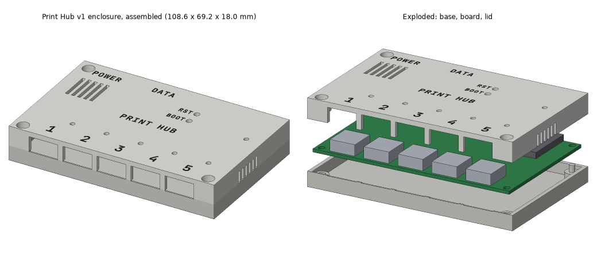
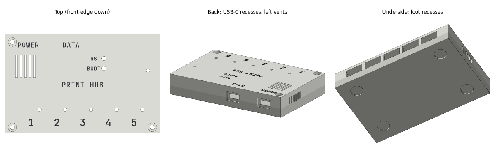

# Print Hub v1 enclosure

A two-part 3D-printed box for the Print Hub v1 board (104 x 66 x 1.6 mm): a
**base** tray with the standoffs and a **lid** that carries every opening.
Everything is generated by `enclosure.py` (build123d 0.13), which also runs a
fit check against the board and its connectors.




| | |
|---|---|
| Outer size | **108.6 x 69.2 x 18.0 mm** (w x d x h), 19-20 mm tall on its feet |
| Walls / top / floor | 2.0 mm |
| Board clearance | 0.3 mm all round |
| Fasteners | **3 x M3 x 12 socket head cap screw (ISO 4762 / DIN 912) + 3 x M3 x 4 mm heat-set inserts**; the fourth hole gets a printed peg (see "Antenna corner") |
| Material | about 19 cm³ per part (roughly 25 g each in PETG at 100 %, less with infill) |

## Files

| File | What it is |
|---|---|
| `enclosure.py` | The parametric model. Every dimension is a named constant at the top with a plain-English comment |
| `printhub-base.stl` | Base, **in print orientation** (floor on the bed) |
| `printhub-lid.stl` | Lid, **in print orientation** (top face on the bed) |
| `printhub-enclosure-step.zip` | Both parts in their assembled position (+Z up, +Y towards the back / USB-C side, board bottom face at Z = 0) |
| `printhub-preview.png` | Assembled iso view and exploded view |
| `printhub-views.png` | Top (front edge down), back (USB-C side) and underside |

Rebuild (about 2 minutes, most of it the fit check):

```sh
docker run --rm -u $(id -u):$(id -g) -e HOME=/tmp \
  -v /home/user/offgrid-hardware:/w \
  -w /w/print-hub/v1/mechanical/enclosure ogkicad-printhub:1 python3 enclosure.py
```

`--check-only` runs only the fit check. `--no-check` only builds and exports.
The exit code is 1 if any fit-check line fails. The output is reproducible: the
STEP export has a fixed timestamp, so the same constants give the same files.

### Switches at the top of `enclosure.py`

| Constant | Default | Other choice |
|---|---|---|
| `FASTENER` | `'insert'`: Ø4.0 x 5.0 mm pockets for M3 x 4 heat-set inserts | `'selftap'`: Ø2.6 x 5.5 mm pilot holes (use this for resin) |
| `ANTENNA_HOLE` | `'peg'`: printed peg, no metal near the antenna | `'screw'`: a fourth insert and screw (the fit check flags it) |
| `LED_WINDOW` | `'hole'`: Ø2.5 mm through-holes | `'thin'`: 0.4 mm skin left in the top plate |
| `BUTTON_STYLE` | `'pin'`: Ø3 mm paperclip holes with guide tubes | `'flexure'`: printed cantilever plungers (FDM only) |
| `FOOT_DEPTH` | 1.0 mm recesses | 0 removes them |
| `BRIDGE_LAYER` | 0.2 | set it to your layer height (see "Printing") |

## Printing

Both parts print **without supports**, on FDM and on resin, in these orientations:

* **Base: floor on the bed**, open side up.
* **Lid: top face on the bed**, open side up. The engraved text and the LED
  windows are on the bed face, so they come out crisp. Every opening in the lid
  walls (USB-A notches, USB-C recesses, side vents) is open at the lid's free
  edge, so nothing in the walls has to bridge.

The fit check (section 8) lists every downward-facing face in the print
orientation. There are only three kinds, all deliberate:
* base: the ceilings of the four foot recesses, 10.6 mm round bridges 1 mm off the bed;
* lid: the floors of the engraved letters, letter-stroke-wide bridges 0.6 mm off the bed;
* lid: the counterbore floors. These use the stepped "bridging layer" trick:
  one layer bridges the 6.2 mm counterbore leaving a 3.4 mm slot, the next layer
  bridges the slot leaving a 3.4 mm square, and then the round hole carries on.
  It needs no supports and no drilling.

### FDM (0.4 mm nozzle)

* **Material: PETG** (or ASA/ABS). The buck converter puts 1-2 W into the box,
  and PLA can creep under the screw clamp once it gets warm. PLA is fine for a
  cool desk.
* Layer height 0.2 mm (0.16 mm for crisper text; then set `BRIDGE_LAYER = 0.16` and rebuild).
* 5 perimeters (so the 2 mm walls and the standoffs print solid), 5 top and 5
  bottom layers, 20-30 % infill.
* Supports off, no brim.
* Elephant-foot compensation of about 0.15 mm. Both parts have their outer
  edges on the bed, and the lid also has its text there.
* Use an Arachne-style slicer (PrusaSlicer 2.6+, Cura 5, Orca) or enable
  "detect thin walls". The front skin in the base is 0.6 mm and the frame
  around each USB-C is 0.7 mm (see "Design notes").

### Resin

* Same orientations, directly on the build plate, no supports. Neither part
  traps resin: both open towards the vat.
* Use a tough or ABS-like resin at 0.05 mm layers. Standard resin is brittle
  around the screw bosses.
* **Heat-set inserts do not work in resin** (it does not melt). Set
  `FASTENER = 'selftap'` and rebuild, or glue the inserts into the 4.0 mm pockets with epoxy.
* Do not use `BUTTON_STYLE = 'flexure'` in resin. The cantilevers crack.
* The floor and the lid top are large first layers. If your printer struggles
  with big flat areas on the plate, slow the lift speed. Over-exposed bottom
  layers can soften the engraved text slightly.

## Hardware

| Qty | Part | Notes |
|---|---|---|
| 3 | M3 x 12 mm socket head cap screw, ISO 4762 / DIN 912 | Stainless A2 or black steel. Head sits 1.0 mm below the lid surface in a Ø6.2 x 4.0 mm counterbore. The thread enters the insert over its full 4.0 mm (tip at the insert's bottom) |
| 3 | M3 x 4 mm brass heat-set insert | Pocket is Ø4.0 x 5.0 mm with 1.5 mm of plastic around it. Check your insert's datasheet and set `INSERT_HOLE_D` to match |
| 4 | Round self-adhesive rubber bumper, Ø10 mm (up to 10.5), 2-3 mm tall | Recesses are Ø10.6 x 1.0 mm |

No screw goes in the back-right hole (49, -30). The printed peg locates the board there.

With `FASTENER = 'selftap'` the same M3 x 12 screws cut their own thread into the Ø2.6 mm pilot holes.

## Assembly

1. Clean up the prints. Check that the thin front skin of the base and the peg
   in its back-right corner are intact.
2. **Inserts**: press the three inserts into the front-left, front-right and
   back-left standoffs with a soldering iron (about 220-240 °C for PETG). Make
   them flush with the standoff top. One standing proud makes the board rock, so
   sand it flush if needed.
3. **Feet**: stick the four bumpers into the recesses on the bottom.
4. **Board**: lower it straight into the base, components up, USB-A side to the
   front (the side with the thin skin), back-right hole over the peg. It rests on
   the three standoffs, the peg's standoff, the ledge under its front edge and the
   pillar under the buttons.
5. **Lid**: lower it straight down. The notches in its front wall pass over the
   USB-A shells, the two halves of each USB-C recess meet, and the peg enters its socket.
6. **Screws**: drive the three M3 x 12 screws through the lid and the board into
   the inserts. Tighten them snug (about 0.4 N·m), not hard: they clamp the board
   between the lid's bosses and the standoffs.
7. Check that a USB-A and a USB-C cable each seat fully, and that RST clicks with a paperclip.

## Design notes

**Coordinates.** All positions in the script use the board's KiCad
coordinates: millimetres from the board centre, x to the right, y towards the
front (USB-A) edge, z up from the board's bottom face. KiCad's y points down the
screen, so the 3D model uses Y = -y. Building straight in KiCad (x, y) would
have produced a mirror-image box.

**The split** is a single flat plane 0.1 mm above the board's top face. The base
is a shallow tray. The lid carries everything above the board, and all its
connector openings are notches open at its bottom edge, so it lowers straight
down over the connectors. The board is clamped between the lid's bosses
(Ø6.8 mm, inside the Ø7 keep-clear circles) and the base's standoffs (Ø7 mm,
4 mm tall).

**The front wall is moved back over the board.** The USB-A mouths are only
0.5-0.6 mm past the board edge, and a plug's overmould must reach within about
0.5 mm of the mouth. A normal wall (board edge + 0.3 mm + 2 mm) would put the
mouths 1.7 mm behind the outer face, and plugs would not seat. So the front
wall's outer face is 0.4 mm in front of the mouths (0.3 mm by the board notes'
33.6), and it is a full 2 mm thick above the board (in the lid) and below it (a
ledge under the board's front strip, in the base). The board's front edge sits in
a slot in that wall. Only the 0.6 mm skin directly in front of the board edge is
thinner than 2 mm. The lid's wall sits on the 1.1 mm strip of board in front of
the receptacles; per `src/layout.py` nothing but the USB-A receptacles lives in
front of y = 19. Each USB-A cut-out is the mouth flange (14.4 x 7.0 mm, measured
from the STEP) plus 0.5 mm all round.

**USB-C**: the back wall is a normal 2 mm wall. Each receptacle passes through a
cut-out 0.5 mm larger than its body, and the outer face around it is recessed
13.5 x 8.0 mm (a 12.5 x 7 mm overmould + 0.5 mm) down to 0.4 mm outside the
mouth. The plug therefore seats fully. That leaves a 0.7 mm frame around each
receptacle.

**LED windows: Ø2.5 mm through-holes**, chosen over 0.4 mm thin spots because:
* they work in any colour, including the brand's black (Pitch), while a thin
  spot only glows in white or natural material;
* a 0.4 mm skin is just two FDM layers, which come out blotchy and pinholed, and
  it is a bloomed first layer in resin;
* each LED sits 7.4 mm below the window, and the 2 mm-deep hole only passes
  light from almost straight below, so a neighbour's colour does not leak through.

`LED_WINDOW = 'thin'` gives the thin-spot version for translucent material.

**Buttons: Ø3 mm paperclip holes**, each with a 5 mm square guide tube ending
1 mm above the button, so the clip lands on the plunger. Reasons:
* they print reliably on FDM and resin;
* RESET cannot be pressed by accident on a hub that powers printers.

`BUTTON_STYLE = 'flexure'` gives two printed cantilevers (12 x 6 x 1 mm,
sharing a 1 mm slot) with posts down to the buttons. They need about 4 N to
press and suit FDM PETG/PLA only.

**Antenna corner.** The back-right mounting hole (49, -30) is only 6.2 mm from the
ESP32's antenna area (x 23.2-42.8, y -33 to -26.4). It sits inside the 10 mm
no-screws/no-inserts zone. So by default that corner gets **no metal**:
* a Ø2.8 mm printed peg on the base standoff passes through the board hole into
  a socket in the lid boss;
* the lid has no screw hole there, so the plastic above the antenna stays plain.

This conflicts with the "4 x M3 screws" request. The three remaining screws hold
the lid, and the peg locates the board. `ANTENNA_HOLE = 'screw'` restores a
fourth insert and screw, and the fit check then marks it FAIL. A nylon M3 screw
with a nylon nut would be the metal-free way to clamp that corner if it is ever
needed.

**Vents** (about 2.5 W in the box: 1-2 W from the buck, 0.5 W from the port switches):
* 5 top slots (1.6 x 16 mm) right over the buck converter and its inductor;
* 6 slots in the left wall beside the buck;
* 6 slots in the right wall away from the antenna, for cross-flow.

The side slots run from the split plane up and are open at the lid's edge, so
they print without bridges. No vent is within 10 mm of the antenna area.

**Brand.** The outline is all right angles, with no fillets and no chamfers
(none are needed to print; use the slicer's elephant-foot compensation instead).
Text is engraved 0.6 mm deep in JetBrains Mono 500 with 0.06 em tracking, from
`print-hub/v1/fonts`:
* port numbers 1-5 above the ports;
* POWER and DATA over the USB-Cs;
* RST and BOOT by the button holes;
* PRINT HUB at the centre of the lid.

The labels are uppercase as requested. The brand would set word labels in
Instrument Sans, sentence case. The glyph outlines are merged with shapely,
because the variable font's overlapping contours break OCCT's own text builder.

## Fit check result

`enclosure.py` builds simple boxes for the board and its parts from the measured
STEP sizes, plus the real STEP models of the USB-A and USB-C receptacles. It then
checks:
* that nothing intersects the base or lid;
* plug seating and mouth setback;
* cut-out clearance and heights;
* wall thickness, probed through the solids;
* the fasteners against the antenna rule;
* that both STLs are watertight;
* the overhangs in print orientation.

The board is the only thing that touches the enclosure, where it is clamped. The
"all other parts" box covers the whole board up to y = 19 at 3.5 mm tall, minus
the mounting-hole keep-clear circles and the button courtyards.

```
Print Hub v1 enclosure
  outer size 108.6 x 69.2 x 18.0 mm (w x d x h), feet not included
  board bottom at z 0; floor -6.0..-4.0; split 1.70; ceiling 10.00; top 12.00
  screws: 3 x M3 x 12 ISO 4762, counterbore 4.00 deep; 3 x M3 x 4 heat-set inserts (hole 4.0)
  base 18.9 cm^3, lid 19.7 cm^3
  wrote printhub-base.stl, printhub-lid.stl, printhub-enclosure-step.zip, printhub-preview.png, printhub-views.png

FIT CHECK  (KiCad coordinates: y towards the front; z above the board bottom face)
  -- 1. parts (boxes from measured STEP sizes) must not intersect base or lid
  [PASS] board                                          clear, min gap 0.00 mm (board is clamped: contact intended)
  [PASS] USB-A 1 body                                   clear, min gap 1.03 mm
  [PASS] USB-A 1 mouth                                  clear, min gap 0.50 mm
  [PASS] USB-A 1 pins (design 3.0 mm)                   clear, min gap 1.00 mm
  [PASS] USB-A 2 body                                   clear, min gap 1.03 mm
  [PASS] USB-A 2 mouth                                  clear, min gap 0.50 mm
  [PASS] USB-A 2 pins (design 3.0 mm)                   clear, min gap 1.00 mm
  [PASS] USB-A 3 body                                   clear, min gap 1.03 mm
  [PASS] USB-A 3 mouth                                  clear, min gap 0.50 mm
  [PASS] USB-A 3 pins (design 3.0 mm)                   clear, min gap 1.00 mm
  [PASS] USB-A 4 body                                   clear, min gap 1.03 mm
  [PASS] USB-A 4 mouth                                  clear, min gap 0.50 mm
  [PASS] USB-A 4 pins (design 3.0 mm)                   clear, min gap 1.00 mm
  [PASS] USB-A 5 body                                   clear, min gap 1.03 mm
  [PASS] USB-A 5 mouth                                  clear, min gap 0.50 mm
  [PASS] USB-A 5 pins (design 3.0 mm)                   clear, min gap 1.00 mm
  [PASS] USB-C POWER                                    clear, min gap 0.50 mm
  [PASS] USB-C DATA                                     clear, min gap 0.50 mm
  [PASS] ESP32-S3 module                                clear, min gap 0.30 mm
  [PASS] button RST                                     clear, min gap 1.00 mm
  [PASS] button BOOT                                    clear, min gap 1.00 mm
  [PASS] buck inductor                                  clear, min gap 3.00 mm
  [PASS] LED port 1                                     clear, min gap 5.60 mm
  [PASS] LED port 2                                     clear, min gap 5.60 mm
  [PASS] LED port 3                                     clear, min gap 5.60 mm
  [PASS] LED port 4                                     clear, min gap 5.60 mm
  [PASS] LED port 5                                     clear, min gap 5.60 mm
  [PASS] LED status                                     clear, min gap 5.20 mm
  [PASS] all other parts (<= 3.5 mm)                    clear, min gap 0.10 mm
  -- 2. real STEP models (all solids incl. pins) against the enclosure
  [PASS] USB-A 1 (STEP)                                 overlap 0.0000 mm^3, min gap 0.50 mm
  [PASS] USB-A 2 (STEP)                                 overlap 0.0000 mm^3, min gap 0.50 mm
  [PASS] USB-A 3 (STEP)                                 overlap 0.0000 mm^3, min gap 0.50 mm
  [PASS] USB-A 4 (STEP)                                 overlap 0.0000 mm^3, min gap 0.50 mm
  [PASS] USB-A 5 (STEP)                                 overlap 0.0000 mm^3, min gap 0.50 mm
  [PASS] USB-C POWER (STEP)                             overlap 0.0000 mm^3, min gap 0.50 mm
  [PASS] USB-C DATA (STEP)                              overlap 0.0000 mm^3, min gap 0.50 mm
  -- 3. connector mouths and plug seating
  [PASS] USB-A mouth vs front outer face (STEP)         mouth y 33.50, face y 33.90 -> mouth 0.40 mm behind the face (0..0.5 wanted)
  [PASS] USB-A mouth vs front outer face (board notes)  mouth y 33.60, face y 33.90 -> mouth 0.30 mm behind the face (0..0.5 wanted)
  [PASS] USB-A 1 plug (16 x 8 overmould) seats          overmould stops 0.40 mm short of the mouth (<= 0.5)
  [PASS] USB-A 2 plug (16 x 8 overmould) seats          overmould stops 0.40 mm short of the mouth (<= 0.5)
  [PASS] USB-A 3 plug (16 x 8 overmould) seats          overmould stops 0.40 mm short of the mouth (<= 0.5)
  [PASS] USB-A 4 plug (16 x 8 overmould) seats          overmould stops 0.40 mm short of the mouth (<= 0.5)
  [PASS] USB-A 5 plug (16 x 8 overmould) seats          overmould stops 0.40 mm short of the mouth (<= 0.5)
  [PASS] USB-C POWER plug (12.5 x 7 overmould) seats    recess floor y -33.99, 0.40 mm outside the mouth (<= 0.5)
  [PASS] USB-C DATA plug (12.5 x 7 overmould) seats     recess floor y -33.99, 0.40 mm outside the mouth (<= 0.5)
  [PASS] USB-A cut-out clearance round the shell        min 0.50 mm (0.5 wanted)
  -- 4. heights
  [PASS] lid ceiling over the USB-A shells              1.05 mm of air
  [PASS] TH pins (3.0 mm) to the base floor             1.00 mm clear (>= 1.0)
  [PASS] TH pins (2.4 mm) to the base floor             1.60 mm clear (>= 1.0)
  -- 5. wall thickness (probed through the solids)
  [PASS] left wall, lid                                 2.00 mm
  [PASS] left wall, base                                2.00 mm
  [PASS] right wall, lid                                2.00 mm
  [PASS] right wall, base                               2.00 mm
  [PASS] back wall, lid                                 2.00 mm
  [PASS] back wall, base                                2.00 mm
  [PASS] front wall between ports, lid                  2.00 mm
  [PASS] front wall, base (under the board)             2.00 mm
  [PASS] lid top plate                                  2.00 mm
  [PASS] base floor                                     2.00 mm
  note: front skin in front of the board edge (z 0..1.7) is 0.60 mm by design (see notes)
  note: frame round each USB-C in the recess floor is 0.69 mm by design
  note: under the engraved text the top plate is 1.4 mm
  -- 6. fasteners
  [PASS] M3 screw + insert at (-49, -30)                69.5 mm from the antenna area (>= 10)
  [PASS] printed peg at (49, -30), no metal             hole is 6.2 mm from the antenna area
  [PASS] M3 screw + insert at (-49, 30)                 88.9 mm from the antenna area (>= 10)
  [PASS] M3 screw + insert at (49, 30)                  54.0 mm from the antenna area (>= 10)
  [PASS] M3 x 12 screw engagement                       tip at z -4.00, 4.0 mm into the insert; head 1.00 mm below the lid top
  [PASS] screw (-49, -30) misses all parts              
  [PASS] screw (-49, 30) misses all parts               
  [PASS] screw (49, 30) misses all parts                
  -- 7. exported STL files
  [PASS] printhub-base.stl                              3056 triangles, watertight, z 0.00..9.40 (on the bed)
  [PASS] printhub-lid.stl                               8868 triangles, watertight, z -0.00..10.40 (on the bed)
  -- 8. overhangs in print orientation (faces pointing down, above the bed)
  [PASS] base overhang at z 1.00                        352 mm^2: foot recess ceilings: 10.6 mm round bridges
  [PASS] lid overhang at z 0.60                         118 mm^2: engraved text floors: letter-stroke bridges
  [PASS] lid overhang at z 4.00                         31 mm^2: counterbore floor, bridging layer 1 (spans <= 6.2)
  [PASS] lid overhang at z 4.20                         29 mm^2: bridging layer 2 (spans 3.4)
  [PASS] lid overhang at z 4.40                         7 mm^2: square-to-round corners of the bridged hole (tiny)

FIT CHECK RESULT: PASS (0 failed)
```

## Things to check on the first print

* **USB-A mouth position.** The STEP (matched to the footprint's pad rows) puts
  the mouth at y = 33.5. The board notes and the courtyard say 33.6. The wall
  face is at 33.9, so the setback is 0.3-0.4 mm either way. Confirm a plug seats
  fully. `MOUTH_SETBACK` moves the wall.
* **Port LED position.** `src/layout.py` was changed while this was designed
  (commit 492f15c, 'port LED' now at cx + 6.0, y 17.6 instead of cx + 5.5, 17.5),
  and the windows follow the newer position. The script does not read
  `layout.py`, since that needs pcbnew. If the layout moves the LEDs, buttons or
  connectors again, update the constants in section 2.
* **Part heights.** No built `.kicad_pcb` was available. The check assumes
  everything except the USB-A receptacles, ESP32 module, inductor, buttons and
  LEDs is at most 3.5 mm tall, and that nothing but the USB-A receptacles sits
  in front of y = 19, as `layout.py` places it.
* **Through-hole pins.** The STEP says 2.4 mm below the board. The floor is
  designed for 3.0 mm with 1 mm to spare. Trim the leads if they come out longer.
* **Plug sizes.** The checks assume a 16 x 8 mm USB-A overmould and a 12.5 x 7 mm
  USB-C overmould. Fatter USB-A plugs still stop at the wall face, 0.4 mm from
  the mouth. Plugs over 18 mm wide cannot sit side by side at the 18 mm port
  pitch anyway.
* **Insert pocket.** Ø4.0 mm suits most M3 x 4 inserts. Adjust `INSERT_HOLE_D` to yours.
* **Board thickness.** With a 1.6 ± 0.16 mm board, a thick board leaves a hairline
  gap at the split, and a thin one gets up to 0.1 mm of play before the walls meet.
* **Heat.** The vents are sized by judgement, not simulation. Check the buck area
  after an hour at full load.
