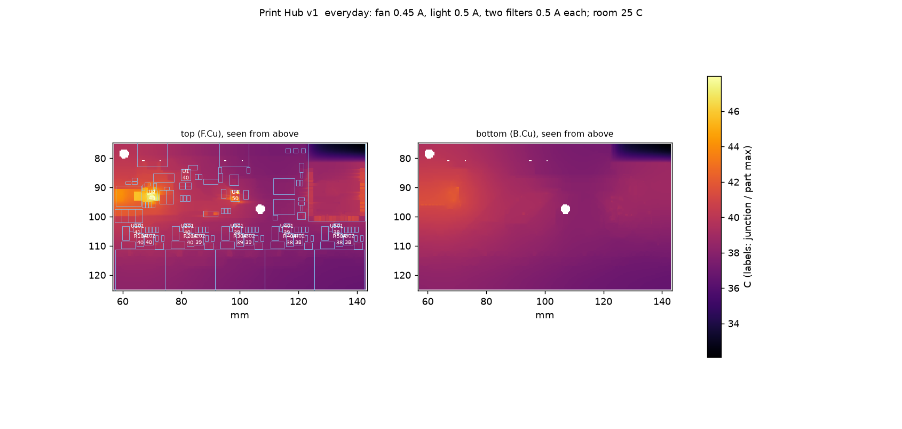
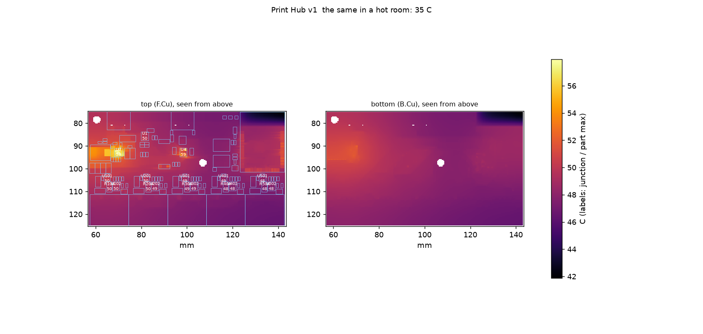
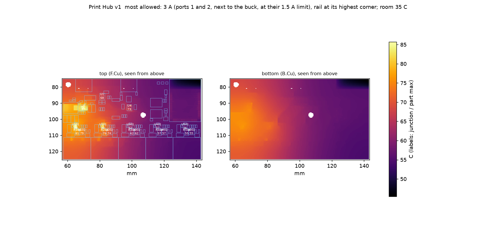

# Print Hub v1: board temperatures in the closed case

Written by `sim/thermal/board_heat.py` from the routed board (`print-hub.kicad_pcb`): all four copper layers, every via and pad, 0.4 mm grid. The board is in the closed PETG case: conduction across the air gaps above and below it, radiation to the walls, the walls cooling by natural convection and radiation from the top and sides only (no credit for the floor or the vents). Limits are each part's rated maximum.

Case: the case from mechanical/enclosure/case_gaps.json: outside 90.6 x 53.2 x 18.0 mm on 4 mm feet; air above the board 1.2-8.4 mm (the lid steps down over the low parts), below it 1.0-4.0 mm.

## everyday: fan 0.45 A, light 0.5 A, two filters 0.5 A each; room 25 C

Heat in the case: **0.99 W** (ESP32 0.25 W, buck 0.23 W, 3.3 0.12 W, inductor 0.11 W, port switch 0.06 W, port USB-A 0.06 W, port LED 0.05 W, OR 0.04 W, copper 0.03 W, port shunt 0.02 W, PD 0.02 W, LED 0.01 W). Lid 33.2 C on average, 36.5 C at its hottest; floor 34.6 / 37.4 C (PETG limit 65 C). The thermistor reads 41.5 C. Energy balance error 2.0e-06 W.

| part | temperature (C) | limit (C) | margin (K) |
|---|---|---|---|
| cap C6 (X5R) | 45.5 | 85 | +40 |
| cap C2 (X5R) | 43.4 | 85 | +42 |
| cap C9 (X5R) | 42.3 | 85 | +43 |
| cap C10 (X5R) | 42.3 | 85 | +43 |
| cap C11 (X5R) | 42.1 | 85 | +43 |
| ESP32 module U5 | 42.0 | 85 | +43 |
| cap C12 (X5R) | 42.0 | 85 | +43 |
| cap C3 (X5R) | 41.8 | 85 | +43 |
| USB-C J1 | 40.7 | 85 | +44 |
| cap C16 (X5R) | 40.6 | 85 | +44 |
| PD sink U1 | 40.5 | 85 | +45 |
| port 1 LED | 40.4 | 85 | +45 |
| cap C102 (X5R) | 40.2 | 85 | +45 |
| cap C202 (X5R) | 39.6 | 85 | +45 |

Board copper: F.Cu 32.2-48.0 C, In1.Cu 32.2-45.2 C, In2.Cu 32.2-42.5 C, B.Cu 32.1-42.4 C.

## the same in a hot room: 35 C

Heat in the case: **1.00 W** (ESP32 0.25 W, buck 0.23 W, 3.3 0.12 W, inductor 0.12 W, port switch 0.06 W, port USB-A 0.06 W, port LED 0.05 W, OR 0.04 W, copper 0.03 W, port shunt 0.02 W, PD 0.02 W, LED 0.01 W). Lid 43.0 C on average, 46.4 C at its hottest; floor 44.3 / 47.2 C (PETG limit 65 C). The thermistor reads 51.4 C. Energy balance error 2.7e-06 W.

| part | temperature (C) | limit (C) | margin (K) |
|---|---|---|---|
| cap C6 (X5R) | 55.4 | 85 | +30 |
| cap C2 (X5R) | 53.3 | 85 | +32 |
| cap C9 (X5R) | 52.2 | 85 | +33 |
| cap C10 (X5R) | 52.2 | 85 | +33 |
| cap C11 (X5R) | 52.0 | 85 | +33 |
| cap C12 (X5R) | 51.9 | 85 | +33 |
| ESP32 module U5 | 51.8 | 85 | +33 |
| cap C3 (X5R) | 51.7 | 85 | +33 |
| USB-C J1 | 50.6 | 85 | +34 |
| cap C16 (X5R) | 50.4 | 85 | +35 |
| PD sink U1 | 50.3 | 85 | +35 |
| port 1 LED | 50.2 | 85 | +35 |
| cap C102 (X5R) | 50.1 | 85 | +35 |
| cap C202 (X5R) | 49.5 | 85 | +36 |

Board copper: F.Cu 42.0-57.9 C, In1.Cu 42.0-55.1 C, In2.Cu 42.0-52.4 C, B.Cu 41.9-52.3 C.

## most allowed: 3 A (ports 1 and 2, next to the buck, at their 1.5 A limit), rail at its highest corner; room 35 C

Heat in the case: **2.16 W** (port switch 0.59 W, buck 0.41 W, port USB-A 0.27 W, ESP32 0.25 W, inductor 0.22 W, 3.3 0.12 W, copper 0.09 W, port shunt 0.09 W, port LED 0.05 W, OR 0.04 W, PD 0.02 W, LED 0.01 W). Lid 51.2 C on average, 61.8 C at its hottest; floor 53.9 / 64.5 C (PETG limit 65 C). The thermistor reads 73.0 C. Energy balance error 4.5e-07 W.

| part | temperature (C) | limit (C) | margin (K) |
|---|---|---|---|
| cap C6 (X5R) | 80.6 | 85 | +4 |
| cap C12 (X5R) | 78.3 | 85 | +7 |
| cap C9 (X5R) | 77.4 | 85 | +8 |
| cap C10 (X5R) | 77.4 | 85 | +8 |
| cap C11 (X5R) | 77.1 | 85 | +8 |
| port 1 USB-A | 77.0 | 85 | +8 |
| cap C102 (X5R) | 76.8 | 85 | +8 |
| cap C2 (X5R) | 76.5 | 85 | +8 |
| cap C105 (X5R) | 76.4 | 85 | +9 |
| port 1 LED | 74.6 | 85 | +10 |
| port 2 USB-A | 74.4 | 85 | +11 |
| cap C205 (X5R) | 73.8 | 85 | +11 |
| cap C202 (X5R) | 73.8 | 85 | +11 |
| cap C3 (X5R) | 73.2 | 85 | +12 |

Board copper: F.Cu 45.6-85.7 C, In1.Cu 45.7-82.7 C, In2.Cu 45.6-76.4 C, B.Cu 45.4-76.9 C.

## Hotter rooms: where the thermal protection takes over

No turning down in these runs: they show what the thermistor reads when the first part reaches its limit, which sets the firmware's thresholds (`firmware/lib/hub/src/hub.h`).

| room (C) | load | heat (W) | thermistor (C) | first part to its limit | its margin (K) | thermistor reading at that part's limit (C) |
|---|---|---|---|---|---|---|
| 35 | 3 A | 2.16 | 73.0 | cap C6 (X5R) | +4.4 | 77.5 |
| 35 | 1.5 A | 1.23 | 55.5 | port 1 USB-A | +23.8 | 79.3 |
| 35 | none | 0.55 | 41.9 | ESP32 module U5 | +36.6 | 78.5 |
| 40 | 3 A | 2.17 | 78.1 | cap C6 (X5R) | -0.7 | 77.4 |
| 40 | 1.5 A | 1.24 | 60.4 | port 1 USB-A | +18.8 | 79.3 |
| 40 | none | 0.55 | 46.8 | ESP32 module U5 | +31.7 | 78.5 |
| 45 | 3 A | 2.19 | 83.1 | cap C6 (X5R) | -5.7 | 77.4 |
| 45 | 1.5 A | 1.24 | 65.4 | port 1 USB-A | +13.9 | 79.3 |
| 45 | none | 0.55 | 51.7 | ESP32 module U5 | +26.8 | 78.5 |
| 50 | 3 A | 2.20 | 88.1 | cap C6 (X5R) | -10.8 | 77.3 |
| 50 | 1.5 A | 1.25 | 70.3 | port 1 USB-A | +8.9 | 79.2 |
| 50 | none | 0.55 | 56.7 | ESP32 module U5 | +21.9 | 78.5 |

With ports on, the lowest thermistor reading at which some part reaches its limit: **77.3 C**. The firmware must have turned the ports down to a safe load before it (DERATE_C to DERATE_FULL_C) and switch them all off by then (TRIP_C). With every port off the board only warms with the room: the "none" rows show it stays inside every rating to a room of about 72 C.

## Result

**every part inside its limit, with the margins above**
