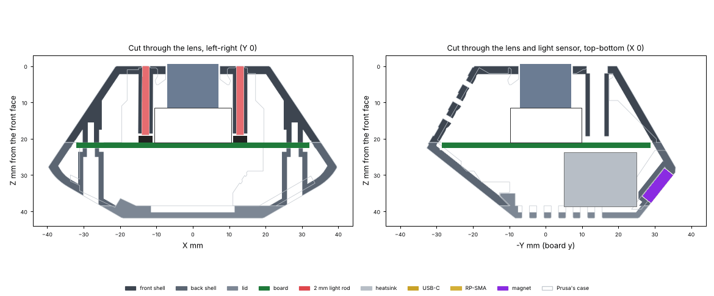
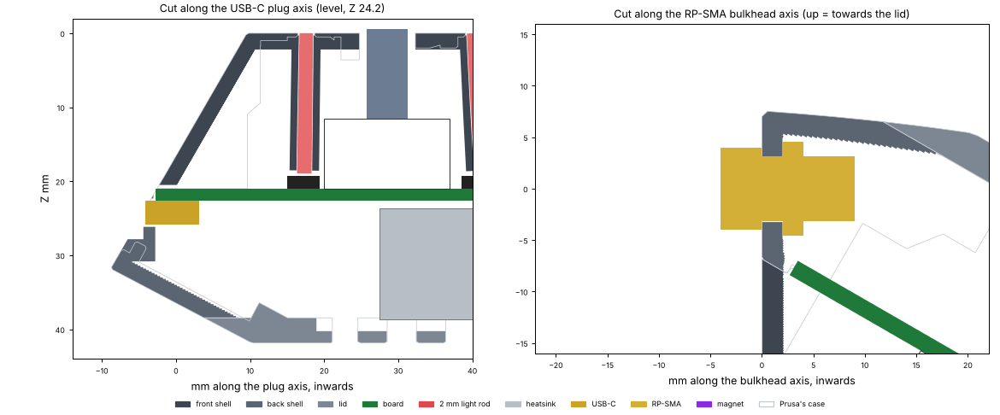

# LayerCam Pro v1: the printed case

Prusa's Buddy3D case for the CORE One on the **outside**, a new **inside**
for LayerCam Pro's one board. Three printed parts, as Prusa's: a front
shell, a back shell and a lid, joined with M2 screws.

**Status: designed, not printed.** Every check passes (below), with the
board outline cut down to fit Prusa's two concave shoulders.



*The case cut through the lens. One board (green) sits at the case's
widest point, at Prusa's own seam (Z 21.0). Six 2 mm clear rods (red) carry
the LEDs' light to Prusa's six front holes. The heatsink stands under the
lid's vent slots, where the lid is 1.6 mm thick. Prusa's case is drawn in
thin grey for comparison.*



*Left: the USB-C plug goes in level, into a seat cut square to it in
Prusa's sloping side facet. Right: the RP-SMA bulkhead, nut inside, with
room for the nut and the jack above the board.*

## The parts

| File (`print/`) | Part | Print it | Volume |
|---|---|---|---|
| `layercam-pro-front-shell.stl` | Front shell, Z 0 to 21.0: lens bore, six rod channels with guide tubes, the light-sensor tube, the four board bosses (M2 pilots) | front face down, as exported | 11.7 cm³ |
| `layercam-pro-back-shell.stl` | Back shell, Z 21.0 to 38.45: the USB-C seat, the RP-SMA hole, both magnet pockets, the four screw counterbores, the lid-screw bosses | its back face (Z 38.45) down, as exported (as Prusa prints its top part) | 11.5 cm³ |
| `layercam-pro-lid.stl` | Lid with Prusa's six vent slots, 1.6 mm thick over the heatsink, Prusa's two lid screws | outer face down, as exported | 3.8 cm³ |

**Print settings (Prusa's for this case):** PrusaSlicer, Prusament PC
Blend Carbon Fiber (PCCF), hardened 0.4 mm nozzle, 0.20 mm STRUCTURAL,
15 % grid infill, **no supports**. Use 4 perimeters (Prusa uses 2): the
new walls are 1.6 to 2.1 mm, and 4 perimeters print them solid. The
openings that print sideways (USB-C obround, magnet pocket floors on the
back chamfers, screw-head seats) are short bridges, as on Prusa's parts.
Carbon-filled PC conducts a little: the case touches the board only at the
four screw pads (Ø4.5); everywhere else it keeps 0.5 mm off it.

## What changed on the outside

The outside is Prusa's own surface (their triangles), except:

| Change | Why |
|---|---|
| **USB-C** moved to the board's edge tab on the same -X facet: a 9.4 x 3.8 obround, plug axis level at Z 24.2 along 149.6°, in a 13.0 x 7.2 seat cut square to the plug (the facet slopes 30°; Prusa's own USB-C recess was 1.1 to 1.4 mm). The receptacle's mouth, 4.2 mm out from the board's edge and past the tab's 2.8 mm end (`geometry.USB_MOUTH`, which the board uses too), sits 0.2 mm inside the seat floor. Prusa's opening and recess are filled flush | level plug from a flat board |
| **RP-SMA** Ø6.5 hole with a flat (5.9 across) on the +X +Y facet of the back shell, at (28.1, 20.4, 26.9) | the antenna (below) |
| **Magnets**: two Ø10.3 x 3.1 mm pockets for 10 x 3 mm discs, on the two faces where Prusa's slide-in block magnets act (the +X back chamfer, centre (31.2, 8.4, 34.6), and the -Y back chamfer, centre (1.0, -32.0, 33.8)), each on the largest flat circle of its face. Prusa's slots are closed | round discs, epoxied flush |
| **Screws**: the board's four M2 screws (`geometry.SCREWS`) clamp board and shells together from the back. The two at (±13, 25.5) use Prusa's two holes in the +Y back chamfer, moved 0.6 mm (Prusa's are at y 26.1); the two at (±28, 0) are **new holes** in the ±X back chamfers, 9 mm from the magnet pocket | one set of screws for board and case |
| **SD-card slot** and Prusa's antenna-lead slit (both at -Y, at the seam) closed flush | no card; the antenna is on the RP-SMA |

Unchanged: the shape, the seam, Prusa's surface texture, the Ø14.9 lens
bore, the six Ø2.4 LED holes, the Ø5.8 light window at (0, -14.15), the
lid's six vent slots, Prusa's slots in the front shell's +Y facet, the
lid's two screws. The LED holes are cut where Prusa's STEP file has them,
which is up to 0.45 mm off `geometry.hole_xy`'s R 13.0 every 60°: at 0°
(13.00, 0.15), 60° (6.63, 11.18), 120° (-6.78, 11.44), 180° (-12.90, -0.35),
240° (-6.64, -11.12), 300° (6.73, -11.65).

## The inside

- **Board**: `geometry.OUTLINE` (cut down to fit, 2710 mm²) with its
  USB-C tab, as `src/pcb.py` draws it, clamped at the case's widest point, front face on four Ø4.5
  boss tops at Z 21.0 (Prusa's outer seam), screws through the board and
  the back shell's Ø4.5 pads. 0.5 mm round the board everywhere else; the
  USB-C tab runs into a slot in the wall (0.25 mm at its end; no copper
  within 0.3 mm of it). Walls are 2.0 mm normal to Prusa's outside (a 2 mm ball
  erosion of Prusa's case, in 0.2 mm slabs, one per print layer), 1.6 mm
  where something must come closer.
- **Light rods**: six channels Ø2.15 for 2.0 mm clear rods, from each
  LED (`geometry.led_xy`, front face Z 21.0) to Prusa's hole (Z 0): leaning
  0.5° and 1.1° at 0° and 180° (Prusa's holes are not exactly over the
  LEDs), 4.2°, 3.4°, 4.4° and 2.9° at 60°, 120°, 240° and 300°. Each rod's
  inner end stops 0.3 mm short of its LED (Vishay VSMY3850X01, PLCC-2,
  1.75 mm tall: `LED_H`). Guide tubes Ø4.0 end 0.7 mm short of the LEDs.
- **Light sensor**: a Ø4.0 tube from Prusa's Ø5.8 window to Z 19.3,
  0.65 mm short of the TEMT6000 under it.
- **Lens and IR-cut holder**: the box `geometry.HOLDER_BOX` from Z 11.5 to
  21.0 and the Ø14.9 bore in front of it are kept clear.
- **Heat**: the heatsink (20 x 20 x 15 on the chip at (0, -15)) has
  0.84 mm to the lid and 0.5 mm to the back shell; the lid is 1.6 mm thick
  over it (and under its -Y chamfer), with Prusa's six vent slots, three of
  them over the fins. Nothing stands between the slots and the fins. No
  extra vents: Prusa's slots in the front shell's +Y facet stay open.

## The antenna: where and why

In the printer (Prusa's install guide and photos) the camera sits in the
top-left front corner with the USB-C cable going to the back. That pose is
the one where Prusa's **-Y back-chamfer magnet face lies on the left frame**
and the **+Y back chamfer against the ceiling** (the only pair of faces on
the case at 90° that includes a magnet face and leaves the plug pointing
backwards): the lens then looks right and 51° down across the bed, and
Prusa's tilted plug points back (and right), as the guide says. The
light window is low next to the post and the slotted +Y face up and to the
right, as in Prusa's photos. Measured from Prusa's files, not yet on a
printer.

In that pose the case's +X side faces the front of the printer. The
bulkhead goes on the **+X +Y facet of the back shell**, which faces the
front frame (0.75) and the room (0.65), almost level. With a 2 dBi
tilt-swivel dipole folded down 90°, the antenna hangs down the front frame
beside the front-left post, out of the gantry's way, on the other side
from the USB-C cable. The faces that point straight down are no good: the
front shell's -Y facets are below the board (the lead cannot reach them),
the back shell's -Y facet is 7.7 mm tall and 4 mm from the left wall,
and the back chamfers send the jack into the board and the heatsink.
`case.sma_search()` finds the spot: the only place with a flat Ø9.6
outside (the bulkhead's hex) and room inside for the nut and the jack,
clear of the board's parts (3.7 mm above them), the screw bosses and the
magnets.

## Bill of extra parts

| Qty | Part | Search for |
|---|---|---|
| 4 | M2 x 8 socket head cap screw, A2 stainless (board and shells; they tap their own thread in the Ø1.7 pilots, as Prusa's do) | "M2 x 8mm socket head cap screws stainless DIN 912" |
| 2 | M2 x 6 socket head cap screw (lid, Prusa's) | "M2 x 6mm socket head cap screws stainless" |
| 1 length | 2.0 mm clear **polycarbonate** rod (Tg about 145 °C; clear acrylic softens near 100 °C and is the second choice), cut 6 x 19.0 mm (the channels are 18.95 to 19.01 mm), ends square and polished | "2mm clear polycarbonate rod" (or "2mm clear acrylic rod") |
| 2 | Disc magnet 10 x 3 mm, **N35SH or N38SH** (rated 150 °C; plain N grades are 80 °C). No Amazon listing found that names an SH grade in this size; the nearest confirmed SH disc is K&J Magnetics D62SH, 3/8 x 1/8 in, N42SH, 150 °C, which fits the pocket (0.08 mm proud) | "N35SH 10x3mm disc magnet" / "high temperature neodymium magnet 150°C 10mm x 3mm" |
| 1 | High-temperature epoxy for the magnets and the rods: J-B Weld Original (rated 287 °C) | "J-B Weld Original" |
| 1 | Antenna lead: **W.FL / MHF3 (MHF III) to RP-SMA female bulkhead, about 10 cm, 1.13 mm cable** (the ESP32-C6-MINI-1U-H4's socket is MHF III, not U.FL). The bulkhead is 1/4-36 UNS with a flat; nut and lock washer go inside | "MHF4 MHF3 W.FL to RP-SMA female bulkhead 10cm 1.13mm" (check it says MHF3/MHF III) |
| 1 | Antenna: 2.4 GHz RP-SMA dipole, **2 dBi** (the module is certified with 2.33 dBi; no more gain than that), tilt-swivel | "2.4GHz 2dBi RP-SMA antenna swivel" (most listings are 3-9 dBi: check) |

The heatsink (20 x 20 x 15 mm) and its 3M 8810 tape are in the main README.

## Assembly

1. Print the three parts. Clean the pilots (Ø1.7) and the rod channels
   (Ø2.15) with a drill bit of that size if needed.
2. Magnets: a little epoxy in each pocket, press the disc in flush, wipe,
   let it cure.
3. Rods: from inside the front shell, push each rod into its channel until
   its end is flush with the front face; a small drop of epoxy on the rod's
   side about 5 mm from its inner end before the last push holds it. Keep
   the inner end clean.
4. Heatsink on the main chip (3M 8810).
5. Board onto the front shell's four bosses, LEDs over the rods, the light
   sensor under its tube, the USB-C tab in its slot.
6. RP-SMA: feed the W.FL end in through the D-hole from outside, seat the
   jack's hex on the flat outside, lock washer and nut inside; plug the
   W.FL into the module.
7. Back shell on (the seam at Z 21.0), then the four M2 x 8 screws: two
   through the holes in the +Y back face, two through the holes in the ±X
   back chamfers (a long 1.5 mm hex key).
8. Lid on, two M2 x 6.
9. In the printer: the -Y back-chamfer magnet face against the left frame,
   the +Y back chamfer against the ceiling, USB-C cable to the back; screw
   the antenna on and fold it down along the front-left post.

## Build and check

```
python3 enclosure/src/case.py <folder with Prusa's files>   # builds print/, images/, runs the checks
python3 enclosure/src/check.py <folder with Prusa's files>  # checks the committed print/*.stl
```

The folder holds Prusa's `buddy-camera-bottom-r2`, `-top-r1` and `-lid-r1`
(STL and STEP) from Printables model 1343977; they are not committed. Needs
numpy, scipy, shapely, trimesh, manifold3d, matplotlib, Pillow and
cadquery-ocp (a venv in `out/` is fine). The solids are Prusa's STL
triangles (their STEP files do not tessellate watertight); the STEP files
give the exact faces. Scratch goes to `enclosure/out/` (git-ignored), with
`out/fit-outline.txt`.

Check results (2 Nov 2026 build):

| Check | Result |
|---|---|
| Board seat | four Ø4.5 boss tops at Z 21.00, pilots Ø1.7 x 5.5 |
| Board outline | `geometry.OUTLINE` lies wholly inside the room the case leaves (1.6 mm wall, 0.5 mm round the board from Z 20.5 to 23.1) |
| Board clearance | 0.50 mm to the front shell and the back shell, 3.0 to the lid; the USB-C tab's end 0.24 (no copper within 0.3 mm of it); only the four Ø4.5 pads touch it |
| Prusa's front holes | LED holes, window and bore cut where Prusa's STEP file has them |
| Rod channels | all six walled from the front plate to the tube top, open at both ends, rod to case 0.07 mm, 0.3 mm to each LED, rods 18.95 to 19.01 mm |
| Light-sensor tube | open end to end, 0.65 mm short of the sensor |
| IR-cut holder volume | clear |
| Heatsink | 0.84 mm to the lid (>= 0.5), 0.5 to the back shell, 3 slots over it |
| USB-C mouth | axis level at Z 24.23; mouth 4.20 mm out from the board's edge (as `src/layout_main.py` places it), 0.20 mm inside the seat floor; opening clear |
| Walls (outside to inside) | front shell thinnest 1.95 mm; back shell 1.51 at one spot beside the antenna jack's room (0.03 % of its surface); lid 1.48 at two corners of its 1.6 mm pocket (0.09 %) |
| Magnet pockets | 3.10 deep, floors 1.50 mm |
| RP-SMA | 2.0 mm wall at the hole, nut and jack room clear |
| Parts | do not overlap |

## Open (the owner's decisions)

1. Done: `geometry.OUTLINE` is now the outline that fits. Prusa's case
   has two concave shoulders at about (±26, -12) at the seam that the first
   (convex) outline ran 2.9 mm into. `check.py` tests the outline against
   the room the case leaves; if it ever fails, `case.py` writes an outline
   that fits to `out/fit-outline.txt`.
2. The two new screw holes at (±28, 0) on the back chamfers; the top two
   could reuse Prusa's holes exactly if `geometry.SCREWS` had y 26.1.
3. The antenna face rests on the camera's pose in the printer, worked out
   from Prusa's files and photos: check it in a CORE One before ordering.
4. The USB-C seat is deeper than Prusa's recess at its top (4 mm): a level
   plug on a 30° facet needs it.
5. The light window is left open (Prusa fits a blue window piece there);
   a Ø5.8 x 2 mm clear disc would close it.
6. `geometry.hole_xy` (R 13.0 every 60°) is up to 0.45 mm off Prusa's
   holes (listed above); the case keeps Prusa's and leans the rods to
   them. The two straight LEDs could move under their real holes.

## Licence

The case is derived from Prusa Research's printed case for the Buddy3D
camera for the CORE One (Printables model 1343977, by Prusa Research a.s.,
licensed GNU GPL v2), so everything in this folder (the code, the STL
files, the images) is published under the **GNU General Public License
v2**: see [`LICENSE`](LICENSE). Prusa's files are not included; download
them from Printables. Thanks to Prusa Research for publishing them. Prusa,
CORE One and Buddy3D are Prusa's names, used here only to say what the
case fits and comes from.
