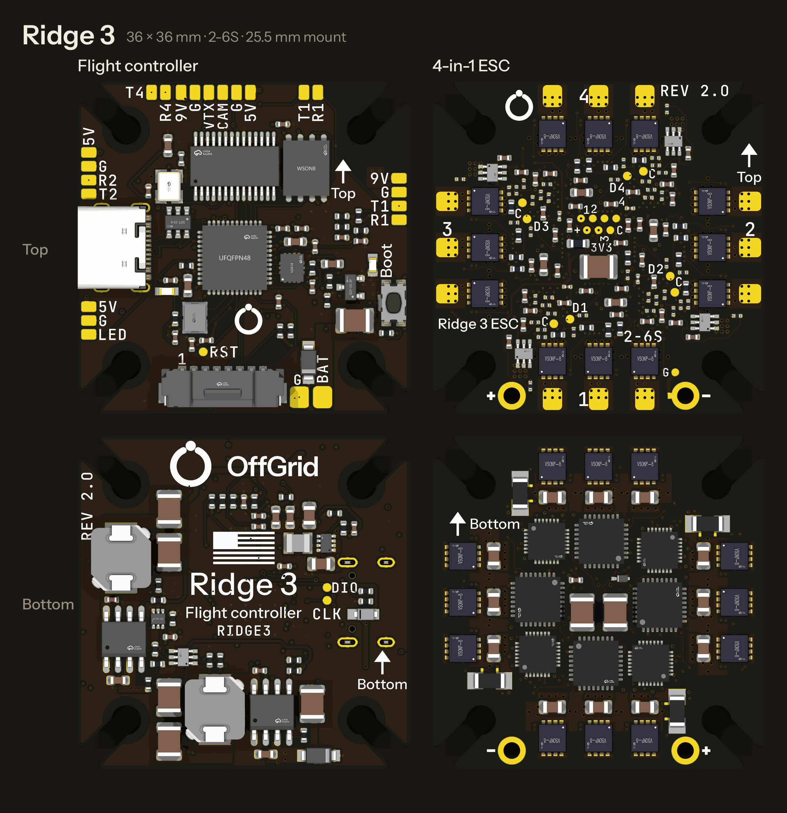

# Ridge 3: flight controller + 4-in-1 ESC for 3-inch quads, 2-6S

Two 36 × 36 mm boards on the 25.5 mm hole pattern: a flight controller with
HD and analog video, and a 4-in-1 ESC with current sensing and a
temperature sensor on every motor.  They connect with an 8-wire stack lead
in the FPV standard's pin order.  When one breaks, you replace that board,
not the whole stack.

Ridge 3 is the first of a line named by prop size: **Ridge 3**, **Ridge 7**,
**Ridge 12**. Only Ridge 3 is designed so far; Ridge 3 Lite
([`../ridge3-lite/`](../ridge3-lite/)), one board with the flight controller
and ESC and no FPV parts, is a separate design for the same quads.

**Revision 2** is built for a heavy quad on a 50 °C day: every part is
chosen for the temperatures the simulations give, and the firmware's limits
act before the power stage burns out.  On such a day, with 5 m/s of air over
the stack and the ESC on its heatsink, it holds 52 % throttle indefinitely
before AM32's temperature limit starts cutting a motor (hover is 27 %; 58 %
on a 25 °C day).  A hard three-minute flight has that limit cutting a motor
for 9 % of it, from about a minute in, with the hottest FET at 128 °C:
on a day that hot the limit, not the parts, sets the pace.  [`docs/REV2.md`](docs/REV2.md) lists every change from revision 1 and
why; [`STRESS.md`](STRESS.md) runs both revisions through the same
simulations, including what rev 2 still does not pass.

**Status: designed, not yet built.** Both boards pass KiCad DRC with zero
errors, zero warnings and zero unconnected items against JLCPCB's rules.
The copper matches `src/circuit.py` pad for pad, and
[`VERIFICATION.md`](VERIFICATION.md) checks the design against sources other
than itself. No board has been made or measured.  The FC's last three
fixes before ordering are in: its 3.3 V buck's output capacitance, its 5 V
buck's enable on USB power, and its 5 V rail's copper, which the first
routing had run through a feedback line ([`docs/STATUS.md`](docs/STATUS.md),
D10-D12).  Order the prototypes
that [`docs/TEST_PLAN.md`](docs/TEST_PLAN.md#what-to-order-for-testing)
lists, build one stack, and go through the [bring-up](#bring-up) steps
before building more.  Every test and simulation, with why it exists, how
to run it and this revision's result, is in [`TESTS.md`](TESTS.md).  Open
decisions, the prototype test plan and the progress log are in
[`docs/STATUS.md`](docs/STATUS.md) (start there when taking the board on),
with [`docs/TEST_PLAN.md`](docs/TEST_PLAN.md) and
[`docs/CHANGING.md`](docs/CHANGING.md).

**Revision 2.0** for both boards: printed `REV 2.0` by a corner of each, and
in each board file's title block, which the Gerbers carry. Each board keeps
its own number (`REVISION` in `src/fc_layout.py` and `src/esc_layout.py`), so
a change to one board moves only its number.



---

## What it does

| | Flight controller (`fc/`) | 4-in-1 ESC (`esc/`) |
|---|---|---|
| Battery | 2-6S as printed (up to 25.2 V); a 6S LiHV pack (26.1 V) is simulated and passes.  On 2S the 9 V video supply cannot hold 9 V, and at full load the FC draws about 1.9 A through the stack lead's 1.5 A contacts: [`docs/RELIABILITY.md`](docs/RELIABILITY.md) recommends rating it 3S-6S LiPo and 6S LiHV, an open decision ([`docs/STATUS.md`](docs/STATUS.md), D8).  The ESC lead feeds the FC; the video supply has its own battery pads | 2-6S as printed, 6S LiHV simulated.  60 V FETs: 42 % of their rating on 6S (44 % on LiHV) |
| Brain | STM32G473 (170 MHz). Betaflight target `RIDGE3` | 4 × Artery AT32F421 (120 MHz). AM32 target `RIDGE3_F421` |
| Sensors | TDK IIM-42652 industrial gyro (-40..105 °C; an ICM-42688-P fits the same pads), battery voltage, current from the ESC | Current per motor (0.5 mΩ Kelvin shunt + TI INA186), battery voltage, an NTC thermistor at each motor's FETs |
| Video (optional groups) | **HD** (the default build): solder pads for DJI O3/O4, Walksnail and HDZero air units, `9V G T1 R1` (MSP DisplayPort on UART1). **Analog build:** adds an AT7456E OSD with camera and VTX pads | – |
| Power out | 5 V 2 A with airflow, 1 A continuous on the ground in still air (0.5 A at 60 °C: [`docs/RELIABILITY.md`](docs/RELIABILITY.md)) (TI LMR38020F). **9 V 2 A for the VTX** (a second LMR38020F) from its own battery pads, which Betaflight can switch off and a thermostat cuts above 96 °C. 3.3 V from a TI TPS628501 buck | – |
| Power stage | – | 24 × Infineon ISZ023N06LM6 (60 V, 2.3 mΩ), TI DRV8320H smart gate drivers (set gate current, 2 A hold-off, overcurrent shutdown) |
| Protection | TVS on each battery input. The 9 V rail stays off without its battery pads, and when its thermostat trips | Three 10 µF 50 V bus ceramics on the board, the FC's TVS on the same battery line. Current limit and temperature limit (read at the FETs) per motor (AM32), the drivers' overcurrent shutdown, stuck-rotor cut-out |
| Connectors | USB-C, BOOT button, Molex Micro-Lock Plus stack lead (locking), solder pads | Through-hole battery pads, motor pads, soldered stack lead |
| Blackbox | 16 MB Infineon flash (-40..125 °C); the board runs without it | – |
| Layers | 6 | 8 (two battery plane pairs) |
| Mounting | 25.5 mm, M2 soft-mount grommets, at least 6 mm above the ESC | 25.5 mm, M2, screwed down on its heatsink |
| Cooling | – | A machined aluminium heatsink under the ESC, fins along the air, on a gap pad over the bottom side's parts (`mechanical/`) |

**Mounting holes.** Each corner hole (3.2 mm) has a 2.5 mm slot cut out to
the corner. A standard M3-to-M2 rubber grommet slides in from the corner and
snaps into the hole, rather than being forced through a closed hole.  M2
screws and nuts; no M3 hard mount (the frames' 25.5 mm holes are M2, and an
M3 nut needs bare board the copper now uses).  Why the holes stay where
they are, and what rev 2 changed round them, is in `docs/MOUNTING.md`.
The outline has no sharp point anywhere:
where each slot opens through the edge, the point is rounded by a tight
0.3 mm arc sweeping into a 2 mm one along the slot (so it takes under 1 mm
of the straight edge, which the production panel's break-off tabs need),
and where the slot meets the hole by a 0.3 mm round, which keeps the lip
that holds the grommet.

**The ESC's heatsink.**  The ESC sits on a 6061 aluminium plate the size of
the board, black anodized, with 8 mm fins underneath along the quad's
front-rear axis and four feet round the mounting holes that stand on the
frame.  Four bosses round the holes carry the ESC (on the bare ring the
copper keeps clear of each hole), so the gap between the board and the plate
is machined, 1.25 mm, and a 1.5 mm T-Global TG-A6200 gap pad fills it.
Every part on the ESC's bottom has a pocket at least as deep as its maximum
height (from its maker's drawing), cut at two depths, 0.8 and 1.45 mm (a
pocket within 0.4 mm of a deeper one is cut as deep).  The pad lies at the
board's squeeze over the processors, drivers and bridge capacitors; over the
FETs and shunts (1.05-1.10 mm parts in 1.45 mm pockets) it has 1.6 mm of
room for its 1.5 mm and does not press (the thermal model counts the pad
only on bare board).  The two tall 1210 capacitors have a window through the
plate and a hole in the pad.  Notches at the rear let the battery lead in from below.
`src/heatsink.py` makes it from the routed ESC: the STEP, the gap pad's
outline (DXF) and a drawing for the CNC order are in `mechanical/`, and
the stress simulations use the same geometry.  It weighs about 14.5 g, the pad
5 g, and the stack stands 11.6 mm higher on the frame.  The ESC no longer
takes grommets: the FC carries the gyro and keeps its own.

**Stack lead:** 8 wires in the FPV standard's order, pin 1 to pin 1:
`1 VBAT, 2 GND, 3 CUR, 4 3V3, 5 M1, 6 M2, 7 M3, 8 M4`, but for pin 4: the
standard's ESC telemetry wire carries the FC's 3.3 V down to the ESC's four
MCUs (86 mA at most), so the ESC needs no 3.3 V regulator and its gate
drivers' own 3.3 V outputs, which are linear from the battery, carry no
load.  The ESC's MCUs therefore run only with the FC connected.  Neither
board pairs with another maker's 4-in-1 or FC on a standard lead: an ESC
that drives telemetry on pin 4 would fight the FC's 3.3 V (the Micro-Lock
housing does not fit the usual JST-SH header anyway).  At the ESC the wires
are soldered to pads (no connector at the hot end): VBAT, 3V3 and CUR
(`+ 3V3 C`) and the four signals (`1 2 3 4`) to two rows in the middle of
the top, and the ground wire to a pad of its own beside the battery minus
pad, where the FC's ground meets the
ESC's (through the battery pad's Kelvin tap: no motor current flows between
that pad and the battery wire, so none flows round the lead).  At the FC
they go into a Molex Micro-Lock Plus housing (505565-0801, 505431
terminals): 1.5 A and 105 °C per contact, against the JST-SH's 1 A and
85 °C, and it locks.  The lead carries only the FC's own 5 V side, under
0.6 A on an empty 6S pack; the video supply has its own wires from the
ESC's battery pads.  To use this ESC with another maker's FC, solder that
FC's lead to the ESC's pads but keep its pin 4 (TLM, an input on that FC)
off the `3V3` pad, and give the `3V3` pad 3.3 V (about 90 mA) from that FC
or a regulator: without it the ESC's MCUs do not run.  To use this FC with
another ESC, make a lead with the Molex housing at this end and leave
pin 4 unconnected: this FC drives 3.3 V on it.  The ESC's CUR output is the
average of its four channels' sensors: 12.5 mV per amp of battery current
unloaded, 12.2 mV/A into the FC's 100 kΩ (Betaflight `ibata_scale` 125,
which the firmware sets, reads about 2.4 % low; trim it at bring-up).

**Motor numbering:** Betaflight's Quad X. Motor 1 is rear-right, 2
front-right, 3 rear-left and 4 front-left. On the ESC, each motor's number is
printed beside its three pads. The order of the three wires within a motor
does not matter: set the direction in the AM32 Configurator
(<https://am32.ca>).

---

## Headroom, and what the stack cannot do

**Voltage.** The design rule is that no part runs above 60 % of its rating
on a full 6S pack (25.2 V).  In revision 2 every part that touches the
battery meets it, the power FETs included:

| Part | Rating | At 25.2 V |
|---|---|---|
| ESC FETs, Infineon ISZ023N06LM6 | 60 V | 42 % |
| ESC gate drivers, TI DRV8320H | 60 V (65 V absolute) | 42 % |
| FC 5 V and 9 V BECs, TI LMR38020F | 80 V | 32 % |
| Bridge, bus and input capacitors | 50-100 V | 25-50 % |

Rev 1's 40 V FETs ran at 63 %, and its switch node rang to their rating.
The 60 V parts with the DRV8320H's controlled gate current keep the
simulated peaks at 30 A well inside 60 V (37.7 V, [`STRESS.md`](STRESS.md));
at a full-throttle punch's 68 A they reach 42 V in the estimated 5 nH loop
and 53 V in the 8 nH bracket ([`docs/RELIABILITY.md`](docs/RELIABILITY.md),
[`docs/STATUS.md`](docs/STATUS.md) D2).  Two switching checks do not pass
outright.  At 30 A the high side's turn-off pulls the driver's SHx pin to
-9.2 V in the 5 nH loop (-12.8 V in the bracket), past its -7 V for 200 ns
(fail).  While the high side turns on, the off low-side FET's gate reaches
1.76 V on its die at 150 °C (the worst of the 3-8 nH runs), above the hot
FET's threshold, about 0.4 V minimum and 1.0 V typical (marginal): the
driver holds the gate pin to its ground, but the FET's source bounces
through the source copper and the shunt.  The model's switching energies
show no shoot-through.  [`docs/TEST_PLAN.md`](docs/TEST_PLAN.md) T5
measures both, the gate at the FET with a differential or isolated probe
([`docs/STATUS.md`](docs/STATUS.md) D2, D6).  The ESC carries its own bus
capacitance (three 10 µF 50 V ceramics beside the twelve bridge
capacitors), so nothing hangs on the battery leads.  The FC's SMF33A TVS
clamps slow surges on the same battery line.

**Current.** Each FET is rated 149 A continuous with its case at 25 °C
(105 A at 100 °C, 596 A pulsed; 2.3 mΩ maximum at 10 V gate drive, and the
DRV8320H drives about 11 V).  A 3" motor's 20-30 A bursts are a small
fraction of that.  What limits current is heat in a 36 mm board, and the
simulations in [`STRESS.md`](STRESS.md) give the numbers at 25, 50 and 60 °C
air.  The firmware keeps the board from cooking itself: AM32's per-motor
current limit (20 A, read from this board's shunts, over 50 ms), its
temperature limit (110 °C, read by a thermistor at each motor's FETs) and
stuck-rotor protection (a cut after about 248 ms).  Under them, each gate
driver has its own overcurrent trip (all six FETs off for 4 ms, then a
retry) at 0.6 V across a FET and the copper in series with it: about
118-143 A with a hot FET, 181-221 A with a cool one, so it never acts in a
punch (64-68 A) and catches a short or a jammed motor.  In the simulated
worst crash, a motor stopped dead at full throttle right after hard flying
on a 50 °C day, the low-side FET still passes its 175 °C rating for about
0.2 s before AM32 cuts.  See [`firmware/README.md`](firmware/README.md);
[`docs/RELIABILITY.md`](docs/RELIABILITY.md) has the crash and the punch,
and [`docs/STATUS.md`](docs/STATUS.md) the decisions they raise (D3, D4).

**Heat on the flight controller.**  The FC's own losses are its supplies,
and the video supply is the big one.  It runs from its own battery pads,
and a thermostat beside it switches it off above 96 °C (on again at 76 °C),
which keeps the supplies and the processor in their ratings on the ground
up to a 50 °C day, and in the simulated hard flight at 50 °C never trips.
In the HD build the only parts rated below 105 °C are the USB-C receptacle
(85 °C; it carries nothing in flight) and the two status LEDs (100 °C): the
air unit solders to pads, so no 85 °C connector carries the video.  The analog build's AT7456E OSD is an 85 °C part the thermostat does
not protect: on the ground in still air it reaches 91 °C on a 25 °C day.
Past the design day, at 60 °C in still air, the processor reaches 107 °C
against its 105 °C even with the video held off.  The 130 °C STM32G473CEU3
fits the same pads, but ST quotes 52 weeks for the whole STM32G4 family.
On the bench, put a fan on the stack or keep the video off;
[`STRESS.md`](STRESS.md) has the times.

The inner copper is 1 oz on both boards.  None of this is measured yet:
bring-up steps 6 (the ESC's FETs) and 7 (the FC's video thermostat), and
[`docs/TEST_PLAN.md`](docs/TEST_PLAN.md) T8 and T9, measure it.

**What it cannot do:**

- 7S or 8S. That is Ridge 7's job.
- Serial ESC telemetry: the stack lead's TLM wire carries 3.3 V instead.
  Bidirectional DShot carries RPM, and AM32's extended DShot telemetry
  carries temperature, voltage and current, instead.
- A barometer or a magnetometer. GPS goes on UART4.

---

## Cost, against an $80 AIO

The reference is the GEPRC TAKER G4 AIO this stack replaces, about $80.
Component cost comes from JLC's live catalogue prices on 1 October 2026
(the ESC's FETs, which JLC sources globally, at DigiKey's 100-piece price),
before assembly fees and bare boards:

| | 1 set | 100 sets | 1,000 sets |
|---|---|---|---|
| FC (HD build) | $38.23 | $29.73 | $28.54 |
| ESC | $63.13 | $54.48 | $52.56 |
| **Stack** | **$101.36** | **$84.21** | **$81.10** |

The analog build adds $5.33 / $3.63 / $3.46 to the FC (the AT7456E OSD,
its 27 MHz crystal and their parts).  The ESC's row is its BOM before
2 October's changes (four ferrite beads and eight 1 µF capacitors in, eight
other capacitors out), which move it by a few cents.  The FC's row includes
the three parts D10 and D11 added on 19 October (a 10 µF 0805 and two 0402
resistors, $0.32 / $0.20 / $0.20), priced from the same listing; all three
were already on the board, so the extended-part count below is unchanged.

Revision 1 was $84.48 / $57.12 / $53.60.  Revision 2 spends the difference
on surviving a hot day:

- **The FETs are most of it**: 24 × Infineon ISZ023N06LM6 at $1.49 is
  $35.76 of the ESC's $53 (rev 1's 40 V Toshiba parts: $10.37).  Two
  cheaper 60 V parts fit the same land, both rated 150 °C instead of 175 °C
  and with more on-resistance (more heat): Vishay SiSS22LDN (3.65 mΩ) and
  Infineon BSZ040N06LS5 (4.0 mΩ, JLC stock).  The BSZ040 has been through
  the simulations and is not a substitute ([`docs/RELIABILITY.md`](docs/RELIABILITY.md));
  the SiSS22LDN has no SPICE model.
- **The rest** (per set at 1,000): the gyro ($11.06), the four gate drivers
  ($7.76), the FC MCU ($5.19), the flash ($4.56), the four current
  amplifiers ($2.34), the four ESC MCUs ($1.86).
- **One-off, the parts alone pass $100**, and on top come JLC's per-order
  assembly fees: setup, stencil, and a loading fee for each unique extended
  part (on 1 October's listing, 31 on the FC's HD build, 35 on its analog
  build and 17-18 on the ESC; JLC's quote gives the count on the day).
- **The point is still the repair.** A crash that kills a motor channel
  costs one ESC, not a whole stack.  Get a JLC or PCBWay quote for the
  panels at the volume you plan: bare boards and assembly were not priced
  here.

## Sourcing: LCSC/JLCPCB, global sourcing, DigiKey

Every part has an LCSC number (for JLCPCB assembly) or, where LCSC does not
stock it, a manufacturer part number for JLCPCB's global sourcing or
PCBWay's turnkey service (`src/parts.py`).  The chips that matter come from
TI (supplies, gate drivers, current amplifiers, thermostat), ST (FC MCU),
TDK InvenSense (gyro), Infineon (FETs, flash), Diodes Inc. and Alpha & Omega
(small FETs), and Murata, Samsung, TDK, Taiyo Yuden, NDK, Abracon, Rohm,
Vishay, Stackpole, Yageo, Molex, C&K and GCT (passives, crystals, LEDs and
connectors).

The exceptions and thin spots, checked 1 October 2026:

| Part | Issue | What to do |
|---|---|---|
| AT7456E analog OSD | Made in China; the only analog OSD chip still in production | Accepted exception, and only in the analog build: the default HD build leaves it off |
| Artery AT32F421G8U7 (ESC MCUs) | Artery lists an office in Hsinchu, Taiwan and its R&D in mainland China (Chongqing, Suzhou) | A second exception to the non-Chinese rule, taken because it is the AM32-supported MCU that reads a FET thermistor and fits beside the DRV8320H.  The ST alternative (STM32G431KBU3, 5 × 5 mm) needs a board relayout |
| Infineon ISZ023N06LM6 (ESC FETs) | Not stocked by LCSC | JLC global sourcing or PCBWay turnkey; DigiKey had 2,625 on 30 September |
| Infineon S25FL128L (flash) | LCSC lists it with 0 stock | JLC global sourcing; the board runs without it |
| Abracon ABM8AIG 27 MHz (OSD crystal) | JLC stock 1 | DigiKey had 8,544; SCTF SX3B27.000F1010G30 (105 °C) fits the same land with JLC stock |
| TI TPS628501 (3.3 V buck), Murata GCJ32E 10 µF (ESC bus) | JLC stock 85 / 259 (1 October) | Enough for a prototype run; buy ahead or consign for volume |
| TDK TFM252012ALMAR47MTAA (3.3 V inductor) | Out of stock at JLC / LCSC on 13 October (DigiKey had stock) | Consign it from DigiKey, or the Bourns SRP2512TMA-R47M after a land check: [`docs/STATUS.md`](docs/STATUS.md), D5 |
| STM32G473CEU6 (FC MCU) | 105 °C junction; the 130 °C CEU3 fits the same pads and image but is out of stock everywhere: since mid-2026 ST quotes 52 weeks for the whole STM32G4 family (foundry capacity moved to higher-value parts, distributors asking for 2027's orders now), and DigiKey, Mouser, JLC and ST's own store have none of the -3 temperature grade.  The STM32G474CEU3 is the same (DigiKey 0, 52 weeks, 3 October) | Fit the CEU3 when it is available |
| Resistors | JLC's are UNI-ROYAL (operations in China) | Yageo equivalents are listed as `dk_mpn` in `parts.py`, except for the FC's 57.6k, 121k, 22.1k and 3.3k, which still need one |

## Selling in the US and allied countries (not legal advice)

- **FCC Covered List (22 Dec 2025).** New foreign-produced UAS critical
  components, flight controllers and motors among them, cannot get FCC
  equipment authorization, whichever country made them (allies included).
  The exemptions are the Blue UAS list and US-made "domestic end products"
  (US-assembled, over 65 % US component value), both extended to 1 Jan 2028,
  plus DoW Conditional Approvals for producers with an onshoring plan.
  Whether a radio-less FC/ESC needs FCC authorization at all is arguable
  (47 CFR 15.103(a)). Get a TCB or FCC counsel opinion before selling in the
  US.
- **NDAA §848 (DoD) and the American Security Drone Act (federal
  agencies).** These bind government buyers. §848 bars flight controllers
  (not ESCs) made in China, Russia, Iran or North Korea; ASDA looks at who
  manufactured or assembled the product. A JLCPCB-assembled FC fails both.
  The same design assembled in the US or an allied country by a non-PRC
  firm passes, which is what the DigiKey part numbers in `src/parts.py`
  (`dk`, `dk_mpn`) are for; no DigiKey BOM file is generated yet.
- **From 1 Jan 2027** (10 U.S.C. 4873), DoD may not buy PCBs made in those
  four countries, so a compliant build also needs a non-PRC bare-board fab.
  The Gerbers suit any 6- and 8-layer ENIG fab; the ESC's filled
  vias-in-pad are a standard option.
- **Claims.** Say what is true and documented ("assembled in USA; key
  chips from US, EU and Japanese makers"). Do not claim "NDAA compliant" or
  "Blue UAS" until it is.

## The name

"Ridge" names the line by prop size: Ridge 3, Ridge 7, Ridge 12. A web
search found no FPV product called Ridge. Still to do: a trademark search
(USPTO, EUIPO, UKIPO, CIPO) and attorney clearance, and a check of the house
mark. "OFFGRID" is registered in class 9 by another company (Faraday bags,
Reg. 6076046).

---

## Ordering

Everything to upload is in `fc/production/` and `esc/production/`. You do
not need KiCad or Python.

**For the first prototypes**, order what
[`docs/TEST_PLAN.md`](docs/TEST_PLAN.md#what-to-order-for-testing) lists:
one FC panel and two ESC panels from `production/panel/`, one of them with
the 18 kΩ IDRIVE line.  At JLCPCB a 36 mm board cannot be assembled on its
own: only Standard PCBA places parts on both sides, and it takes boards and
panels from 70 × 70 mm (JLCPCB's PCB assembly capabilities page, checked
2026-10-14).  The single-board files below are for bare boards, or for a fab
that assembles a 36 mm board on both sides.  The panels carry the HD build
only; the analog build exists as single-board files (`ridge3-fc-analog-*`).

### Bare boards (JLCPCB or PCBWay)

Upload `ridge3-fc-gerbers.zip` and `ridge3-esc-gerbers.zip` as two separate
orders:

| Setting | FC | ESC |
|---|---|---|
| Layers | **6** | **8** |
| Dimensions | 36 × 36 mm (read from the outline) | same |
| Thickness | 1.6 mm | 1.6 mm |
| Material | FR-4, TG155 or better | same |
| Solder mask | **Black** (JLCPCB) / **Matte black** (PCBWay): the brand's Pitch | same |
| Silkscreen | **White**: the brand's Bone | same |
| Surface finish | **ENIG**: the QFN and LGA parts need a flat finish | same |
| Outer copper | 1 oz | 1 oz |
| Inner copper | **1 oz** | **1 oz**. Not 2 oz: JLCPCB's finest on 2 oz is 0.15 / 0.15 mm, and the inner signal layers use 0.1 mm |
| Via covering | **Epoxy filled and capped (POFV)**: vias sit in pads | **Epoxy filled and capped (POFV)**: vias sit in pads, down to 0.25 mm vias inside the chips' 0.25 mm pins. JLCPCB makes POFV the free default on 6- and 8-layer boards; at PCBWay it is a paid option |
| Min track / spacing | 0.1 / 0.1 mm | 0.1 / 0.1 mm |
| Min via | 0.35 mm / 0.15 mm drill (JLCPCB's multilayer minimum drill) | 0.25 mm / 0.15 mm drill (inside the chips' pins); 0.35 / 0.15 elsewhere. JLCPCB's multilayer minimum, at its small-via surcharge |
| Stackup | The fab's standard 1.6 mm 6-layer build with 1 oz inner layers | The fab's standard 1.6 mm 8-layer build with 1 oz inner layers. No impedance control needed |
| Order number | "Specify location" or "Remove": no spot is kept free for it | same |

The outline includes the four corner slots. They are routed with the
outline, so no special order option is needed: the slot is 2.5 mm wide,
above every fab's minimum router slot.

### Assembly (single boards, at a fab that assembles both sides of a 36 mm board)

At JLCPCB, upload the panel files instead (*Ordering in volume*, below): its
two-sided Standard PCBA needs a board or panel of at least 70 × 70 mm.

| | FC | ESC |
|---|---|---|
| Sides | **Both sides** | **Both sides** |
| BOM | `ridge3-fc-bom-jlcpcb.csv` | `ridge3-esc-bom-jlcpcb.csv` |
| CPL (pick and place) | `ridge3-fc-cpl-jlcpcb.csv` | `ridge3-esc-cpl-jlcpcb.csv` |

Most parts are JLCPCB stock.  The ESC's FETs, the FC's flash and the OSD
crystal come through JLCPCB's global sourcing (or PCBWay's turnkey), and a
few parts have only prototype-sized stock: see [Sourcing](#sourcing-lcscjlcpcb-global-sourcing-digikey).

- **Placement preview:** in JLCPCB's placement preview, check pin 1 of the
  QFN parts and of the ESC's FETs, the LEDs (the two colours' pads are
  numbered the opposite way) and the orientation of the connectors before
  paying.  Rotations follow each part's JLCPCB library footprint, so they
  should need no changes, except where a land is drawn from the maker's
  drawing with no JLCPCB footprint behind it: the ESC's FETs and its
  shunts.
- **PCBWay:** use `*-bom-pcbway.csv`. It lists the manufacturer part
  numbers and the LCSC numbers, with the same CPL.
- **Not assembled:** the battery lead, motor wires, the stack lead, the
  video battery wires, the receiver and the VTX. These are hand-soldered or
  plugged in.

### Also needed (not on the boards)

- **No bulk capacitors.**  Revision 2 carries its bus capacitance on the
  ESC; nothing goes on the battery leads.
- **Battery lead:** XT30 or XT60 pigtail, 14-16 AWG (the pads' 1.8 mm
  holes take up to 14 AWG).
- **Stack lead:** a Molex Micro-Lock Plus housing, 505565-0801, with eight
  505431 crimp terminals and eight 28 AWG wires (the ESC's lead pads are
  sized for 28-30 AWG), about 7 cm, crimped
  in the pin order of [the stack lead](#what-it-does) and soldered to the
  ESC's lead pads (`+ 3V3 C` and `1 2 3 4` in the middle of the top, the
  ground wire on `G` beside the battery minus pad).  Check it with a
  multimeter: VBAT must reach pin 1, and the `3V3` pad pin 4.
- **Video battery wires (HD or analog VTX):** two 20-22 AWG wires from the
  FC's `BAT` and `G` pads (rear right) to the ESC's battery pads.  Without
  them the 9 V video supply has no input and stays off; the rest of the FC
  runs from the stack lead.
- **ST-Link V2 or Artery AT-Link**, Artery's OpenOCD, and a current-limited
  bench supply, to flash the ESC bootloaders once.
- **The ESC's heatsink:** machined from `mechanical/ridge3-esc-heatsink-step.zip`
  (unzip it) in 6061 with black anodizing, with the drawing
  `mechanical/ridge3-esc-heatsink.pdf` attached for the one tolerance that
  matters (the bosses' height over the pad face, ±0.05 mm).  JLCCNC and
  PCBWay CNC both take a STEP and a PDF drawing; it was not priced here.
- **Gap pad:** one T-Global TG-A6200-40-40-1.5 (40 × 40 × 1.5 mm, DigiKey
  1168-TG-A6200-40-40-1.5-ND), cut to `mechanical/ridge3-esc-gap-pad.dxf`
  (print it 1:1 as a template, or have it die-cut).
- **Grommets, screws and nuts:** four M3-to-M2 soft-mount grommets for the
  FC, for a 3.0-3.5 mm hole, flange 4.4-4.5 mm (e.g. FlyingTech type B,
  4.4 x 6.6 mm).  Four M2 screws long enough for the frame plate, the
  heatsink (11.6 mm under the ESC), the ESC, the gap to the FC and the FC on
  its grommets (about 30 mm on a 3 mm frame plate), four M2 nuts to clamp
  the ESC on the heatsink, M2 nylon spacers above them so that the FC's
  bottom sits at least 6 mm above the ESC's top (the FC's inductors and a
  1210 capacitor sit over the ESC's motor and battery joints), and four
  M2 nylon-insert or aluminium nuts on top.

### Ordering in volume

**Panels.** JLCPCB's Standard PCBA is the only JLC service that places
both sides (Economic PCBA places one). It needs a board or panel of at least
70 × 70 mm (capabilities page, checked 2026-10-14). `make.py` therefore also writes a **3 × 2 panel** of each board
to `production/panel/`: Gerbers, BOM and CPL, ready to upload in place of
the single-board files. The panel is 112 × 88 mm with six boards, 5 mm
rails, mouse-bite tabs, three fiducials per side and four 2 mm tooling
holes. Every board keeps a strip at each corner of every edge free of parts
and copper, so the tabs never sit on the grommet slots or next to a part.
The rail reads `JLCJLCJLCJLC`, so JLC prints its order number there rather
than on a board. After depanelling, sand the tab stubs flush (up to
0.25 mm). `make.py` checks every copy on the panel against the single board:
Gerbers (to 10 nm, and filled regions by shape), BOM and CPL. It also checks
that the panel's DRC result equals six copies of the board's own.

**Programming** is the one per-unit labour step. Each FC flashes over USB
(hold BOOT, plug in). Each ESC needs four short SWD sessions on its test
pads. At volume, use a pogo-pin fixture on those pads, or the assembler's
pre-programming service.

---

## Assembly

1. **Receiver on the FC:** the left edge's front pads, `5V`, `G`, `R2` to
   the receiver's TX, `T2` to the receiver's RX. CRSF on UART2 is the
   default.
2. **Video:**
   - **HD** (DJI O3/O4, Walksnail, HDZero): solder the air unit's lead to
     the FC's right edge's front pads (`9V G T1 R1`): its supply to `9V`,
     ground to `G`, its RX to `T1` and its TX to `R1`.  If the air unit carries the receiver's SBUS (DJI),
     solder that wire to `R2` in place of the receiver's TX.
   - **Analog:** camera on `CAM`, `G`, `5V`; VTX on `VTX`, `G` and `9V`,
     along the front edge.
3. **Battery lead** onto the ESC's rear pads, from below (the heatsink's
   notches take the wires out to the rear) and trimmed flush on top: `+`
   left, `-` right, as printed on both sides.
4. **Stack lead:** solder its wires to the ESC's lead pads, the ground wire
   to `G` beside the battery minus pad.
5. **Flash the ESCs.**  First do [bring-up](#bring-up) step 1 (no power:
   BAT+ to BAT- and the FC's rails not shorted).  Then, with the two boards
   side by side (not stacked, no motors) and the stack lead plugged into
   the FC: the ESC's MCUs run from
   the FC's 3.3 V on the lead's pin 4.  Power them from a current-limited
   bench supply (12 V, 0.3 A) on the battery lead.  See
   [`firmware/README.md`](firmware/README.md).  Each MCU's `Dn` (data) and
   `C` (clock) pads are on the ESC's top, over that MCU, side by side (the
   clock pad's label is the letter alone where the channel's number does not
   fit); the probe's ground goes to the battery pad.
6. **Motor wires:** each motor's three wires to the three pads beside its
   number.
7. **Stack:** the heatsink on the frame, fins front to rear, its notches at
   the rear.  Peel the gap pad's liners and lay it on the heatsink's top
   face between the four bosses.  The ESC on the bosses, pressing the pad,
   with the **front arrow forward** and the side marked **Top** facing up;
   a nut on each screw clamps it down.  Then the spacers, and the FC on its
   grommets (slid into the corner slots), front arrow forward and Top up,
   and the top nuts.  Plug the stack lead into the FC (it latches).
   (The FC's gyro alignment assumes its top faces up; Betaflight's board
   alignment can change that.)
8. **Video power:** the two video battery wires from the FC's `BAT` / `G`
   pads to the ESC's battery pads (`+` / `-`).

## Bring-up

Do these in order. Each step catches a fault before it can damage the next.

1. **No power:**
   - Measure BAT+ to BAT- on the ESC. It must not read as a short: the
     meter should climb past a few kΩ as the capacitors charge.
   - Measure the FC's `5V` and `9V` pads to `G` the same way, and its
     3.3 V at the ESC's `3V3` lead pad (the stack lead plugged into the FC)
     to the lead's `G` pad: the FC has no 3.3 V pad of its own.
2. **FC on USB only:**
   - The red power LED lights.
   - Flash Betaflight: hold **BOOT**, plug in USB, and follow
     [`firmware/README.md`](firmware/README.md).  Only the image in this
     repository: stock Betaflight mis-scales this board's gyro.
   - Paste `firmware/betaflight/cli-setup.txt` into the CLI.
3. **Orientation, before anything spins.** Phase 1 lost three crashes to a
   wrong board alignment, so check it on the bench, not in the air. In the
   Setup tab:
   - Tilt the nose down: the model goes nose down.
   - Tilt the right side down: the model rolls right.
   - Yaw right: the model yaws right.
   Then calibrate the accelerometer on a level surface: it should read
   about 1 g level before calibration (2 g means the wrong firmware).
4. **Stack on a current-limited supply, the video wires off** (or the air
   unit unplugged): 15 V with a 0.3 A limit, or a smoke stopper on the
   battery.
   - It should idle near 0.1 A: the four gate drivers, the FC's supplies
     and the five processors (an estimate from `sim/data.py`, not
     measured).  Record it.
5. **Stack plus battery, props off:**
   - The AM32 configurator, through Betaflight passthrough, must see four
     `RIDGE3_F421` ESCs. Send the default config, then set the motor KV and
     pole count, the current limit (20 A), the temperature limit (110 °C)
     and a fixed 24 kHz PWM (variable PWM off): the settings table in
     [`firmware/README.md`](firmware/README.md).
   - Betaflight's ESC temperatures (`dshot_edt`) should read the room's
     temperature within a few degrees: that checks the four thermistors.
   - In Betaflight's Motors tab, spin each motor slowly. Confirm the order
     is 1 rear-right, 2 front-right, 3 rear-left, 4 front-left, and fix the
     directions in the AM32 Configurator (<https://am32.ca>).
   - Check the RPM and current readouts. Bidirectional DShot working means
     the motor signal path is sound. The current reading should rise with
     throttle.
6. **Heat, props on, before the first real flight.** Tape a thermocouple
   to the hottest FET. Hold the quad down and run full throttle for 10 s,
   then 30 s. Stop at 110 °C.  Compare the thermocouple with the ESC
   temperature Betaflight shows: AM32's limit acts on the latter.
   Until this is measured, the simulations in [`STRESS.md`](STRESS.md) are
   the ESC's only rating.
7. **Video thermostat**, on the bench, VTX on, no fan: the FC's 9 V rail
   should stay on until the board by the 9 V regulator reaches about 96 °C,
   then switch off, and come back near 76 °C.  A hot-air gun pointed at the
   thermostat (U_TSW, bottom, beside the 9 V regulator) does it faster.
8. **First flight:** hover on a leash or in a net first.

---

## The look

Both boards follow the OffGrid brand hand-off (v3.2). Dark is the brand's
default expression, so the boards are **Pitch** (black solder mask) with
**Bone** type (white silkscreen) and ENIG gold pads.

- The FC's bottom carries the horizontal lockup (the mark and "OffGrid")
  centred on the front edge, with no tagline, and under it, on the centre
  line, the flag of the United States, the product name and the firmware
  to flash. Its top carries the mark on its own.
- In the lockup the word sits on one line with the mark, its capitals
  centred on the ring. This is the one change from the hand-off file,
  whose baseline leaves the word 25 units (of its 200) above the ring's
  centre; it was made at the owner's direction.
- The flag is not from the brand files. It is drawn in the proportions of
  Executive Order 10834 (hoist 1, fly 1.9, 13 stripes), 3.5 mm high, in one
  colour: the red stripes and the union are ink, the white stripes are
  the board. The 50 stars are left out: at this size each would be about
  0.2 mm across, below what silkscreen prints, so the union is solid.
- Every side carries the same front arrow (2.6 mm long, 1.8 mm across the
  head: one definition in `src/brand.py`) with the side's name, **Top** or
  **Bottom**, beside it. Where it sits and which side of the arrow the word
  takes depends on each side's free room.
- The ESC is full of parts on both sides. Its mark sits on top in the
  roomiest free spot, at the front edge. The top also carries the name, each
  motor's number, the pack range, the SWD pad names and the stack
  lead pads' names. Neither side has room for the firmware code at the
  smallest size the fab prints cleanly (1 mm), so it is not printed: the
  build to flash is `RIDGE3_F421` ([`firmware/README.md`](firmware/README.md)).
- Every mark is at or over the brand's minimum size (16 px for the mark,
  24 px for the lockup, at 1/96 in per px) with its clear space kept, and no
  ink goes under the grommets.
- Pad names, part codes and numerals are JetBrains Mono. Words ("Boot",
  "Flight controller") are Instrument Sans. Both follow the brand's `tokens.json`.
- Everything is drawn as filled outlines from the fonts in `fonts/` (SIL
  OFL; [`fonts/README.md`](fonts/README.md) has their versions and
  hashes), not KiCad's stroke font. The Gerbers carry the exact
  letterforms, and nobody needs the fonts installed.
- Silkscreen prints one colour, and the brand's rule is one accent or none,
  so there is no Ember.
- No brand file is copied into this repository: `src/brand.py` draws the
  mark and the lockup from the hand-off's numbers.  `src/verify.py`
  compares the mark with the brand's own lockup PNG in the brand repository
  (offgridevices/offgrid-brand, private, at `685c4d4`: hand-off v3.2) when
  `OFFGRID_BRAND` points at a checkout of it; without one, that check
  SKIPs.

---

## Files

```
ridge-3/
  README.md               this file
  images/                 both sides of both boards on one sheet; stress/:
                          the STRESS.md figures
  VERIFICATION.md         every design check that can be made without
                          hardware, with its result (src/verify.py)
  STRESS.md               the stack simulated flat out, hot, on 6S: copper,
                          switching, battery line, stack lead, heat (sim/),
                          revision 2 against revision 1
  fc/                     flight controller
    ridge3-fc.kicad_pcb / .kicad_pro / .kicad_dru   open in KiCad 10
    production/           Gerbers zip, BOM + CPL (JLCPCB), BOM (PCBWay),
                          netlist, assembly drawing (PDF); the analog
                          build's BOMs and CPL (-analog)
      panel/              the same for a 3 x 2 panel, for volume assembly
    images/               renders
  esc/                    4-in-1 ESC, same layout
  mechanical/             STEP models of both boards (zipped), for frame CAD;
                          the ESC's heatsink: STEP (zipped) for the CNC order,
                          STL for a viewer or a printed test fit, the order's
                          drawing (PDF, PNG preview), 3D views, the gap pad's
                          outline (DXF), and the JSON make.py checks
  firmware/               Betaflight image and its gyro patch, AM32
                          bootloader and firmware, the AM32 target patch and
                          the script that makes its NTC table, flashing
                          script, CLI setup
  TESTS.md                every test and simulation: why, how to run it, and
                          revision 2.0's result with its date
  docs/README.md          the board's records: start with docs/STATUS.md
  docs/STATUS.md          where it stands, open decisions, next steps, log
  docs/TEST_PLAN.md       the tests for the first prototypes
  docs/CHANGING.md        how to carry a decision into the design
  docs/REV2.md            every change from revision 1, and why
  docs/RELIABILITY.md     variants, a crash, a punch: the trade-offs and
                          what to decide, and what only the bench can settle
  docs/MOUNTING.md        the mounting holes and slots
  docs/DATASHEETS.md      the datasheets verify.py reads (not committed)
  docs/research/          the research behind the rev 1 part choices: ESC
                          power stage, FC video, sourcing and market
  aio.pretty/ aio.3dshapes/   footprints and 3D models (from JLCPCB/EasyEDA's
                          own library entries for the exact LCSC parts; the
                          USB-C connector and the BOOT switch use KiCad's
                          own models)
  fonts/                  Instrument Sans and JetBrains Mono (SIL OFL), with
                          their versions and hashes (fonts/README.md)
  src/                    the design, as Python (see below)
  sim/                    the stress simulations behind STRESS.md
    results/              their reports, committed: the variants, the
                          ground runs, the crash, the punch
    rev1/                 revision 1's boards and circuit, for the comparison
  tools/                  Dockerfile: the pinned toolchain; board_view.py and
                          mcu_cluster_search.py (not part of the build)
  video/                  exploded-view videos, made from the board files
  requirements.txt        Python packages for src/ and sim/, pinned
  requirements-cadquery.txt   CadQuery, for the heatsink's CAD files
  .gitignore              the build's working copy of the Gerbers
                          (*/production/gerbers/), the CadQuery venv
                          (.venv-cq/), KiCad's backups, final videos
```

## How it is made (and how to change it)

The design is the Python in `src/`. Nothing is drawn by hand, and nothing
is patched after the fact: every board comes out of the same code path.  To
apply a decision or swap a part, follow [`docs/CHANGING.md`](docs/CHANGING.md).

| File | What it holds |
|---|---|
| `circuit.py` | The schematic: every part and every connection, pin by pin, with the reasons. |
| `parts.py` | Every orderable part, with its LCSC and DigiKey numbers, MPN and footprint. |
| `footprints.py` | Builds `aio.pretty` from the JLCPCB/EasyEDA library entries (`src/easyeda_raw/`), plus the pads, test points and slotted mounting holes; adding a part: [below](#adding-a-parts-footprint-and-3d-model). |
| `pcb.py` | Shared board construction: outline, stackup, rules, footprints from the circuit, placement, zones, keepouts, text; KiCad's DRC, and the refresh of each part's value and LCSC number from `circuit.py`. |
| `fc_layout.py`, `esc_layout.py` | Placement, power copper, planes and silkscreen. The ESC is one motor channel written once and stamped onto four edges: driver, MCU, FETs, bridge capacitors, shunt, amplifier and thermistor in the same places on each. |
| `legalize.py` | Packs the parts round their intended spots: the parts that must sit at a pin first, each supply's parts with their chip, nothing in a reserved via corridor or tab strip. |
| `route.py`, `fanout.py`, `finish.py` | Plane fan-out and escape vias, then Freerouting for the signal routing, then an in-house maze router with rip-up for the last connections. |
| `stamp.py` | Routes one ESC channel of the template and stamps it onto the other three (`esc_layout.CHANNELS`). |
| `cleanup.py`, `pofv.py` | ESC clean-up after routing: unused escape vias and stubs come out one at a time, each removal kept only if KiCad's DRC agrees; vias move off the POFV hole spacing if needed. |
| `pipeline.py` | The order the above run in for `--reroute`. |
| `tools/board_view.py` | Not part of the build: a quick top and bottom PNG of a board (courtyards, pads by net class, tracks, vias, unrouted connections), for iterating on placement. |
| `tools/mcu_cluster_search.py` | Not part of the build: the search that found the spots of the ESC's small parts round its MCU and driver (supply, reset and filter capacitors, the comparators' dividers, the thermistor's bias, the debug pads). It scores each layout against the fan-out's own via rules and the lines `esc_layout.route_local` lays first, so every pin keeps a way out; the spots it found are written into `esc_layout.py`. |
| `artwork.py`, `brand.py` | Silkscreen placement (labels go only where they touch no pad, hole, part body, grommet or other label) and the OffGrid mark, lockup and type as outlines. |
| `fab.py` | Gerbers, drills, BOM, CPL, netlist, assembly PDF, renders (256-colour PNG), STEP. |
| `stable.py` | Keeps a rebuild from rewriting what has not changed: KiCad stamps each Gerber and STEP with the time and its raytracer's noise differs per run, so Gerbers keep their bytes when only the stamp differs, and renders and STEPs are made again only when the board, a 3D model or KiCad changed. |
| `heatsink.py` | The ESC's heatsink from the routed board: a pocket over every bottom-side part at its maximum height (`parts.HEIGHTS`), merged where the metal between would be too thin to machine; fins, feet, battery-lead notches; the gap pad at its maker's charted impedance.  STEP, STL, DXF and 3D views (CadQuery), the drawing, and the geometry the thermal model uses. |
| `panel.py` | The 3 × 2 production panel (KiKit), checked copy by copy against the single board. |
| `make.py` | Runs it all with gates. |
| `models3d.py` | Each footprint's 3D model refreshed from the library, and where the models sit, for `verify.py`'s checks. |
| `verify.py` | Writes `VERIFICATION.md`. |

`python3.12 src/make.py` rebuilds every output from the committed
`.kicad_pcb` files (`python3.12 src/make.py --help` lists its options; run
from `ridge-3/`, about 5.5 minutes for both boards on four cores when
nothing has to be rendered again; re-rendering the four panel views added
about 9 minutes). It fails unless
each board has zero DRC errors, zero warnings and zero unconnected items,
the copper matches `circuit.py` pad for pad, and every assembled part is in
the BOM and the CPL. Run on unchanged boards it leaves every fab and order
file byte for byte as it was, so `git status` shows only what a change
really moved; renders and STEP models are made again only when the board, a
3D model or KiCad changed (`stable.py`). `python3.12 src/make.py --fab-only`
runs every gate and writes every order file, single boards and panels, but
skips the renders, the STEP models, the panel renders and the stack sheet
(about 5 minutes for both boards).
`python3.12 src/make.py --reroute` places and routes both boards from
scratch first, with a fixed seed per board, so the same inputs give the same
boards. `python3.12 src/verify.py` then writes `VERIFICATION.md`.

The committed `.kicad_pcb` files are the design of record, silkscreen
included: CI runs every gate and builds the fab files from them, but redoes
neither the routing nor the artwork (`--fab-only` without `--artwork`).
After a change to the outline or the silkscreen (`src/*_layout.py`,
`src/artwork.py`, `src/brand.py`), run `python3.12 src/make.py --artwork`
and commit the boards.  `--reroute` overwrites
them with a new placement and routing, so review the copper before
committing it, and run it only when a part's land changes
([`docs/CHANGING.md`](docs/CHANGING.md)).  Whether a `--reroute` gives back
the committed copper, and how long it takes, has not been measured.

**CI.** The `ridge-3` job in `../.github/workflows/ci.yml` runs on every
pull request into `main` (`claude-code-review.yml` calls it first) and on
every push to `main`, in KiCad's official 10.0.6 image pinned by digest:
`make.py --fab-only`, a check that it left every committed output
unchanged, then `verify.py` (without the firmware sources, datasheets and
brand art, whose checks SKIP there).  A change whose fab and order files
were not rebuilt and committed fails there.  CI does not compare the
renders, the STEP models, the stack sheet, `VERIFICATION.md` (which it
writes after the comparison) or `STRESS.md` with a rebuild: commit those
from your own runs.  Every check, with this revision's result, is in
[`TESTS.md`](TESTS.md).

### Setup

The build host is Ubuntu 24.04, or the Docker image that
[`tools/Dockerfile`](tools/Dockerfile) describes; its header has the
commands to build and use it.  The image starts from KiCad's official
`kicad/kicad:10.0.6`, pinned by digest, which CI runs in directly: Debian 13
with Python 3.13.  There the Python packages that matter come from pip at
fixed versions (a few of Debian's own, such as packaging, are not pinned:
`requirements.txt` says why).  numpy, SciPy, Pillow, matplotlib and pyamg are other versions
than in the table below, since those have no wheels for Python 3.13
(`requirements.txt` lists both sets).  The fab files do not depend on them,
but the panels' Gerbers do depend on Shapely: KiKit builds each panel's
outline with it, and Shapely 2.1 (Debian 13's own package) gives other
panel Gerbers than the committed ones.  Use Shapely 2.0.7 there, as the
image and CI do; Ubuntu's 2.0.3 gives the same files.  The image's steps
have been run in the KiCad image's file system, where `make.py` left every
committed file as it was; it has not been built with `docker build`.  In
the image, write `python3` wherever this README says `python3.12` or
`sim/.venv/bin/python`: its Python 3.13 has every package installed
system-wide.  The simulations have not been run there yet, and CadQuery and
the videos' Python 3.11 are not in it.  macOS and Windows are untested:
`src/` reads KiCad's libraries from `/usr/share/kicad/`.  On Ubuntu 24.04,
from `ridge-3/`:

```
sudo add-apt-repository ppa:kicad/kicad-10.0-releases
sudo apt install kicad=10.0.6~ubuntu24.04.1 kicad-symbols=10.0.6~ubuntu24.04.1 \
  kicad-footprints=10.0.6~ubuntu24.04.1 kicad-packages3d=10.0.6~ubuntu24.04.1 \
  python3-numpy python3-scipy python3-shapely python3-matplotlib python3-pil \
  python3-fonttools python3-pip python3.12-venv g++ ngspice xvfb xauth \
  openjdk-21-jre poppler-utils
python3.12 -m pip install --break-system-packages -r requirements.txt
python3.12 -m pip install --break-system-packages --no-deps gerbonara==1.6.3
```

If the PPA no longer offers `10.0.6~ubuntu24.04.1`, use the Docker image,
which is pinned by digest.

Ubuntu's Python refuses a plain `pip install` (PEP 668), hence
`--break-system-packages`; the packages Ubuntu ships come from apt and the
rest from pip, as `requirements.txt` sets out (pip builds pyamg 5.0.1 from
source, hence `g++`), and gerbonara goes in on its own with `--no-deps`.
Then, only when they are needed:

- **`make.py --reroute`:** Freerouting 1.9.0,
  <https://github.com/freerouting/freerouting/releases/download/v1.9.0/freerouting-1.9.0.jar>
  (SHA-256 `9084a4888937a7f31f857ecc12aa7a37407f51160e4d2892dff9c9bb47ae3102`),
  named by `FREEROUTING_JAR=/path/to/freerouting-1.9.0.jar`.
- **The heatsink's CAD files**, which `make.py esc` makes again only when
  the ESC or the heatsink's parameters change: CadQuery in a venv of its
  own (it needs a newer numpy than Ubuntu's shapely is built for):
  `python3.12 -m venv .venv-cq && .venv-cq/bin/pip install -r requirements-cadquery.txt`,
  then `CADQUERY_PYTHON=$PWD/.venv-cq/bin/python python3.12 src/make.py esc`.
- **The simulations** and **the videos**: their own venvs, below.

| Tool | Version | Used for |
|---|---|---|
| KiCad | 10.0.6: `kicad`, `kicad-symbols`, `kicad-footprints`, `kicad-packages3d` at `10.0.6~ubuntu24.04.1` (`ppa:kicad/kicad-10.0-releases`); `kicad/kicad:10.0.6` by digest in the image | `pcbnew`, `kicad-cli`: DRC, Gerbers, drills, renders, STEP |
| Python | 3.12.3 (Ubuntu 24.04's) | `src/`, `sim/` |
| from apt | numpy 1.26.4, scipy 1.11.4, shapely 2.0.3, Pillow 10.2.0, matplotlib 3.6.3, fonttools 4.46.0 | `src/` |
| from pip | pypdf 6.19.0, uharfbuzz 0.56.2, pymupdf 1.28.2, scikit-image 0.26.0, kikit 1.8.1, gerbonara 1.6.3, pyamg 5.0.1 (`requirements.txt`) | `src/`, the panel (KiKit), `sim/` (pyamg) |
| In the image and CI | Python 3.13.5; numpy 2.2.4, scipy 1.15.3, shapely 2.0.7, Pillow 11.1.0, matplotlib 3.10.1, fonttools 4.46.0, pyamg 5.2.1, the rest as above, from pip; Debian's packaging, PyYAML, typing-extensions and wxPython unpinned (CI leaves out matplotlib and pyamg) | the same |
| Freerouting | 1.9.0, on OpenJDK 21 under `xvfb-run` | `make.py --reroute` |
| CadQuery | cadquery 2.8.0, cadquery-ocp 7.9.3.1.1, ezdxf 1.4.4, vtk 9.6.2, numpy 2.5.3 (`requirements-cadquery.txt`) | the heatsink's STEP, STL, DXF and views |
| ngspice | 42 (Ubuntu's `42+ds-3build1`) | `sim/` |
| poppler-utils | 24.02.0 (`pdftotext`) | the datasheets' text ([`docs/DATASHEETS.md`](docs/DATASHEETS.md)) |
| easyeda2kicad | 1.0.1 (`python3.12 -m pip install --break-system-packages easyeda2kicad==1.0.1`) | a new part's footprint and 3D model (below) |
| Video | Python 3.11.15, bpy 4.5.14, numpy 1.26.4, Pillow 12.3.0, imageio-ffmpeg 0.6.0 with ffmpeg 7.0.2 (`video/requirements.txt`) | the exploded-view videos |
| Arm GNU Toolchain | 13.3.rel1 | the firmware images ([`firmware/README.md`](firmware/README.md)) |

### What `verify.py` reads from outside the repository

`verify.py` checks the design against sources other than itself.  Five are
not in this repository.  Point these variables at them; without one, the
checks that need it SKIP and the run still passes.  Commit a
`VERIFICATION.md` made with all five set.  Without access to the brand
repository, ask the owner for it.  If that is not possible, commit with
that one check SKIP and say so in [`docs/STATUS.md`](docs/STATUS.md)'s log.

| Variable | What it points at | Source |
|---|---|---|
| `AM32_SRC` | an AM32 checkout at the commit the target patch is for; `verify.py` applies `firmware/am32`'s patch in memory (a checkout that already carries this exact patch also works) | <https://github.com/am32-firmware/AM32>, `2738df3240baa5bd4295b460cf0c5cfe0bd49d97` |
| `AM32_BL_SRC` | an AM32-bootloader checkout | <https://github.com/am32-firmware/AM32-bootloader>, `578ff29cb6774c5ce491075ec9b7f05e9781acd6` |
| `BF_SRC` | a Betaflight checkout; the gyro patch is applied in memory the same way | <https://github.com/betaflight/betaflight>, tag `2025.12.5`, `7348054f268f0058574719c134e9f149565bb8ea` |
| `RIDGE3_DATASHEETS` | a folder of the parts' datasheets and their text | each file, its document and how its text was made: [`docs/DATASHEETS.md`](docs/DATASHEETS.md) |
| `OFFGRID_BRAND` | a checkout of the brand repository, for the mark's one check | offgridevices/offgrid-brand (private), `685c4d4` (hand-off v3.2) |

```
AM32_SRC=/src/AM32 AM32_BL_SRC=/src/AM32-bootloader BF_SRC=/src/betaflight \
  RIDGE3_DATASHEETS=/src/datasheets OFFGRID_BRAND=/src/offgrid-brand \
  python3.12 src/verify.py
```

### Adding a part's footprint and 3D model

Every footprint in `aio.pretty` is either generated in `src/footprints.py`
(pads, test points, the mounting hole, the shunt's and the FETs' lands) or
converted once from JLCPCB/EasyEDA's own library entry for the exact LCSC
part with easyeda2kicad 1.0.1 and kept verbatim in `src/easyeda_raw/`.  For
a new LCSC part, in an empty scratch folder (it writes `ee.pretty/` and
`ee.3dshapes/` there):

```
easyeda2kicad --footprint --3d --lcsc_id Cxxxxxx --output ee
```

1. Copy the `.kicad_mod` from `ee.pretty/` into `src/easyeda_raw/` as it
   is.  Its 3D model line must read `ee.3dshapes/NAME.wrl`: `footprints.py`
   points it at `../aio.3dshapes/NAME.stpZ` by that name.
2. Gzip the STEP from `ee.3dshapes/` into `aio.3dshapes/NAME.stpZ` (KiCad
   reads gzipped STEP under that extension):
   `gzip -c ee.3dshapes/NAME.step > aio.3dshapes/NAME.stpZ`.
3. Pad names that differ from the datasheet's, or an exposed pad smaller
   than the maker's land pattern, go in `FIXUPS` in `src/footprints.py`;
   a model that sits off the pads, in `MODEL_SHIFT`.  The raw file stays
   verbatim.
4. `python3.12 src/footprints.py` rewrites `aio.pretty` (item IDs are
   derived from each footprint's name, so the footprints that did not
   change come out byte for byte).
5. The part's entry in `src/parts.py` names it as `aio:NAME`, with its
   body height in `HEIGHTS` if it sits on the ESC's bottom; then the loop
   in [`docs/CHANGING.md`](docs/CHANGING.md).

Check the converted land against the maker's drawing before using it.

### Exploded-view videos

`python3.12 video/make_video.py fc` (or `esc`) makes a 16:9 video of a board
taking itself apart, straight from its `.kicad_pcb`. The board stands on
its edge and opens sideways into its layers: the parts on each side, each
solder mask with its silkscreen printed on it, and every copper layer on its
FR-4. The camera then stops on the top side's parts, on all the copper at
once, and on the bottom side's parts (seen from the side they face), naming
each, and pulls back to the whole with a label on each. Last, the board
closes and lies down under the title.

- **Labels:** they come from the board file itself: what the copper layers
  carry (a layer mostly covered by one net and nearly free of tracks is that
  net's plane), which sides have silkscreen, and the part count on each side.
- **Tour:** `"tour"` in a board's settings picks the stops (by default
  `components top`, `copper`, `components bottom`; `mask top` and
  `mask bottom` are the other units).
- **Settings:** each board's own settings are a few lines in `video/fc.json`
  and `video/esc.json`: the title and a few words on the main parts. A
  changed board needs only the command again, and a new board needs its own
  small JSON.
- **Builds:** the flight controller's video shows its default HD build:
  the analog build's parts (the OSD and its parts) keep their pads and lose
  their bodies.  `--build analog` shows the analog build, with its own
  title and highlights (`"builds"` in `video/fc.json`).
- **Commands**, run from `ridge-3/` with KiCad's Python (`python3.12`):

  ```
  python3.12 video/make_video.py fc --check          # build the scene only (1-5 min): no frames
  python3.12 video/make_video.py fc --stills 0,270   # a few labelled frames (numbered at 30 fps)
  python3.12 video/make_video.py fc                  # 720p 30 fps draft
  python3.12 video/make_video.py fc --final          # 4K 60 fps
  python3.12 video/make_video.py fc --final --build analog
  python3.12 video/make_video.py esc --final
  ```

  Everything goes to `video/out/<board>/`, which git ignores: the draft as
  `ridge3-fc-explode-draft.mp4`, the final videos as
  `ridge3-fc-explode.mp4`, `ridge3-fc-analog-explode.mp4` and
  `ridge3-esc-explode.mp4`.  The final videos are published (as release
  assets, for example), never committed.
- **Options:** `--check` builds the scene and stops; `--stills N,N` renders
  only those frames, labelled (frame numbers at the quality's frame rate:
  30 fps for a draft, 60 with `--final`); `--final` is 4K at 60 fps with more
  samples; `--build NAME` shows another build of the FC
  (`circuit.BUILDS`); `--jobs N` renders N frames at once (2 by default);
  `--out PATH` names the MP4; `--music PATH` lays another audio file under
  it; `--config PATH` reads the settings from another file.  `VIDEO_PYTHON`
  names the Python 3.11 that makes `video/.venv` (default `python3.11`).
- **Length:** both boards' final videos run 32.75 s, 1,965 frames at 60 fps
  (the ESC's settings shorten its labelled hold to 3.2667 s to make it so),
  the length of the music edit named in `video/music/README.md`.  The track
  is licensed and stays out of git; without it the video comes out silent
  and the run says so.
- **Type:** Instrument Sans from `fonts/`, checked against the OffGrid brand
  v3.2.
- **Setup:** the first run makes `video/.venv` (Python 3.11 with Blender as
  a module, from `video/requirements.txt`; about 1.1 GB).  Ubuntu 24.04 has
  no Python 3.11: `sudo add-apt-repository ppa:deadsnakes/ppa && sudo apt
  install python3.11 python3.11-venv` (the Ridge 3 videos were made with its
  3.11.15-1+noble1; [the guide's Tools](../docs/product-video.md#tools)).
  The Docker image has neither Python 3.11 nor bpy: make the videos outside
  it.
- **Rendering:** it uses Cycles, on a GPU when Blender finds one (CUDA,
  OptiX, HIP, Metal, oneAPI), otherwise on the CPU.  A 4K frame takes 2-4.5
  minutes on a 4-core CPU, so a final video is 65-147 hours there: use a
  GPU where one is at hand.  A stopped render resumes where it stopped:
  run the same command again.
- **Disk:** a board's work folder in `video/out/` takes 70-180 MB for each
  quality and build before any frames; a draft's frames take about 1.8 GB,
  and a final video's 4K frames far more (not measured; tens of GB).

The repository-wide guide to these videos, for a new board too, is
[`../docs/product-video.md`](../docs/product-video.md).

### Stress simulations

`sim/.venv/bin/python sim/stress.py` writes `STRESS.md` and its figures in
`images/stress/`: the FC on the ESC, a full 6S pack, hot air (50 °C is the
design's hot day), full current.  It runs revision 2 (the boards and
`circuit.py` in this tree) and revision 1 (its board files and circuit,
kept in `sim/rev1/`; `sim/design.py`) through the same simulations and
compares them, so it follows the boards as they change.  The other reports
the documents quote are committed in `sim/results/`; the caches (copper
maps, SPICE runs) stay in `sim/out/`, which git ignores.

| File | What it does |
|---|---|
| `copper.py` | Each board's copper as a 0.05 mm grid per layer: which net owns each cell, every via and plated hole, the pads of each part. |
| `dcflow.py` | DC current flow in one net's copper: voltage, current density, loss, current in each via barrel. |
| `selfcheck.py` | `dcflow.py` against a strip and a ring, whose resistance has a closed form, and how much wider `copper.py`'s grid draws a thin track; `stress.py` runs it and quotes it. |
| `copperloss.py` | Where the motor current heats the ESC's copper, per amp squared, over AM32's six commutation steps. |
| `spice.py` | ngspice: one half-bridge switching (the makers' FET models; each design's gate driver as its datasheet drive), the battery line, and the FET models' checks against their datasheets. |
| `thermal.py`, `stack.py` | Both boards as thermal grids, stacked with the air gap between them, and the ESC's heatsink under it (its plate on the ESC's grid, from `src/heatsink.py`'s geometry: pockets, contact, the gap pad's charted impedance, the fins); each part that heats or has a temperature limit gets a node. |
| `losses.py` | Heat per part for an operating point: FETs, switching, dead time, shunts, drivers, regulators, the FC's supplies. |
| `data.py` | Every datasheet figure used, with its source, and each assumption, marked as one; `DESIGNS` maps each revision to its parts. |
| `design.py` | Where each revision's files come from: rev 2 from the working tree, rev 1 from `sim/rev1/`. |
| `stress.py` | The scenarios and the report.  `--variant=NAME` runs rev 2 with one change from `data.VARIANTS` (another FET, IDRIVE, AM32's temperature limit, a LiHV pack, thin air) into `sim/results/variants/NAME/` (`STRESS.md` and `found.json`). |
| `variants.py` | The variants' runs side by side ([`sim/results/VARIANTS.md`](sim/results/VARIANTS.md)). |
| `ground.py` | The stack on the ground, still air, with the video and 5 V loads wired either way, 25-60 °C ([`sim/results/variants/rev2/GROUND.md`](sim/results/variants/rev2/GROUND.md)). |
| `crash.py` | A motor jammed at full throttle: AM32's reaction, the gate driver's overcurrent monitor with the copper it measures through, the FET junctions and the source copper's hottest via ([`sim/results/crash/CRASH.md`](sim/results/crash/CRASH.md)). |
| `punch.py` | A full-throttle punch from hover: the phase current it peaks at, the overcurrent monitor's margin, and the switching edges at that current for two IDRIVE settings ([`sim/results/punch/PUNCH.md`](sim/results/punch/PUNCH.md)). |

- **Setup:** ngspice (`apt install ngspice`), and a venv that sees KiCad's
  `pcbnew` and the packages above: `python3.12 -m venv
  --system-site-packages sim/.venv`.  The solvers need pyamg 5.0.1, which
  `requirements.txt` installs (5.0 works with the SciPy 1.11 that Ubuntu
  ships; newer pyamg needs SciPy 1.12); without it there,
  `sim/.venv/bin/pip install pyamg==5.0.1`.
- **The FET models** are the makers', for simulation, not for passing on,
  so none is in this repository.  Put each in `sim/out/spice/` under its
  own name, or point its variable at it (`sim/spice.py`'s docstring says
  where each comes from):

  | Variable | Library | Needed for |
  |---|---|---|
  | `OPTIMOS6_60V_LIB` | Infineon's "OptiMOS 6 60 V" library, `OptiMOS6_60V_Spice.lib` (the ISZ023N06LM6's page, "Simulation models"; headed `Version 030726`, SHA-256 `329e8eaf97ba8e682ba316e3a2bd402cc737f01cd7f505787bcc920fca0e20d8`) | rev 2: every run |
  | `OPTIMOS5_60V_LIB` | Infineon's "OptiMOS / OptiMOS 5 60 V" library, `OptiMOS_OptiMOS5_60V_Spice.lib`, from the same zip (`Version 030726`, SHA-256 `7215379a380e047c3f67e1f081abe37a641c74281463e400e1af0d1f88c948eb`) | the BSZ040N06LS5 variants only |
  | `TPN2R304PL_LIB` | Toshiba's TPN2R304PL "G0" PSpice model, `TPN2R304PL_G0_00_PSpice_rev1.lib` (the part's page, "Design & Development", "SPICE model"; SHA-256 `d07c7aa62f38f581b061e6eff178f2cc18585628509fad2031fca986ec6d8d65`) | rev 1, only for the comparison in `STRESS.md` |

- **The runs**, in this order, from `ridge-3/` (times on a 4-core machine):

  ```
  export OPTIMOS6_60V_LIB=/path/to/OptiMOS6_60V_Spice.lib
  export OPTIMOS5_60V_LIB=/path/to/OptiMOS_OptiMOS5_60V_Spice.lib
  export TPN2R304PL_LIB=/path/to/TPN2R304PL_G0_00_PSpice_rev1.lib
  sim/.venv/bin/python sim/stress.py                 # STRESS.md, images/stress/: both revisions, about 3 h 25 min
  sim/.venv/bin/python sim/stress.py --variant=rev2  # sim/results/variants/rev2/: about 2.5 h
  sim/.venv/bin/python sim/crash.py                  # sim/results/crash/: about 21 min
  sim/.venv/bin/python sim/punch.py                  # sim/results/punch/: about 37 min
  sim/.venv/bin/python sim/ground.py                 # sim/results/variants/rev2/GROUND.md
  for v in idrive30 lihv alt2250 bsz040 bsz040-idrive30 temp120 idrive30-temp120; do
    sim/.venv/bin/python sim/stress.py --variant=$v  # about 1.5-2.5 h each
  done
  sim/.venv/bin/python sim/crash.py --variant=bsz040 # sim/results/crash/bsz040/
  sim/.venv/bin/python sim/variants.py               # sim/results/VARIANTS.md
  ```

  `crash.py`, `punch.py` and `ground.py` start from the `found.json` that
  `stress.py --variant=rev2` writes, so that run comes first.  Without
  Toshiba's model, `stress.py` stops at once (rev 1 runs first), but
  `--variant=...` runs rev 2 alone.
  `sim/stress.py --quick --variant=rev2` (one air speed and temperature,
  short runs, into `sim/out/quick/` only) checks that the code runs without
  Toshiba's model.
- The copper maps are cached in `sim/out/` per board file.
  `SIM_BOARD_ESC` / `SIM_BOARD_FC` point rev 2 at other board files (one
  still being routed, say).
