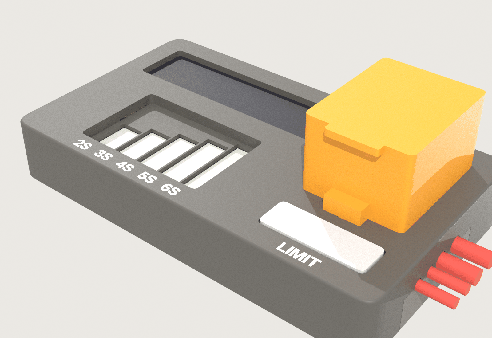
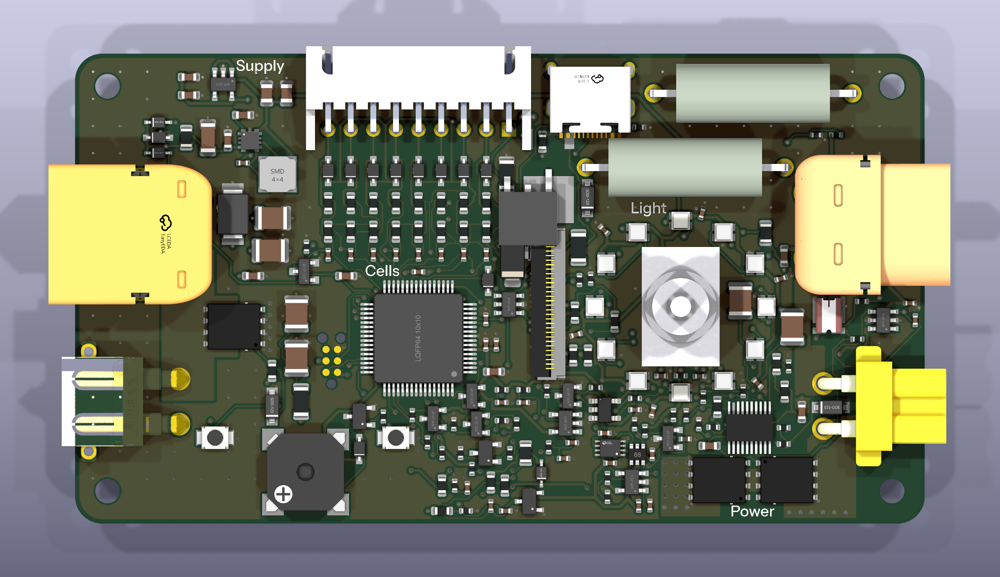

# SmokeBreak v1

**A smoke stopper you hold in one hand.** The battery plugs into one end and
the drone's lead into the other. Before the drone gets full battery power,
SmokeBreak checks it with a gentle 3 V probe. A short, a half-short or a
reversed lead is caught there, and nothing burns. The drone's capacitors are
then charged slowly through resistors. Only after that does the main switch
close, behind a guarded flip-up toggle.

Plug a pack's balance lead into its socket and SmokeBreak also reads every
cell (2S–6S), the pack's balance and its internal resistance. It remembers
each pack by number.

> **Status: design complete, not yet built.**
> - The board is fully routed: KiCad 10 DRC 0 errors, 0 warnings, 0 unconnected.
> - Its nets match the circuit pad for pad.
> - The power-path simulations pass (21 of 21), and so do the firmware model's 328 tests.
> - The printed case passes its fit check against the board.
>
> Nothing has been measured on hardware yet: build a few and go through
> *Bring-up* before a larger order.

## This revision

| | |
|---|---|
| Revision | **v1** (product: [`../README.md`](../README.md)) |
| Status | designed, not yet built |
| Tests and simulations | [`TESTS.md`](TESTS.md): every one with its v1 result |
| Trade-offs | [`docs/decisions.md`](docs/decisions.md) |
| How the circuit works | [`docs/architecture.md`](docs/architecture.md) |
| Toolchain | KiCad 10.0.7 (pinned image, `tools/Dockerfile`), Freerouting 2.5.0, ngspice 47, CadQuery 2.8 |
| Brand | OffGrid v3.2.2 ([`docs/brand.md`](../../docs/brand.md)); checked by `tools/verify_brand.py` |

| | |
|---|---|
| Case | 97 × 56 × 15 mm, G2 (curvature-continuous) corners, printed in three colours; the switch guard stands 17.9 mm above the face |
| Batteries | 2S–14S LiPo, LiHV, Li-ion (6–60.9 V); a 1S pack works when USB powers the box. XT60 and XT30 male |
| Drone | XT60 (12 AWG) and XT30 (16 AWG) female leads; 15 A continuous, 25 A for 60 s |
| Balance lead | five JST-XH sockets, 2S to 6S, in a well in the face |
| Screen | 2.25" 76 × 284 colour bar (EastRising ER-TFT2.25-1) |
| Controls | guarded flip-up toggle (up = on) inside a 12-LED status ring; one Limit rocker (− / +); beeper |
| Protection | 4 µs short-circuit cut-off, current limit, reversed-battery blocking on both sides, a 40 A fire fuse, refuses packs above 62.5 V |
| PCB | 91.6 × 50.6 mm, 6 layers, 1.6 mm, 1 oz copper on every layer, black mask, white silk, ENIG |

## Requirements

What the owner set, and where v1 stands.

| Requirement | v1 |
|---|---|
| Stops a short before it smokes | ✅ 3 V probe first; 4 µs cut-off when on (simulation case 3) |
| Survives wrong connections: reversed pack, pack on the drone side, both sides | ✅ simulations cases 2, 4, 5, 6 |
| Per-cell battery check, 2S–6S | ✅ divider network on 0.1 % resistors; firmware model tests |
| Fire safety if a part inside fails | ✅ soldered 40 A / 80 V fuse (`docs/decisions.md`) |
| Survives a pack bigger than 14S by mistake | ✅ 100 V supply chip; the screen says "too high" and it will not arm |
| Thin, small, one-hand use, does not rock when armed | ✅ 15 mm case, rubber feet, finger lip under the back edge |
| Perfectionist face: one 6 mm margin everywhere, G2 corners, screen corners matched in the UI | ✅ `src/geometry.py`, read by the board and the case |
| One rocker; text only "2S…6S" and "LIMIT" | ✅ multi-colour inlays, 2.5 mm caps, strokes ≥ 0.44 mm |
| Orderable from PCBWay, SMD parts assembled on one side | ✅ `production/` |
| Case printable on a multi-material printer | ✅ `enclosure/print/`: watertight STLs, fit check passes |
| Landed cost $20–22 (owner, 11 Oct 2026) | ❌ about **$52.50** at 100 units (`tools/cost.py`): the two flat pre-charge resistors (≈ $14.70) and the toggle (≈ $10.20) are most of the gap (*Next steps*) |
| 15 A continuous in the closed case | ⏳ not yet checked for heat (*Limits*) |

## Next steps

1. **Decide on cost.** Either accept about $52.50, or look at cheaper
   alternatives: same-footprint pre-charge resistors, and a short-lever toggle
   (which would also make the guard lower). Either part change re-runs the
   routing and every check.
2. **Confirm with EastRising** that the ER-TFT2.25-1 is the IPS version
   with the ST7789P3 controller. Check its FPC's contact side against J7.
3. **Order 5 prototypes** (*Ordering*) and print one case (*Printing*).
4. **Bring them up** (*Bring-up*). Then measure what the simulations
   predict: pre-charge time and resistor heat, short cut-off time, and the
   temperature of the FETs at 15 A in the closed case. Record the results
   in `TESTS.md`.
5. **Write the real firmware** from the model in `firmware/` (every
   decision there is specified and tested).
6. Changes that need new copper go into `v2/`.

## Ordering the board (PCBWay)

1. **PCB:** upload `production/smokebreak-gerbers.zip`.
   - 6 layers, 91.6 × 50.6 mm, FR-4 TG150, 1.6 mm.
   - **1 oz copper on the outer and the inner layers** (the battery current runs on the inner planes).
   - Min track/space 4/4 mil, min hole 0.2 mm.
   - **Black** mask, **white** silkscreen, **ENIG**, vias tented.
2. **Assembly:** turnkey, top side only. Upload
   `production/smokebreak-bom-pcbway.csv` and `production/smokebreak-cpl.csv`.
   - LCSC has no stock of the fuse (**2822HC40-RTR**) or the pre-charge
     resistors (**D2TO020C3R900FRE3**). Their BOM lines ask PCBWay to source
     them by part number from Digi-Key or Mouser.
   - The THT lines are not fitted; they ship loose: XT60PW-M, XT30PW-M,
     JST B3B/B4B/B5B/B6B/B7B-XH-A (one each), the C&K 7107 toggle, and the
     two drone leads (XT60H female on 12 AWG, XT30U female on 16 AWG, 50–75 mm).
3. **Display:** EastRising ER-TFT2.25-1 (76 × 284, 8-pin 0.5 mm FPC),
   bought separately. Ask for the IPS version.

## Printing the case

The files are in `enclosure/print/`. Use a 0.4 mm nozzle, 0.2 mm layers,
and PETG or ASA (PLA softens in a hot car).

| Part | Colour | Orientation | Notes |
|---|---|---|---|
| `top.stl` | main | face down | supports only inside the balance well (its floor plate is a bridge 2.7 mm up) |
| `text_inlay.stl` | white | with the top | same print job, second filament |
| `ring_inlay.stl` | translucent | with the top | same print job, third filament |
| `bottom.stl` | main | inside up | flat |
| `guard.stl` | accent | on its side | |
| `rocker.stl` | main | cap down | |

Hardware:
- 3 × M3 heat-set inserts (M3 × 5.7)
- 3 × M3 × 8 button-head screws
- 4 × Ø10 mm rubber feet (Bumpon)
- a Ø2 × 20 mm steel dowel (guard hinge)
- a Ø2 × 12 mm steel dowel (rocker pivot)
- a Ø6 × 3 mm N52 disc magnet (glued into the guard's tip)

The STEP models of every part, and the assembly, are in
`mechanical/smokebreak-enclosure-step.zip`. The fit check's full report is
`enclosure/print/fit_check.txt`.

## Assembly

1. **Balance sockets:** J12 (2S), J11 (3S), J10 (4S), J9 (5S) and J5 (6S),
   mouths up. Pin 1 (the square pad) goes at the front. The bottom silkscreen
   names each socket and points an arrow at pin 1 (the black wire).
2. **Battery plugs:** XT60 (J1) and XT30 (J2) male at the battery end. Seat
   them fully and use a big iron (the pads sit on power planes).
3. **Drone leads:** strip 5 mm and tin. The XT60 lead goes to J3 and the
   XT30 lead to J4, red to + (marked on both sides of the board).
4. **Toggle SW1 last,** lever upright.
5. **Trim every lead to 1.0 mm or less** under the board (the floor leaves 1.3 mm).
6. **Case:**
   1. Press the inserts into the top shell.
   2. Slide the guard's pin along its groove, then fit the guard.
   3. Fit the rocker and its pin.
   4. Tape the display into its pocket, with the FPC folded under to J7.
   5. Drop the board in.
   6. Hook the floor's tongue into the battery-end groove and close the
      floor. Its end tab clamps the drone leads.
   7. Fit the three screws.

## Bring-up

1. **Bare board:** check there are no shorts VIN–GND, VOUT–DRONE_NEG,
   +5V–GND or +3V3–GND.
2. **USB-C only:** +5V should read about 4.7 V and +3V3 should read 3.3 V.
   Flash over the SWD pads on the underside (J6) or USB DFU.
3. **Bench supply** at 12 V with a 100 mA limit, into the battery XT60,
   guard closed. The screen wakes, and nothing appears on the drone side.
4. **Reverse the bench supply:** nothing happens and nothing gets warm.
5. **Probe tests** with resistors on the drone side: open, 1 kΩ, 18 Ω,
   0.3 Ω. Then a 2200 µF capacitor bank for the pre-charge. Then a real drone.
6. **Measure and set in firmware:** the board's own capacitance on VOUT as
   the probe sees it, the current amplifier's offset, and the cell-divider gains.

## Limits

- **Heat at 15 A is not simulated.** The FETs (Q1, Q2 about 4 mΩ each, Q11
  about 8 mΩ) make about 4 W together at 15 A inside a closed printed case.
  Measure at bring-up before rating the box above short motor tests.
- **The pre-charge resistors' pulse rating** is read off the datasheet
  curve (about 10 J each at 100 ms). The firmware's 12 J abort puts 6 J on
  each. Bench-test repeated attempts and set the cool-down from the
  thermistor.
- **1S packs** need USB power: the 5 V supply starts at 6 V.
- **The guard sensor** reads "open" only once the guard is past about 40°.
  A guard that is only partly lifted counts as closed.
- **Simulation open risks** (models read off datasheet graphs, the short
  cut-off timing, capacitor DC bias) are listed in `sim/SIM.md`.

## Building it again

Everything here is generated by the scripts in `src/`, `enclosure/` and
`sim/`. Run them inside the pinned toolchain (`tools/Dockerfile`; `tools/kd`
runs a command in it).

| What | Command (from `smokebreak/v1`) | Notes |
|---|---|---|
| Silkscreen art on the routed board | `python3 src/artwork.py` | what CI runs |
| Production files, STEP, renders, DRC and net gates | `python3 src/fab.py` | `--no-3d` for the production files and gates only |
| Check the committed files | `python3 tools/check_outputs.py` | after the two above |
| Firmware model tests | `python3 -m pytest -q firmware/tests` | |
| Simulations | `cd sim && python3 run_all.py` | writes `sim/SIM.md` and `sim/plots/` |
| Brand check | `python3 tools/verify_brand.py` | needs Chromium |
| Case | `python3 enclosure/dump_board.py` (KiCad's Python), then `enclosure.py --no-dump` and `check.py` (a Python with CadQuery 2.8 and trimesh), `render.py` (Blender's Python, previews), `package.py` | see `enclosure/README.md` |
| The whole board from the circuit | `bash src/pipeline.sh` | about 3 hours; routing differs run to run, so the committed board stays the design of record |

The routed board (`smokebreak.kicad_pcb`) is the design of record. CI does
not route the board again; it rebuilds the art and every production file from
the routed board, and fails if they differ from what is committed.

## What is where

| Path | What |
|---|---|
| `smokebreak.kicad_pcb` / `.kicad_pro` / `.kicad_dru` | the routed board (KiCad 10) |
| `production/` | Gerber zip, PCBWay BOM, pick-and-place, netlist |
| `mechanical/` | the board in 3D (`smokebreak-step.zip`), the case parts in 3D (`smokebreak-enclosure-step.zip`) |
| `enclosure/` | the case as code (CadQuery), its fit check, and `print/` (the STLs) |
| `images/` | renders of the board and the case |
| `src/` | the board as code: `geometry.py` (every mechanical number), `circuit.py`, `parts.py`, `place.py`, the router steps, `artwork.py`, `fab.py` |
| `lib/` | footprints and 3D models |
| `fonts/` | the brand fonts the silkscreen and case text are drawn in (OFL) |
| `sim/` | power-path simulations and their report |
| `firmware/` | reference model of every firmware decision, with tests |
| `ui/` | the screens, drawn at the panel's real resolution |
| `tools/` | toolchain (Dockerfile), output check, brand check, cost tally, debug plots |
| `docs/` | decisions, architecture, the original spec, market research, the design studies and concepts behind the face |
