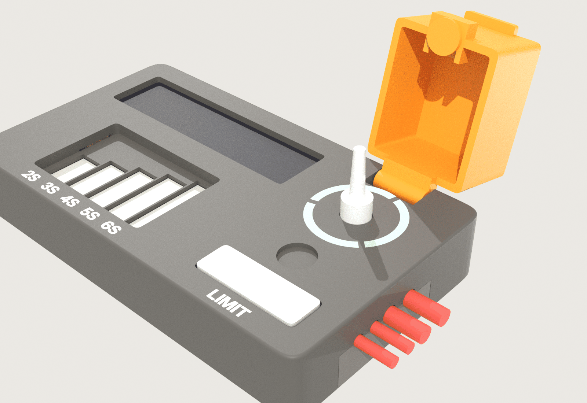

# SmokeBreak v1: the case

The printed case, as code. Every number comes from
[`../src/geometry.py`](../src/geometry.py), the same file the board's
placement reads. Each part's position comes from the placed board.




| Part | File | What it is |
|---|---|---|
| Top shell | `print/top.stl` | the face (screen window, balance well, light-ring slot, rocker opening), the walls, the screw bosses |
| Floor | `print/bottom.stl` | screw counterbores, rubber-foot recesses, the battery-end hook, the tab that clamps the drone leads |
| Guard | `print/guard.stl` | hinged switch guard with the magnet pocket |
| Rocker | `print/rocker.stl` | the Limit paddle; it pivots on a steel pin |
| Light ring | `print/ring_inlay.stl` | translucent, prints with the top |
| Text | `print/text_inlay.stl` | "2S … 6S" and "LIMIT", second colour, prints with the top |

The STEP versions and an assembly (with the board, the display and the
components as boxes) are in `../mechanical/smokebreak-enclosure-step.zip`.
How to print and assemble it: [`../README.md`](../README.md).

## Build it

```
python3 dump_board.py      # KiCad's Python (pcbnew): part positions -> board_parts.json
python enclosure.py --no-dump   # CadQuery 2.8: build and export to out/
python check.py            # the fit check -> out/fit_check.txt (needs trimesh)
python render.py           # Blender's Python (bpy): the previews in out/
python3 package.py         # copy STLs, STEP zip, report and previews to their committed places
```

`out/` is scratch (git-ignored). `package.py` writes `print/`, the STEP zip
in `../mechanical/` and `../images/case-*.png`.

## The fit check

`check.py` checks:

- every STL is watertight;
- no component touches the shell, floor, guard or rocker (each part as its
  courtyard times its height);
- the real 3D bodies of the parts that pass through a wall (XT60, XT30,
  USB-C, toggle bushing), and their gaps;
- the display pocket's clearance, and the 6.34 mm height limit under the
  screen;
- the guard: it clears the lever, swings open, and the magnet field at
  the hall sensor;
- the rocker presses both switches;
- the drone leads fit their clamp.

The latest report is [`print/fit_check.txt`](print/fit_check.txt).

## Coordinates

The model is built in `geometry.py`'s case frame: x toward the drone end,
y toward the user, z up. The exported files are mirrored to a right-handed
frame (y toward the back), the same as KiCad's 3D view.
