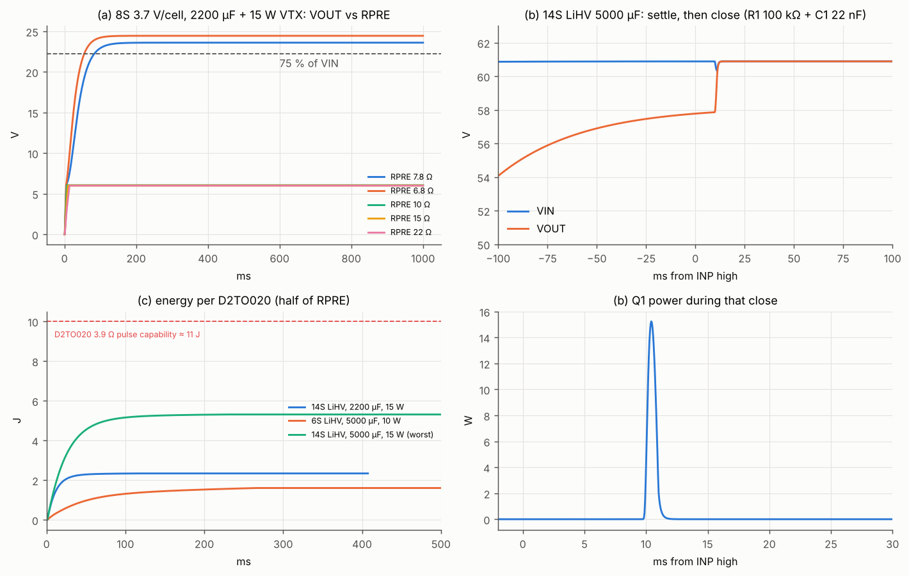
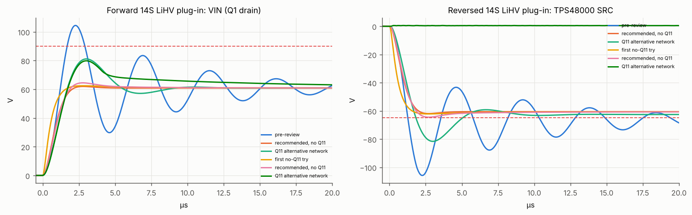
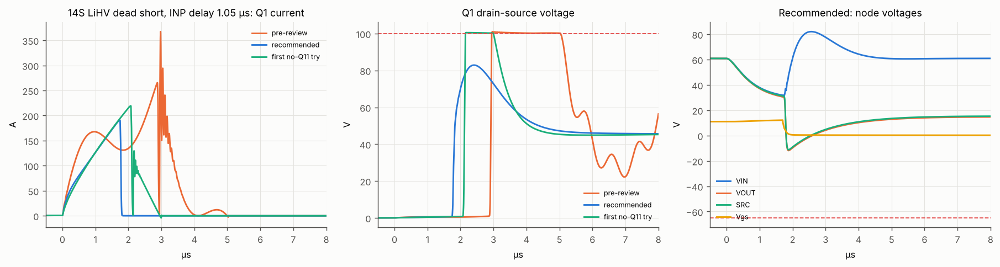
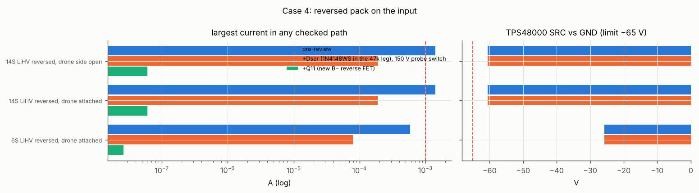
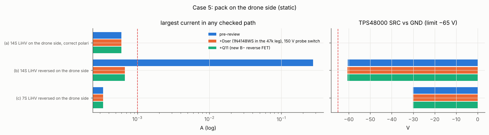
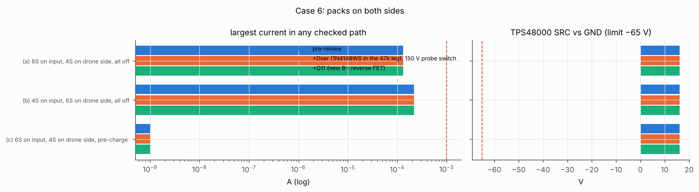
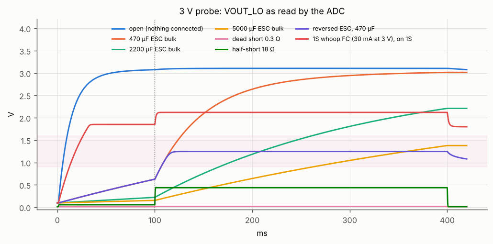
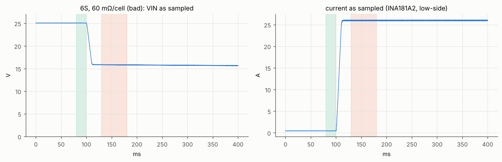
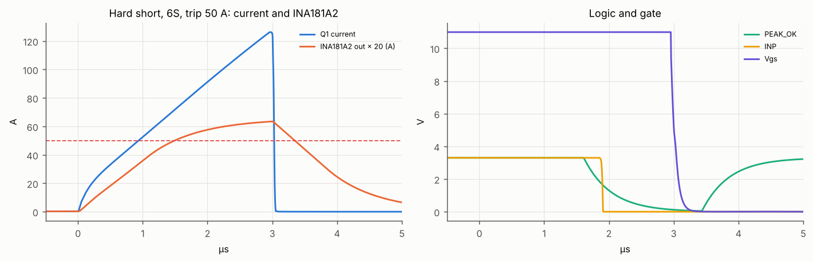

# SmokeBreak v1 — power-path simulations

Generated by `run_all.py` on 2026-10-18 with **ngspice-47** (`/usr/local/bin/ngspice`, batch mode), Python 3.13.16, matplotlib. Total run time 43 s.

Run: `cd smokebreak/v1/sim && python3 run_all.py` (or `python3 run_all.py 3 7`). Each `case*.cir` also runs alone with its default parameters (`ngspice -b case3_short.cir`). Generated decks, data and logs go to `work/` (scratch, git-ignored), plots to `plots/`. The runner retries a deck with more forgiving solver options if it does not converge.

Circuit under test: [`src/circuit.py`](../src/circuit.py). References: [architecture.md](../docs/architecture.md), [spec.md](../docs/spec.md) §4-5.

## Result

**21 of 21 checks PASS, none FAIL**. **The board as built (src/circuit.py) is the *Q11 alternative network*:** Q11 BSC070N10LS5 in the battery minus with a 4.7 MΩ gate and 12 V zener, 2 × 2.2 µF direct, 2 × 4.7 µF / 0.33 Ω damper, 2 × 4.7 µF / 0.47 Ω snubber, RISCP 40.2 kΩ, the 65 mV hard-short LMV331, the Cdvdt network, the 15 V gate zener, a 43 mΩ pre-charge P-FET and 150 V probe and pre-charge driver parts. Rows marked *pre-review* are the circuit before this simulation review, kept for comparison; they fail as expected.

| case | check | result | detail |
|---|---|---|---|
| 1 | (a) 2 × 3.9 Ω reaches 75 % within 1 s, 8S-14S at ≥ 3.7 V/cell, 2200 µF + 15 W VTX | PASS | slowest 80 ms |
| 1 | (b) chosen Cdvdt network closes settled 8S-14S cases within derated SOA (R1 100 kΩ + C1 22 nF) | PASS |  |
| 1 | (b) 2S-7S, 2200 µF + 10 W VTX, 2 × 3.9 Ω: every close within SOA, or refused by firmware when the gap > 12 V | PASS |  |
| 1 | (c) normal attempt ≤ 12 J (6 J per D2TO020 3.9 Ω, ~60 % of its pulse rating) | PASS | max 10.6 J |
| 1 | (c) pre-charge FET, recommended ≤ 50 mΩ class (DMP10H400SE SOA limits applied), within 50 % | PASS | 38 % |
| 2 | Q11 alternative + Q11 (4.7 MΩ from VIN + 12 V zener): forward hot plug < 90 V, reversed harmless (SRC/VS ≥ −65 V, Q11 avalanche < 50 A) | PASS | VIN 79.8 V, Q11 28 A |
| 2 | recommended (no Q11): forward 14S LiHV hot plug < 90 V, reversed keeps SRC/VS ≥ −65 V, also at −20 %/+20 % capacitance | PASS | SRC -61.9 V (tol. -64.5 V) |
| 3 | recommended (no Q11, hard-short LMV331 at 65 mV and at 80 mV, 7 mV late offset): 1S/6S/10S/14S short, INP delay typ and max, worn pack, 300 nH leads: no avalanche, SRC ≥ −65 V, Vgs < 19 V, probe switch inside rating | PASS |  |
| 3 | Q11 alternative network (65 mV hard-short, RISCP 40.2 kΩ): 1S/6S/10S/14S short, INP delay typ and max, worn pack, 300 nH leads: no avalanche, SRC ≥ −65 V, Vgs < 19 V | PASS |  |
| 4 | reversed input (static): all paths < 1 mA, TPS48000 inside −65 V, with Dser (no B− FET needed) | PASS |  |
| 4 | reversed input (static), Q11 alternative (4.7 MΩ from VIN + 12 V zener): all paths < 1 mA, TPS48000 inside −65 V | PASS |  |
| 5 | drone-side pack, static (normal and reversed 7S/14S): paths < 1 mA, SRC ≥ −65 V, probe switch in rating | PASS |  |
| 5 | drone-side pack, static, Q11 alternative: paths < 1 mA, SRC ≥ −65 V | PASS |  |
| 5 | 14S LiHV plugged into the drone side (both polarities) with the snubber: VOUT < 90 V, SRC ≥ −65 V | PASS |  |
| 5 | Q11 alternative: drone-side plug-in with the 4 µF/0.47 Ω snubber: VOUT < 90 V, SRC ≥ −65 V | PASS |  |
| 6 | both sides powered, off: nothing conducts | PASS |  |
| 6 | both sides powered, off, Q11 alternative: nothing conducts | PASS |  |
| 7 | Q11 alternative (4 µF snubber, firmware board C 4.1 µF): probe classifies all ten loads; C within ±15 % | PASS |  |
| 7 | probe classifies all ten loads; C within ±15 % | PASS |  |
| 8 | IR estimate of the 60 mΩ/cell pack within 15 % | PASS | worst +0.5 % |
| 9 | peak path (INA181A2 + LMV331): trip level → INP low < 5 µs; hard short onset → INP low < 5 µs | PASS |  |

## Findings that shaped src/circuit.py

1. **TPS48000 reverse rating verified:** VS, CS±, SRC to GND −65 V (datasheet §5.1). A reversed 14S LiHV pack *at rest* is fine (SRC −60.6 V, VS −60.9 V). **The plug-in of a reversed pack rings:** SRC (which holds the most negative value through Q1's body diode) reaches −104 V with the 2 × 2.2 µF input. The previous recommendation (2 × 2.2 µF + 4 µF/0.33 Ω) holds −65 V only up to 10S and needed a B− FET (Q11) above that.
2. **Q11 is not needed.** The first no-Q11 try (0.1 µF + 8 µF/0.47 Ω damper, 4 µF/0.47 Ω snubber) passes the reversed plug-in but fails the 10S/14S short at the maximum INP delay even with the 80 mV hard-short LMV331 (Q1 avalanches at 80-130 A). A sweep of ≈ 150 damper/snubber/threshold combinations found that the output snubber is the lever: a stronger snubber holds SRC up during the cut. **1 µF direct + 16 µF/0.33 Ω damper + 12 µF/0.22 Ω snubber** passes everything: reversed 14S plug-in SRC -61.9 V (-64.5 V with −20 % damper C and +20 % direct C), 14S short Q1 Vds ≤ 91 V at both 65 mV and 80 mV, with 300 nH drone leads included. Leaner networks that pass nominally (0.47 µF + 12 µF damper) leave < 1 V reversed-plug margin at tolerance or < 5 V Vds margin, so they were rejected.
2a. **Q11 alternative (smaller board area), also passes the full suite:** Q11 in the battery B− lead (gate VIN → 4.7 MΩ, 12 V zener) + **2 × 2.2 µF direct (keep both)** + 2 × 4.7 µF/0.33 Ω damper + 2 × 4.7 µF/**0.47 Ω** snubber, 65 mV hard-short, RISCP 40.2 kΩ. 14S short at max INP delay: Q1 Vds ≤ 90 V including 300 nH leads; reversed plug-in: Q11 avalanches ≈ 28 A for < 1 µs (fitted BSC070N10LS5: 50 A / 55 mJ single pulse). With only **one** 2.2 µF direct it passes the standard cases but Q1 avalanches (9 A) with 300 nH drone leads, so keep both. A 0.22 Ω snubber fails the reversed drone-side plug-in (SRC −70 V), so 0.47 Ω. **The gate is 4.7 MΩ, not 47 kΩ:** 47 kΩ would draw 1.04 mA from a plugged-in 14S pack (SPEC: < 30 µA off); 4.7 MΩ draws 10 µA and brings the gate up in ≈ 10 ms, the body diode carrying meanwhile. This run simulates the 4.7 MΩ.
3. **Dead short pre-review:** Q1 reaches its 100 V breakdown at 6S-14S and avalanches far above its 50 A IAS; SRC goes below −65 V; the AO3401A probe switches (30 V) break down whenever VOUT swings negative. Causes: the TPS48000's 4 µs SCP, the INA181's slew and the LMV331's delay in the peak path, no output snubber, no input damping.
3a. **LMV331 instead of TLV7011 is acceptable** for both comparators: with the datasheet's overdrive-dependent delay (0.35-1 µs) every case 3 and case 9 check passes. Its input common-mode range ends ≈ 0.7 V below VCC (≈ 2.6 V on 3.3 V); above that it pulls PEAK_OK low whatever PEAK_REF is, so the programmable trip cannot be set above ≈ 52 A (fail-safe). Cap firmware at 50 A.
4. **BSC040N10NS5 linear-mode SOA is very small** (0.53 A for 10 ms at 25 V). With PU straight through 47 Ω the main switch closes in µs and the inrush trips the 50 A SCP; it must close with a gate slew network, only after the pre-charge has settled, and never across a large gap.
5. **Q4 BC817 (45 V) holds the full pack voltage** in normal use (60.9 V at 14S LiHV); a reversed pack forward-biases its base-collector junction (1.2 mA, 0.12 mA into the unpowered PRE_ON pin).
6. **Q3 DMP10H400SE** is at 112 % of its derated SOA in the worst pre-charge (14S LiHV, 5000 µF): the 47 kΩ gate drive turns it on slowly through the linear region (110 W peak).
7. **RISCP 15.4 kΩ (50 A)** sits at the peak-path ceiling and would nuisance-trip the motor test.
8. **SMBJ58CA** has a 58 V stand-off below 14S LiHV (60.9 V): up to ≈ 20 µA leakage at a min-Vbr part, a large share of the < 30 µA off budget. It does not limit any simulated peak in the recommended design, so SMBJ64CA (64 V stand-off) costs nothing in protection.

As-built and alternative runs that fail (details in the case tables):

- case 1: as-built gate (PU 47 Ω, no Cdvdt) closes within SOA and without SCP trip — inrush through the remaining gap trips the 50 A SCP or exceeds SOA
- case 1: (b) every 2S-7S drone with a 10 W VTX can be powered with 2 × 3.9 Ω — refused: 6S @ 3.5 (7.8 Ω, gap 14.9 V)
- case 1: (c) Q3 DMP10H400SE (pre-review) within 50 % of its SOA during pre-charge — 112 % of derated SOA
- case 2: pre-review: forward hot plug < 90 V — 104 V
- case 2: pre-review: reversed hot plug keeps SRC/VS ≥ −65 V — SRC -106 V
- case 3: pre-review survives the short at 1S-14S — 8 of 8 cases fail
- case 3: first no-Q11 try (0.1 µF + 8 µF/0.47 Ω, 4 µF/0.47 Ω), hard-short 80 mV survives the short at 1S-14S — 4 of 8 cases fail
- case 3: Q11 network with one 2.2 µF direct, 14S, 300 nH drone leads — Q1 Vds 100.3 V, avalanche 9 A
- case 3: recommended without the hard-short comparator, 14S — peak 284 A, Q1 avalanche 35 A
- case 3: recommended, SCP only (comparators dead), 14S — peak 286 A, Q1 avalanche 36 A
- case 4: 14S LiHV reversed, drone side open: pre-review — Q4 leg **-1.2 mA**, PRE_ON pin 120 µA
- case 4: 14S LiHV reversed, drone attached: pre-review — Q4 leg **-1.2 mA**, PRE_ON pin 120 µA
- case 4: BC817 Q4 (Vceo 45 V, Vcbo 50 V) at 14S LiHV idle — Vce 60.9 V
- case 5: (b) 14S LiHV reversed on the drone side: pre-review — probe Q7 **250.1 mA**, Vds 33 V
- case 5: (c) 7S LiHV reversed on the drone side: pre-review — probe Q7 2 nA, Vds 30 V

## Previous run (superseded)

The first version of this suite (same day) simulated the earlier architecture — TPS48111, high-side
shunt, INA290 — and led to RPRE 8.2 Ω, an electrolytic input damper, an output snubber, and B− reverse
FETs because the TPS48111's SRC is rated only to −30 V and its VS/CS pins to −1 V. Those results do not
apply to the board in `src/circuit.py` and were replaced by this run.

A second version (TPS48000, but modelling an INA240A2 + TLV7011 peak path) recommended 2 × 2.2 µF + a
4 µF/0.33 Ω damper + a 4 µF/0.47 Ω snubber with an 80 mV hard-short comparator, plus a B− FET (Q11) for
reversed plug-ins of 11S-14S. With the board's actual INA181A2 + LMV331 and the stronger snubber found here,
Q11 is no longer needed; that network is kept below as the "Q11 alternative".

## Models and assumptions

Topology and part values follow `../src/circuit.py` (TPS48000, low-side 1 mΩ shunt RS1 in the drone
return, INA181A2 + LMV331 (open drain, 10 kΩ) + SN74LVC1G74 latch + 74LVC1G11 into INP, pre-charge
Q3/D3/RPRE, probe switches, BAT46WJ aux OR, SMBJ64CA, 2 × 2.2 µF input; the pre-review rows keep the parts the circuit had before this review). Note: circuit.py carries
the INA181A2 and LMV331, not the INA240A2/TLV7011 named in the brief; this run models what circuit.py has. Decks include `lib/smokebreak.lib` (devices,
behavioural parts) and `lib/board.lib` (board blocks). Datasheets read for this run: TI TPS4800-Q1
(SLUSEZ1B, Mar 2026), Infineon BSC040N10NS5 (Rev 2.4), TI INA181 (2023), TI LMV331 (SLCS136V), Diodes
DMP10H400SE (DS37841), Vishay AC series (28730).

| Part | Model | Key parameters |
|---|---|---|
| Battery | `BATT` / `BATTR` (soft-start) | N × Vcell, N × Rcell + 3 mΩ lead, 150-300 nH; Rcell 3 / 15 / 60 mΩ |
| Q1, Q2 BSC040N10NS5 | `VDMOS` | Rds(on) 3.2 mΩ @ 10 V, 4.2 mΩ @ 6 V; 45 A @ Vgs 4.5 V (plateau 4.6 V @ 50 A); Ciss 4.1 nF, Crss 28 pF, Coss 0.63 nF @ 50 V; body diode 0.9 V @ 50 A; breakdown 100 V. **Limits (datasheet):** ID,pulse 544 A, IAS 50 A, EAS 268 mJ (50 A), V(BR)DSS 100 V @ 25 °C, Vgs ±20 V; **SOA (Diagram 3, digitised, Tc 25 °C):** at 25 V: 10 µs 223 A, 100 µs 19 A, 1 ms 1.84 A, 10 ms 0.53 A, DC 0.25 A — power falls as 1/V (thermal-instability slope); checked at 50 % |
| TPS48000 | `TPS48000` behavioural | POR 2.5 V; EN/UVLO 1.18 V (4.8 µs); OV 1.23 V (4.5 µs); charge pump 11 V, 345 µA; PU 6.5 Ω (1.69 A), PD 5.5 Ω (2 A); INP 1.4 V, INP→PD 0.36 µs typ / 1.05 µs max; SCP = 2 µA·RISCP + 19 mV on CS+−CS− (low-side), tSC 4 µs, latched; reverse I(VS) 22 µA. **Abs max (verified, §5.1):** VS, CS±, SRC to GND −65…100 V; PU/PD/BST to SRC −0.3…19 V, to GND −65…112 V; EN/OV/INP/CS_SEL between V(VS) and V(VS)+70 V when VS < 0 |
| Peak path | `PEAKPATH` | 10 Ω/10 Ω/1 nF → INA181A2 50 V/V, 210 kHz, 2 V/µs, 0…3.28 V → LMV331 (delay t0 + q/Vod fitted to the 2.7 V table: 10 mV → 1 µs, 100 mV → 350 ns; VICR −0.1…2.6 V at 3.3 V, above it the output pulls low) → PEAK_OK → latch CLR → AND (+10 ns); optional second LMV331 on the shunt at a fixed threshold with its 7 mV max offset, open drain onto PEAK_OK |
| Q3 pre-charge P-FET DMP10H400SE | `VDMOS pchan` | 0.2 Ω @ −10 V; SOA (Fig. 12, min-pad board): 100 µs 12 A (≤ 30 V), 1 ms 46 W, 10 ms 16 W, 100 ms 7.8 W, 1 s 3.8 W; checked at 50 % |
| Pre-charge driver | circuit.py | D2 10 V, 100 kΩ G-S, 47 kΩ, Q4/Q5 BC817 (Gummel-Poon, no breakdown model: Vce/Vcb reported against 45/50 V) |
| D3 SS2H10, D4/aux BAT46WJ, BAT54S | diodes | 100 V 2 A (IFSM 50 A ≈ 10 A²s); 100 V 150 mA; 30 V |
| Probe Q6/Q7 AO3401A | `VDMOS pchan` | 30 V, breakdown at 33 V so exposure shows as current |
| TVS D1 | `TVSBI` | SMBJ64CA (the board's): 64 V stand-off, 71.1 (min)…78.6 (max) V @ 1 mA, 103 V @ 5.8 A; the max-Vbr corner is used for clamping |
| Q11 (battery-minus FET) | `VDMOS` (BSC040N10NS5 model) | the fitted BSC070N10LS5 is the same 100 V SuperSO8 class; avalanche judged against its 50 A / 55 mJ single-pulse rating (datasheet Rev 2.2); gate from VIN through 4.7 MΩ + 12 V zener |
| RPRE | 2 × Vishay D2TO020 3.9 Ω | pulse capability **≈ 10 J per resistor** (datasheet single-pulse curve at 100 ms) |
| Drone | per case | leads 2 × 75-100 nH + 2 mΩ; bulk 470/2200/5000 µF, 30 mΩ, 5 nH; VTX 10-15 W from 6 V UVLO; FC 1 W; ESC body diodes |

Ceramics are entered at their effective value at 60 V (4.7 µF/100 V X7S 1210 ≈ 2 µF; 2.2 µF/100 V
X7R 1210 ≈ 1 µF). Thermal behaviour is checked through SOA/pulse ratings, not simulated. The DC
miswiring cases are solved as slow-start transients (the plain `.op` found non-physical solutions with
the constant-power loads and the latches).

## Case 1 — Pre-charge (2 × 3.9 Ω D2TO020), main-switch close, Q3/D3 stress

### (a) 8S-14S, 2200 µF + 15 W VTX (+1 W FC/RX)

Board per circuit.py: Q3 DMP10H400SE driven through 47 kΩ by two BC817s, D3 SS2H10, RPRE. Requirement: VOUT > 75 % of VIN within 1 s at 3.7-4.35 V/cell (3.5 V/cell shown for information).

| RPRE | (a) | slowest t75 | stalls below 75 % (any V/cell) |
|---|---|---|---|
| 7.8 Ω (2 × 3.9 Ω D2TO020) | PASS | 80 ms | - |
| 6.8 Ω | PASS | 53 ms | - |
| 10 Ω | **FAIL** | never | 8S@3.5, 8S@3.7, 8S@3.85, 9S@3.5 |
| 15 Ω | **FAIL** | never | 8S@3.5, 8S@3.7, 8S@3.85, 8S@4.2, 8S@4.35, 9S@3.5, 9S@3.7, 9S@3.85, 9S@4.2, 9S@4.35, 10S@3.5, 10S@3.7, 10S@3.85, 10S@4.2, 10S@4.35, 11S@3.5, 11S@3.7, 11S@3.85, 12S@3.5, 12S@3.7, 12S@3.85, 13S@3.5 |
| 22 Ω | **FAIL** | never | 8S@3.5, 8S@3.7, 8S@3.85, 8S@4.2, 8S@4.35, 9S@3.5, 9S@3.7, 9S@3.85, 9S@4.2, 9S@4.35, 10S@3.5, 10S@3.7, 10S@3.85, 10S@4.2, 10S@4.35, 11S@3.5, 11S@3.7, 11S@3.85, 11S@4.2, 11S@4.35, 12S@3.5, 12S@3.7, 12S@3.85, 12S@4.2, 12S@4.35, 13S@3.5, 13S@3.7, 13S@3.85, 13S@4.2, 13S@4.35, 14S@3.5, 14S@3.7, 14S@3.85, 14S@4.2, 14S@4.35 |

Time to 75 % with 2 × 3.9 Ω:

| pack | 3.5 V/cell | 3.7 V/cell | 3.85 V/cell | 4.2 V/cell | 4.35 V/cell |
|---|---|---|---|---|---|
| 8S | 122 ms | 80 ms | 67 ms | 52 ms | 49 ms |
| 9S | 63 ms | 54 ms | 49 ms | 43 ms | 42 ms |
| 10S | 48 ms | 44 ms | 42 ms | 39 ms | 37 ms |
| 11S | 43 ms | 40 ms | 38 ms | 35 ms | 34 ms |
| 12S | 38 ms | 36 ms | 35 ms | 33 ms | 32 ms |
| 13S | 36 ms | 34 ms | 34 ms | 32 ms | 32 ms |
| 14S | 33 ms | 33 ms | 33 ms | 31 ms | 31 ms |

The limit is getting past the VTX's 6 V UVLO: R < 6 V·(VIN − 6 V − ~0.7 V)/P. 7.8 Ω clears it for every 8S pack down to 3.5 V/cell with 16 W of load.

### (b) Closing the main switch: gate network against the BSC040N10NS5 SOA

**The BSC040N10NS5's SOA is a linear-mode SOA with a thermal-instability slope: at 25 V it allows only 1.84 A for 1 ms, 0.53 A for 10 ms and 0.25 A DC (Diagram 3, digitised; power falls as 1/V).** Closing the main switch across a large gap is therefore not allowed. The firmware waits until the pre-charge has settled (VOUT within 1 % for 20 ms), then closes. Pass = worst sliding-window power (10 µs-100 ms) ≤ 50 % of the SOA at that window's mean Vds, the switch closes, and the SCP does not trip on the inrush.

| gate network | case | gap at close | close | Q1 peak I | Q1 peak P | worst % of derated SOA | result |
|---|---|---|---|---|---|---|---|
| pre-review: PU 47 Ω, no Cdvdt | 8S 3.7 V/cell, 2200 µF, 15 W | 6.1 V | SCP trip | 65 A | 180 W | 1 % | **FAIL** |
| pre-review: PU 47 Ω, no Cdvdt | 8S 3.7 V/cell, 5000 µF, 15 W | 6.2 V | SCP trip | 66 A | 335 W | 1 % | **FAIL** |
| pre-review: PU 47 Ω, no Cdvdt | 14S LiHV, 5000 µF, 15 W | 3.1 V | 0 ms | 35 A | 8 W | 1 % | PASS |
| R1 100 kΩ + C1 22 nF | 8S 3.7 V/cell, 2200 µF, 15 W | 6.1 V | 6 ms | 7 A | 28 W | 18 % | PASS |
| R1 100 kΩ + C1 22 nF | 8S 3.7 V/cell, 5000 µF, 15 W | 6.2 V | 7 ms | 15 A | 50 W | 31 % | PASS |
| R1 100 kΩ + C1 22 nF | 14S LiHV, 5000 µF, 15 W | 3.1 V | 11 ms | 13 A | 15 W | 5 % | PASS |
| R1 100 kΩ + C1 47 nF | 8S 3.7 V/cell, 2200 µF, 15 W | 6.1 V | 11 ms | 4 A | 16 W | 13 % | PASS |
| R1 100 kΩ + C1 47 nF | 8S 3.7 V/cell, 5000 µF, 15 W | 6.2 V | 14 ms | 8 A | 31 W | 23 % | PASS |
| R1 100 kΩ + C1 47 nF | 14S LiHV, 5000 µF, 15 W | 3.1 V | 21 ms | 7 A | 11 W | 5 % | PASS |
| R1 100 kΩ + C1 100 nF | 8S 3.7 V/cell, 2200 µF, 15 W | 6.1 V | 23 ms | 2 A | 8 W | 8 % | PASS |
| R1 100 kΩ + C1 100 nF | 8S 3.7 V/cell, 5000 µF, 15 W | 6.2 V | 30 ms | 4 A | 17 W | 17 % | PASS |
| R1 100 kΩ + C1 100 nF | 14S LiHV, 5000 µF, 15 W | 3.1 V | 42 ms | 4 A | 6 W | 3 % | PASS |
| R1 100 kΩ + C1 220 nF | 8S 3.7 V/cell, 2200 µF, 15 W | 6.1 V | 49 ms | 1 A | 4 W | 9 % | PASS |
| R1 100 kΩ + C1 220 nF | 8S 3.7 V/cell, 5000 µF, 15 W | 6.2 V | 62 ms | 2 A | 9 W | 19 % | PASS |
| R1 100 kΩ + C1 220 nF | 14S LiHV, 5000 µF, 15 W | 3.1 V | 90 ms | 2 A | 3 W | 3 % | PASS |

**Chosen: R1 100 kΩ + C1 22 nF** (gate → GND through 10 Ω; PD stays direct to the gates for fast turn-off; PU's 47 Ω becomes 100 kΩ). Output slew ≈ (11 V − 4.6 V)/(R1·C1) ≈ 2909 V/s; gate current 64 µA < the 100 µA minimum charge-pump current. A 15 V gate-source zener (BZT52C15) is then needed: C1 holds the gate while SRC collapses in a short (case 3).

2S-7S with 2200 µF + 10 W VTX (+1 W FC), chosen gate network; '3.9 Ω tap' = a second pre-charge P-FET feeding the mid-point of the two D2TO020s for ≤ 7S:

| pack | RPRE | pre-charge | gap at close | closed | Q1 peak P | E(Q1) | % of derated SOA | result |
|---|---|---|---|---|---|---|---|---|
| 2S @ 3.5 | 7.8 Ω | stall 4.9 V | 2.2 V | 2 ms | 7 W | 0.01 J | 2 % | PASS |
| 2S @ 3.5 | 3.9 Ω tap | 75 % at 24 ms | 1.2 V | 2 ms | 3 W | 0.00 J | 1 % | PASS |
| 2S @ 4.35 | 7.8 Ω | stall 5.9 V | 2.8 V | 2 ms | 12 W | 0.01 J | 4 % | PASS |
| 2S @ 4.35 | 3.9 Ω tap | stall 6.0 V | 2.7 V | 2 ms | 12 W | 0.01 J | 4 % | PASS |
| 3S @ 3.5 | 7.8 Ω | stall 6.0 V | 4.5 V | 3 ms | 24 W | 0.02 J | 10 % | PASS |
| 3S @ 3.5 | 3.9 Ω tap | stall 6.0 V | 4.5 V | 3 ms | 22 W | 0.02 J | 9 % | PASS |
| 3S @ 4.35 | 7.8 Ω | stall 6.0 V | 7.0 V | 3 ms | 40 W | 0.06 J | 32 % | PASS |
| 3S @ 4.35 | 3.9 Ω tap | stall 6.0 V | 7.0 V | 4 ms | 31 W | 0.05 J | 26 % | PASS |
| 4S @ 3.5 | 7.8 Ω | stall 6.0 V | 8.0 V | 4 ms | 46 W | 0.07 J | 43 % | PASS |
| 4S @ 3.5 | 3.9 Ω tap | stall 6.1 V | 7.9 V | 4 ms | 34 W | 0.07 J | 33 % | PASS |
| 4S @ 4.35 | 7.8 Ω | stall 6.0 V | 11.4 V | 5 ms | 62 W | 0.14 J | 95 % | PASS |
| 4S @ 4.35 | 3.9 Ω tap | 75 % at 44 ms | 4.0 V | 3 ms | 16 W | 0.02 J | 6 % | PASS |
| 5S @ 3.5 | 7.8 Ω | stall 6.0 V | 11.4 V | 5 ms | 62 W | 0.14 J | 97 % | PASS |
| 5S @ 3.5 | 3.9 Ω tap | 75 % at 42 ms | 3.9 V | 3 ms | 16 W | 0.01 J | 6 % | PASS |
| 5S @ 4.35 | 7.8 Ω | stall 15.5 V | 6.3 V | 5 ms | 30 W | 0.04 J | 20 % | PASS |
| 5S @ 4.35 | 3.9 Ω tap | 75 % at 23 ms | 3.0 V | 2 ms | 11 W | 0.01 J | 4 % | PASS |
| 6S @ 3.5 | 7.8 Ω | stall 6.1 V | 14.9 V | 6 ms | 73 W | 0.23 J | 156 % | refused (gap > 12 V) |
| 6S @ 3.5 | 3.9 Ω tap | 75 % at 24 ms | 3.1 V | 2 ms | 11 W | 0.01 J | 4 % | PASS |
| 6S @ 4.35 | 7.8 Ω | 75 % at 61 ms | 4.7 V | 4 ms | 20 W | 0.02 J | 9 % | PASS |
| 6S @ 4.35 | 3.9 Ω tap | 75 % at 19 ms | 2.5 V | 2 ms | 8 W | 0.01 J | 3 % | PASS |
| 7S @ 3.5 | 7.8 Ω | 75 % at 78 ms | 5.2 V | 4 ms | 23 W | 0.03 J | 11 % | PASS |
| 7S @ 3.5 | 3.9 Ω tap | 75 % at 20 ms | 2.6 V | 2 ms | 9 W | 0.01 J | 3 % | PASS |
| 7S @ 4.35 | 7.8 Ω | 75 % at 44 ms | 4.0 V | 4 ms | 16 W | 0.01 J | 6 % | PASS |
| 7S @ 4.35 | 3.9 Ω tap | 75 % at 17 ms | 2.2 V | 2 ms | 6 W | 0.00 J | 2 % | PASS |

### (c) Energy per D2TO020, pre-charge FET and diode

| attempt | peak I | peak P per resistor | E(RPRE) total | E per D2TO020 | Q3 DMP10H400SE peak P / E | Q3 % of derated SOA | D3 ∫I²dt |
|---|---|---|---|---|---|---|---|
| 14S LiHV, 2200 µF, 15 W | 7.44 A | 216 W | 4.68 J | 2.34 J | 110 W / 0.12 J | 90 % | 0.60 A²s |
| 6S LiHV, 5000 µF, 10 W | 3.14 A | 39 W | 3.21 J | 1.61 J | 20 W / 0.08 J | 20 % | 0.41 A²s |
| 14S LiHV, 5000 µF, 15 W (worst) | 7.45 A | 216 W | 10.62 J | 5.31 J | 110 W / 0.28 J | 112 % | 1.36 A²s |

Vishay D2TO020C3R900 pulse capability (datasheet single-pulse curve at 100 ms): **≈ 10 J per resistor**. Two in series share the energy equally. Worst normal attempt: **5.3 J per resistor** (53 % of the chart value). At a 15 J abort budget: **7.5 J per resistor** (75 %). Peak power 238 W per resistor. Recommended: lower the firmware abort budget to 12 J (6 J each, 60 %), keep the 1 s timeout and the NTC cool-down; 2 × 3.9 Ω D2TO020 then works.

Q3 (DMP10H400SE, 0.2-0.25 Ω, SOT-223, min-pad SOA 46 W/1 ms, 16 W/10 ms, 7.8 W/100 ms): worst 112 % of the derated SOA (the slow 47 kΩ turn-on crosses the linear region and the I²R peak is ~7 A × 1.7 V). With a ≈ 30 mΩ 100 V P-FET the same attempt uses 38 %. D3 SS2H10: ∫I²dt ≤ 1.36 A²s against ≈ 10 A²s for its 50 A/8.3 ms IFSM — adequate.

## Case 2 — Hot plug at the input, both polarities

14S LiHV (60.9 V, 3 mΩ/cell + 3 mΩ lead, 250 nH) plugged into the input with an ideal contact; main switch and pre-charge off. Forward: peak at the Q1 drain (VIN) and the TPS48000 VS pin < 90 V. Reversed: the TPS48000 tolerates −65 V on VS, SRC, CS± and PU/PD/BST (datasheet SLUSEZ1B §5.1, verified), and SRC follows VIN through Q1's body diode and *holds* the most negative value (body diode = peak detector). Static reversed 14S LiHV puts SRC at −60.2 V (4.8 V margin); the plug-in ring must stay inside that. The recommended network is also run with its damper capacitance −20 % and the direct capacitance +20 % (X7S bias/tolerance). TVS SMBJ64CA (the board's) at its maximum breakdown (78.6 V) and 103 V clamp at 5.8 A. Q11 is modelled with the BSC040N10NS5 VDMOS (same 100 V SuperSO8 class) and judged against the fitted BSC070N10LS5's 50 A / 55 mJ avalanche rating.

| input network | cost | fwd VIN peak | fwd VS peak | fwd | rev VIN min | rev SRC min | rev VS min | Q11 stress | rev |
|---|---|---|---|---|---|---|---|---|---|
| pre-review (2 × 2.2 µF, no snubber) | $0 (reference) | 104.4 V | 83.0 V | **FAIL** | -106.4 V | -105.8 V | -84.4 V | - | **FAIL** |
| recommended, no Q11 (1 µF + 16 µF/0.33 Ω damper, 12 µF/0.22 Ω snubber) | ≈ $1.10: 14 × 4.7 µF/100 V X7S 1210 (~$0.08) + 0.33 Ω and 0.22 Ω 1206; one of the two existing 2.2 µF removed; no Q11 | 62.0 V | 60.9 V | PASS | -62.4 V | -61.9 V | -60.9 V | - | PASS |
| Q11 alternative network (2 × 2.2 µF + 4 µF/0.33 Ω damper, 4 µF/0.47 Ω snubber) | ≈ $0.40 for the caps + Q11 BSC070N10LS5 ≈ $1.15 (LCSC, 100 pcs) ≈ $1.55 | 81.1 V | 73.1 V | PASS | -82.1 V | -81.6 V | -73.7 V | - | **FAIL** |
| first no-Q11 try (0.1 µF + 8 µF/0.47 Ω damper, 4 µF/0.47 Ω snubber) | ≈ $0.42 (fails the 10S/14S short, case 3) | 62.4 V | 61.5 V | PASS | -62.6 V | -62.2 V | -61.6 V | - | PASS |
| recommended, no Q11 (1 µF + 16 µF/0.33 Ω damper, 12 µF/0.22 Ω snubber), tolerance: damper C −20 %, direct C +20 % |  | 64.5 V | 61.6 V | PASS | -65.0 V | -64.5 V | -61.7 V | - | PASS |
| Q11 alternative network (2 × 2.2 µF + 4 µF/0.33 Ω damper, 4 µF/0.47 Ω snubber) + Q11 |  | 79.8 V | 71.9 V | PASS | -0.2 V | -0.1 V | -0.0 V | Q11 100 V / 28 A | PASS |

Without Q11, a reversed hot plug stays inside −65 V up to **10S LiHV** (Q11 alternative network), **8S LiHV** (pre-review); the recommended network covers 14S.

The reversed plug wants little capacitance directly on VIN and the rest behind a resistor; the short (case 3) wants low-impedance capacitance to absorb the battery lead's current at turn-off. The first no-Q11 try (0.1 µF direct, 8 µF/0.47 Ω) met the first need and failed the second. The recommended network meets both by making the damper big (16 µF, so its R can be 0.33 Ω), keeping 1 µF direct, and moving the rest of the short-circuit absorption to a stronger output snubber (12 µF/0.22 Ω), which the reversed input plug never sees. Q11 is therefore not needed.

## Case 3 — Short circuit while ON

Board ON (gate 11 V above source). At t = 0 a 10 mΩ short closes at the drone end of 10 cm leads (150 nH round trip; drone 2200 µF/30 mΩ bulk at the same point); battery lead 250 nH. Trip paths: TPS48000 SCP (pre-review RISCP 15.4 kΩ → 49.8 mV = 50 A; recommended 40.2 kΩ → 99 mV = 99 A, ≥ 78 A at the datasheet's ±22 %, so it never pre-empts the peak setting; tSC ≤ 4 µs with TMR open); the programmable peak path (INA181A2 → LMV331 → PEAK_OK → latch CLR → AND → INP) at its highest setting (50 A); and, recommended, a second LMV331 straight on the shunt's Kelvin pads at a fixed threshold, its open drain wired onto PEAK_OK. Both LMV331s use the overdrive-dependent delay of the datasheet's 2.7 V table (10 mV → 1000 ns, 100 mV → 350 ns; 5 V is faster), + 10 ns for the latch and AND, and the hard-short one gets its maximum 7 mV offset in the late direction (65 mV → trips at 72 A, 80 mV → 87 A). INP → PD 0.36 µs typ / 1.05 µs max.

Pass: Q1/Q2 never reach their 100 V breakdown (the BSC040N10NS5's avalanche current rating is only 50 A, so avalanche at hundreds of amps is not allowed), VS < 100 V, SRC ≥ −65 V, Vgs < 19 V (PU/PD to SRC), peak current < 544 A, probe switch inside its Vds rating (AO3401A 30 V pre-review; 150 V recommended).

| variant | pack | INP→PD | peak I | cut-off | Q1 Vds peak | avalanche I | VIN peak | SRC min | Vgs peak | probe switch Vds | E(Q1) | result |
|---|---|---|---|---|---|---|---|---|---|---|---|---|
| pre-review | 1S | 0.36 µs | 65 A | 17.26 µs | 51.2 V | - | 20.4 V | -44.3 V | 11.0 V | 33.2 V (30 V part) | 0.4 mJ | **FAIL** |
| pre-review | 1S | 1.05 µs | 65 A | 17.26 µs | 51.2 V | - | 20.4 V | -44.3 V | 11.0 V | 33.2 V (30 V part) | 0.4 mJ | **FAIL** |
| pre-review | 6S | 0.36 µs | 85 A | 2.52 µs | 100.5 V | 75 A | 62.6 V | -74.1 V | 11.0 V | 33.3 V (30 V part) | 0.7 mJ | **FAIL** |
| pre-review | 6S | 1.05 µs | 188 A | 3.50 µs | 100.7 V | 188 A | 62.7 V | -81.6 V | 11.0 V | 33.3 V (30 V part) | 2.1 mJ | **FAIL** |
| pre-review | 10S | 0.36 µs | 120 A | 2.26 µs | 100.5 V | 113 A | 96.5 V | -67.9 V | 11.0 V | 33.3 V (30 V part) | 1.9 mJ | **FAIL** |
| pre-review | 10S | 1.05 µs | 258 A | 3.44 µs | 100.9 V | 258 A | 97.5 V | -64.6 V | 11.0 V | 33.3 V (30 V part) | 5.3 mJ | **FAIL** |
| pre-review | 14S | 0.36 µs | 190 A | 2.63 µs | 100.7 V | 190 A | 125.3 V | -62.2 V | 11.0 V | 33.3 V (30 V part) | 6.5 mJ | **FAIL** |
| pre-review | 14S | 1.05 µs | 367 A | 4.04 µs | 101.1 V | 367 A | 123.7 V | -54.0 V | 11.0 V | 33.3 V (30 V part) | 11.4 mJ | **FAIL** |
| recommended | 1S | 0.36 µs | 43 A | 8.01 µs | 12.9 V | - | 10.9 V | -4.5 V | 11.1 V | 8.1 V (150 V part) | 0.1 mJ | PASS |
| recommended | 1S | 1.05 µs | 43 A | 8.01 µs | 12.9 V | - | 10.9 V | -4.5 V | 11.1 V | 8.1 V (150 V part) | 0.1 mJ | PASS |
| recommended | 6S | 0.36 µs | 102 A | 2.28 µs | 42.3 V | - | 40.0 V | -8.8 V | 11.6 V | 12.3 V (150 V part) | 0.0 mJ | PASS |
| recommended | 6S | 1.05 µs | 128 A | 2.98 µs | 50.9 V | - | 45.4 V | -14.2 V | 11.6 V | 17.7 V (150 V part) | 0.1 mJ | PASS |
| recommended | 10S | 0.36 µs | 128 A | 1.66 µs | 57.0 V | - | 57.8 V | -5.6 V | 11.8 V | 9.1 V (150 V part) | 0.1 mJ | PASS |
| recommended | 10S | 1.05 µs | 172 A | 2.36 µs | 70.8 V | - | 66.1 V | -15.8 V | 12.0 V | 19.3 V (150 V part) | 0.1 mJ | PASS |
| recommended | 14S | 0.36 µs | 129 A | 1.11 µs | 64.2 V | - | 71.5 V | 6.1 V | 11.7 V | 0.2 V (150 V part) | 0.0 mJ | PASS |
| recommended | 14S | 1.05 µs | 191 A | 1.81 µs | 82.9 V | - | 82.0 V | -11.2 V | 12.2 V | 14.7 V (150 V part) | 0.1 mJ | PASS |
| recommended, hard-short at 80 mV | 1S | 0.36 µs | 43 A | 8.00 µs | 12.9 V | - | 10.9 V | -4.6 V | 11.1 V | 8.1 V (150 V part) | 0.1 mJ | PASS |
| recommended, hard-short at 80 mV | 1S | 1.05 µs | 43 A | 8.00 µs | 12.9 V | - | 10.9 V | -4.6 V | 11.1 V | 8.1 V (150 V part) | 0.1 mJ | PASS |
| recommended, hard-short at 80 mV | 6S | 0.36 µs | 104 A | 2.33 µs | 43.0 V | - | 40.4 V | -9.2 V | 11.6 V | 12.7 V (150 V part) | 0.0 mJ | PASS |
| recommended, hard-short at 80 mV | 6S | 1.05 µs | 130 A | 3.02 µs | 51.4 V | - | 45.8 V | -14.6 V | 11.6 V | 18.1 V (150 V part) | 0.1 mJ | PASS |
| recommended, hard-short at 80 mV | 10S | 0.36 µs | 143 A | 1.89 µs | 61.6 V | - | 60.5 V | -9.2 V | 11.8 V | 12.7 V (150 V part) | 0.1 mJ | PASS |
| recommended, hard-short at 80 mV | 10S | 1.05 µs | 186 A | 2.59 µs | 75.3 V | - | 68.8 V | -18.8 V | 12.0 V | 22.3 V (150 V part) | 0.2 mJ | PASS |
| recommended, hard-short at 80 mV | 14S | 0.36 µs | 151 A | 1.36 µs | 70.9 V | - | 75.2 V | -0.7 V | 11.9 V | 4.2 V (150 V part) | 0.1 mJ | PASS |
| recommended, hard-short at 80 mV | 14S | 1.05 µs | 213 A | 2.06 µs | 89.5 V | - | 85.9 V | -16.4 V | 12.3 V | 19.9 V (150 V part) | 0.2 mJ | PASS |
| first no-Q11 try (0.1 µF + 8 µF/0.47 Ω, 4 µF/0.47 Ω), hard-short 80 mV | 1S | 0.36 µs | 34 A | 5.38 µs | 24.5 V | - | 15.1 V | -10.4 V | 11.1 V | 13.9 V (150 V part) | 0.0 mJ | PASS |
| first no-Q11 try (0.1 µF + 8 µF/0.47 Ω, 4 µF/0.47 Ω), hard-short 80 mV | 1S | 1.05 µs | 34 A | 5.38 µs | 24.5 V | - | 15.1 V | -10.4 V | 11.1 V | 13.9 V (150 V part) | 0.0 mJ | PASS |
| first no-Q11 try (0.1 µF + 8 µF/0.47 Ω, 4 µF/0.47 Ω), hard-short 80 mV | 6S | 0.36 µs | 105 A | 2.34 µs | 79.5 V | - | 53.9 V | -28.7 V | 11.6 V | 32.1 V (150 V part) | 0.0 mJ | PASS |
| first no-Q11 try (0.1 µF + 8 µF/0.47 Ω, 4 µF/0.47 Ω), hard-short 80 mV | 6S | 1.05 µs | 130 A | 3.03 µs | 96.9 V | - | 62.6 V | -37.9 V | 11.6 V | 41.4 V (150 V part) | 0.1 mJ | PASS |
| first no-Q11 try (0.1 µF + 8 µF/0.47 Ω, 4 µF/0.47 Ω), hard-short 80 mV | 10S | 0.36 µs | 143 A | 1.87 µs | 100.3 V | 24 A | 76.1 V | -35.0 V | 12.0 V | 37.8 V (150 V part) | 0.3 mJ | **FAIL** |
| first no-Q11 try (0.1 µF + 8 µF/0.47 Ω, 4 µF/0.47 Ω), hard-short 80 mV | 10S | 1.05 µs | 184 A | 2.57 µs | 100.5 V | 79 A | 80.4 V | -38.7 V | 12.0 V | 40.5 V (150 V part) | 1.6 mJ | **FAIL** |
| first no-Q11 try (0.1 µF + 8 µF/0.47 Ω, 4 µF/0.47 Ω), hard-short 80 mV | 14S | 0.36 µs | 161 A | 1.45 µs | 100.4 V | 53 A | 88.0 V | -28.9 V | 12.2 V | 31.1 V (150 V part) | 1.0 mJ | **FAIL** |
| first no-Q11 try (0.1 µF + 8 µF/0.47 Ω, 4 µF/0.47 Ω), hard-short 80 mV | 14S | 1.05 µs | 219 A | 2.15 µs | 100.6 V | 129 A | 91.3 V | -32.0 V | 12.4 V | 33.6 V (150 V part) | 4.5 mJ | **FAIL** |
| Q11 alternative network | 1S | 0.36 µs | 39 A | 8.29 µs | 17.2 V | - | 11.7 V | -12.5 V | 11.1 V | 16.0 V (150 V part) | 0.1 mJ | PASS |
| Q11 alternative network | 1S | 1.05 µs | 39 A | 8.29 µs | 17.2 V | - | 11.7 V | -12.5 V | 11.1 V | 16.0 V (150 V part) | 0.1 mJ | PASS |
| Q11 alternative network | 6S | 0.36 µs | 94 A | 2.15 µs | 43.4 V | - | 40.5 V | -26.5 V | 11.7 V | 30.0 V (150 V part) | 0.0 mJ | PASS |
| Q11 alternative network | 6S | 1.05 µs | 114 A | 2.85 µs | 53.1 V | - | 45.8 V | -32.9 V | 11.7 V | 36.4 V (150 V part) | 0.1 mJ | PASS |
| Q11 alternative network | 10S | 0.36 µs | 119 A | 1.15 µs | 55.7 V | - | 53.0 V | -27.8 V | 11.5 V | 31.3 V (150 V part) | 0.0 mJ | PASS |
| Q11 alternative network | 10S | 1.05 µs | 143 A | 1.85 µs | 66.2 V | - | 61.7 V | -40.3 V | 12.0 V | 43.7 V (150 V part) | 0.1 mJ | PASS |
| Q11 alternative network | 14S | 0.36 µs | 152 A | 0.94 µs | 72.9 V | - | 69.9 V | -30.4 V | 11.5 V | 33.9 V (150 V part) | 0.1 mJ | PASS |
| Q11 alternative network | 14S | 1.05 µs | 190 A | 1.65 µs | 87.6 V | - | 81.0 V | -52.3 V | 12.3 V | 55.7 V (150 V part) | 0.2 mJ | PASS |
| Q11 network with one 2.2 µF direct (1 µF + 4 µF/0.33 Ω, 4 µF/0.47 Ω) | 1S | 0.36 µs | 39 A | 8.13 µs | 19.1 V | - | 12.6 V | -12.3 V | 11.1 V | 15.9 V (150 V part) | 0.1 mJ | PASS |
| Q11 network with one 2.2 µF direct (1 µF + 4 µF/0.33 Ω, 4 µF/0.47 Ω) | 1S | 1.05 µs | 39 A | 8.13 µs | 19.1 V | - | 12.6 V | -12.3 V | 11.1 V | 15.9 V (150 V part) | 0.1 mJ | PASS |
| Q11 network with one 2.2 µF direct (1 µF + 4 µF/0.33 Ω, 4 µF/0.47 Ω) | 6S | 0.36 µs | 97 A | 2.26 µs | 50.3 V | - | 42.4 V | -26.7 V | 11.7 V | 30.1 V (150 V part) | 0.0 mJ | PASS |
| Q11 network with one 2.2 µF direct (1 µF + 4 µF/0.33 Ω, 4 µF/0.47 Ω) | 6S | 1.05 µs | 121 A | 2.96 µs | 62.0 V | - | 48.3 V | -34.9 V | 11.7 V | 38.3 V (150 V part) | 0.1 mJ | PASS |
| Q11 network with one 2.2 µF direct (1 µF + 4 µF/0.33 Ω, 4 µF/0.47 Ω) | 10S | 0.36 µs | 113 A | 1.31 µs | 59.4 V | - | 55.7 V | -26.9 V | 11.8 V | 30.4 V (150 V part) | 0.0 mJ | PASS |
| Q11 network with one 2.2 µF direct (1 µF + 4 µF/0.33 Ω, 4 µF/0.47 Ω) | 10S | 1.05 µs | 146 A | 2.01 µs | 76.0 V | - | 65.1 V | -39.6 V | 12.1 V | 43.1 V (150 V part) | 0.1 mJ | PASS |
| Q11 network with one 2.2 µF direct (1 µF + 4 µF/0.33 Ω, 4 µF/0.47 Ω) | 14S | 0.36 µs | 135 A | 0.98 µs | 72.3 V | - | 71.2 V | -26.3 V | 11.7 V | 29.7 V (150 V part) | 0.1 mJ | PASS |
| Q11 network with one 2.2 µF direct (1 µF + 4 µF/0.33 Ω, 4 µF/0.47 Ω) | 14S | 1.05 µs | 181 A | 1.68 µs | 94.1 V | - | 83.1 V | -47.2 V | 12.4 V | 50.6 V (150 V part) | 0.1 mJ | PASS |
| recommended, SCP only (comparators dead) | 14S | 1.05 µs | 286 A | 2.98 µs | 100.4 V | 36 A | 93.4 V | -32.5 V | 12.5 V | 35.9 V (150 V part) | 2.1 mJ | **FAIL** |
| recommended without the hard-short comparator | 14S | 1.05 µs | 284 A | 2.96 µs | 100.4 V | 35 A | 93.4 V | -32.1 V | 12.5 V | 35.6 V (150 V part) | 2.0 mJ | **FAIL** |
| recommended, 15 mΩ/cell pack | 14S | 1.05 µs | 172 A | 1.81 µs | 70.5 V | - | 69.8 V | -9.9 V | 12.2 V | 13.3 V (150 V part) | 0.1 mJ | PASS |
| recommended, 300 nH drone leads | 14S | 1.05 µs | 178 A | 2.58 µs | 87.3 V | - | 82.7 V | -4.7 V | 12.0 V | 8.3 V (150 V part) | 0.1 mJ | PASS |
| recommended, 300 nH drone leads, hard-short at 80 mV | 14S | 1.05 µs | 189 A | 2.74 µs | 91.2 V | - | 84.6 V | -7.0 V | 12.0 V | 10.6 V (150 V part) | 0.2 mJ | PASS |
| Q11 alternative network, 300 nH drone leads | 14S | 1.05 µs | 164 A | 2.20 µs | 89.5 V | - | 79.9 V | -41.2 V | 12.1 V | 44.7 V (150 V part) | 0.1 mJ | PASS |
| Q11 alternative network, 15 mΩ/cell pack | 14S | 1.05 µs | 180 A | 1.65 µs | 81.0 V | - | 63.8 V | -50.3 V | 12.3 V | 53.6 V (150 V part) | 0.1 mJ | PASS |
| Q11 network with one 2.2 µF direct, 300 nH drone leads | 14S | 1.05 µs | 168 A | 2.35 µs | 100.3 V | 9 A | 83.6 V | -42.3 V | 12.2 V | 45.8 V (150 V part) | 0.5 mJ | **FAIL** |

**The first no-Q11 try fails.** With 0.1 µF direct and the damper behind 0.47 Ω, the battery lead's ≈ 200 A has nowhere low-impedance to go at turn-off: VIN rises to ≈ 90 V while the drone side pulls SRC to −30…−40 V, and Q1 avalanches at 10S and 14S at the maximum INP delay (≈ 80-130 A, IAS is 50 A).

**What fixes it without Q11:** 1 µF directly on VIN (the most the reversed plug tolerates with tolerance margin), a 16 µF damper (big enough that 0.33 Ω still damps the hot plug), and a stronger output snubber, 12 µF/0.22 Ω. The snubber holds VOUT, and with it SRC, up during the cut (SRC ≈ −15 V instead of −35…−55 V), which takes 15-20 V off Q1's Vds. A swept set of ≈ 150 networks is summarised in SIM.md finding 2.

**Hard-short comparator:** the TPS48000's own SCP needs up to 4 µs; the programmable path waits for the INA181A2 to slew (2 V/µs) and the LMV331 is slow at small overdrive. At 14S the current rises at ≈ 150 A/µs, so every µs costs ≈ 150 A. 65 mV is the lowest threshold that stays above the 50 A peak cap with the LMV331's 7 mV offset; 80 mV also passes with the recommended network (less margin, see the 300 nH lead row).

**Output snubber:** still needed even though SRC may now go to −65 V. Without it the drone side swings to −70…−100 V after the cut, which drags SRC below −65 V and puts VIN − VOUT across Q1 (avalanche). It also damps the drone-side hot plug (case 5). The probe's AO3401A (30 V) sees the negative VOUT through D4 and breaks down — replace it with a 150 V PNP (MMBT5401) or a ≥ 100 V P-FET.

## Case 4 — Reversed pack on the input (static)

Reversed pack on the input, everything off (rails dead; MCU and hall pins modelled as ESD diodes). DC steady state. TPS48000 limits verified in its datasheet (SLUSEZ1B §5.1): VS, CS±, SRC to GND −65 V; PU/PD/BST to GND −65 V; EN/UVLO, OV, INP, CS_SEL between V(VS) and V(VS) + 70 V when VS < 0; I(REV) 22 µA typ. The INA181A2 (abs max −0.3…26 V common mode) sits on the low-side shunt, so its inputs stay ≈ 0 V. Pass: every path < 1 mA, SRC/VS ≥ −65 V.

**14S LiHV reversed, drone side open**

| path / node | pre-review | +Dser (1N4148WS in the 47k leg), 150 V probe switch | +Q11 (new B− reverse FET) |
|---|---|---|---|
| input pack, total | **-1.4 mA** | -187 µA | -61 nA |
| Q1 | -3 µA | -3 µA | -0 nA |
| TVS D1 | -264 nA | -264 nA | 0 nA |
| Q4 (BC817) collector leg | **-1.2 mA** | -63 nA | 0 nA |
| MCU PRE_ON pin | 120 µA | 0 nA | 0 nA |
| hall GUARD_OPEN pin | 106 µA | 0 nA | 0 nA |
| VIN divider | -60 µA | -60 µA | -27 nA |
| EN divider | -41 µA | -41 µA | -19 nA |
| OV divider | -60 µA | -60 µA | -28 nA |
| SRC vs GND (≥ −65 V) | -60.6 V | -60.6 V | -0.0 V |
| VS vs GND (≥ −65 V) | -60.9 V | -60.9 V | -0.0 V |
| Q4 BC817 Vce / Vcb | -0.2 / -0.6 V | -0.0 / -0.4 V | -0.0 / -0.0 V |
| probe switch Vds | 0.0 V | 0.0 V | -0.0 V |
| VIN / VOUT | -60.9 / -0.0 V | -60.9 / -0.0 V | -0.0 / 0.0 V |
| **result** | **FAIL** | PASS | PASS |

**14S LiHV reversed, drone attached**

| path / node | pre-review | +Dser (1N4148WS in the 47k leg), 150 V probe switch | +Q11 (new B− reverse FET) |
|---|---|---|---|
| input pack, total | **-1.4 mA** | -187 µA | -61 nA |
| Q1 | -3 µA | -3 µA | -0 nA |
| TVS D1 | -264 nA | -264 nA | 0 nA |
| Q4 (BC817) collector leg | **-1.2 mA** | -63 nA | 0 nA |
| MCU PRE_ON pin | 120 µA | 0 nA | -0 nA |
| hall GUARD_OPEN pin | 106 µA | 0 nA | 0 nA |
| VIN divider | -60 µA | -60 µA | -27 nA |
| EN divider | -41 µA | -41 µA | -19 nA |
| OV divider | -60 µA | -60 µA | -28 nA |
| SRC vs GND (≥ −65 V) | -60.6 V | -60.6 V | -0.0 V |
| VS vs GND (≥ −65 V) | -60.9 V | -60.9 V | -0.0 V |
| Q4 BC817 Vce / Vcb | -0.2 / -0.6 V | -0.0 / -0.4 V | -0.0 / -0.0 V |
| probe switch Vds | 0.0 V | 0.0 V | -0.0 V |
| VIN / VOUT | -60.9 / -0.0 V | -60.9 / -0.0 V | -0.0 / 0.0 V |
| **result** | **FAIL** | PASS | PASS |

**6S LiHV reversed, drone attached**

| path / node | pre-review | +Dser (1N4148WS in the 47k leg), 150 V probe switch | +Q11 (new B− reverse FET) |
|---|---|---|---|
| input pack, total | -588 µA | -80 µA | -26 nA |
| Q1 | -1 µA | -1 µA | -0 nA |
| Q4 (BC817) collector leg | -508 µA | -28 nA | 0 nA |
| MCU PRE_ON pin | 48 µA | 0 nA | -0 nA |
| hall GUARD_OPEN pin | 40 µA | 0 nA | 0 nA |
| VIN divider | -26 µA | -26 µA | -17 nA |
| EN divider | -18 µA | -18 µA | -12 nA |
| OV divider | -26 µA | -26 µA | -17 nA |
| SRC vs GND (≥ −65 V) | -25.8 V | -25.8 V | -0.0 V |
| VS vs GND (≥ −65 V) | -26.1 V | -26.1 V | -0.0 V |
| Q4 BC817 Vce / Vcb | -0.1 / -0.6 V | -0.0 / -0.4 V | -0.0 / -0.0 V |
| probe switch Vds | 0.0 V | 0.0 V | -0.0 V |
| VIN / VOUT | -26.1 / -0.0 V | -26.1 / -0.0 V | -0.0 / 0.0 V |
| **result** | PASS | PASS | PASS |

**14S LiHV, correct polarity, board idle (pre-charge off): voltage on the BC817 driver**

| path / node | pre-review | +Dser (1N4148WS in the 47k leg), 150 V probe switch | +Q11 (new B− reverse FET) |
|---|---|---|---|
| input pack, total | **4.9 mA** | **4.9 mA** | **5.0 mA** |
| Q2 | -414 nA | -414 nA | -414 nA |
| TVS D1 | 264 nA | 264 nA | 264 nA |
| hall GUARD_OPEN pin | 263 µA | 263 µA | 263 µA |
| aux OR from VIN | **4.7 mA** | **4.7 mA** | **4.7 mA** |
| VIN divider | 58 µA | 58 µA | 58 µA |
| VOUT divider | 4 µA | 4 µA | 4 µA |
| VOUT_LO clamp | 12 µA | 12 µA | 12 µA |
| EN divider | 41 µA | 41 µA | 41 µA |
| OV divider | 60 µA | 60 µA | 60 µA |
| SRC vs GND (≥ −65 V) | 4.9 V | 4.9 V | 4.9 V |
| VS vs GND (≥ −65 V) | 60.9 V | 60.9 V | 60.9 V |
| Q4 BC817 Vce / Vcb | 60.9 / 60.9 V | 60.9 / 60.9 V | 60.9 / 60.9 V |
| probe switch Vds | -0.1 V | -0.1 V | -0.1 V |
| VIN / VOUT | 60.9 / 4.6 V | 60.9 / 4.6 V | 60.9 / 4.6 V |
| **result** | **FAIL** | PASS | PASS |

As built: a reversed pack forward-biases Q4's base-collector junction (PRE_G is pulled to −60 V through R 100k/D2), so ≈ 1.2 mA flows from GND through the base pull-downs and from the unpowered MCU PRE_ON pin (≈ 0.12 mA into its ESD diode — harmless, but over the 1 mA total budget together). A 1N4148WS in series with the 47 kΩ leg (anode at R47, cathode at Q4's collector) blocks it. In normal use Q4 holds the full pack voltage: **60.9 V across a 45 V BC817** at 14S — use a ≥ 100 V NPN (MMBTA42 300 V or MMBT5551 160 V) for Q4. Static reverse polarity is then fine without a B− FET; the dynamic case (plug-in ring) is case 2.

## Case 5 — Pack on the drone side (static and plug-in)

Nothing on the input. (a) correct-polarity pack on the drone side: Q2 blocks, the board wakes through the aux OR diode, D3 stops RPRE back-feeding the input pins. (b-d) reversed pack: the common source sits at VOUT + 0.7 V. Static first (DC), then the plug-in transient.

**(a) 14S LiHV on the drone side, correct polarity**

| path / node | pre-review | +Dser (1N4148WS in the 47k leg), 150 V probe switch | +Q11 (new B− reverse FET) |
|---|---|---|---|
| drone-side pack, total | **5.4 mA** | **5.4 mA** | **5.4 mA** |
| aux OR from VOUT | **4.7 mA** | **4.7 mA** | **4.7 mA** |
| VOUT divider | 60 µA | 60 µA | 60 µA |
| VOUT_LO clamp | 600 µA | 600 µA | 600 µA |
| SRC vs GND (≥ −65 V) | 0.1 V | 0.1 V | 0.1 V |
| VS vs GND (≥ −65 V) | 0.0 V | 0.0 V | 0.0 V |
| Q4 BC817 Vce / Vcb | 0.0 / 0.0 V | 0.0 / 0.0 V | 0.0 / 0.0 V |
| probe switch Vds | -0.1 V | -0.1 V | -0.1 V |
| VIN / VOUT | 0.0 / 60.9 V | 0.0 / 60.9 V | 0.0 / 60.9 V |
| **result** | PASS | PASS | PASS |

**(b) 14S LiHV reversed on the drone side**

| path / node | pre-review | +Dser (1N4148WS in the 47k leg), 150 V probe switch | +Q11 (new B− reverse FET) |
|---|---|---|---|
| drone-side pack, total | **-275.9 mA** | -670 µA | -670 µA |
| Q2 | -3 µA | -3 µA | -3 µA |
| MCU PRE_ON pin | -8 µA | -0 nA | -0 nA |
| hall GUARD_OPEN pin | -8 µA | -0 nA | -0 nA |
| VIN divider | 811 nA | -30 nA | -30 nA |
| VOUT divider | -60 µA | -60 µA | -60 µA |
| VOUT_LO clamp | -600 µA | -607 µA | -607 µA |
| probe Q6 (1 kΩ) | **25.1 mA** | 2 nA | 2 nA |
| probe Q7 (100 Ω) | **250.1 mA** | 2 nA | 2 nA |
| SRC vs GND (≥ −65 V) | -60.5 V | -60.6 V | -60.6 V |
| VS vs GND (≥ −65 V) | -0.1 V | -0.0 V | -0.0 V |
| Q4 BC817 Vce / Vcb | 0.7 / 0.7 V | -0.0 / -0.0 V | -0.0 / -0.0 V |
| probe switch Vds | 33.3 V | 60.9 V | 60.9 V |
| VIN / VOUT | -0.1 / -60.9 V | -0.0 / -60.9 V | -0.0 / -60.9 V |
| **result** | **FAIL** | PASS | PASS |

**(c) 7S LiHV reversed on the drone side**

| path / node | pre-review | +Dser (1N4148WS in the 47k leg), 150 V probe switch | +Q11 (new B− reverse FET) |
|---|---|---|---|
| drone-side pack, total | -334 µA | -334 µA | -334 µA |
| Q2 | -2 µA | -2 µA | -2 µA |
| VOUT divider | -30 µA | -30 µA | -30 µA |
| VOUT_LO clamp | -303 µA | -303 µA | -303 µA |
| SRC vs GND (≥ −65 V) | -30.1 V | -30.1 V | -30.1 V |
| VS vs GND (≥ −65 V) | -0.0 V | -0.0 V | -0.0 V |
| Q4 BC817 Vce / Vcb | -0.0 / -0.0 V | -0.0 / -0.0 V | -0.0 / -0.0 V |
| probe switch Vds | 30.4 V | 30.4 V | 30.4 V |
| VIN / VOUT | -0.0 / -30.4 V | -0.0 / -30.4 V | -0.0 / -30.4 V |
| **result** | **FAIL** | PASS | PASS |

**Plug-in transient at the drone connector (14S LiHV, 150 nH lead, input open)**

| network | polarity | VOUT peak | VOUT min | SRC min | probe switch Vds | result |
|---|---|---|---|---|---|---|
| pre-review | correct | 102.3 V | -0.0 V | -13.0 V | 0.0 V (30 V) | **FAIL** |
| pre-review | reversed | 0.0 V | -102.9 V | -101.8 V | 33.3 V (30 V) | **FAIL** |
| recommended snubber 12 µF/0.22 Ω, 150 V probe | correct | 61.6 V | -0.0 V | -0.0 V | 0.0 V (150 V) | PASS |
| recommended snubber 12 µF/0.22 Ω, 150 V probe | reversed | 0.0 V | -61.8 V | -61.3 V | 61.6 V (150 V) | PASS |
| Q11 alternative, snubber 4 µF/0.47 Ω | correct | 63.1 V | -0.0 V | -0.0 V | 0.0 V (150 V) | PASS |
| Q11 alternative, snubber 4 µF/0.47 Ω | reversed | 0.0 V | -63.3 V | -62.8 V | 63.1 V (150 V) | PASS |
| Q11 alternative with 4 µF/0.22 Ω snubber (not chosen) | correct | 70.0 V | -0.0 V | -0.3 V | 0.0 V (150 V) | PASS |
| Q11 alternative with 4 µF/0.22 Ω snubber (not chosen) | reversed | 0.0 V | -70.5 V | -70.0 V | 70.3 V (150 V) | **FAIL** |

As built (100 nF only on VOUT) the plug-in rings to ≈ ±100 V: Q2 and the aux OR diode see > 100 V for a correct pack, SRC is dragged far below −65 V for a reversed one. The 12 µF/0.22 Ω snubber damps it. A reversed pack still drives the probe switches' drains to −60 V through D4: the 30 V AO3401A breaks down and passes ≈ 0.25 A through the 100 Ω — use a 150 V part.

## Case 6 — Packs on both sides

Packs on both connectors, everything off; then the pre-charge switched on by mistake. Pass (off): power-path branches < 1 mA; each pack supplies at most the board's own consumption.

**(a) 6S on input, 4S on drone side, all off**

| path / node | pre-review | +Dser (1N4148WS in the 47k leg), 150 V probe switch | +Q11 (new B− reverse FET) |
|---|---|---|---|
| input pack, total | **10.5 mA** | **10.5 mA** | **10.5 mA** |
| drone-side pack, total | 149 µA | 149 µA | 149 µA |
| Q2 | 184 nA | 184 nA | 184 nA |
| hall GUARD_OPEN pin | 263 µA | 263 µA | 263 µA |
| aux OR from VIN | **10.4 mA** | **10.4 mA** | **10.4 mA** |
| VIN divider | 24 µA | 24 µA | 24 µA |
| VOUT divider | 16 µA | 16 µA | 16 µA |
| VOUT_LO clamp | 133 µA | 133 µA | 133 µA |
| EN divider | 17 µA | 17 µA | 17 µA |
| OV divider | 25 µA | 25 µA | 25 µA |
| SRC vs GND (≥ −65 V) | 16.2 V | 16.2 V | 16.2 V |
| VS vs GND (≥ −65 V) | 25.2 V | 25.2 V | 25.2 V |
| Q4 BC817 Vce / Vcb | 25.2 / 25.2 V | 25.2 / 25.2 V | 25.2 / 25.2 V |
| probe switch Vds | -0.1 V | -0.1 V | -0.1 V |
| VIN / VOUT | 25.2 / 16.8 V | 25.2 / 16.8 V | 25.2 / 16.8 V |
| **result** | PASS | PASS | PASS |

**(b) 4S on input, 6S on drone side, all off**

| path / node | pre-review | +Dser (1N4148WS in the 47k leg), 150 V probe switch | +Q11 (new B− reverse FET) |
|---|---|---|---|
| input pack, total | 91 µA | 91 µA | 94 µA |
| drone-side pack, total | **10.6 mA** | **10.6 mA** | **10.6 mA** |
| Q1 | 185 nA | 185 nA | 185 nA |
| hall GUARD_OPEN pin | 263 µA | 263 µA | 263 µA |
| aux OR from VOUT | **10.4 mA** | **10.4 mA** | **10.4 mA** |
| VIN divider | 16 µA | 16 µA | 16 µA |
| VOUT divider | 24 µA | 24 µA | 24 µA |
| VOUT_LO clamp | 217 µA | 217 µA | 217 µA |
| EN divider | 11 µA | 11 µA | 11 µA |
| OV divider | 17 µA | 17 µA | 17 µA |
| SRC vs GND (≥ −65 V) | 16.2 V | 16.2 V | 16.2 V |
| VS vs GND (≥ −65 V) | 16.8 V | 16.8 V | 16.8 V |
| Q4 BC817 Vce / Vcb | 16.8 / 16.8 V | 16.8 / 16.8 V | 16.8 / 16.8 V |
| probe switch Vds | -0.1 V | -0.1 V | -0.1 V |
| VIN / VOUT | 16.8 / 25.2 V | 16.8 / 25.2 V | 16.8 / 25.2 V |
| **result** | PASS | PASS | PASS |

**(c) 6S on input, 4S on drone side, pre-charge ON (wrong)**

| path / node | pre-review | +Dser (1N4148WS in the 47k leg), 150 V probe switch | +Q11 (new B− reverse FET) |
|---|---|---|---|
| input pack, total | **983.1 mA** | **983.1 mA** | **982.4 mA** |
| drone-side pack, total | **-972.1 mA** | **-972.1 mA** | **-971.5 mA** |
| Q2 | 185 nA | 185 nA | 185 nA |
| RPRE | **972.3 mA** | **972.3 mA** | **971.6 mA** |
| Q4 (BC817) collector leg | 324 µA | 313 µA | 313 µA |
| MCU PRE_ON pin | 261 µA | 261 µA | 261 µA |
| hall GUARD_OPEN pin | 262 µA | 262 µA | 262 µA |
| aux OR from VIN | **10.4 mA** | **10.4 mA** | **10.4 mA** |
| VIN divider | 24 µA | 24 µA | 24 µA |
| VOUT divider | 16 µA | 16 µA | 16 µA |
| VOUT_LO clamp | 133 µA | 133 µA | 133 µA |
| EN divider | 17 µA | 17 µA | 17 µA |
| OV divider | 25 µA | 25 µA | 25 µA |
| SRC vs GND (≥ −65 V) | 16.2 V | 16.2 V | 16.2 V |
| VS vs GND (≥ −65 V) | 25.2 V | 25.2 V | 25.2 V |
| Q4 BC817 Vce / Vcb | 0.0 / -0.7 V | 0.0 / -0.7 V | 0.0 / -0.7 V |
| probe switch Vds | -0.1 V | -0.1 V | -0.1 V |
| VIN / VOUT | 25.2 / 16.8 V | 25.2 / 16.8 V | 25.2 / 16.8 V |
| **result** | PASS | PASS | PASS |

With the pre-charge on by mistake 0.97 A flows from the 6S into the 4S pack (7.4 W in RPRE, continuous — the 12 J budget is gone in 1.6 s). The probe stage must read VOUT first: > 1 V → 'Drone side already has power', no pre-charge, no switch.

## Case 7 — 3 V probe classification

Probe per circuit.py: +3V3 → Q6 + 1 kΩ (0-100 ms) or Q7 + 100 Ω (100-400 ms) → BAT46WJ → VOUT; the ADC reads VOUT_LO (100 kΩ, BAT54S, 1 nF) at 1 kHz. Board capacitance on VOUT: 100 nF + the 12 µF snubber (subtracted). Firmware constants: source 3.3 V, Schottky 0.30 V / 0.42 V at the two currents.

Decision tree: V2 < 50 mV → short · V1 > 2.6 V → open / no bulk C · not settled (|dV/dt| > 0.15 V/s over 350-400 ms) or V2 > 2.4 V → capacitor (C = ∫I dt / V to 1.5 V) · both phases settled and ohmic (R1/R2 within ±35 %) with R ≤ 150 Ω → half-short (on 1S only ≤ 10 Ω) · settled 0.9-1.6 V → reversed lead · otherwise on 1S → electronics (pass).

| load | V1 (1 kΩ) | V2 (100 Ω) | s2 | R1 / R2 | verdict | detail | result |
|---|---|---|---|---|---|---|---|
| open (nothing connected) | 3.071 V | 3.104 V | 0.00 V/s | - | open / no bulk C | C ≈ 1 µF | PASS |
| 470 µF ESC bulk | 0.605 V | 3.013 V | 0.52 V/s | - | capacitor | C ≈ 442 µF (-6 %) | PASS |
| 2200 µF ESC bulk | 0.216 V | 2.195 V | 3.64 V/s | 77.4 / 320.7 Ω | capacitor | C ≈ 2063 µF (-6 %) | PASS |
| 5000 µF ESC bulk | 0.150 V | 1.365 V | 3.20 V/s | 52.5 / 90.1 Ω | capacitor | C ≈ 4665 µF (-7 %) | PASS |
| dead short 0.3 Ω | 0.013 V | 0.019 V | 0.00 V/s | 4.4 / 0.7 Ω | short | R = 0.65 Ω | PASS |
| half-short 18 Ω | 0.055 V | 0.437 V | 0.00 V/s | 18.7 / 17.9 Ω | half-short | R = 17.9 Ω | PASS |
| half-short 120 Ω | 0.317 V | 1.580 V | -0.00 V/s | 118.2 / 121.6 Ω | half-short | R = 121.6 Ω | PASS |
| reversed ESC, 470 µF | 0.605 V | 1.246 V | 0.00 V/s | 252.6 / 76.3 Ω | reversed | clamp 1.25 V | PASS |
| reversed ESC, 2200 µF | 0.215 V | 1.246 V | 0.00 V/s | 77.4 / 76.3 Ω | reversed | clamp 1.25 V | PASS |
| 1S whoop FC (30 mA at 3 V), on 1S | 1.851 V | 2.120 V | 0.00 V/s | 1610.7 / 278.9 Ω | 1S electronics (pass) | non-ohmic 1.85 / 2.12 V | PASS |

## Case 8 — Bad battery while ON (IR estimate)

6S pack, ohmic + polarisation (τ 2 s), 3 mΩ lead; board ON; 25 A motor-test step at 100 ms with ±1.5 A ripple. Current from the low-side shunt via INA181A2 (12-bit, +10 mA offset, +1 % gain error), VIN from its divider (+0.2 %), 10 kHz, ±½ LSB noise; IR = ΔV/ΔI between 80-100 ms and 130-180 ms; 20 noise seeds. Pass: bad pack within 15 %.

| pack | true IR | VIN idle → load | current | sag to | estimate | worst error | result |
|---|---|---|---|---|---|---|---|
| 6S, 60 mΩ/cell (bad) | 360 mΩ | 25.06 → 15.84 V | 0.45 → 25.98 A | 2.64 V/cell | 362 mΩ | +0.5 % | PASS |
| 6S, 15 mΩ/cell (worn) | 90 mΩ | 25.20 → 22.83 V | 0.45 → 25.75 A | 3.81 V/cell | 94 mΩ | +4.2 % | (info) |
| 6S, 3 mΩ/cell (good) | 18 mΩ | 25.24 → 24.68 V | 0.45 → 25.72 A | 4.11 V/cell | 22 mΩ | +23.1 % | (info) |

The bad pack sags to 2.64 V/cell. At 1S the TPS48000's EN/UVLO divider (1M/470k: 3.85 V rising, 3.57 V falling) turns the switch off when a 1S pack sags under load — expected, and the firmware should report it as a collapsed battery.

## Case 9 — Peak comparator timing

Path per circuit.py: shunt → 10 Ω/10 Ω/1 nF → INA181A2 (50 V/V, 210 kHz, 2 V/µs) → LMV331 (U8, open drain, 10 kΩ R66; overdrive-dependent delay from the 2.7 V table, 350 ns at 100 mV, 1 µs at 10 mV) → PEAK_OK → SN74LVC1G74 CLR → 74LVC1G11 → INP → TPS48000 PD (0.36 µs typ / 1.05 µs max). 6S, board ON, recommended networks, RISCP 40.2 kΩ, fault at the drone end of the leads.

| scenario | INP→PD | onset → I > trip | onset → INP low | trip → INP low | onset → Vgs < 3 V | peak I | SCP fired | result |
|---|---|---|---|---|---|---|---|---|
| hard short 10 mΩ, trip 20 A (setting 5 A) | 0.36 µs | 0.22 µs | 0.93 µs | 0.72 µs | 1.38 µs | 64 A | no | PASS |
| hard short 10 mΩ, trip 20 A (setting 5 A) | 1.05 µs | 0.22 µs | 0.93 µs | 0.72 µs | 2.08 µs | 91 A | no | PASS |
| hard short 10 mΩ, trip 50 A (max setting) | 0.36 µs | 0.94 µs | 1.90 µs | 0.97 µs | 2.36 µs | 101 A | no | PASS |
| hard short 10 mΩ, trip 50 A (max setting) | 1.05 µs | 0.94 µs | 1.90 µs | 0.97 µs | 3.05 µs | 126 A | no | PASS |
| hard short 10 mΩ, trip 50 A + 65 mV hard-short LMV331 | 0.36 µs | 0.94 µs | 1.87 µs | 0.93 µs | 2.33 µs | 100 A | no | PASS |
| hard short 10 mΩ, trip 50 A + 65 mV hard-short LMV331 | 1.05 µs | 0.94 µs | 1.87 µs | 0.93 µs | 3.02 µs | 125 A | no | PASS |
| 1 Ω fault behind 2200 µF, trip 8 A (setting 2 A) | 0.36 µs | 6.23 µs | 7.63 µs | 1.40 µs | 8.06 µs | 9 A | no | PASS |
| 1 Ω fault behind 2200 µF, trip 8 A (setting 2 A) | 1.05 µs | 6.23 µs | 7.63 µs | 1.40 µs | 8.75 µs | 10 A | no | PASS |
| 0.35 Ω fault, trip 40 A (setting 10 A) | 0.36 µs | 28.55 µs | 30.30 µs | 1.75 µs | 30.75 µs | 41 A | no | PASS |
| 0.35 Ω fault, trip 40 A (setting 10 A) | 1.05 µs | 28.55 µs | 30.30 µs | 1.75 µs | 31.44 µs | 41 A | no | PASS |
| 0.5 Ω fault, trip 30 A (slow ramp, small overdrive) | 0.36 µs | 36.29 µs | 38.40 µs | 2.11 µs | 38.84 µs | 30 A | no | PASS |
| 0.5 Ω fault, trip 30 A (slow ramp, small overdrive) | 1.05 µs | 36.29 µs | 38.40 µs | 2.11 µs | 39.54 µs | 30 A | no | PASS |

The INA181A2's 2 V/µs slew and the LMV331's slow response at small overdrive set the delay. LMV331 limits: its input common-mode range is −0.1 V to VCC − 0.7 V (≈ 2.6 V on 3.3 V). Above that it pulls PEAK_OK low whatever PEAK_REF is (datasheet §7.2.2.1, cases 2 and 4), so the programmable trip has a fail-safe ceiling of ≈ 52 A. Cap the firmware setting at 50 A. The fixed 65 mV LMV331 on the shunt bypasses the INA181's slew for hard shorts. Both LMV331s are acceptable in place of the TLV7011 (they are already on the board as U8): slower (≈ 0.35-1 µs vs 0.26 µs), but every check passes with that delay.

## Design values chosen

| item | value | cost / note | from |
|---|---|---|---|
| RPRE | 2 × Vishay D2TO020 3.9 Ω in series (7.8 Ω), one bank for 1S-14S | as asked; fits the case | 1(a) |
| RPRE energy | worst normal attempt (14S LiHV, 5000 µF) 10.6 J = **5.3 J per D2TO020**; at a 15 J abort 7.5 J each; D2TO020 3.9 Ω pulse capability ≈ 10 J | firmware abort budget **12 J** (6 J each, 55 %) | 1(c) |
| Cdvdt | R1 100 kΩ + C1 22 nF: C1 from GATE to **GND** in series with **R2 = 1 kΩ**; PU resistor 47 Ω → **100 kΩ**; PD stays direct. Not gate→SRC (that only adds Ciss; in source-follower mode the output slew is set by the gate-to-GND capacitance) | +2 parts, ~$0.01 | 1(b), 3 |
| Main-switch close rule | close only after the pre-charge has settled (VOUT within 1 % for 20 ms) and VIN − VOUT ≤ 12 V; else report 'drone draws power at x V' | firmware | 1(b) |
| RISCP | **40.2 kΩ** → 99 mV = 99 A (≥ 78 A at −22 %), above the peak path's 52 A ceiling | pre-review 15.4 kΩ = 50 A | 3 |
| Gate-source zener | **15 V (BZT52C15)**, cathode at GATE, anode at SRC; Vgs peak 12.3 V in the worst short (PU/PD-SRC max 19 V) | ~$0.01 | 3 |
| Input network | **1 µF effective directly on VIN** (keep one 2.2 µF/100 V, remove the second); **add 8 × 4.7 µF/100 V X7S 1210 (16 µF eff.) + 0.33 Ω VIN→GND damper** (R: pulse-rated 1206/2010, ≈ 30 mJ per plug-in) | ≈ $0.65 | 2, 3 |
| Output snubber | **6 × 4.7 µF/100 V X7S 1210 (12 µF eff.) + 0.22 Ω, VOUT → DRONE_NEG**. Needed even with SRC rated −65 V; it is also what lets the short pass without Q11 | ≈ $0.50 | 3, 5 |
| Hard-short comparator | **second LMV331 on the shunt Kelvin pads, fixed 65 mV** (58-72 A with offset), open drain onto PEAK_OK (clears the latch). 80 mV also passes, with less margin | ≈ $0.10 | 3, 9 |
| TVS | SMBJ64CA instead of SMBJ58CA (stand-off ≥ 60.9 V); every case now runs at its maximum-breakdown corner | same price | 2, 3, 4 |
| B− reverse FET (Q11) | **not fitted** in the recommended design. Space-saving alternative (full suite passes, **fitted on the board**): Q11 **Infineon BSC070N10LS5** (LCSC C3278731; 100 V, 7 mΩ @ 10 V, 8.5 mΩ @ 4.5 V, 50 A / 55 mJ single-pulse avalanche, SuperSO8; ≈ $1.15 @ 100) in the B− lead, gate VIN → **4.7 MΩ** (not 47 kΩ: 1 mA standby) + 12 V zener; 2 × 2.2 µF direct + 2 × 4.7 µF/0.33 Ω damper + 2 × 4.7 µF/0.47 Ω snubber | ≈ $1.55 vs ≈ $1.10 for the no-Q11 network | 2-7 |
| Pre-charge FET | DMP10H400SE is at 112 % of derated SOA → ≤ 50 mΩ 100 V P-FET in DPAK/PowerPAK (e.g. Vishay SUD50P10-43L class; check LCSC stock), uses ≈ 40 %; D3 SS2H10 adequate | ≈ +$0.3 | 1(c) |
| Pre-charge driver | Q4 BC817 → **MMBTA42 / MMBT5551** (≥ 160 V); **1N4148WS in series with the 47 kΩ** (blocks the reversed-pack path into PRE_ON) | ≈ $0.01 | 4 |
| Probe switches | AO3401A (30 V) → **150 V part** (MMBT5401 PNP or ≥ 100 V P-FET) | ≈ $0.02 | 3, 5 |
| Peak path | INA181A2 + LMV331 as on the board; cap the setting at **50 A** (LMV331 common-mode ceiling ≈ 52 A); latch U9 already present | firmware | 9 |
| Damping + snubber total | 14 × 4.7 µF/100 V X7S 1210 + 2 resistors, one 2.2 µF removed | **≈ $1.10** (over the $0.50 target, but replaces Q11) | 2, 3, 5 |

## Open risks

1. **SOA digitising.** The BSC040N10NS5 and DMP10H400SE SOA curves were read off the datasheet graphs; the main-switch close and pre-charge verdicts depend on them (worst main close 97 % of the derated value).
2. **TPS48000 is behavioural.** tSC (4 µs max), INP→PD (0.36/1.05 µs) and PU/PD strength come from the datasheet tables; confirm the short-circuit cut-off and Vgs on the bench.
3. **14S hard short relies on the hard-short LMV331.** Without it, or with both comparators failed (TPS48000 SCP only), Q1 avalanches briefly at ≈ 35 A, inside IAS 50 A but with no margin.
4. **Reversed 14S plug-in margin is small:** SRC −61.9 V nominal, −64.5 V with −20 % damper C (limit −65 V). The damper capacitance must be ≥ 16 µF *effective at 60 V*; check the chosen capacitor's DC-bias curve.
5. **Q11 alternative only:** Q11 is modelled with the BSC040N10NS5 VDMOS (same footprint class); at 1S its gate sees only the pack voltage (3-4.35 V), so its Rds(on) is above the 4.5 V figure there.
6. **LMV331 delay is a typical-only datasheet figure** (no max); the model uses the slower 2.7 V table on the 3.3 V rail.
7. **6S at 3.5 V/cell with a 10 W VTX** (VTX stuck at its 6 V UVLO, gap 15 V) cannot be powered with 7.8 Ω inside the BSC040N10NS5 SOA; firmware refuses it. A 3.9 Ω tap (second pre-charge switch at the D2TO020 mid-point) powers every 2S-7S case.
8. **D2TO020 pulse rating** is a chart value (single pulse, ≈ 11 J at 3.9 Ω); confirm with Vishay for repeated attempts and set the NTC cool-down accordingly.
9. **Ceramic DC-bias** values (4.7 µF → ~2 µF at 60 V) set the damper and snubber; check the chosen part's curve.
10. **Lead parasitics** (250 nH battery, 2 × 75 nH drone, 0.3 nH shunt) and an ideal, bounce-free contact are assumptions; the 300 nH drone-lead case passes.
11. **Off-state SRC/VOUT drift:** the charge pump keeps ≈ 345 µA flowing out of SRC for ~30 ms after enable (CBST charge), which lifts VOUT through Q2's body diode if nothing is connected; the 'VOUT > 1 V' check must wait for that or be qualified by the probe.
12. **1S:** the EN/UVLO divider turns the switch off when a 1S pack sags below 3.57 V under load.
